# 55. Why you need to position your brand
> Positioning is how prospects perceive your brand in their mind; win by being different (not "better"), first in a category or subcategory, contrasting the leader, naming a strategic enemy and saying no, and finding the obvious hole in the prospect's mind. Taught from about 120 slides with a dozen brand case studies.

## 🤖 Agent use
- **Use when:** tearing down a competitor's positioning from its ads, deciding what position our own brand/product can own before writing hooks or angles, or checking that an ad's claim ("we're better") is not a weak position.
- **Inputs → outputs:** competitor ads, category leader, our product's real differences, customer-review complaints → a position statement (category/contrast/value/enemy/"no") that ads, hooks and creator briefs must reinforce.
- **Rules:**
  - **DO** write the position before the ad: ask "What position do you own?" If it cannot be answered, that is "likely your problem". [00:37-01:33]
  - **DON'T** claim to be better: "you should never, ever say that you're better, because if you were, you'd be number one." Claim a difference and let the audience ask why. [19:00-19:32; 23:16]
  - **DO** make the difference visible: seeing is believing (Kind Bar transparent packaging; visually different ads). [13:42; 19:32-20:26]
  - **IF** you can be first **THEN** name a new category or sub-category ("first prebiotic soda", "first sanitary wipes for dudes"); **IF** not first **THEN** reposition the leader by contrast (who it is for, what it avoids). [20:26-24:15]
  - **DO** name a strategic enemy (a competitor, an approach or a belief) and say "no" to something competitors will not give up. [25:04-31:33]
  - **DO** research the prospect's mind (reviews, behavior) to find the obvious-but-missed hole (Milk Duds last longer; Halo Top: eat the whole pint). [33:49-39:31]
  - **DON'T** pick a position that is already owned (see [56](56-positioning-exercise.md)); and keep the position narrow enough to be real, broad enough to have demand. [00:00-01:13 of 56]
  - **IF** you are small **THEN** "it's better to be more narrow than... more broad". [05:41-06:24 of 56]
  - **DO** keep tracking competitors, "not so you can copy their ads" but to separate yourself. [07:48]
- **See also:** [56. Positioning exercise](56-positioning-exercise.md) · [Brand enemy](../../../../concepts/brand-enemy.md) · [Category perception](../../../../concepts/category-perception.md) · [Perception management](../../../../concepts/perception-management.md) · [Native advertising](../../../../concepts/native-advertising.md)

Lesson page note (signed "Spencer", dated "March 23rd"): positioning was moved to its own section at the end of the program because it is "a massive concept", the authors of the books he recommends "SOLELY consult brands on positioning", and doing it properly "will require you to go very deep into your brand". Recommendation: apply the copywriting strategies first, then revisit. The 5-takeaway list from the page is reproduced verbatim below.

## Key ideas

### Why positioning, and a first test [00:00-02:18]
- About 120 slides built from "multiple books, watching a lot of podcasts" and applying it to their brands. Thesis, credited to Jack Trout (and Al Ries): "Great marketing is not a battle of products. It's a battle of perceptions in the mind." [00:00-00:37]
- Exercise: pause and answer "What position do you own?". Not being able to say what position you hold is likely the problem; "most people in e-com nowadays, they don't even know what positioning is. I was one of those people." [00:37-01:33]

### Opening proof cases [02:18-05:20]
- **Old Spice:** "a dying company", "seen as what your grandpa uses." In 2010 it researched and found "women buy 60% of this product in the category" (instructor claim), shifted from "smell good for the girls" to "the man that your man could smell like" ("Look at your man, now back at me. Sadly, he isn't me. But he could smell like me."). Within a year it was the top-selling men's body wash. Same body wash, only repositioned. [02:18-03:42; 06:13]
- **Comfrt (Whisper: "comfort"):** a crowded market. Hoodie positioned as a "weighted hoodie for mental health", then TikTok focus on "relatable content & establishing authority at scale". Slide: "$1B+ company valuation; sold 25% of the company; fastest growing e-commerce brand of all time". [03:42-05:20; slide 4:16]
  - The monthly sales screenshot (about $100M) shown in the video is explicitly AI-generated by the instructor ("this is actually AI... I don't even know how to tell it's fake") and is not evidence. Treat the figure as unverified.
  - "Their positioning wasn't... we have a better hoodie." The hoodies "are nice", but not a hoodie where you say "I've never seen a hoodie like this before. They just positioned it properly." [06:13; 06:13]
- Principle: "A company stuck with a losing position is not going to benefit much from hard work." "A lot of brute force is not going to fix a terrible position." You still need better and more ads, but also "have a better position." [05:20-06:13]

### Definition and why it matters [06:13-10:24]
- "Positioning is how your customers will perceive your brand and your product in their mind", including prospects. [06:50; slide 6:46]
- "Actionable" version quoted from April Dunford (as Whisper heard it): "position defines how your product is the best in the world at delivering a differentiated value that a well-defined set of customers care a lot about". [07:48-08:40]
- Positioning is "not just branding" and "not just marketing"; the mind is overcrowded (Trout/Ries said so in the 1960s; Instagram, Facebook and TikTok did not exist), so choice among options is "nearly impossible". [08:40-10:24]
- It is about **differentiation**: "the set of characteristics of your product and your brand that distinguish it from others". "Nobody cares about better. They care about why are you different?" [09:31-10:24; slide 9:56]
- Reasoning: to create something that doesn't already exist in the mind is increasingly difficult, so know what is already in the prospect's mind and use it; many marketers "are marketing and advertising as if competitor positions do not already exist". [06:50-07:48]

### Case study: the bar market (differentiation, not quality) [10:24-17:28]
| Brand | Position taken | Mechanism | Instructor's value claim |
|---|---|---|---|
| Quest Bar (2010, after PowerBar) | High protein, "no to carbs"; not for endurance athletes but for regular, low-carb/keto people | Attack where the leader is weak (PowerBar: sugar-loaded, low protein) | "$1B worth of differentiation" (slide) |
| RX Bar (2013) | "No B.S.": nothing to hide | Ingredients on the front of the pack ("3 egg whites, 6 almonds, 4 cashews, 2 dates, no BS"); implies competitors hide things | "$600M worth of differentiation" (slide) |
| Kind Bar | First whole-food energy bar; extrusion as the enemy | Transparent packaging showing whole ingredients ("seeing is believing") | "$5B worth of differentiation" (slide) |
| David's Protein | Highest protein per calorie | Chart of grams of protein per calorie; "David Cod" stunt ("We don't recognize limits") that sells fish to dramatize protein per calorie | "$725M" in two years (slide) |
- Each time: "Better? Up for debate. Different? Yep." [11:14-17:28]
- David Cod reinforces the position every day; "in modern day marketing, it's very rare to see a brand actually reinforcing position". Instructor caveat on David: "controversy" about calories and a fat not recognized by the body; he does not care for that, just uses it as an example. He says his agency pitched to work with David and "didn't make the cut". [15:13-16:46]
- Conclusion slide: "In all cases, yes there was CLEAR product differentiation (they changed the features)... but the perception the customer has of each of those brands is what actually makes them valuable." [16:46-17:28]

### Takeaway 1: be different, not better [17:28-20:26]
- Slide: "You do not win by being better. You win by being different - in a way that occupies a clear mental slot." [17:28]
- Monster vs Red Bull clones: after Red Bull, thousands of energy drinks in small (8.3 oz) cans; Monster launched 16 oz cans, "just different". [18:21; slide 18:26]
- Claiming "better" makes the mind "defensive... suspicious": "if you really were better, wouldn't you be the leader?" Claiming "different" makes people ask "why", and "that search for why is what leads them to conclude that maybe you actually are better." [19:00-19:32]
- Pair the difference with a **visual** difference: "seeing is believing"; his agency Apex has a brand "doing $15 million a month" (instructor claim) simply by being visually different; buyers cannot tell if the product is better, only that it looks different. [19:32-20:26]

### Takeaway 2: be first (new category or sub-category) [20:26-23:16]
- "If you cannot be first in a new category, be first in a subcategory." Slide examples: first smartphone (Apple iPhone; also makes other phones "dumb phones"), first mountain water in a can (Liquid Death), first prebiotic soda (Poppi/Olipop; Poppi "sold for... $2 billion", instructor says), first sanitary wipes for dudes (Dude Wipes, "multi-nine-figure"). [20:26-22:23]
- Do not make the subcategory too narrow or already taken: "glacier water in a can" would still make people think of Liquid Death. [22:23-23:16]

### Takeaway 3: if you can't be first, reposition (contrast, not comparison) [23:16-25:47]
- "We're better than our competitors" is NOT repositioning; define a contrast. [23:16]
- Examples (from slides): Tylenol vs aspirin ("for people who can't take aspirin", instructor: Whisper "Talenol"/Tylenol); Shopify vs Amazon ("for the merchant" vs "for the customer"); Stolichnaya ("Most American vodkas seem Russian. Stolichnaya is different. It is actually Russian."); Scope vs Listerine ("fights bad breath without giving you medicine breath"). [23:16-25:47]

### Takeaway 4: find a strategic enemy [25:47-28:49]
- "When you define what you are against, it becomes clear what you are for" (Laura Ries, The Strategic Enemy; 2025 edition of Positioning). Changing a firmly held belief is hard; contrasting a new idea against something already accepted is more effective. [25:47]
- Enemy can be a competitor, an approach, or a concept/belief (Harry Dry's "ABC method" is cross-referenced for later storytelling). It "energizes and motivates" customers and drives word of mouth, referrals and organic growth. [26:31]
- "Not about hate"; it is about acknowledging the consumer is making a choice. Avoid the "everybody trap": selling to everyone sells nothing. [27:18]
- Examples: Tesla vs gasoline vehicles; Uber vs taxis; Colgate vs tooth powders ("they put toothpaste in a tube"); The Farmer's Dog vs "brown burnt balls" (kibble); Lalo vs "ugly plastic high chairs". [27:58]

### Takeaway 5: say "no" [28:49-33:49]
- "No is one of the most powerful words." If you say yes to everything and everybody there is little chance of a strategic enemy; saying no "enhances your position". [28:49]
- **Chick-fil-A:** no beef burgers, no Sundays; "Eat mor chikin" cow ads; $21.6B in 2023, third behind McDonald's ($53B) and Starbucks ($28.7B); 2,552 locations vs McDonald's 13,457 and Starbucks 16,346 (slide figures). [29:19-30:48]
- **Uniqlo:** no to trends (Zara's inverse); $22B vs Zara $34B and H&M $24.3B (slide figures; audio says "buying Zara's 34 billion and H&M's 24.3" as transcribed). [30:06-31:33]
- **GEM:** no to pills ("first real food multivitamin bite"); raised about $10M (instructor recollection). [31:33-32:11]
- **Brandy Melville:** no to inclusive sizing, one size fits most; "lines down the street"; slide says over $200M in sales annually, audio says "multiple nine figures". He notes the backlash and that stating one size is petite is different from disparaging people. [32:11-33:49]
- Tie-in: "there's an inverse position that could be equally as strong" (trendy vs timeless). [30:06]

### Find your creneau ("look for the hole") [33:49-39:31]
- French expression from the book (Whisper: "chrono"; slide: "Finding your Creneau"). Look for the hole in the market and in the consumer's mind. First step: look inside the mind of the prospect through research. [33:49-34:45]
- **Milk Duds:** average buyer 10-year-olds, eaten in movie theaters; candy bars are gone in a couple of bites; Milk Duds come in a box with 15 slow-eating chocolate-covered caramels; position "America's long-lasting alternative to the candy bar"; after the change "the company sold more Milk Duds than it ever did in history". The obvious thing "is so easy to miss". [34:45-37:05]
- **Halo Top:** ex-lawyer (2013) who wanted to eat a pint without hating himself; better product alone was not enough; the hole: people eat the whole pint but feel bad. Position: call out "280 calories per pint" in a huge font on the label, something competitors were unwilling to say; top-selling US pint a year later (mid-2017) with "$347M in sales" and social buzz. [37:05-39:31; slide 38:48]

### Takeaways recap and Evolve's own position [39:31-44:59]
- Five questions (see Prompts); "finding the right position is not meant to be easy." Beware "me too" brands with no reason to buy from you vs a competitor. [41:16-41:56]
- Evolve's example (slide "Finding Your Position"): New category: high-ticket coaching for a monthly subscription (first on Skool); Contrast: everyone says fast results, "we do it slowly"; Values: "building real skills to win long term"; Enemy: gurus teaching copy-paste strategies (also $10K programs and "media buying... don't focus on creatives"); Say no to: copy-paste strategies, hacks, trends. The name Evolve fits "get rich slowly". [41:56-44:05]
- Recommended reading: Al Ries and Jack Trout, Positioning; Laura Ries, The Strategic Enemy. Credits: Al Ries, Jack Trout, Laura Ries, Harry Dry (slide), and Kyle Milligan on the page. [44:05]
- Next: [56. Positioning Exercise](56-positioning-exercise.md). [44:45]

## Steps / framework
Position-finding checklist (assembled from the five takeaways and the creneau cases):
1. **Research the prospect's mind and the category** (reviews, behavior, what leaders own).
2. **New (sub)category?** Narrow so you are first.
3. **Contrast:** If not first, define who the leader is not for or what it will not do.
4. **Values:** Align with a belief or cause to attract a tribe (and alienate others).
5. **Strategic enemy:** competitor, approach, or belief.
6. **Say no:** pick something competitors cannot give up.
7. **Make it visible and reinforce it daily** in ads, packaging and stunts (Kind Bar packaging, Halo Top label, David Cod).

## Examples
See the Positioning moves table below and the brand tables in Key ideas. Each example: the prior mental slot, the new slot, the single message used.

## Structured units

### Positioning moves library
| Brand (niche) | Move | The line / device | Enemy / "no" | Result claimed | Source |
|---|---|---|---|---|---|
| Old Spice (men's body wash) | Reposition for the buyer's partner | "Look at your man, now back at me. Sadly, he isn't me. But he could smell like me." | Grandpa image | Top-selling men's body wash within a year | [02:18-03:42] |
| Comfrt (apparel) | Weighted hoodie for mental health + TikTok relatability | Mission: mental health | Not "better hoodie" | $1B+ valuation (slide); AI mock sales screenshot (not real) | [03:42-05:20] |
| Quest Bar | High-protein, no carbs | "Not for endurance athletes" | PowerBar | "$1B worth of differentiation" (slide) | [10:46-11:14] |
| RX Bar | Ingredients on front, "No B.S." | "3 egg whites, 6 almonds, 4 cashews, 2 dates, no BS" | Hidden ingredients | $600M (slide) | [12:10-12:54] |
| Kind Bar | First whole-food bar; transparent packaging | Extrusion is the enemy | Extruded bars | $5B (slide) | [12:54-14:25] |
| David's Protein | Highest protein per calorie; David Cod | "We don't recognize limits." | Other protein bars | $725M in 2 years (slide) | [14:25-17:28] |
| Monster (energy drinks) | Bigger can | 16 oz vs 8.3 oz | Small Red Bull-style cans | - | [18:21] |
| Apple iPhone | First smartphone | Category name "smartphone" makes others "dumb phones" | Other phones (Nokia, BlackBerry) | - | [21:09-21:48] |
| Liquid Death | First mountain water in a can | Death to plastic; crazy branding | Plastic bottles, boring branding | - | [21:48-22:23]; [42:43-43:22] |
| Poppi / Olipop | First prebiotic soda | - | Soda | Poppi sold for ~$2B (instructor) | [22:23] |
| Dude Wipes | First sanitary wipes for dudes | - | Generic wipes | Multi-nine-figure (instructor) | [22:23] |
| Tylenol | For people who can't take aspirin | - | Aspirin | - | [23:16-24:15] |
| Shopify | For the merchant | vs Amazon "for the customer" | Amazon | - | [24:15] |
| Stolichnaya | Actually Russian | "Most American vodkas seem Russian. Stolichnaya is different. It is actually Russian." | Fake-Russian vodkas | - | [24:15-25:04] |
| Scope | Fights bad breath without medicine breath | Listerine smells like medicine | Listerine | - | [25:04-25:47] |
| Tesla / Uber / Colgate / The Farmer's Dog / Lalo | Strategic enemy | See list | Gasoline cars / taxis / tooth powders / kibble / ugly plastic high chairs | - | [27:58] |
| Chick-fil-A | No beef, no Sundays | "Eat mor chikin" | Beef burgers | $21.6B 2023, third largest (slide) | [29:19-30:48] |
| Uniqlo | No trends | Universal, timeless essentials | Zara fast fashion | $22B (slide) | [30:06-31:33] |
| GEM | No pills | First real-food multivitamin bite | Synthetic pills | ~$10M raised (instructor) | [31:33-32:11] |
| Brandy Melville | No inclusive sizing | One size fits most | Size inclusivity trend | $200M+ annually (slide) | [32:11-33:49] |
| Milk Duds | Long-lasting alternative to the candy bar | "America's long-lasting alternative to the candy bar" | Candy bars | Record sales | [34:45-37:05] |
| Halo Top | Call out 280 calories per pint | "280" in a huge font | Competitors unwilling to say it | Top pint in US; $347M | [37:05-39:31] |
| The Conscious Bar | No added sugar | - | Added sugar | - | [40:28]; page |

### Angles
| Angle | Core desire / pain | Heuristic(s) | Best format | Example line | Source |
|---|---|---|---|---|---|
| Different, not better | Understand why this one is different | - | Any; visual packaging | "Most American vodkas seem Russian. Stolichnaya is different. It is actually Russian." | [24:15-25:04] |
| Nothing to hide | Trust in ingredients | - | Packaging, static | "3 egg whites, 6 almonds, 4 cashews, 2 dates, no BS" | [12:10-12:54] |
| Say-no / eat-the-whole-pint | Guilt-free indulgence | - | Label / UGC | "280 calories per pint" | [37:05-39:31] |
| Strategic enemy | Rally against a common irritation | - | UGC / brand story | "Brown burnt balls" (kibble) vs fresh dog food | [27:58] |

## Prompts / templates (verbatim)
From the lesson page, verbatim ("5 Simple Takeaways To Start With Positioning"):

```text
Can You Create a New Category?: Instead of competing in an existing market, can you invent a new subcategory where you have no competitors? (Apple - the smartphone, Poppi - the prebiotic sodas, Dude Wipes - sanitary wipes for men)

How Can You Create Contrast?: Can you put yourself against the "status quo" and do the opposite of what everyone else is doing? (Liquid Death - Water in can, not a bottle. Shopify - for the merchants, Stoli's - vodka that is actually russion)

How Can You Align With Values?: Can you align yourself with a specific belief or social caus that use values to attract a loyal tribe while alienating others. (Comfrt - mental health, Black Rifle Coffee - veteran rights)

Who Is Your Strategic Enemy?: ho or what are you against? (Uber - against Taxis, The Farmer's Dog - against Kibble, Lalo - against ugly hair chairs)

What Will You Say No To?: What are you willing to say no to that other competitors can't? (GEM - said no to pills, Brandy Melville - said no to tons of sizes, The Conscious Bar - said no to added sugar)
```

(Typos are as in the source: "russion", "caus", "ho", "hair chairs"; the slide and lesson 56 say "ugly high chairs".) Credits listed: Jack Trout, Al Ries, Laura Ries, April Dunford, Harry Dry, Kyle Milligan.

## Screenshots
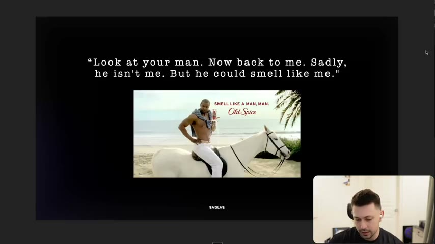
*Old Spice shift from "smell good for the girls" to "the man that your man could smell like". [02:42]*

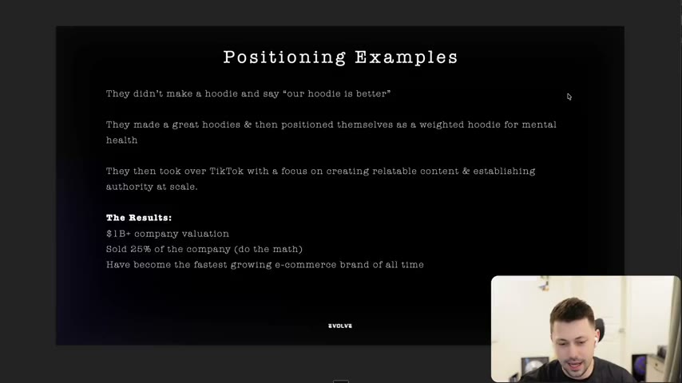
*"Positioning Examples": weighted hoodie for mental health, TikTok relatability; results listed. [04:16]*

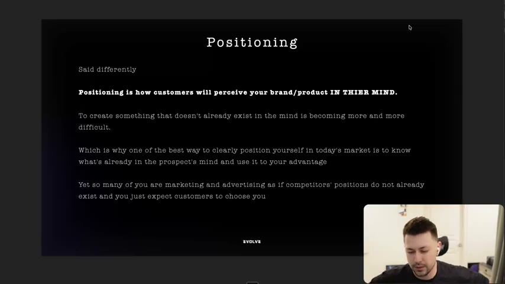
*"Positioning is how customers will perceive your brand/product IN THEIR MIND." [06:46]*

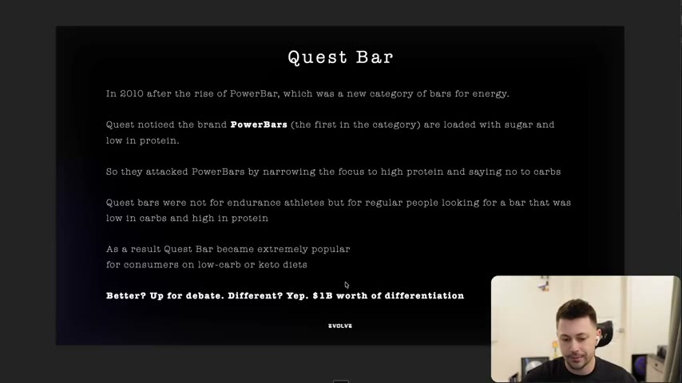
*Quest Bar: attack PowerBar's weakness (sugar, low protein); "Better? Up for debate. Different? Yep. $1B worth of differentiation". [10:47]*

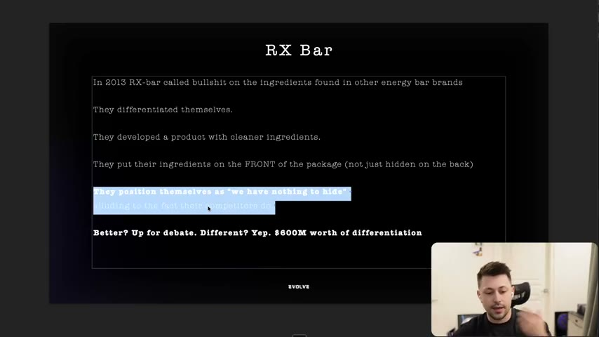
*RX Bar: ingredients on the front, "we have nothing to hide". [12:57]*


*Kind Bar: extrusion as the enemy and transparent packaging. [14:17]*

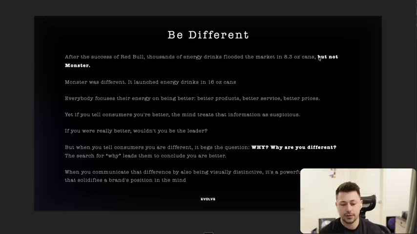
*"Be Different": Monster 16 oz cans; "better" is suspicious, "different" begs the question WHY. [18:26]*

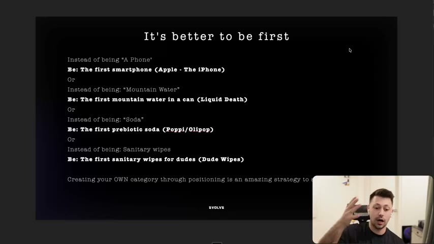
*"It's better to be first": Instead of being X, be the first Y list. [21:03]*

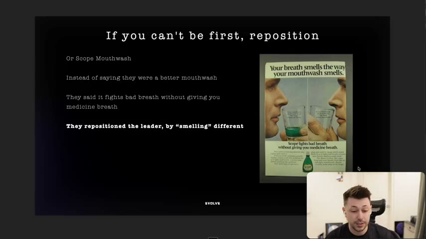
*Scope ad "Your breath smells the way your mouthwash smells": repositioning the leader by smelling different. [25:17]*

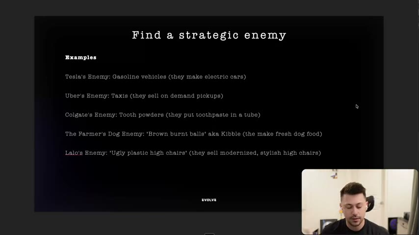
*Strategic enemy list: Tesla, Uber, Colgate, The Farmer's Dog, Lalo. [27:57]*

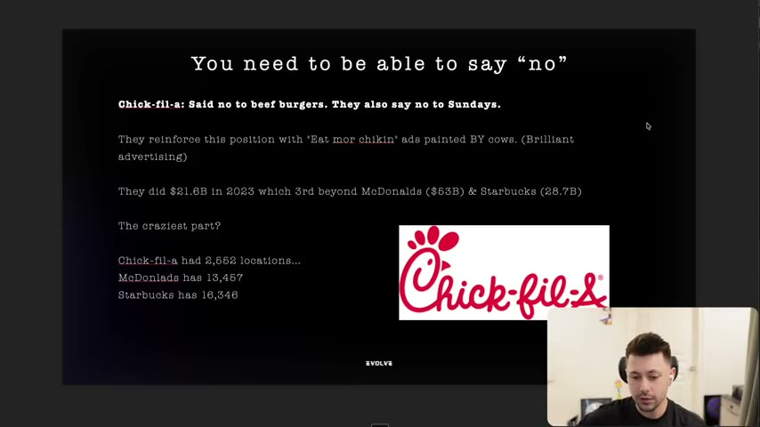
*"You need to be able to say no": Chick-fil-A figures. [29:17]*

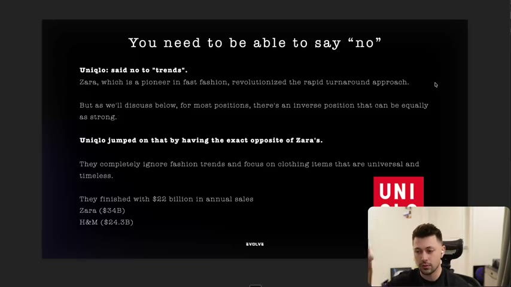
*Uniqlo: no to trends, vs Zara and H&M sales. [30:27]*

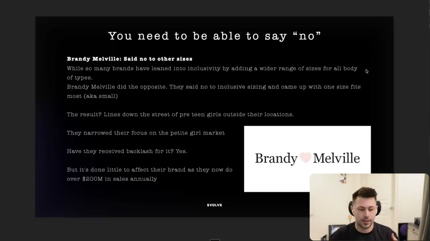
*Brandy Melville: no to inclusive sizing. [32:17]*

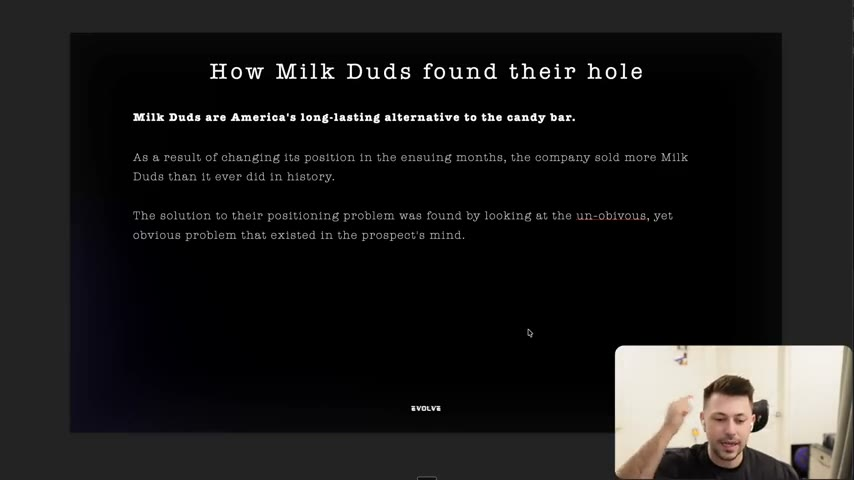
*"America's long-lasting alternative to the candy bar". [36:44]*

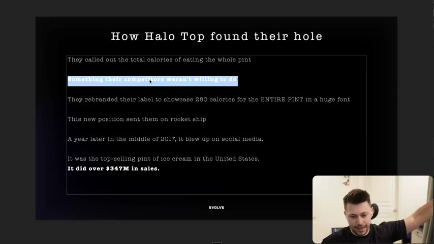
*Halo Top: 280 calories for the entire pint in a huge font; $347M sales. [38:48]*

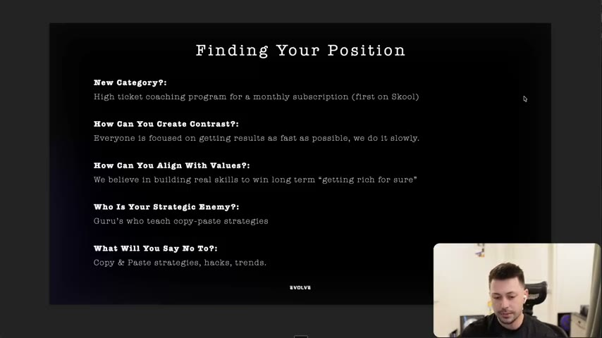
*"Finding Your Position" filled in for Evolve: category, contrast, values, enemy, no. [44:07]*

## How to apply
- [ ] Before writing ads, fill the five takeaway questions for our product (see [56](56-positioning-exercise.md) for the worksheet).
- [ ] For each competitor ad pulled, record the position it implies (category, contrast, values, enemy, "no") and the line that reinforces it.
- [ ] Remove "we're better" claims from hooks; replace with a difference the viewer can see or a contrast with the leader.
- [ ] Add one visual cue that proves the difference (packaging, label number, comparison stunt).
- [ ] Read reviews of competitors to find the obvious hole (Milk Duds, Halo Top method).
- [ ] Check that each ad reinforces the position; add a recurring device that does so (David Cod style).
- [ ] Verify numbers before reusing them in copy; the instructor's valuations and sales are claims.

## Related
- Previous: [54. Iteration Examples & Breakdowns (Walkthrough)](54-iteration-examples-breakdowns-walkthrough.md) · Next: [56. Positioning Exercise](56-positioning-exercise.md)
- [Luxury positioning](../../../../concepts/luxury-positioning.md) · [Switching behavior](../../../../concepts/switching-behavior.md) · [Competitor landscape audit](../../../../playbooks/competitor-landscape-audit.md)

## Sources and limitations
- Transcript: [55. Why you need to position your brand .txt](<../../../../../raw/evolve/copywriting/_transcripts/✍️ Evolve Copywriting (NEW)/55. ⭐️ Why you need to position your brand ✍️ Evolve Copywriting (NEW) Evolve.txt>) · Page text: [55 ….html.md](<../../../../../raw/evolve/copywriting/_extracted/✍️ Evolve Copywriting (NEW)/55. ⭐️ Why you need to position your brand_✍️ Evolve Copywriting (NEW)_Evolve.html.md>)
- Machine transcription (Whisper large-v3-turbo); full recording covered (last segment 44:59). Whisper wrote "Rise"/"Rice" for Ries, "Trowell"/"Child" for Trout, "chrono" for creneau, "Talenol" for Tylenol, "Stolys" for Stoli, "Poppy" for Poppi and "comfort" for Comfrt. The audio's "13,000" (McDonald's locations) and "multiple nine figures" (Brandy Melville) differ slightly from the slides' figures; slide values are preferred.
- Statistics (60% of buyers, $100M/month, $15M/month, valuations, sales, "$1B/$600M/$5B worth of differentiation") are instructor/slide claims with no sources shown. The Comfrt sales chart was AI-generated for the slide. Book references (Positioning, The Strategic Enemy) are not included in the course files.
- The slide "Fun Fact" shows an email thread about pitching David's Protein; the content is not readable.
