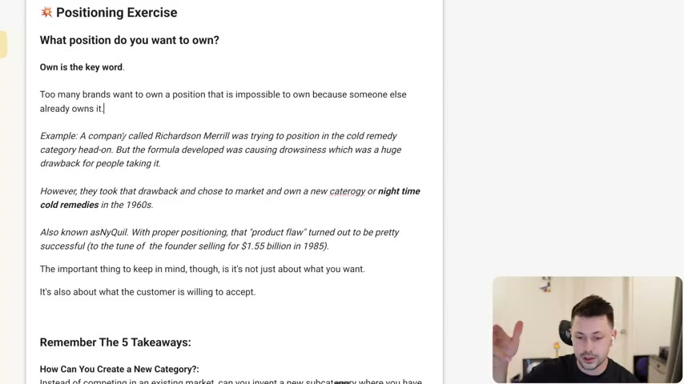
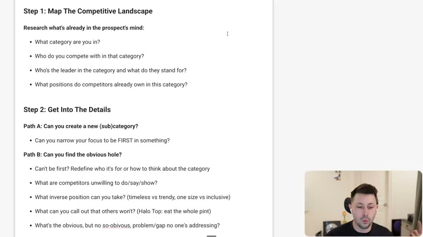
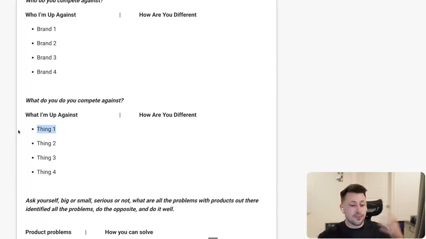
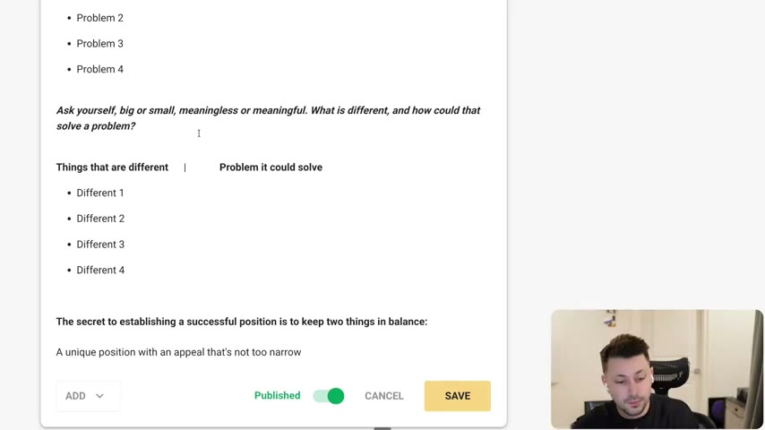

# 56. Positioning Exercise
> A three-step worksheet (map the competitive landscape, get into the details via "new category" or "obvious hole", make it concrete with an enemy, a "no" and a visual difference) plus four fill-in tables that map who you compete against, product problems and your differences to a position you can own.

## 🤖 Agent use
- **Use when:** defining or auditing the position for our brand or a competitor's brand before writing angles, hooks, UGC scripts or briefs; also use the tables to structure a competitor teardown.
- **Inputs → outputs:** category, competitor list, features, review complaints, our real differences → four filled tables and a short position statement (category, contrast, values, enemy, "no", visual difference).
- **Rules:**
  - **DO** ask "What position do you want to own?" and treat "own" as the key word: do not pick a position someone else already owns. [00:00-00:34]
  - **DO** check that the customer is willing to accept the position, not only that you want it ("it's also about what the customer is willing to accept"). [01:13]
  - **DO** research the prospect's mind first: category, competitors, leader and what it stands for, positions already owned. [02:04]
  - **IF** you cannot be first **THEN** redefine who it is for or how to think about the category, and look for the inverse position (timeless vs trendy, one size vs inclusive). [02:35]
  - **DO** fill the tables with "How are you different?", not "Why are you better?". [03:23-04:01]
  - **DO** find product problems from competitor reviews where people complain, then ask how you avoid or solve each. [04:01-04:46]
  - **DO** keep a unique position with an appeal "not too narrow", but if small "it's better to be more narrow than it is to be more broad". [05:41-06:24]
  - **IF** you paste the exercise into a Google Doc or Claude (the instructor says "if you want to, you totally can") **THEN** still fill it from real competitor, review and product facts; the value is writing things down and seeing differences and problems that map together. [03:23; 04:46-05:41]
- **See also:** [55. Why you need to position your brand](55-why-you-need-to-position-your-brand.md) · [Brand enemy](../../../../concepts/brand-enemy.md) · [Competitor landscape audit](../../../../playbooks/competitor-landscape-audit.md) · [Angle remix](../../../../playbooks/angle-remix.md)

## Key ideas

### What position do you want to own? [00:00-02:04]
- Do this after [55](55-why-you-need-to-position-your-brand.md): "if you have just finished the positioning video and you're jumping right into this one, you're brave, but I would recommend go take a five, 10 minute break." [00:00]
- "Own is the key word... Too many brands want to own a position that is impossible to own because someone else already owns it." [00:00-00:34]
- **Richardson Merrill / NyQuil:** was trying to position head-on in the cold remedy category; its formula caused drowsiness, "a huge drawback". It took that drawback and chose to market and own a new category, nighttime cold remedies, in the 1960s: "also known as NyQuil." The "product flaw" turned into success, "to the tune of the founder selling it for $1.5 billion in 1985" (audio) / "$1.55 billion in 1985" (page). (instructor claim) [00:34-01:13]
- Caveat: "it's not just about what you want. It's also about what the customer is willing to accept." The consumer happened to accept drowsiness as a nighttime benefit. [01:13-02:04]

### Four steps [02:04-03:23]
- The instructor says "not really four steps like fully ironed out": three on the page, plus the active exercise. [01:13-02:04]
- Step 1 map the landscape (what category, who competes, who leads and what they stand for, what positions are owned) so "you can have some more knowledge". [02:04]
- Step 2 Path A (new sub-category: narrow to be first in something) or Path B (the obvious hole). Example call-out: "Halo Top, eat the whole pint." [02:35]
- Step 3 make it concrete: define the strategic enemy (competitor, approach, or belief/concept), define what you'll say no to, make it visually different. "Different beats better." If it needs product work you "might be playing a very long-term game here". [02:35-03:23]

### Active exercise [03:23-05:41]
- Table 1, "Who do you compete against?": list brands, then "how are you different" (not why you are better). [03:23-04:01]
- Table 2, "What do you compete against?": "specific features... if a product has a specific feature and you don't, how are you different?" [04:01]
- Table 3, product problems: "go and look at reviews where people complain." For each problem, how you solve it or how your product does not have the problem. [04:01-04:46]
- Table 4, "things that are different" -> "problem it could solve": list differentiators and map each to a problem from Table 3: "Different one solves this problem. Boom, now we're onto something." [04:46-05:41]
- On-screen the page text differed slightly from the extracted page: table 1 header showed "Who I'm Up Against | Why You" on one frame and "How Are You Different" on others, and the product-problem prompt had the extra clause "identified all the problems, do the opposite, and do it well." (frames 3:40-4:10). The instructor's spoken correction is to use "how are you different".

### Balance: unique but not too narrow [05:41-06:24]
- "The secret to establishing a successful position is to keep two things in balance: a unique position with an appeal that is not too narrow." [05:41]
- You can go too narrow and limit your TAM; "if you're trying to get to eight or nine figures, use your brain", but under about $100K/month start in a narrow subcategory and expand ("avatars and sub avatars are so important"). [05:41-06:24]

## Steps / framework

| Step | Questions | Source |
|---|---|---|
| 1. Map the competitive landscape | Category? Competitors? Leader and what it stands for? Positions competitors already own? | [02:04]; page |
| 2A. New (sub)category | Can you narrow your focus to be FIRST in something? | [02:35]; page |
| 2B. Obvious hole | Redefine who it is for / how to think about the category; what competitors won't do/say/show; inverse position; what you can call out that others won't; obvious but not so obvious gap | [02:35]; page |
| 3. Make it concrete | Strategic enemy (competitor / approach / belief); what you will say no to; make it visually different | [02:35-03:23]; page |
| Active exercise | Four tables below | [03:23-05:41]; page |

## Examples
- **NyQuil / Richardson Merrill:** turn a flaw (drowsiness) into an owned category (nighttime cold remedy). [00:34-01:13]
- **Halo Top ("eat the whole pint"):** an example of calling out what others won't. [02:35]
- Contrast pairs for the inverse-position question: "timeless vs trendy, one size vs inclusive" (Uniqlo vs Zara; Brandy Melville vs inclusive sizing; see [55](55-why-you-need-to-position-your-brand.md)). [02:35]

## Structured units

### Templates
| Template | Use for | Example fill | Source |
|---|---|---|---|
| Who I'm Up Against / How Are You Different | Competitor brand map | Brand 1... Brand 4 | page; [03:23] |
| What I'm Up Against / How Are You Different | Feature map | Thing 1... Thing 4 | page; [04:01] |
| Product problems / How you can solve | Review-complaint map | Problem 1... Problem 4 | page; [04:01-04:46] |
| Things that are different / Problem it could solve | Differentiator to problem map | Different 1... Different 4 | page; [04:46-05:41] |
| Position statement (derived) | Output of steps 1-3 | "We are the [category/contrast] for [who], not [enemy]; we say no to [thing]; visually: [difference]" | derived from steps |

## Prompts / templates (verbatim)
The exercise as given on the lesson page (including its typos):

```text
What position do you want to own?

Own is the key word.

Too many brands want to own a position that is impossible to own because someone else already owns it.

Example: A company called Richardson Merrill was trying to position in the cold remedy category head-on. But the formula developed was causing drowsiness which was a huge drawback for people taking it.

However, they took that drawback and chose to market and own a new category for night time cold remedies in the 1960s.

Also known asNyQuil. With proper positioning, that "product flaw" turned out to be pretty successful (to the tune of the founder selling for $1.55 billion in 1985).

The important thing to keep in mind, though, is it's not just about what you want.

It's also about what the customer is willing to accept.


Remember The 5 Takeaways:

How Can You Create a New Category?:
Instead of competing in an existing market, can you invent a new subcategory where you have no competitors? (Apple - the smartphone, Poppi - the prebiotic sodas, Dude Wipes - sanitary wipes for men)

How Can You Create Contrast?:
Can you put yourself against the "status quo" and do the opposite of what everyone else is doing? (Liquid Death - Water in can, not a bottle. Shopify - for the merchants, Stoli's - vodka that is actually Russian)

How Can You Align With Values?:
Can you align yourself with a specific belief or social cause that use values to attract a loyal tribe while alienating others. (Comfrt - mental health, Black Rifle Coffee - veteran rights)

Who Is Your Strategic Enemy?: Who or what are you against? (Uber - against Taxis, The Farmer's Dog - against Kibble, Lalo - against ugly high chairs)

What Will You Say No To?:What are you willing to say no to that other competitors can't? (GEM - said no to pills, Brandy Melville - said no to tons of sizes, The Conscious Bar - said no to added sugar)


Step 1: Map The Competitive Landscape

Research what's already in the prospect's mind:
* What category are you in?
* Who do you compete with in that category?
* Who's the leader in the category and what do they stand for?
* What positions do competitors already own in this category?

Step 2: Get Into The Details

Path A: Can you create a new (sub)category?
* Can you narrow your focus to be FIRST in something?

Path B: Can you find the obvious hole?
* Can't be first? Redefine who it's for or how to think about the category
* What are competitors unwilling to do/say/show?
* What inverse position can you take? (timeless vs trendy, one size vs inclusive)
* What can you call out that others won't? (Halo Top: eat the whole pint)
* What's the obvious, but no so-obivous, problem/gap no one's addressing?

Step 3: Make It Concrete

Define your strategic enemy(s):
* Is it a competitor, an approach, or a belief/concept?

Define what you'll say "no" to:
* What will you eliminate that competitors won't?

Make it visually different:
* Different beats better, how can you visually stand out?


Active Exercise To Get Flowing

Who do you compete against?

Who I'm Up Against | How Are You Different
* Brand 1
* Brand 2
* Brand 3
* Brand 4

What do you do you compete against?

What I'm Up Against | How Are You Different
* Thing 1
* Thing 2
* Thing 3
* Thing 4

Ask yourself, big or small, serious or not, what are all the problems with products out there.

Product problems | How you can solve
* Problem 1
* Problem 2
* Problem 3
* Problem 4

Ask yourself, big or small, meaningless or meaningful. What is different, and how could that solve a problem?

Things that are different | Problem it could solve
* Different 1
* Different 2
* Different 3
* Different 4

The secret to establishing a successful position is to keep two things in balance:
A unique position with an appeal that's not too narrow
```

## Screenshots

*Skool page "Positioning Exercise": "What position do you want to own?", with the Richardson Merrill / NyQuil example. [00:40]*


*Steps 1-3: map the landscape, get into the details (Path A/B), make it concrete. [02:10]*


*Active exercise tables 1 and 2 (brands and features), with the product-problems prompt. [04:10]*


*Table 4 (things that are different -> problem it could solve) and the "not too narrow" balance note. [04:50]*

## How to apply
- [ ] Copy the worksheet into a Google Doc (or ask Claude to run it), but fill from real competitor pages, reviews and our product facts.
- [ ] Complete Step 1 for the category: list the leader and what positions competitors own.
- [ ] Pick Path A (first in a sub-category) or Path B (obvious hole) and write the answer in one sentence.
- [ ] Fill all four tables; draw lines between differences and the problems they solve.
- [ ] Write the enemy, the "no" and the visual difference.
- [ ] Test the position against the customer: is it something they will accept, and is it not too narrow for the revenue goal?

## Related
- Previous: [55. Why you need to position your brand](55-why-you-need-to-position-your-brand.md) · Next: [57. 100 Hook Templates (from winning ads deck)](57-100-hook-templates-form-winning-ads-deck.md)
- [Perception management](../../../../concepts/perception-management.md) · [Category perception](../../../../concepts/category-perception.md)

## Sources and limitations
- Transcript: [56. Positioning Exercise .txt](<../../../../../raw/evolve/copywriting/_transcripts/✍️ Evolve Copywriting (NEW)/56. 💥 Positioning Exercise ✍️ Evolve Copywriting (NEW) Evolve.txt>) · Page text: [56 ….html.md](<../../../../../raw/evolve/copywriting/_extracted/✍️ Evolve Copywriting (NEW)/56. 💥 Positioning Exercise_✍️ Evolve Copywriting (NEW)_Evolve.html.md>)
- Machine transcription (Whisper large-v3-turbo); full recording covered (last segment 7:00). The video shows the Skool lesson page being read (and edited, "Published / Save" bar visible), so on-screen text can differ slightly from the extracted page text; the extracted page text is used for the verbatim block. The NyQuil sale figure is stated as "$1.5 billion" in audio and "$1.55 billion" on the page (instructor claim, unverified).
- The "Remember the 5 Takeaways" list repeats lesson 55's page list with small wording fixes ("Russian", "high chairs").
