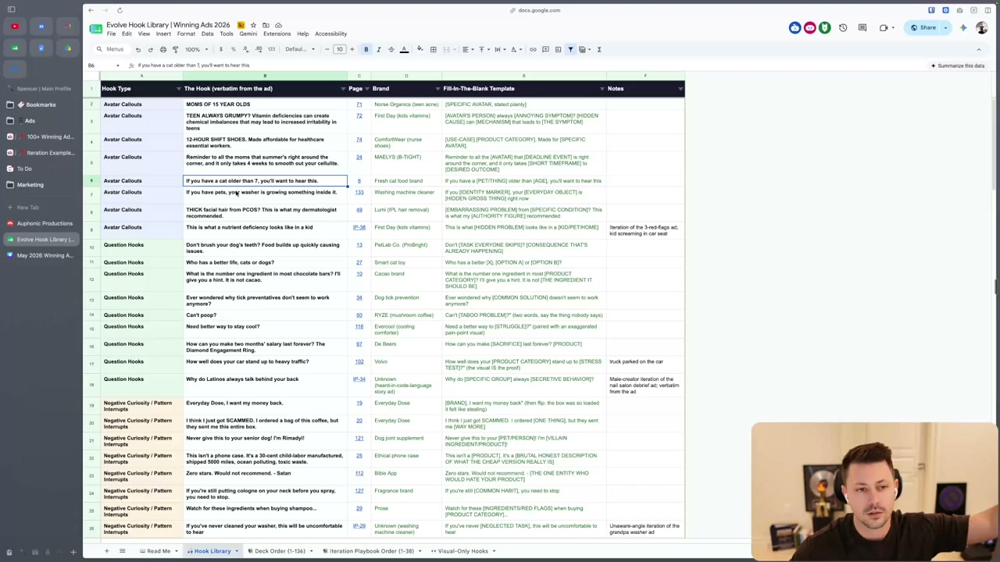
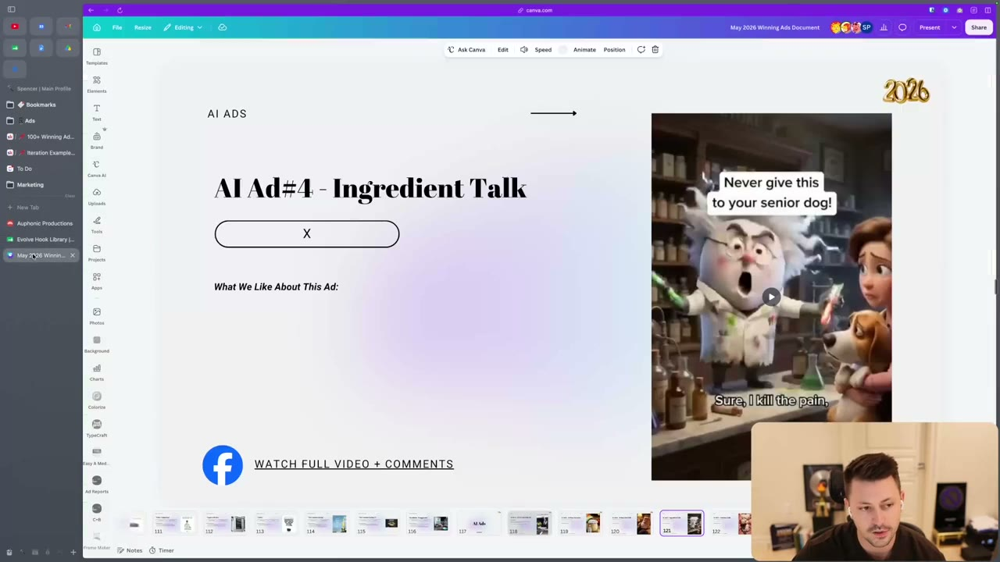

# 57. 100 Hook Templates (Form Winning Ads Deck)
> Introduces the Evolve hook library, a Google Sheet of 100+ hooks taken from winning ads, sorted by hook type and turned into fill-in-the-blank templates, so a writer can borrow a hook mechanism from a different niche instead of only copying competitors. The sheet itself is login-blocked in the course files; this page records what the video says and the 25 rows that are legible on screen.

## 🤖 Agent use
- **Use when:** you need a hook and have no idea how to phrase it, or you are tearing down a competitor ad and want to turn its opening into a reusable template for our product.
- **Inputs → outputs:** a hook from any niche (competitor, adjacent category, or the on-screen rows below) + our product/avatar → a fill-in-the-blank template with named slots → a new hook for our product.
- **Rules:**
  - **DO** treat the library as inspiration for mechanisms, not copy-paste. The instructor says he is "obviously not the biggest fan of templates" and does not "really believe in copy and pasting". [00:00–00:54]
  - **DO** look across categories as well as at direct competitors: "you don't just have to steal hooks from your competitors... you can also look across categories and sometimes those are the most powerful ones." [00:54–01:39]
  - **DO** abstract a hook into slots (use case, product category, specific avatar, taboo problem, ingredient red flag...) before reusing it. His examples: nurse-shoe hook to "use case, product category, made for specific avatar"; "Can't poop?" to "can't + taboo problem"; shampoo hook to "watch out for these ingredients when buying [product category]". [00:54–01:39]
  - **DON'T** assume the full sheet is available to you. The course page says you cannot copy the sheet and it requires a Google login (blocked here); use only the templates recorded below and say so in outputs. [page text]
  - **IF** you do not know how to fill a template **THEN** finish the rest of the program first: "you'll learn how to actually fill these in properly once you go through the entire copywriting program." [01:39]
- **See also:** [23. The framework behind great hooks](23-the-framework-behind-great-hooks.md) · [24. The 2 types of hooks](24-the-2-types-of-hooks.md) · [25. The 2 ways to write great hooks](25-the-2-ways-to-write-great-hooks.md) · [Hooks library](../../../../libraries/hooks.md) · [Competitor ad teardown playbook](../../../../playbooks/competitor-ad-teardown.md)

**Availability note:** the lesson links to a Google Sheet ("Evolve Hook Library | Winning Ads 2026"). It needs a login, so the file is blocked and was not exported. Its contents are not reproduced here beyond what the screen recording shows. Nothing in this page is inferred beyond that.

## Key ideas

### What the library is [00:00–00:54]
- "The Evolve hook library" is described as "pretty new". It was "put together based off of all of the winning ads", about 120 once individual pages are removed, "120 plus ads". [00:00]
- Every ad was categorised by **hook type**, the actual hook was written out, and then each was turned into a **template** for students. [00:00]
- Purpose, in his words: help you "think about how you can take these specific hooks or these other ads that aren't in your niche and actually bring them over into your niche". [00:00]

### Example of cross-niche borrowing [00:54–01:39]
- "You might not be... selling nurse shoes... but you can still take inspiration from this hook": use case + product category + "made for [specific avatar]". [00:54]
- "Can't poop?" becomes "can't [taboo problem]". [00:54]
- "Watch out for these ingredients" on shampoo becomes "watch out for these red flags when buying [product category]" and he adds that ingredients "are great if you're supplements". [00:54]
- Further categories exist lower in the sheet that are not shown on screen: "more POV or relatable ones or symptom talk". [00:54–01:39]

### Where the library comes from [01:39–02:28]
- It draws on the "100 plus winning ads document" and on the "iteration playbook document", both covered later in the program (see [52](52-the-iteration-playbook-script.md) and [53](53-the-iteration-playbook-formats-styles.md)). [01:39]
- If students are stuck for a hook, "here is an entire library of them. Here's the types of categories that they're in. And then here's the fill in the blank templates". [01:39]
- He asks students to report anything weird in the sheet. [01:39]

### How the sheet is organised (read from the screen) [00:00–00:45]
- Title bar: "Evolve Hook Library | Winning Ads 2026". Tabs along the bottom: **Read Me**, **Hook Library**, **Deck Order (1-136)**, **Iteration Playbook Order (1-38)**, **Visual-Only Hooks**.
- "Hook Library" columns: **Hook Type · The Hook (verbatim from the ad) · Page · Brand · Fill-In-The-Blank Template · Notes**.
- "Page" is a number into the winning-ads deck (a Canva deck titled "May 2026 Winning Ads Document", 136 pages; see the second screenshot). Page values like "IP-38" most likely point into the iteration playbook (derived from the tab name "Iteration Playbook Order").
- Hook types visible: **Avatar Callouts**, **Question Hooks**, **Negative Curiosity / Pattern Interrupts**. Other hook types exist (the speaker names POV/relatable and symptom talk) but are not visible.

## Steps / framework
1. Pick a hook from any niche that stops you (competitor, adjacent category, or the table below).
2. Identify its **hook type** (avatar callout, question, negative curiosity / pattern interrupt, ...).
3. Replace the niche-specific words with named slots ([SPECIFIC AVATAR], [HIDDEN CAUSE], [TABOO PROBLEM] ...) to get the template.
4. Fill the slots with our own avatar, problem, product category and proof (use the research and angle work from [17](17-being-aware-of-avatars.md) to [22](22-how-to-finalize-your-ad-ideas.md)).
5. Check the result against the [58. copywriting checklist](58-copywriting-checklist-when-writing.md) (gap, emotion, stakes, mechanism, falsifiable, nobody else could write it).

## Examples
The only examples in the files are the rows legible on the screen recording (below) and the three hooks the speaker names aloud (nurse-shoe, "Can't poop?", shampoo ingredients). No before/after rewrites are shown in this lesson.

## Structured units

### Templates
Rows 2 to 26 of the "Hook Library" tab as legible at [00:45] (screenshot). Transcribed from a 1280x720 recording, so small punctuation may be off. "Page" is the deck page; Notes are the sheet's own notes column. The sheet has 100+ rows; the remainder are unavailable.

| Hook type | Fill-in-the-blank template | Brand / niche (as in sheet) | Verbatim hook (example fill) | Page | Notes | Source |
|---|---|---|---|---|---|---|
| Avatar Callouts | [SPECIFIC AVATAR, stated plainly] | Norse Organics (teen acne) | MOMS OF 15 YEAR OLDS | 71 | | sheet row 2 |
| Avatar Callouts | [AVATAR'S PERSON] always [ANNOYING SYMPTOM]? [HIDDEN CAUSE] can [MECHANISM] that leads to [THE SYMPTOM] | First Day (kids vitamins) | TEEN ALWAYS GRUMPY? Vitamin deficiencies can create chemical imbalances that may lead to increased irritability in teens | 72 | | sheet row 3 |
| Avatar Callouts | [USE-CASE] [PRODUCT CATEGORY]. Made for [SPECIFIC AVATAR]. | ComfortWear (nurse shoes) | 12-HOUR SHIFT SHOES. Made affordable for healthcare essential workers. | 74 | | sheet row 4 |
| Avatar Callouts | Reminder to all the [AVATAR] that [DEADLINE EVENT] is right around the corner, and it only takes [SHORT TIMEFRAME] to [DESIRED OUTCOME] | MAELYS (B-TIGHT) | Reminder to all the moms that summer's right around the corner, and it only takes 4 weeks to smooth out your cellulite. | 24 | | sheet row 5 |
| Avatar Callouts | If you have a [PET/THING] older than [AGE], you'll want to hear this | Fresh cat food brand | If you have a cat older than 7, you'll want to hear this. | 8 | | sheet row 6 |
| Avatar Callouts | If you [IDENTITY MARKER], your [EVERYDAY OBJECT] is [HIDDEN GROSS THING] right now | Washing machine cleaner | If you have pets, your washer is growing something inside it. | 133 | | sheet row 7 |
| Avatar Callouts | [EMBARRASSING PROBLEM] from [SPECIFIC CONDITION]? This is what my [AUTHORITY FIGURE] recommended | Lumi (IPL hair removal) | THICK facial hair from PCOS? This is what my dermatologist recommended. | 49 | | sheet row 8 |
| Avatar Callouts | This is what [HIDDEN PROBLEM] looks like in a [KID/PET/HOME] | First Day (kids vitamins) | This is what a nutrient deficiency looks like in a kid | IP-38 | Iteration of the 3-red-flags ad; kid screaming in car seat | sheet row 9 |
| Question Hooks | Don't [TASK EVERYONE SKIPS]? [CONSEQUENCE THAT'S ALREADY HAPPENING] | PetLab Co. (ProBright) | Don't brush your dog's teeth? Food builds up quickly causing issues. | 13 | | sheet row 10 |
| Question Hooks | Who has a better [X], [OPTION A] or [OPTION B]? | Smart cat toy | Who has a better life, cats or dogs? | 27 | | sheet row 11 |
| Question Hooks | What is the number one ingredient in most [PRODUCT CATEGORY]? I'll give you a hint. It is not [THE INGREDIENT IT SHOULD BE] | Cacao brand | What is the number one ingredient in most chocolate bars? I'll give you a hint. It is not cacao. | 10 | | sheet row 12 |
| Question Hooks | Ever wondered why [COMMON SOLUTION] doesn't seem to work anymore? | Dog tick prevention | Ever wondered why tick preventatives don't seem to work anymore? | 34 | | sheet row 13 |
| Question Hooks | Can't [TABOO PROBLEM]?" (two words, say the thing nobody says) | RYZE (mushroom coffee) | Can't poop? | 50 | | sheet row 14 |
| Question Hooks | Need a better way to [STRUGGLE]?" (paired with an exaggerated pain-point visual) | Evercool (cooling comforter) | Need better way to stay cool? | 116 | | sheet row 15 |
| Question Hooks | How can you make [SACRIFICE] last forever? [PRODUCT] | De Beers | How can you make two months' salary last forever? The Diamond Engagement Ring. | 97 | | sheet row 16 |
| Question Hooks | How well does your [PRODUCT CATEGORY] stand up to [STRESS TEST]?" (the visual IS the proof) | Volvo | How well does your car stand up to heavy traffic? | 102 | truck parked on the car | sheet row 17 |
| Question Hooks | Why do [SPECIFIC GROUP] always [SECRETIVE BEHAVIOR]? | Unknown (heard-in-code-language story ad) | Why do Latinos always talk behind your back | IP-34 | Male-creator iteration of the nail salon debrief ad; verbatim from the ad | sheet row 18 |
| Negative Curiosity / Pattern Interrupts | [BRAND], I want my money back" (then flip: the box was so loaded it felt like stealing) | Everyday Dose | Everyday Dose, I want my money back. | 19 | | sheet row 19 |
| Negative Curiosity / Pattern Interrupts | I think I just got SCAMMED. I ordered [ONE THING], but they sent me [WAY MORE] | Everyday Dose | I think I just got SCAMMED. I ordered a bag of this coffee, but they sent me this entire box. | 20 | | sheet row 20 |
| Negative Curiosity / Pattern Interrupts | Never give this to your [PET/PERSON]! I'm [VILLAIN INGREDIENT/PRODUCT]! | Dog joint supplement | Never give this to your senior dog! I'm Rimadyl! | 121 | | sheet row 21 |
| Negative Curiosity / Pattern Interrupts | This isn't a [PRODUCT]. It's a [BRUTAL HONEST DESCRIPTION OF WHAT THE CHEAP VERSION REALLY IS] | Ethical phone case | This isn't a phone case. It's a 30-cent child-labor manufactured, shipped 5000 miles, ocean polluting, toxic waste. | 25 | | sheet row 22 |
| Negative Curiosity / Pattern Interrupts | Zero stars. Would not recommend. - [THE ONE ENTITY WHO WOULD HATE YOUR PRODUCT] | Bible App | Zero stars. Would not recommend. - Satan | 112 | | sheet row 23 |
| Negative Curiosity / Pattern Interrupts | If you're still [COMMON HABIT], you need to stop | Fragrance brand | If you're still putting cologne on your neck before you spray, you need to stop. | 127 | | sheet row 24 |
| Negative Curiosity / Pattern Interrupts | Watch for these [INGREDIENTS/RED FLAGS] when buying [PRODUCT CATEGORY]... | Prose | Watch for these ingredients when buying shampoo... | 29 | | sheet row 25 |
| Negative Curiosity / Pattern Interrupts | If you've never [NEGLECTED TASK], this will be uncomfortable to hear | Unknown (washing machine cleaner) | If you've never cleaned your washer, this will be uncomfortable to hear | IP-29 | Unaware-angle iteration of the grandpa washer ad | sheet row 26 |

Cross-reference: the Bible App row ("Zero stars. Would not recommend.") and the Evercool row ("Need better way to stay cool?") are also reference ads inside the [65. Banger Static Ads Prompt](65-banger-static-ads-prompt.md) (examples #5 and #8). The sheet's own "Notes" column mentions iterating on earlier ads, which is the method taught in section 07 ([46](46-the-10-step-iteration-process.md) onward).

### Rules of thumb
- **DO** reduce any borrowed hook to its slots first, then fill with our own avatar and proof. [00:54–01:39]
- **DON'T** lift the example fill word for word; "my goal... is just to help you guys think about how you can take these specific hooks... and actually bring them over into your niche". [00:00]
- **IF** the best hook for our niche is not in our competitors' ads **THEN** search other categories and port the template. [00:54–01:39]
- (derived) **IF** a template needs a claim ("4 weeks", "30-cent") **THEN** only fill it with a figure we can substantiate; see [10. Why you need to write facts](10-why-you-need-to-write-facts.md).

## Screenshots

*The "Hook Library" tab: Hook Type, The Hook (verbatim from the ad), Page, Brand, Fill-In-The-Blank Template, Notes. Source for the Templates table above. [00:45]*

*The winning-ads deck ("May 2026 Winning Ads Document", Canva) that the "Page" column refers to: slide "AI Ad#4 - Ingredient Talk" with the on-screen hook "Never give this to your senior dog!" (matches sheet row 21). [00:07]*

## How to apply
- [ ] Tag the hook type of every competitor hook you collect (avatar callout, question, negative curiosity / pattern interrupt, other).
- [ ] Write the hook's template with named slots next to the verbatim line.
- [ ] When writing for our product, start from a template from a different category than our competitors'.
- [ ] Fill each slot with a fact we can support; reject slots we cannot fill truthfully.
- [ ] State in any output that the full 100+ template sheet is unavailable and only the 25 on-screen rows were used.

## Related
- Previous: [56. Positioning Exercise](56-positioning-exercise.md) · Next: [58. Copywriting Checklist (when writing)](58-copywriting-checklist-when-writing.md)
- [Hooks library](../../../../libraries/hooks.md) · [Risk-reduction hooks](../../../../concepts/risk-reduction-hooks.md) · [Creative primitives](../../../../concepts/creative-primitives.md)

## Sources and limitations
- Transcript: [57. 100 Hook Templates… .txt](<../../../../../raw/evolve/copywriting/_transcripts/✍️ Evolve Copywriting (NEW)/57. 📌 100 Hook Templates (Form Winning Ads Deck) ✍️ Evolve Copywriting (NEW) Evolve.txt>) · Page text: [57….html.md](<../../../../../raw/evolve/copywriting/_extracted/✍️ Evolve Copywriting (NEW)/57. 📌 100 Hook Templates (Form Winning Ads Deck)_✍️ Evolve Copywriting (NEW)_Evolve.html.md>)
- **Blocked source:** the Google Sheet `docs.google.com/spreadsheets/d/1PNbydGy-_bgni80Nj7d-J3CEGxEgu_ReeaLDPRz60FE` requires login and was not exported. The page text says you cannot make a copy of it, but that you can still get the fill-in-the-blank templates. Only the 25 rows legible in the video are reproduced. Hooks 26+ and the other tabs (Deck Order, Iteration Playbook Order, Visual-Only Hooks, Read Me) are unavailable.
- Machine transcription (Whisper large-v3-turbo); the full recording is covered (last segment 02:28 of 02:29). The speaker is not named in the audio, so the instructor is "unverified" (the screen's browser profile reads "Spencer | Main Profile", which is not a statement by the speaker).
- Screen transcription of the sheet rows is manual from a 720p frame; brand names in the sheet are the sheet's own labels (some are marked "Unknown" there).
