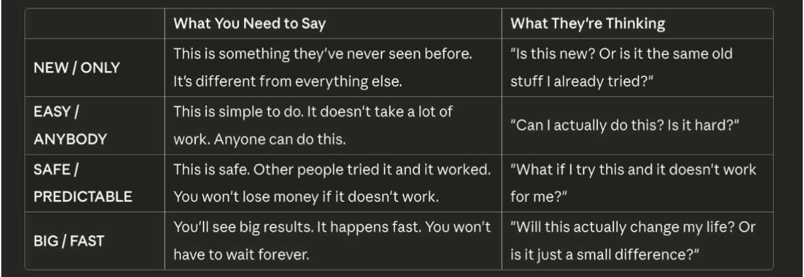

# 62. Value words
> A one-image reference table (credited to Kyle Milligan) pairing four value-word groups (new/only, easy/anybody, safe/predictable, big/fast) with what the copy needs to say and the doubt running in the reader's head.

## 🤖 Agent use
- **Use when:** a hook or claim feels flat and you need to decide which promise to emphasise, or you are tearing down an ad and want to name which value words it leans on and which reader doubt it answers.
- **Inputs → outputs:** a draft claim or a competitor ad → the value-word group(s) it expresses and the reader thought it answers → a rewrite that adds or sharpens a missing value.
- **Rules:**
  - **DO** check each draft against the four rows: does it say it is new/only, easy/for anybody, safe/predictable, big/fast? [image]
  - **DO** write to the thought in the right-hand column. Each value answers a specific doubt: "Is this new?", "Can I actually do this?", "What if I try this and it doesn't work for me?", "Will this actually change my life?" [image]
  - **DON'T** claim a value the product cannot support; "safe", "easy" and "fast" need proof (derived; see [60. Facts list](60-facts-list.md) and [58. checklist](58-copywriting-checklist-when-writing.md) Q8).
  - **IF** an ad only states a feature **THEN** add the value word it implies and the line that answers the reader's doubt. (derived)
- **See also:** [63. Power words](63-power-words.md) · [64. Eugene's headlines](64-eugenes-headlines.md) · [14. Why you need to use unique mechanisms](14-why-you-need-to-use-unique-mechanisms.md) · [Risk-reduction hooks](../../../../concepts/risk-reduction-hooks.md)

The lesson page has no text apart from the image and the credit "**Credit:** - Kyle Milligan". There is no video. The content is entirely in the image, transcribed below.

## Key ideas

### The four value-word groups [image]
Transcribed from the image (a 3-column table; no other text in it):

| Value words | What You Need to Say | What They're Thinking |
|---|---|---|
| NEW / ONLY | This is something they've never seen before. It's different from everything else. | "Is this new? Or is it the same old stuff I already tried?" |
| EASY / ANYBODY | This is simple to do. It doesn't take a lot of work. Anyone can do this. | "Can I actually do this? Is it hard?" |
| SAFE / PREDICTABLE | This is safe. Other people tried it and it worked. You won't lose money if it doesn't work. | "What if I try this and it doesn't work for me?" |
| BIG / FAST | You'll see big results. It happens fast. You won't have to wait forever. | "Will this actually change my life? Or is it just a small difference?" |

The first column header cell in the image is blank.

## Steps / framework
(derived use of the table; the table itself is the source's)

1. List the claims in the draft or competitor ad.
2. Tag each with a group: new/only, easy/anybody, safe/predictable, big/fast.
3. For any group not covered, check whether the reader doubt in column 3 is likely for this avatar (use [objections list](61-objections-list.md)).
4. Add or rewrite one line so it answers that doubt, with a fact behind it.

## Examples
None are given in the course files for this lesson: the page is the table and a credit line. (Applying the groups to ads in this KB, e.g. the reference ads in [65](65-banger-static-ads-prompt.md), is left to the agent.)

## Prompts / templates (verbatim)
Image text, verbatim (cell wording as shown, quotation marks as shown):

```text
                What You Need to Say                                              What They're Thinking
NEW / ONLY      This is something they've never seen before.                      "Is this new? Or is it the same old stuff I already tried?"
                It's different from everything else.
EASY / ANYBODY  This is simple to do. It doesn't take a lot of work.              "Can I actually do this? Is it hard?"
                Anyone can do this.
SAFE /          This is safe. Other people tried it and it worked.                "What if I try this and it doesn't work for me?"
PREDICTABLE     You won't lose money if it doesn't work.
BIG / FAST      You'll see big results. It happens fast.                          "Will this actually change my life? Or is it just a small difference?"
                You won't have to wait forever.
```

## Screenshots

*The lesson's only content: four value-word groups, what the copy must say, and the reader's silent question. Credit: Kyle Milligan (page text).*

## How to apply
- [ ] Tag every claim in a draft with one of the four groups.
- [ ] For each missing group, decide whether the avatar's doubt is real; if so, add a proof-backed line.
- [ ] Pick one group as the lead for each hook; do not try to say all four in one headline (derived).
- [ ] When tearing down a competitor ad, record which group it leans on and which reader doubt it answers.

## Related
- Previous: [61. Objections list](61-objections-list.md) · Next: [63. Power words](63-power-words.md)
- [03. How to guarantee you get better at copywriting](03-how-to-guarantee-you-get-better-at-copywriting.md) (that page also credits Kyle Milligan)

## Sources and limitations
- Page text: [62. Value words .html.md](<../../../../../raw/evolve/copywriting/_extracted/✍️ Evolve Copywriting (NEW)/62. Value words_✍️ Evolve Copywriting (NEW)_Evolve.html.md>) · Image: [62-img01.png](../../../../../raw/evolve/copywriting/linked/skool-images/62/62-img01.png)
- No video or attachment. The image was read directly (not OCR); the table above reproduces every word in it. The course does not say how to apply the table; the Steps are derived.
