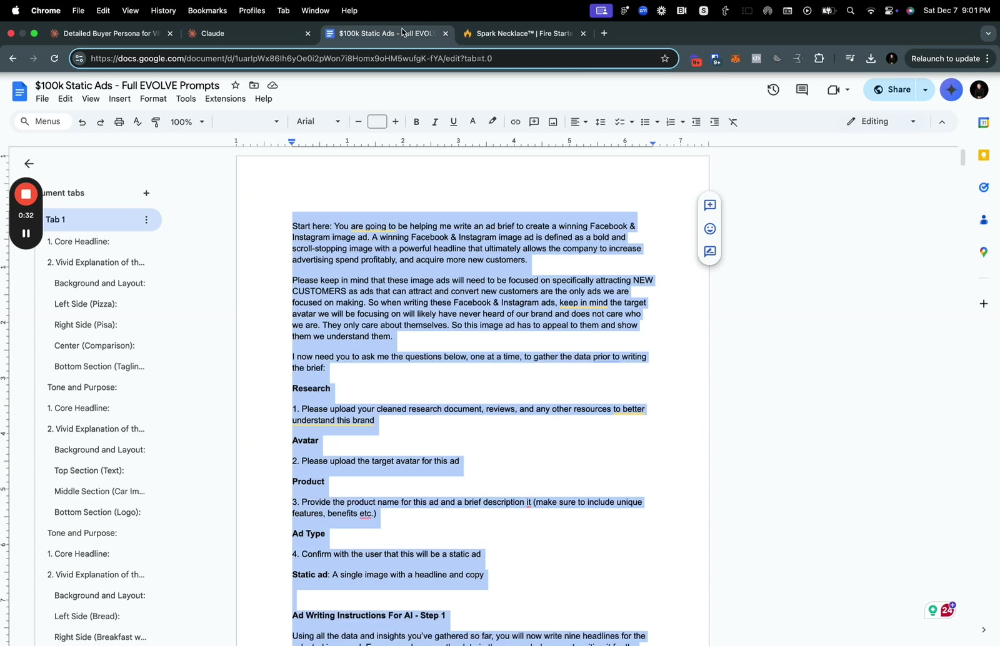
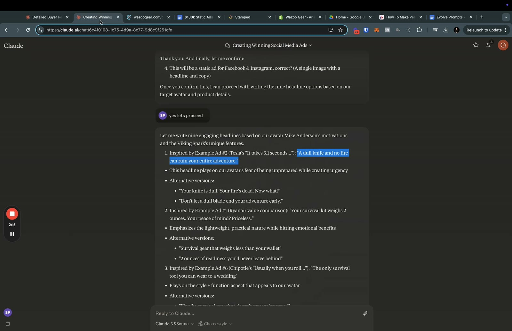
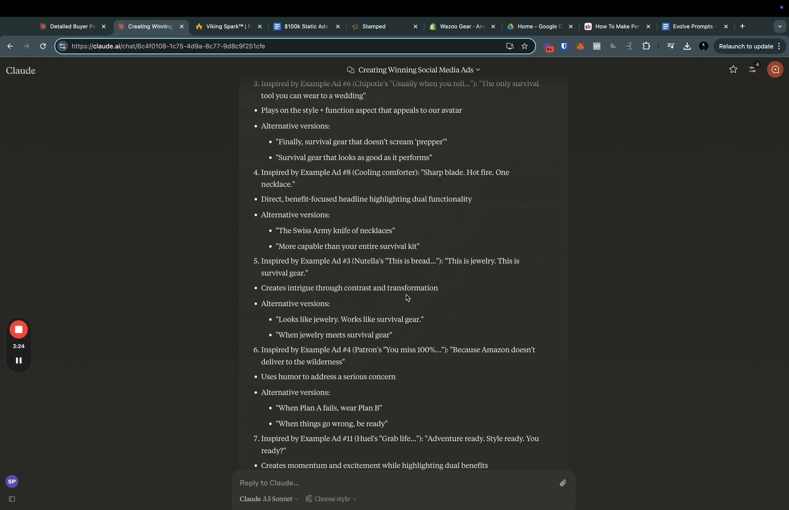
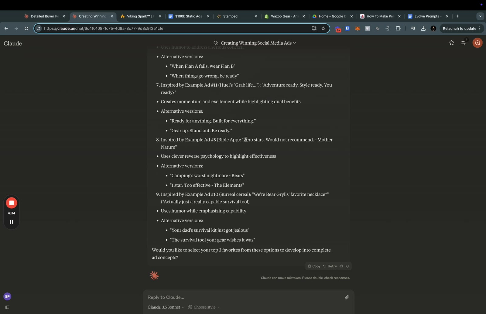
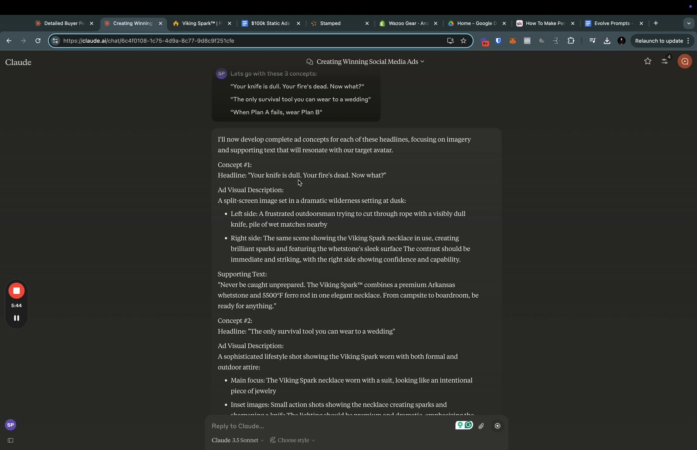
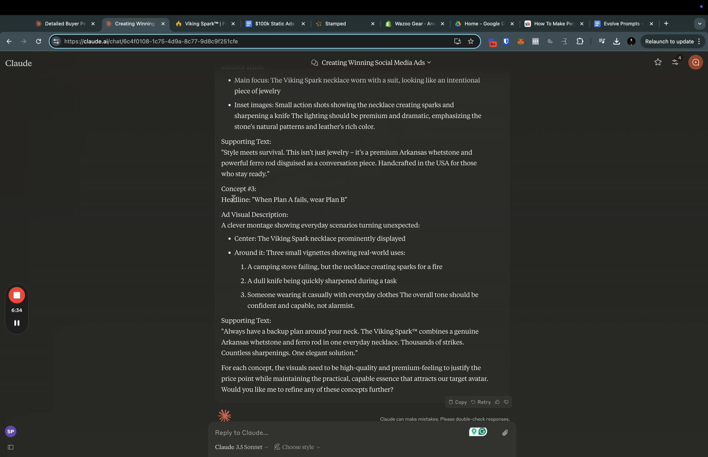

# 65. Banger Static Ads Prompt
> A long two-step prompt that makes Claude interview you for research, avatar and product, write nine scroll-stopping static-ad headlines modelled on eleven famous winning ads (with a reference, a rationale and two alternates each), and then turn your three favourites into condensed image-ad concepts with visual descriptions and call-out text; the video demos it end to end and the full prompt is reproduced below.

## 🤖 Agent use
- **Use when:** writing Facebook/Instagram static (single-image) ads for **new customers**, or when you need a headline set plus a designer-ready image brief from a research doc, an avatar and a product description.
- **Inputs → outputs:** (1) cleaned research document and reviews, (2) target avatar, (3) product name plus description with unique features and benefits, (4) confirmation to proceed → **Step 1:** nine headlines (6-8 words max), each with the reference ad used, why it stops the scroll, and two alternates → user picks top 3 (or any number) → **Step 2:** a condensed image-ad concept per pick (image description, call-outs, supporting text) ready for editors.
- **Rules:**
  - **DO** ask the four intake questions one at a time (research, avatar, product, confirmation) and wait for each answer before writing. [prompt]
  - **DO** write every headline for an avatar who "has never heard of our brand and does not care who we are" and "only care[s] about themselves". [prompt]
  - **DO** make each headline cite which reference ad (#1-#11) it borrows its mechanism from, say why it stops the scroll, and give two alternates. [prompt, Step 1; shown on screen at 02:16]
  - **DO** pause after the nine headlines and ask the user for their top 3; only then write the full concepts. [prompt, Step 2; 05:13]
  - **DO** keep imagery congruent with the headline, make the reader feel understood, and keep language "clear and concise" and simple. [prompt, Final Rules]
  - **DO** let the prompt aim for bold statics, "some of them are going to be humorous, some are going to be witty, some are going to be kind of like controversial", and "definitely not... ones that get scrolled by". [00:00]
  - **IF** there is no avatar yet **THEN** build one first with the program's persona/avatar prompt (a page in the Evolve AI classroom shown on screen), then continue; "it will write a new avatar for you". [00:46–01:36]
  - **DON'T** reuse a reference ad's wording for our product. Several demo outputs follow the original almost line for line (see the Hooks table), which is the "copy the asset" failure; keep the mechanism (twist, contrast, double meaning) and change the words and picture. (derived)
  - **DON'T** accept a headline longer than the prompt's own 6-8 word limit without a reason; the prompt's examples and Claude's demo outputs often exceed it. (derived from the prompt text)
- **See also:** [67. How to write image ads, part 1](67-how-to-write-image-ads-part-1.md) · [68. part 2](68-how-to-write-image-ads-part-2.md) · [69. Write your image ad briefs](69-action-item-write-your-image-ad-briefs.md) · [37. Evolve writing prompts](37-evolve-writing-prompts.md) · [64. Eugene's headlines](64-eugenes-headlines.md) · [Ad teardowns library](../../../../libraries/ad-teardowns.md) · [Humor in ads](../../../../concepts/humor-in-ads.md)

## Key ideas

### What this prompt is for [00:00–00:46]
- "The new static ads prompt that I have been working on", with "a little bit more sauce to it": it is "really about creating bold and... eye-catching statics". [00:00]
- It references "some incredible ads"; it is "quite a long prompt, almost a 20-page prompt" (instructor claim; the DOCX is about 30,000 characters). [00:00]
- Instructor claim: "I've scraped almost a lot of the internet to find some of these ads. Some of them you may recognize, some you may not." [01:36]
- Compared with the "basic static ad prompt", the headlines are "super fire". [05:13]

### Demo walkthrough [00:46–06:53]
1. **Research and avatar upload.** Upload the research doc "and everything else" to a new Claude chat; if the right avatar is missing, copy the persona/avatar prompt from the program ("how to make personas and avatars"), upload it, and ask Claude to "create a new avatar for the Viking Spark following this prompt". [00:46–01:36] On screen: a Skool page titled "How To Make Personas/Avatars With Claude" in the "Evolve AI" classroom (screenshot sheet near 01:02), and, in the chat, uploads of reviews and customer-survey feedback. The page for that classroom lesson is not in this lesson's files.
2. **Product information.** Paste the product details. The demo product is a survival necklace: the screen shows the Wazoo Gear product page "Spark Necklace" (the speaker and Claude say "Viking Spark"). He notes he first typed the wrong product ("the spark necklace") instead of the Viking Spark, "which is kind of like this tandem product". [01:36–02:25]
3. **Confirmation.** Claude asks to confirm "a static ad for Facebook & Instagram... (A single image with a headline and copy)"; the user answers "yes lets proceed" (on screen, 02:16).
4. **Nine headlines.** Claude outputs, for each: the example ad it was "inspired by", the headline, a one-line reason, and "Alternative versions". The instructor comments on a few: the survival-gear-for-a-wedding line is "pretty cool"; "because Amazon doesn't deliver to the wilderness. That is fire."; "this would actually... you can say 'because Amazon doesn't deliver to the Amazon', right? So you could play on words with that"; of the Bear Grylls one, "Maybe that one's not that good. Actually, just a really capable survival tool. So that one's okay." [01:36–05:13]
5. **Pick favourites.** He chose three without editing them: "Your knife is dull. Your fire's dead. Now what?", "The only survival tool you can wear to a wedding", and "When Plan A fails, wear Plan B"; of the last: "that is super fire". [05:13] (exact wording from the on-screen message at 05:26)
6. **Concepts.** Claude then writes, per pick, an "Ad Visual Description" and "Supporting Text" ([05:13–06:53]; wording below from screenshots). He tells viewers to "let your visual designers cook with this too. And this might, again, just spark ideas." [06:53]
7. **Maintenance.** "This prompt will continue to get better as we're obviously going to continue to add actually better statics and more winning statics to it"; "Our team is going to be pumping out statics with this." (instructor claims) [06:53]

### The prompt's design (read from the full text below)
- **Frame:** write an ad brief for a "winning Facebook & Instagram image ad", defined as "a bold and scroll-stopping image with a powerful headline that ultimately allows the company to increase advertising spend profitably, and acquire more new customers".
- **Audience rule:** only new customers; the avatar "does not care who we are".
- **Intake:** four questions, one at a time (research, avatar, product, final confirmation).
- **Step 1:** nine headlines, 6-8 words max, written to stop the scroll; for each concept name the reference example ad used, explain why it stops the scroll, give two more iterations of the same idea.
- **Reference set:** eleven ads, each given as "Core Headline", a "Vivid Explanation" (background and layout, elements, tone and purpose). See the teardown table.
- **Step 2:** after the user picks their top 3 "(or however many I'd like)", write the images and call-out text for editors, "more condensed than the examples above".
- **Final rules:** (1) assume the avatar does NOT know or care about us; (2) imagery must match and emphasise the headline; (3) make people FEEL something and feel understood; (4) be clear, concise and simple.

## Steps / framework
1. Open a fresh Claude chat and paste the whole prompt below ("Start here" to the final rules).
2. Answer Claude's four questions in order: upload cleaned research and reviews; upload the avatar (generate one first if needed); give the product name and a description with unique features and benefits; confirm.
3. Review the nine headlines and their reference-ad rationale. Reject near-verbatim copies; keep the mechanism. (derived)
4. Reply with the top 3 (or more) headlines.
5. Review each concept's image description and supporting text; adapt the visual to what we can actually shoot or design; send to the designer or editor.
6. Log which reference ad (#1-#11) each winning headline borrowed from, so iterations can switch to a different mechanism ([iteration vs variation](../../../../concepts/iteration-vs-variation.md)). (derived)

## Examples

### Demo output: three concepts (from screenshots; Claude's text as shown on screen)
Product: Viking Spark necklace (survival necklace combining an Arkansas whetstone and a ferro rod). Picks made at [05:13].

| Concept | Headline | Ad visual description (on screen) | Supporting text (on screen) |
|---|---|---|---|
| 1 | "Your knife is dull. Your fire's dead. Now what?" | A split-screen image set in a dramatic wilderness setting at dusk. Left side: a frustrated outdoorsman trying to cut through rope with a visibly dull knife, pile of wet matches nearby. Right side: the same scene showing the Viking Spark necklace in use, creating brilliant sparks and featuring the whetstone's sleek surface. The contrast should be immediate and striking, with the right side showing confidence and capability. | "Never be caught unprepared. The Viking Spark™ combines a premium Arkansas whetstone and 5500°F ferro rod in one elegant necklace. From campsite to boardroom, be ready for anything." |
| 2 | "The only survival tool you can wear to a wedding" | A sophisticated lifestyle shot showing the Viking Spark worn with both formal and outdoor attire. Main focus: the necklace worn with a suit, looking like an intentional piece of jewelry. Inset images: small action shots showing the necklace creating sparks and sharpening a knife. The lighting should be premium and dramatic, emphasizing the stone's natural patterns and leather's rich color. | "Style meets survival. This isn't just jewelry - it's a premium Arkansas whetstone and powerful ferro rod disguised as a conversation piece. Handcrafted in the USA for those who stay ready." |
| 3 | "When Plan A fails, wear Plan B" | A clever montage showing everyday scenarios turning unexpected. Center: the necklace prominently displayed. Around it, three small vignettes: (1) a camping stove failing, but the necklace creating sparks for a fire; (2) a dull knife being quickly sharpened during a task; (3) someone wearing it casually with everyday clothes. The overall tone should be confident and capable, not alarmist. | "Always have a backup plan around your neck. The Viking Spark™ combines a genuine Arkansas whetstone and ferro rod in one everyday necklace. Thousands of strikes. Countless sharpenings. One elegant solution." |

Claude closed with: "For each concept, the visuals need to be high-quality and premium-feeling to justify the price point while maintaining the practical, capable essence that attracts our target avatar. Would you like me to refine any of these concepts further?" (on screen, 06:34). The supporting text includes product claims ("5500°F", "Handcrafted in the USA", "Thousands of strikes") that come from the model and the demo product page; verify against the brand's facts before reuse. (derived caution)

## Structured units

### Hooks
The nine Step-1 headlines from the demo (Claude 3.5 Sonnet, per the on-screen model selector), with the reference ad and Claude's rationale as displayed. Heuristic / emotion / self columns left "—" because the lesson does not label them.

| Hook (headline; alternates) | Heuristic(s) | Emotion / zone | Self targeted | Why it works (Claude's on-screen rationale; reference ad) | Source |
|---|---|---|---|---|---|
| "A dull knife and no fire can ruin your entire adventure." <br> Alts: "Your knife is dull. Your fire's dead. Now what?" / "Don't let a dull blade end your adventure early." | — | — | — | "plays on our avatar's fear of being unprepared while creating urgency"; reference: Tesla ad (#2) | screen 02:16 |
| "Your survival kit weighs 2 ounces. Your peace of mind? Priceless." <br> Alts: "Survival gear that weighs less than your wallet" / "2 ounces of readiness you'll never leave behind" | — | — | — | "Emphasizes the lightweight, practical nature while hitting emotional benefits"; reference: Ryanair value comparison (#1) | screen 02:16, [02:25] |
| "The only survival tool you can wear to a wedding" <br> Alts: "Finally, survival gear that doesn't scream 'prepper'" / "Survival gear that looks as good as it performs" | — | — | — | "Plays on the style + function aspect that appeals to our avatar"; reference: Chipotle "Usually when you roll..." (#6) | screen 02:16, [02:57] |
| "Sharp blade. Hot fire. One necklace." <br> Alts: "The Swiss Army knife of necklaces" / "More capable than your entire survival kit" | — | — | — | "Direct, benefit-focused headline highlighting dual functionality"; reference: Evercool cooling comforter (#8) | screen 03:26, [02:57] |
| "This is jewelry. This is survival gear." <br> Alts: "Looks like jewelry. Works like survival gear." / "When jewelry meets survival gear" | — | — | — | "Creates intrigue through contrast and transformation"; reference: Nutella "This is bread..." (#3) | screen 03:26, [03:31] |
| "Because Amazon doesn't deliver to the wilderness" <br> Alts: "When Plan A fails, wear Plan B" / "When things go wrong, be ready" | — | — | — | "Uses humor to address a serious concern"; reference: Patron "You miss 100%..." (#4). Instructor: "That is fire." | screen 03:26, [03:31] |
| "Adventure ready. Style ready. You ready?" <br> Alts: "Ready for anything. Built for everything." / "Gear up. Stand out. Be ready." | — | — | — | "Creates momentum and excitement while highlighting dual benefits"; reference: Huel "Grab life..." (#11) | screen 04:36, [04:18] |
| "Zero stars. Would not recommend. - Mother Nature" <br> Alts: "Camping's worst nightmare - Bears" / "1 star: Too effective - The Elements" | — | — | — | "Uses clever reverse psychology to highlight effectiveness"; reference: Bible App (#5). Instructor: "That one's okay." | screen 04:36, [04:18] |
| "We're Bear Grylls' favorite necklace*" (*Actually just a really capable survival tool) <br> Alts: "Your dad's survival kit just got jealous" / "The survival tool your gear wishes it was" | — | — | — | "Uses humor while emphasizing capability"; reference: Surreal cereal (#10). Instructor: "Maybe that one's not that good." | screen 04:36, [04:18–05:13] |

(derived) Two of these keep the reference ad's wording almost intact ("Zero stars. Would not recommend. - ..." and the "We're [celebrity]'s favorite ... *" asterisk gag); treat them as structure only and rewrite.

### Ad teardowns
The eleven reference ads embedded in the prompt. Descriptions are condensed from the prompt's own "Vivid Explanation" and "Tone and Purpose" text. The prompt gives only positives, so "What fails" and "Fix suggested" are "—". The "Principle" column is derived (the prompt does not name principles).

| Brand / product (niche) | Format | Hook / opening | What works (per prompt) | What fails | Fix suggested | Principle (derived) | Source |
|---|---|---|---|---|---|---|---|
| Ryanair (airline) | Static; solid blue background, symmetrical pizza box vs Leaning Tower of Pisa box with "vs." between; "PIZZA $19.99" vs "LONDON → PISA $19.99"; Ryanair logo | "The world's cheapest airline." ("cheapest" highlighted yellow) | Humor and surprise; pizza-price comparison makes the low fare memorable | — | — | Compare the claim to an everyday price | prompt, Example #1 |
| Tesla Model S (car) | Static; white background, two-line text at top, side-profile black car with blurred rear, logo at bottom | "It takes 3.1 seconds to read this ad." + "The same time it takes a Model S to go from 0 to 60 mph." | Intriguing claim creates curiosity; ties reading time to acceleration; minimal design | — | — | Make the reader experience the claim | prompt, Example #2 |
| Nutella (spread) | Static; white background; plain toast vs toast with heart-shaped Nutella; logo | "This is bread. This is breakfast." + "Turning bread into breakfast since 1964." | Transformation shown side by side; light, warm tone | — | — | Before/after contrast | prompt, Example #3 |
| Patron Silver (tequila) | Static; white background, bold black serif headline, bottle, shot glass with ice and lime wedge, logo | "You miss 100% of the shots you don't take." | Double entendre on the sports quote and tequila shots; premium look | — | — | Twist a well-known phrase | prompt, Example #4 |
| Bible App | Subway ad panel; black background, "Zero stars." with five empty stars, "Would not recommend." "- Satan", app icon and name | "Zero stars. Would not recommend." (- Satan) | Humor and satire on review culture; implies the app is effective | — | — | Negative review from the product's enemy | prompt, Example #5; also in [57](57-100-hook-templates-form-winning-ads-deck.md) row 23 |
| Chipotle (restaurant) | Static; white background, foil-wrapped burrito, hand-drawn black headline, logo stamp, "Pass it on. Find yours @ chipotle.com." | "Usually, when you roll something this good, it's illegal." | Wordplay on "roll"; cheeky tone; shareable | — | — | Pun on the product action | prompt, Example #6 |
| Corona Extra (beer) | Static; beach and blue sky, bottle with water droplets and lime wedge, white serif headline, logo | "Good things take lime." | Play on "good things take time"; lime is the brand's symbol; relaxed, aspirational | — | — | Twist a proverb with a brand cue | prompt, Example #7 |
| Evercool Cooling Comforter (bedding) | Static; woman lying on the kitchen floor by an open fridge, comforter bottom-right, bold white headline | "Need better way to stay cool?" | Exaggerated, relatable situation; comforter shown as the practical alternative | — | — | Problem-first visual, exaggerated pain | prompt, Example #8 (the prompt omits the "1. Core Headline" label here); also [57](57-100-hook-templates-form-winning-ads-deck.md) row 15 |
| Daihatsu Hijet MPV (van) | Static; white background, small van with six smiling passengers (five women, one man), red brand banner | "Picks up five times more women than a Lamborghini." | Unexpected comparison; positions a practical van as fun and social | — | — | Cheeky comparison against a status product | prompt, Example #9 |
| Surreal (cereal) | Outdoor billboard; salmon-pink background, bold black headline, blue box and bowl | "We're Dwayne Johnson's favourite cereal.*" with "*Dwayne is a bus driver from London." | Asterisk twist subverts the celebrity assumption; irreverent | — | — | Fine-print punchline | prompt, Example #10 |
| Huel (meal replacement) | Static; black background, five bowls in an arc, white headline, call-outs "Vegan", "27 vitamins & minerals", "25g protein", "Ready in 5 minutes", logo | "Grab life by the bowls." | Wordplay on "grab life by the horns"; call-outs state convenience, nutrition, taste | — | — | Pun plus proof call-outs | prompt, Example #11 |

### Rules of thumb
- **DO** state the reader's world, not ours: the avatar "only care[s] about themselves". [prompt]
- **DO** make the picture and the headline say the same thing ("Congruency for imagery suggestions must match and emphasize the headline"). [prompt, Final Rule 2]
- **DON'T** tell the story of the brand in a cold-traffic static; assume they do not know or care about us. [prompt, Final Rule 1]
- **IF** the user wants options **THEN** give nine headlines with two iterations each, then narrow to three. [prompt Steps 1-2; 05:13]

## Prompts / templates (verbatim)
The complete Banger Static Ads prompt, from the course DOCX `65. Banger Static Ads Prompt.docx` (see "Differences between the copies" below: the linked Google Doc exports to identical text). Text begins at "Start here:" and ends after the four "Final Rules". Pandoc's backslash escapes (for `#`, `.`, `*`, `$`) were removed; the markdown headings and bold from the conversion are kept as they appear in the extraction. The two asterisks around the Surreal example are as extracted.

````markdown
Start here: You are going to be helping me write an ad brief to create a winning Facebook & Instagram image ad. A winning Facebook & Instagram image ad is defined as a bold and scroll-stopping image with a powerful headline that ultimately allows the company to increase advertising spend profitably, and acquire more new customers.

Please keep in mind that these image ads will need to be focused on specifically attracting NEW CUSTOMERS as ads that can attract and convert new customers are the only ads we are focused on making. So when writing these Facebook & Instagram ads, keep in mind the target avatar we will be focusing on will likely have never heard of our brand and does not care who we are. They only care about themselves. So this image ad has to appeal to them and show them we understand them.

I now need you to ask me the questions below, one at a time, to gather the data prior to writing the brief:

**Research**

1. Please upload your cleaned research document, reviews, and any other resources to better understand this brand

**Avatar**

2. Please upload the target avatar for this ad

**Product**

3. Provide the product name for this ad and a brief description it (make sure to include unique features, benefits etc.)

**Final Confirmation**

4. Confirm with the user that they are ready to proceed with the static ads.

**Ad Writing Instructions For AI - Step 1**

Using all the data and insights you’ve gathered so far, you will now write nine headlines for the selected image ad. Ensure you leverage the data in the research document, writing it for the specific avatar, the correct product, and following the tone. Also, make sure the written headlines are short (6-8 words max) and are written with one key objective in mind: **to stop the scroll of our target avatar and grab their attention to learn more and ultimately purchase from our company**

For each ad concept:

- Reference the example ad from below that you used to come up with the headline and how it works for this brand and avatar specifically

- Briefly explain why this headline will stop our potential avatar’s scroll

- Provide 2 other iterations of that main headline for me to choose from that follow the same idea.

In order to ensure this ad is a scroll-stopping image ad that the target avatar remembers, and gets them to convert, I will need you to understand what these types of image ads look like.  
  
So please follow the examples below of headlines and image descriptions from world-class winning ads that have been written by the top advertisers in the world, and have been proven to convert.  
  
**Example Image Ad #1:**

### **1. Core Headline:**

The core headline of the image ad is:  
**"The world's cheapest airline."**

### **2. Vivid Explanation of the Image Ad:**

The image features a clever and playful comparison that showcases the affordability of Ryanair flights. Here’s the breakdown:

#### **Background and Layout:**

- The **background** is a bold, solid blue, serving as a clean and striking base that makes all the other elements stand out vividly.

- The layout is **symmetrical** with two primary elements side by side, separated by the word “vs.” in the center.

#### **Left Side (Pizza):**

- An open pizza box is displayed prominently. The box is brown and slightly tilted upward for a clear view of its contents.

- Inside the box, there is a pizza that looks typical but unremarkable: it has a slightly uneven crust and scattered toppings, primarily cheese with a few darker ingredients (possibly mushrooms or olives).

- Above the box, **bold white text** reads: **“PIZZA $19.99”**, directly referencing the cost of the pizza.

#### **Right Side (Pisa):**

- Another open box is displayed next to the pizza box. This box is identical in shape and size but contains something completely unexpected: a drawing or artistic depiction of the Leaning Tower of Pisa.

  - The depiction is grayscale and fits perfectly within the box as though it were a slice of pizza.

- Above the box, **yellow and white text** reads: **“LONDON → PISA $19.99”**.

  - The price matches that of the pizza, suggesting that the cost of a flight to Pisa with Ryanair is as affordable as a single pizza.

  - A small **graphic of a Ryanair airplane** is positioned between the cities, illustrating the flight route.

#### **Center (Comparison):**

- Between the two boxes, **the word “vs.”** in bold white text emphasizes the humorous and surprising contrast being drawn: a pizza versus a flight to Pisa for the same price.

#### **Bottom Section (Tagline and Branding):**

- Below the two boxes, the ad features the tagline:  
  **“The world’s cheapest airline.”**

  - The word **“cheapest”** is highlighted in yellow, further emphasizing Ryanair’s value proposition.

- At the very bottom, the **Ryanair logo and name** are placed prominently in white and yellow, reinforcing brand recognition.

### **Tone and Purpose:**

The ad uses humor and an element of surprise to communicate its core message: flying with Ryanair is so inexpensive that it costs as much as an everyday item like pizza. This juxtaposition is designed to grab attention and make the brand’s value proposition memorable.

**Example Image Ad #2:**

### **1. Core Headline:**

The core headline of this ad is:  
**"It takes 3.1 seconds to read this ad."**

### **2. Vivid Explanation of the Image Ad:**

This ad for Tesla is sleek, minimalist, and impactful, relying on its simplicity and clever messaging to leave an impression.

#### **Background and Layout:**

- The entire background is clean **white**, giving the ad a futuristic and minimalist feel while making the text and car stand out sharply.

- The layout is structured with text at the top, a blurred image in the middle, and the Tesla logo at the bottom.

#### **Top Section (Text):**

- The top portion of the ad features two lines of text in a **modern, sans-serif font**:

  1.  The first line, written in **bold black font**, states:  
      **"It takes 3.1 seconds to read this ad."**

      - This grabs attention with its intriguing claim, creating curiosity.

  2.  The second line, written in smaller **gray font**, explains:  
      **"The same time it takes a Model S to go from 0 to 60 mph."**

      - This ties the headline to the product’s performance, highlighting the incredible speed of the Tesla Model S.

#### **Middle Section (Car Image):**

- A **Tesla Model S** is shown in a sleek side profile. The car is depicted in motion, with the **rear portion blurred** to visually emphasize its acceleration and speed.

  - The car is **black**, standing out against the white background and exuding sophistication.

  - The motion blur creates a sense of dynamism, as if the car is surging forward at high velocity.

#### **Bottom Section (Logo):**

- At the very bottom, the iconic **Tesla logo** is displayed in black text, maintaining the minimalist aesthetic.

- The logo anchors the ad, reminding viewers of the brand behind this impressive product.

### **Tone and Purpose:**

- The ad is sophisticated and futuristic, perfectly aligned with Tesla’s branding.

- It uses a clever comparison—how long it takes to read the ad versus how long it takes a Tesla Model S to accelerate—to captivate the viewer and highlight the car’s performance.

- The simplicity of the design reflects Tesla’s modern and innovative ethos.

**Example Image Ad #3:**

### **1. Core Headline:**

The core headline of this ad is:  
**"This is bread. This is breakfast."**

### **2. Vivid Explanation of the Image Ad:**

This advertisement for Nutella uses a simple and visually appealing transformation concept to show how its product elevates an ordinary breakfast.

#### **Background and Layout:**

- The **background is entirely white**, maintaining a clean and minimalistic aesthetic that focuses the viewer’s attention on the product and its effect.

- The layout is symmetrical, with two main images (toasts) displayed side by side in the top half of the ad, accompanied by text below each one.

#### **Left Side (Bread):**

- A single slice of **plain toasted bread** is featured.

  - The bread is golden brown and evenly toasted, with no additional toppings or spreads.

  - Below this slice, in a bold, clean **black sans-serif font**, it says:  
    **"This is bread."**

  - This emphasizes the simplicity and plainness of the bread as a standalone item.

#### **Right Side (Breakfast with Nutella):**

- Another slice of **toasted bread** is displayed, but this one is transformed into something more enticing.

  - The toast is topped with a generous layer of **Nutella spread**, shaped into a **heart** in the center, symbolizing love or affection for the product.

  - The Nutella is glossy and smooth, visually appealing and appetizing.

  - Below this slice, in the same bold black font, it says:  
    **"This is breakfast."**

  - This contrasts the plain bread on the left, showing how Nutella adds flavor and turns bread into a complete breakfast.

#### **Bottom Section (Tagline and Logo):**

- Beneath the images, the tagline reads:  
  **"Turning bread into breakfast since 1964."**

  - The font is smaller, clean, and centered, subtly reminding viewers of Nutella’s long history of being a beloved breakfast staple.

- At the bottom center, the **Nutella logo** is displayed prominently.

  - The logo features **“nut” in black** and **“ella” in red**, maintaining its recognizable branding.

### **Tone and Purpose:**

- The tone is light, simple, and warm, appealing to families or individuals looking for a way to enhance their breakfast.

- The purpose is to demonstrate how Nutella transforms something as ordinary as plain toast into a delicious and enjoyable meal, making it a morning essential.

**Example Image Ad #4:**

### **1. Core Headline:**

The core headline of this ad is:  
**"You miss 100% of the shots you don’t take."**

### **2. Vivid Explanation of the Image Ad:**

This ad for Patrón tequila uses a clever play on words and a clean, high-end aesthetic to deliver its message.

#### **Background and Layout:**

- The **background is entirely white**, giving the ad a clean, premium feel and making the text and product imagery stand out.

- The layout is balanced, with the headline at the top, the product in the center, and the brand logo at the bottom.

#### **Top Section (Text/Headline):**

- The **headline** is written in **bold, black serif font**, and reads:  
  **"You miss 100% of the shots you don’t take."**

  - This is a clever double entendre, referencing both tequila shots and the motivational quote about seizing opportunities.

  - The phrasing is attention-grabbing and memorable, appealing to a fun yet aspirational audience.

#### **Center Section (Product Display):**

- The focal point of the ad is a **bottle of Patrón Silver Tequila**, placed prominently in the center.

  - The bottle is transparent, with the clear liquid inside reflecting light for a premium and elegant look.

  - It features a **natural cork stopper**, giving it an artisanal, high-quality appearance.

  - A **green and yellow ribbon** is tied around the neck of the bottle, adding a subtle pop of color and reinforcing its Mexican heritage.

  - The bottle label is minimalistic but detailed, with the words “Silver Patrón” in a bold serif font, along with certifications of authenticity, such as “100% de Agave” and “Hecho en Mexico.”

- Beside the bottle is a **shot glass** filled with clear tequila and a single ice cube, suggesting a chilled and refreshing experience.

  - A **lime wedge** is placed at the base of the shot glass, reinforcing the tradition of pairing tequila with lime.

#### **Bottom Section (Logo):**

- At the bottom center, the **Patrón logo** is displayed in black.

  - The logo features a bee icon, symbolic of the brand’s handcrafted, authentic nature.

  - Below the logo, the word **“Tequila”** is written in a smaller serif font, emphasizing the product category.

### **Tone and Purpose:**

- The tone is sophisticated yet playful, appealing to tequila enthusiasts who enjoy both quality and fun.

- The ad emphasizes Patrón’s premium nature while encouraging the viewer to indulge in the moment, tying the product to a lifestyle of confidence and celebration.

**Example Image Ad #5:**

### **1. Core Headline:**

The core headline of this ad is:  
**"Zero stars. Would not recommend."**

### **2. Vivid Explanation of the Image Ad:**

This ad for a Bible app combines humor and a subway setting to deliver a memorable and attention-grabbing message.

#### **Setting and Background:**

- The ad is part of a **subway train interior**, positioned on a vertical rectangular advertising panel typically found above the seats or near the doors.

- The subway environment is visible, with parts of the train’s metallic poles, walls, and commuters included in the frame.

#### **Main Design (Ad Panel):**

- The ad is placed on a **black background**, giving it a bold and modern appearance that stands out against the surrounding subway interior.

- The layout is clean and minimalistic, with white text and simple graphical elements.

#### **Headline and Visual Elements:**

1.  **Top Line (Headline):**

    - In bold white text, it says:  
      **"Zero stars."**

      - This references the common star-rating system used in reviews, immediately grabbing attention.

2.  **Star Rating:**

    - Below the headline, a row of **five outlined stars** is displayed, all left empty, reinforcing the "zero stars" concept.

3.  **Subtext (Humorous Review):**

    - Below the stars, the ad reads:  
      **"Would not recommend."**

      - The attribution underneath states:  
        **"- Satan"**

        - This injects humor and clever wordplay, suggesting that the Bible app is highly effective, much to Satan’s dismay.

#### **Bottom Section (Branding):**

- At the bottom of the ad panel, the logo and name of the app are displayed:

  - A small **Holy Bible icon** is shown to the left, recognizable by its brown cover and gold lettering.

  - Beside it, the app’s name is written in **white text**:  
    **"Bible App."**

### **Tone and Purpose:**

- The tone is humorous and cheeky, designed to stand out and engage passersby in a typically mundane setting like a subway.

- The ad positions the Bible app as something impactful and potentially life-changing by implying that even Satan disapproves of it.

- The use of satire and modern review culture makes the ad relatable and memorable for a broad audience.

**Example Image Ad #6:**

### **1. Core Headline:**

The core headline of this ad is:  
**"Usually, when you roll something this good, it's illegal."**

### **2. Vivid Explanation of the Image Ad:**

This ad for Chipotle uses humor, clever wordplay, and a simple design to highlight the quality of its burritos.

#### **Background and Layout:**

- The **background is pure white**, creating a clean and minimalist look that directs all attention to the central image and text.

- The layout is vertically centered, with the burrito image at the top, the headline in the middle, and the branding at the bottom.

#### **Top Section (Burrito Image):**

- A **wrapped Chipotle burrito** is the main visual element.

  - The burrito is tightly and neatly wrapped in shiny aluminum foil, giving it a fresh and appetizing appearance.

  - Its shape is plump and substantial, suggesting a hearty, generously filled meal.

#### **Middle Section (Headline):**

- The bold and humorous headline reads:  
  **"Usually, when you roll something this good, it's illegal."**

  - The text is in a **black, hand-drawn font**, giving it a casual, playful vibe that aligns with Chipotle’s approachable brand identity.

  - The wordplay humorously likens the act of rolling a burrito to rolling something illicit, implying that Chipotle's burritos are so good they seem almost too good to be true.

#### **Bottom Section (Branding):**

- At the bottom, the **Chipotle logo** is displayed in white text on a black, asymmetrical rectangle, resembling a stamp or a label.

  - Beneath the logo, in smaller black text, it says:  
    **"Pass it on. Find yours @ chipotle.com."**

  - This serves as a subtle call-to-action, encouraging viewers to explore Chipotle’s offerings online or share the ad’s message.

### **Tone and Purpose:**

- The tone is cheeky and fun, appealing to a younger, urban audience that appreciates clever humor and high-quality, fresh food.

- The ad’s purpose is to emphasize the exceptional quality of Chipotle’s burritos in a way that is memorable, humorous, and shareable.

**Example Image Ad #7:**

### **1. Core Headline:**

The core headline of this ad is:  
**"Good things take lime."**

### **2. Vivid Explanation of the Image Ad:**

This ad for Corona beer artfully blends its product with a relaxing beach setting, emphasizing its association with leisure and refreshment.

#### **Background and Setting:**

- The ad is set against a **clear blue sky**, with fluffy white clouds scattered across it, evoking feelings of tranquility and freedom.

- The **beach and ocean** are visible in the background, with gentle waves lapping against the shore, creating a sense of relaxation and escapism.

- The foreground features a **weathered wooden surface**, likely a beachside table or log, on which the Corona bottle is placed.

#### **Main Visual Element (Corona Bottle):**

- The centerpiece of the ad is a **bottle of Corona Extra** beer, standing upright on the wooden surface.

  - The bottle is golden and glistening with **water droplets**, giving it a cold, refreshing appearance, as if just taken out of an ice bucket.

  - A **lime wedge** is inserted into the neck of the bottle, reinforcing the iconic way Corona is served.

  - The label is prominently displayed, with the recognizable **blue and gold Corona logo** and the tagline **“La Cerveza Más Fina”** (“The Finest Beer”) printed on it.

#### **Text and Messaging:**

- To the left of the bottle, the headline reads:  
  **"Good things take lime."**

  - The text is written in a clean, white serif font, standing out against the blue sky background.

  - This clever play on the phrase "good things take time" ties directly to the lime garnish that is synonymous with Corona beer, making it witty and memorable.

#### **Branding:**

- Below the headline, the **Corona Extra logo** is displayed in white with a gold crown above it, reinforcing brand identity.

### **Tone and Purpose:**

- The tone is relaxed, lighthearted, and aspirational, appealing to people seeking a moment of escape, leisure, or indulgence.

- The ad effectively associates Corona beer with idyllic beach vacations and good times, using the lime as a symbol of the unique experience it offers.

**Example Image Ad #8:**

The core headline of this ad is:  
**"Need better way to stay cool?"**

### **2. Vivid Explanation of the Image Ad:**

This ad humorously highlights the discomfort of overheating while promoting a cooling comforter as the solution.

#### **Background and Setting:**

- The ad is set in a **kitchen**, with a focus on an open refrigerator as the main backdrop.

- The kitchen is dimly lit, with the bright light from the refrigerator providing the primary illumination, emphasizing the theme of seeking coolness.

#### **Main Visual Elements:**

1.  **Person Seeking Coolness:**

    - A young woman is lying on the kitchen floor with her head resting on a pillow.

    - She appears to be sleeping or attempting to cool down by positioning herself near the open refrigerator.

    - She is dressed lightly, wearing a **tank top and shorts**, emphasizing the heat and her desperation for relief.

    - Her expression is peaceful, but the unusual setting (sleeping by the fridge) adds a humorous and relatable touch.

2.  **Open Refrigerator:**

    - The fridge is fully stocked with drinks, eggs, and other food items, visually reinforcing the concept of coolness.

    - The bright interior light draws the eye and creates a stark contrast with the darker kitchen surroundings.

3.  **Product Placement (Cooling Comforter):**

    - In the bottom-right corner, the **Evercool™ Cooling Comforter** is displayed.

    - The comforter is neatly folded, showing off its **bright blue exterior** and soft, lightweight material.

    - The positioning suggests this product as the perfect alternative to the extreme solution of lying by a fridge.

#### **Text and Branding:**

- **Headline Text:**

  - Positioned to the right of the image, the headline reads:  
    **"Need better way to stay cool?"**

  - The font is bold and white, making it easily legible against the darker kitchen background.

- **Product Name:**

  - At the bottom left, it says:  
    **"Evercool™ Cooling Comforter"**

    - The font is clean and modern, emphasizing the brand and product as the ideal solution.

### **Tone and Purpose:**

- The tone is playful and relatable, using humor to draw attention to the problem of overheating.

- The ad creates a memorable visual of an exaggerated situation (sleeping by the fridge) to introduce the Evercool™ Cooling Comforter as a practical and superior solution for staying cool and comfortable.

**Example Image Ad #9:**

### **1. Core Headline:**

The core headline of this ad is:  
**"Picks up five times more women than a Lamborghini."**

### **2. Vivid Explanation of the Image Ad:**

This ad uses humor and an unexpected comparison to position the Daihatsu Hijet MPV as a practical yet fun alternative to luxury sports cars.

#### **Background and Setting:**

- The ad features a **Daihatsu Hijet MPV** (a compact van) as the centerpiece, positioned on a plain white background. This simple backdrop draws attention to the vehicle and the accompanying text.

#### **Main Visual Elements:**

1.  **The Vehicle (Daihatsu Hijet MPV):**

    - The van is small, boxy, and practical-looking, painted in a light silver-gray color.

    - Its compact design emphasizes utility and efficiency rather than luxury or flashiness.

    - The MPV is shown fully loaded with **six cheerful passengers** inside.

2.  **The Passengers:**

    - The passengers are **five women and one man**, all smiling and laughing, enjoying themselves inside the van.

    - Their body language is casual and lively, suggesting a fun, social atmosphere.

    - The man in the driver's seat is leaning out of the window with a big smile, suggesting he’s both proud and enjoying the company.

3.  **Humorous Context:**

    - The juxtaposition of a small, practical van against a Lamborghini is inherently humorous and unexpected.

    - By showing the van filled with people having fun, the ad highlights the Daihatsu's spaciousness and social appeal, contrasting with the limited seating capacity of a luxury sports car.

#### **Text and Messaging:**

- **Headline:**

  - Written in **bold, black sans-serif font**, the text reads:  
    **"Picks up five times more women than a Lamborghini."**

  - The playful wordplay implies that while a Lamborghini might be flashy, the Daihatsu Hijet MPV is the true "babe magnet" due to its practicality and group-friendly design.

#### **Branding:**

- On the far right, a vertical red banner displays the **Daihatsu logo and branding**, keeping the manufacturer's identity visible but secondary to the humor and messaging of the ad.

### **Tone and Purpose:**

- The tone is cheeky, lighthearted, and self-aware, using humor to stand out and engage viewers.

- The purpose is to position the Daihatsu Hijet MPV as a practical, fun, and social vehicle that prioritizes utility and shared experiences over luxury and exclusivity.

**Example Image Ad #10:**

### **1. Core Headline:**

The core headline of this ad is:  
*"We’re Dwayne Johnson’s favourite cereal."**

### **2. Vivid Explanation of the Image Ad:**

This ad uses humor, bold typography, and a clever twist to promote a cereal brand called **Surreal**.

#### **Background and Layout:**

- The ad is displayed on a **large outdoor billboard**, creating a striking visual against its urban setting.

- The **background is a solid salmon-pink color**, making the bold black text and imagery stand out.

- The layout balances the large headline on the left with the cereal product imagery on the right.

#### **Main Visual Elements:**

1.  **Headline (Text Focus):**

    - The headline is written in **bold, black sans-serif font** and reads:  
      *"We’re Dwayne Johnson’s favourite cereal."**

    - The asterisk immediately hints at a humorous clarification, teasing the viewer to read further.

2.  **Fine Print (Clarification):**

    - Below the headline, in smaller black text, the asterisk explanation says:  
      **"Dwayne is a bus driver from London."*

    - This punchline adds a humorous twist, subverting the viewer’s initial assumption that the ad refers to the famous celebrity Dwayne "The Rock" Johnson.

3.  **Product Display:**

    - To the right of the headline, there is an image of a **blue cereal box** labeled **"Surreal – Frosted High-Protein Cereal"**.

    - Next to the box, a **bowl of cereal** is shown overflowing, with pieces spilling onto the table surface, creating a casual, playful vibe.

    - The design of the cereal box is modern, with cartoonish graphics and a clean, minimalist layout.

#### **Tone and Branding:**

- The tone is witty, irreverent, and self-aware, using humor to make the ad memorable and engaging.

- The playful twist on celebrity endorsements cleverly positions the brand as relatable and down-to-earth, appealing to an audience that appreciates humor and doesn’t take itself too seriously.

- The branding **“Surreal”** reinforces this quirky, unconventional personality.

### **Purpose:**

The ad aims to grab attention through humor and subversion, using the twist to highlight the cereal’s approachable yet unique identity. The use of bold colors and typography ensures the message is eye-catching even from a distance.

**Example Image Ad #11:**

### **1. Core Headline:**

The core headline of this ad is:  
**"Grab life by the bowls."**

### **2. Vivid Explanation of the Image Ad:**

This ad for Huel emphasizes its nutritious and convenient meal options with an inviting and dynamic display of food.

#### **Background and Layout:**

- The background is **dark black**, creating a strong contrast that makes the bowls of food and text pop out vividly.

- The layout features **five bowls of colorful meals** positioned in an arc, with the headline at the top and product features highlighted around the bowls.

#### **Main Visual Elements:**

1.  **Headline:**

    - Centered at the top in bold white text, the headline reads:  
      **"Grab life by the bowls."**

    - This playful phrase uses wordplay on the idiom "grab life by the horns," aligning the message with Huel’s promise of taking control of your health with ease and enjoyment.

2.  **Bowls of Food:**

    - The centerpiece of the ad is the **five black bowls**, each filled with visually appealing dishes representing Huel’s meal options.

      - **Front and Center Bowl:**

        - A creamy dish resembling macaroni and cheese, garnished with herbs for an inviting and hearty look.

      - **Surrounding Bowls:**

        - A mix of vibrant options, including grain-based dishes and vegetable-forward meals, all distinct in texture and color.

      - The steam rising from each bowl suggests freshness and warmth, making the meals look appetizing and ready to eat.

3.  **Product Benefits:**

    - Around the bowls, white text highlights the key benefits of Huel’s meals:

      - **“Vegan”**: Indicates the meals are plant-based.

      - **“27 vitamins & minerals”**: Emphasizes the complete nutritional profile.

      - **“25g protein”**: Highlights the high protein content per serving.

      - **“Ready in 5 minutes”**: Reinforces convenience and quick preparation.

4.  **Branding:**

    - At the bottom-left corner, the **Huel logo** is displayed in bold white text, reinforcing the brand identity.

#### **Tone and Purpose:**

- The tone is bold, empowering, and approachable, encouraging viewers to take charge of their nutrition without sacrificing taste or time.

- The ad highlights Huel’s key selling points: **convenience**, **nutrition**, and **taste**, making it appealing to busy individuals seeking quick yet healthy meal options.

**Ad Writing Instructions For AI - Step 2**

Now after creating the nine hooks, please ask me to pick my top 3 hooks (or however many I’d like). After confirming, you will then write out the rest of the image ads describing the images and providing additional text for call outs, if needed, to have a complete concept ready to send over to our editors.

You can use the examples above as a reference for how to describe the image ad and how our editors should bring it to life, however, please keep it more condensed than the examples above.

**Final Rules To Consider For Image Ads:**

I want you to consider the following rules prior to writing the headlines and final image ads to ensure they tick all of these boxes:

1.  Assume our target avatar does NOT know about us and does not CARE about us.

2.  Congruency for imagery suggestions must match and emphasize the headline

3.  Make people FEEL something. Make people feel like you understand them.

4.  Be Clear and be concise and keep your language simple
````

### Differences between the copies
| Copy | What it is | Result |
|---|---|---|
| Course DOCX (`65. Banger Static Ads Prompt.docx`) | Attachment on lesson 65 (27,524 bytes) | Source for the text above |
| Linked Google Doc (`docs.google.com/document/d/1uarIpWx86Ih6yOe0i2pWon7i8Homx9oHM5wufgK-fYA`), exported as DOCX | Link on the Skool lesson page ("Prompt:") (27,524 bytes) | After converting both to text, the body is **identical** to the DOCX (only the file-name header lines differ). The two DOCX files differ at the binary level (metadata) but not in text. |
| Google Doc as shown in the video, titled "$100k Static Ads - Full EVOLVE Prompts" (recording clock "Sat Dec 7") | Earlier working copy on screen at 00:32 | Intake section differs in the visible part: it has **"Ad Type — 4. Confirm with the user that this will be a static ad — Static ad: A single image with a headline and copy"**, whereas the course copy has **"Final Confirmation — 4. Confirm with the user that they are ready to proceed with the static ads."** Only the first screen of the doc is visible, so other differences cannot be ruled out. The video's Claude output follows the older wording (it asks to confirm "a static ad for Facebook & Instagram... (A single image with a headline and copy)"). |

Quirks in the prompt itself (kept as is above): Example #8 lacks the "1. Core Headline:" label; the intro says nine headlines and "6-8 words max" while the examples and demo outputs are longer; the Step 1 text says "Reference the example ad from below" although the examples appear after the instruction.

## Screenshots

*The prompt as a Google Doc, selected for copying; the outline on the left lists "Core Headline / Vivid Explanation" sections for each reference ad. Note the intake section here ends with "Ad Type" (older wording). [00:32]*


*Step 1 output, headlines 1-3: each has "Inspired by Example Ad #n", a one-line rationale and "Alternative versions". [02:16]*


*Headlines 3-7, including "Sharp blade. Hot fire. One necklace." (cooling-comforter reference) and "Because Amazon doesn't deliver to the wilderness" (Patron reference). [03:26]*


*Headlines 7-9 and the gate: "Would you like to select your top 3 favorites from these options to develop into complete ad concepts?" [04:36]*


*Step 2 output: Concept #1 with "Ad Visual Description" and "Supporting Text" after the user replied "Lets go with these 3 concepts". [05:46]*


*Concept #2's supporting text and Concept #3 (montage with three vignettes), ending with the offer to refine. [06:36]*

## How to apply
- [ ] Assemble the three inputs first: cleaned research doc and reviews, avatar, product description with unique features and benefits.
- [ ] Paste the full prompt into a fresh chat; answer the four intake questions one at a time.
- [ ] Review the nine headlines: strike any that copy the reference ad's wording; check each for the 6-8 word limit.
- [ ] Choose three; ask for the concepts; check every product claim in the supporting text against our facts list ([60](60-facts-list.md)).
- [ ] Convert the image description into a designer brief or a shot list; if making UGC video, reuse only the headline mechanism as the spoken hook (derived).
- [ ] Run the final headline through the [13-question checklist](58-copywriting-checklist-when-writing.md).
- [ ] Record which reference ad (#1-#11) each winner was based on.

## Related
- Previous: [64. Eugene's Headlines](64-eugenes-headlines.md) · Next: [66. Learn more about copywriting](66-learn-more-about-copywriting.md)
- Image-ad lessons that teach the writing behind this prompt: [67](67-how-to-write-image-ads-part-1.md), [68](68-how-to-write-image-ads-part-2.md), [69](69-action-item-write-your-image-ad-briefs.md).
- [Hooks library](../../../../libraries/hooks.md) · [Competitor ad teardown playbook](../../../../playbooks/competitor-ad-teardown.md)

## Sources and limitations
- Transcript: [65. Banger Static Ads Prompt .txt](<../../../../../raw/evolve/copywriting/_transcripts/✍️ Evolve Copywriting (NEW)/65. Banger Static Ads Prompt ✍️ Evolve Copywriting (NEW) Evolve.txt>) · Page text: [65….html.md](<../../../../../raw/evolve/copywriting/_extracted/✍️ Evolve Copywriting (NEW)/65. Banger Static Ads Prompt_✍️ Evolve Copywriting (NEW)_Evolve.html.md>) · DOCX: [65. Banger Static Ads Prompt.docx.md](<../../../../../raw/evolve/copywriting/_extracted/✍️ Evolve Copywriting (NEW)/65. Banger Static Ads Prompt.docx.md>) · Linked Google Doc export: [65-document-1uarIpWx86.docx.md](<../../../../../raw/evolve/copywriting/_extracted/_linked/google/65-document-1uarIpWx86.docx.md>)
- Machine transcription (Whisper large-v3-turbo); the recording is fully covered (last segment starts at 07:27 and ends at 07:30 of a 07:31 video). Whisper wrote "cloud format" for "Claude format", "stat gap prompt" for "static ad prompt", and "wear Bear Grylls' favorite necklace" where the screen shows "We're Bear Grylls' favorite necklace*"; the screen text was used for all quoted headlines. The speaker is not named in the audio ("unverified"; the Claude greeting on screen reads "Good evening, Spencer", which is not a statement by the speaker).
- Neither DOCX contains embedded images (checked in the zip), so the reference ads are available only as the prompt's written descriptions. Those descriptions were not checked against the original ads.
- Heuristic, emotion and self columns, the Principle column and the cautions are derived and not stated in the lesson.
