# 67. How To Write Image Ads - Part 1
> A full, start-to-finish static-ad process: sub-avatar research and a Claude "angle prompt" produce ranked angles and hooks, one concept (a "marksman" test of three angles) goes into a concept brief, and the headline-plus-bullets image ads are then built in a Canva template and filled with Claude-written bullets from the customer research.

## 🤖 Agent use
- **Use when:** writing static (image) ads from scratch for a product that already has a product doc, research and sub-avatars; turning sub-avatar quotes into angles, headlines and callout bullets; filling in the Evolve concept/brief template; judging whether an angle is really an angle or only a "concept".
- **Inputs → outputs:** Master Document (product, research, avatars with verbatim quotes, new information, new mechanisms) + the angle prompt (below) → per-sub-avatar angles with hooks, ranked → one concept brief (concept, angles, testing method, format, 3-4 headline variations) → one finished static ad per headline (headline + sub-line + 3-4 benefit bullets + product image) → exported PNG per variation.
- **Rules:**
  - **DO** keep one master document with tabs Product / Research / Avatars / Angles-Ideas / New Information / New Mechanisms and feed it to Claude; "the more context you give it about who your customer is, the better it's gonna be." [23:40]
  - **DO** paste the sub-avatars (with their quotes) under the angle prompt and ask for 3 angles x 3 hooks per sub-avatar, strongest first. The prompt itself says the user does NOT have to test each angle separately. [00:54–01:37]
  - **DO** write down the angle (the customer's reason to buy) for every concept, even when the concept is a format or a sub-avatar test. [Angle-prompt doc, "Knowledge"]
  - **DO** aim for one to two concepts a day; the instructor spent about two hours on this one. [07:59–08:58]
  - **DO** choose the testing method on purpose: marksman = several angles in one concept (used here), sniper = one angle with several hooks. [01:37; 05:38; 12:27]
  - **DO** make a "hard thing is easy" contrast headline when the audience knows the thing is hard ("Eating 1,200 calories is easy"): "two things that don't go together... now you're curious." [05:01]
  - **DO** sanity-check the number or claim used in a headline before building (he asked ChatGPT for typical calorie intake; he says a claim like "food stays in your stomach three times longer" must be validated). [04:13; 09:51]
  - **DO** feed Claude the inspiration ad (screenshot), the headline, and the research, and tell it the exact number of bullets you want; "I need four", not "two". [18:02–20:11]
  - **DO** lead bullets with a hard fact from the product doc when one exists (GLP-1 increase). [25:38–26:09]
  - **DO** take brand colors from the brand's website with a color-picker extension; fall back to a plain white or brand-blue background if a lifestyle photo looks bad. [15:29–17:06]
  - **DON'T** over-claim ("if you're claiming like it's a wonder drug, again, you're going to run into belief issues"). [20:54]
  - **DON'T** wait for a designer. "It's okay to have ugly ads"; the information in the ad is what is being tested. [19:26; 22:02; 27:26]
  - **IF** you have no photo of the product in use **THEN** put the plain product image there. [28:18]
  - **IF** the ad is static **THEN** delete the "Hold" section of the brief template (it is for videos only). [12:27; brief template]
  - **(derived)** For a UGC video, treat each headline variation as a hook line, the bullets as the on-screen/spoken benefit stack, and the angle as the script's reason-to-buy; keep the same research-quote -> headline logic. See the video-ad lessons: [70. How To Write Video Ads - Part 1](70-how-to-write-video-ads-part-1.md).
- **See also:** [18. Being aware of angles](18-being-aware-of-angles.md) · [68. How To Write Image Ads - Part 2](68-how-to-write-image-ads-part-2.md) · [69. Action item: write your image ad briefs](69-action-item-write-your-image-ad-briefs.md) · [Static ad creation playbook](../../../../playbooks/static-ad-creation.md) · [Creator brief playbook](../../../../playbooks/creator-brief.md) · [Customer research to angles](../../../../playbooks/customer-research-to-angles.md) · [Angle remix](../../../../playbooks/angle-remix.md)

Lesson page text (Skool): a "May 2026" disclaimer says these modules were filmed before the copywriting program and that new "post copywriting" ad-creation modules are coming ("we are documenting the creation of winning ads"). It links the Master Document template, the brief template, the angle prompts, the "13+ Winning Static Ads Templates" Skool lesson, the ColorPick Eyedropper Chrome extension, and Milanote, and shows the four "Final Ads (After some revisions)".

## Key ideas

### 1. Same process for image and video, video just takes longer [00:00–00:54]
- "The way that you write for image ads and video ads is basically gonna be the exact same... when you do video ads, they're gonna take a little bit longer." [00:00]
- Start with your own document: the "master document" with a product tab, research tab, avatars tab, new information tab and new mechanism tab (the screen also shows an "Angles/Ideas" tab). [00:00] The Skool page links it as the Master Document template (see Prompts / templates).

### 2. Run the angle prompt on your sub-avatars [00:54–03:30]
- Open Claude, paste the angle prompt (from the Avatar training; reproduced in full below), then paste the sub-avatars. [00:54]
- Output structure (on-screen): per sub-avatar, three angles; each with a "Reason to Buy" line and three hooks, each tagged "Inspired by:" one of the reference winning ads (see Reference ads below). Sub-avatars are ranked with stars ("STRONGEST", "SECOND STRONGEST", "THIRD") and the output opens with a priority note. [00:54–03:30; frame 03:28]
- Result for the Zend (MetaGlow collagen, appetite/GLP-1) test: Sub-avatar #3 "Stress Eater" (strongest), #2 "Addicted to Junk Food" (second), #1 "Doesn't really know what GLP-1 does" (third). [01:37–06:26]
  - Stress Eater angles: "Stops The Stress-Eating Cycle", "Fills The Empty Pit Without Food", "Eliminates The Regret Cycle". [01:37]
  - Addicted to Junk Food angles: "Makes 1,200 Calories Feel Easy", "Shuts Up Your Stomach For Good", "Lets You Say No Without Willpower". [03:30; 05:38; frame 06:17]
- He reads the hooks and keeps the ones that are "emotionally powered" ("Stop needing discipline, start lowering cortisol") or whose contrast is surprising ("makes 1,200 calories easy"). He notes cortisol "is a pretty popular mechanism". [01:37–03:30]
- Marksman vs sniper: "if you want to do marksman here on this one sub avatar, you can. I'm actually just going to take... a relatively bigger swing." He would "almost want to do a sniper approach" on the "shut up your stomach" angle. [05:38; 05:38]

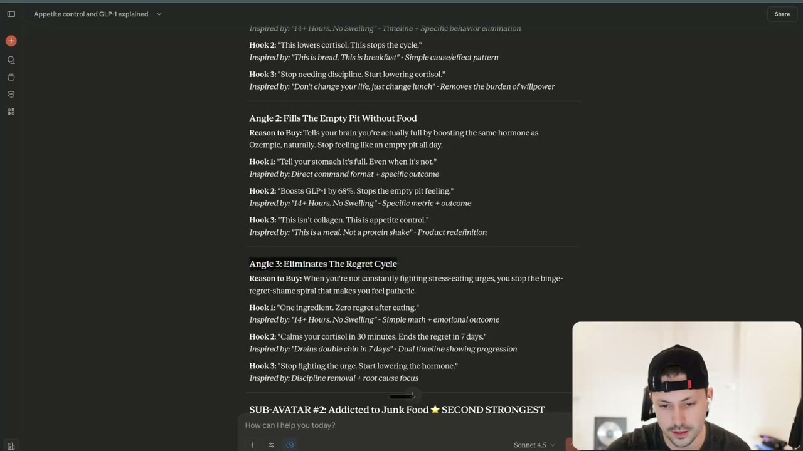
*Claude's output for the Stress Eater sub-avatar: three angles, each with a "Reason to Buy", three hooks and an "Inspired by" tag naming the reference ad pattern. Visible hooks include "Tell your stomach it's full. Even when it's not." and "One ingredient. Zero regret after eating." [03:28]*

### 3. Choosing the angles, with sanity checks [03:30–06:26]
- **Why "1,200 calories is easy" was picked:** "eating 1,200 calories a day is not easy"; calling out "that something that is actually hard is easy... two things that don't go together" grabs attention and creates curiosity. He says this is "a common theme" in the execution modules. [03:30; 05:01]
- **Check the number:** he asks ChatGPT what an average woman 35+ eats; the answer was about 1,600-2,200 calories a day for ages 31-50 (instructor reading from ChatGPT; "good enough for now") so 1,200 is plausibly a hard target. [04:13]
- He treats Claude's ranking as input only: Claude ranked the "natural Ozempic alternative" angle last; he still liked parts of it ("same hormones as Ozempic, no needles") but notes this brand does not want to name Ozempic. [06:26–07:18]

### 4. Refining one angle for a sniper ("dumbed-down GLP-1") [07:18–10:38]
- He opens a follow-up in Claude for the third avatar: the person "has heard of GLP-1... they know that it helps people lose weight, but they don't really understand how it works." Goal: "dumb things down, simplify the language, and explain how our product actually delivers the mechanism." He supplied his own headline ideas: "keep food in your stomach longer, trick your stomach into thinking it's full, and slow stomach emptying." [07:18–07:59]
- Claude's refined hooks (as he reads them aloud) include "GLP-1 tricks your stomach. This boosts it.", "This is just collagen [sic; likely "isn't just"]. Everyone talks about GLP-1. Nobody explains it until now." and "One scoop, food stays in your stomach three times longer." [09:51] He likes the last but says "I would have to validate that claim." [09:51]
- He asks Claude to "make it pack more of a punch... shorter and to the point, kind of like the example" (the static-ads doc). Claude offered "One scoop. Full 3x longer."; he stays with "Trick your stomach into thinking it's full." [10:38]
- On screen, the same angle is also set up as a separate sniper concept doc, "Zend - SDCT #1 - Dumbed Down GLP-1" (fields listed under Prompts / templates). Its angle line reads "How Dyglomera keeps your stomach full", with messaging "Your Stomach Thinks You Just Ate... Even When You Didn't" and "What If Your Stomach Stayed Full For 6 Hours Instead Of 2". It is shown at [11:23] but not discussed. [frame 11:23]

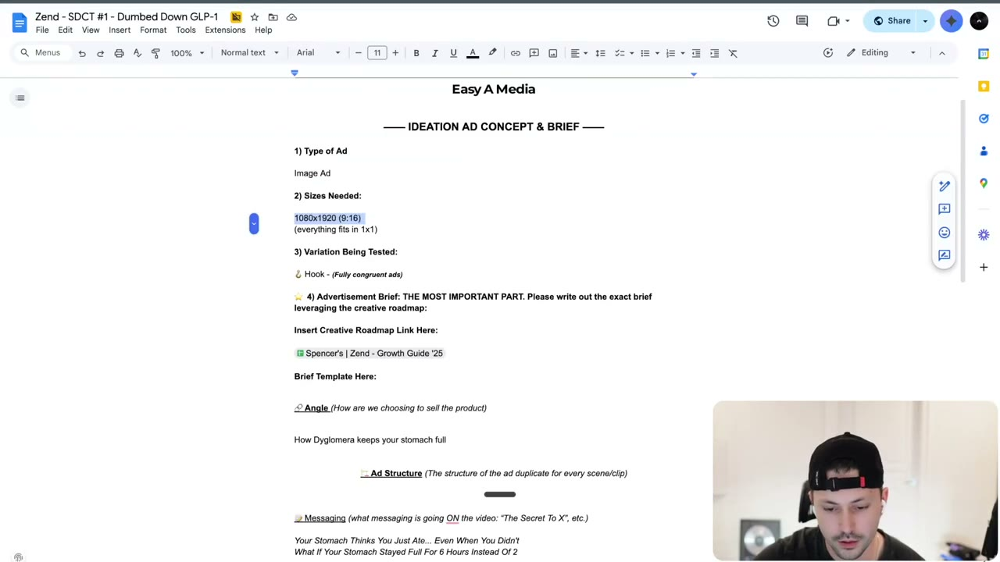
*"Ideation Ad Concept & Brief" for the sniper angle "Dumbed Down GLP-1": type of ad = Image Ad; sizes needed 1080x1920 (9:16) "(everything fits in 1x1)"; variation being tested = Hook "(Fully congruent ads)"; angle = "How Dyglomera keeps your stomach full". [11:23]*

### 5. Put it in the concept brief [10:38–13:59]
- "With statics, you basically have like, we're done" once the angles and headlines exist; make a copy of the concept-brief template and name it (here "Brief Template - Batch #1 - S batch - Sub Avatar Test"). [10:38–11:37]
- Fill the fields in order (full template below): Concept = "to test specific sub avatars to figure out what direction we should go further in from an execution standpoint"; Angle(s) = three angles (Stops The Stress-Eating Cycle; Makes 1,200 Calories Feel Easy; Tricks Your Stomach Into Thinking It's Still Full); Testing Method = Marksman "because we got three angles"; Format; then the variations. [11:37–12:27; frame 12:52]
- Four variations were entered as the "Messaging": (1) "Stop needing discipline. Start lowering cortisol." (2) "Eating 1,200 calories is easy" (3) "This tells your stomach you're full. Even at 1,200 calories." (4) "Trick your stomach into thinking it's still full". [12:27–13:20; frame 14:06]
- For static ads the "Hold" section is deleted. [12:27]
- He also pasted the concept, angles and headlines into Claude and asked for a format recommendation (on-screen prompt: "hey Claude, here's my concept and the angles that I'm going to test. I need your help helping me create and select a format that I should use to test these ads specifically."). Claude's reply begins "Ad Format Recommendations for Your Collagen GLP-1 Test / PRIMARY FORMAT: Product Photography + Headline". [frame 18:07]
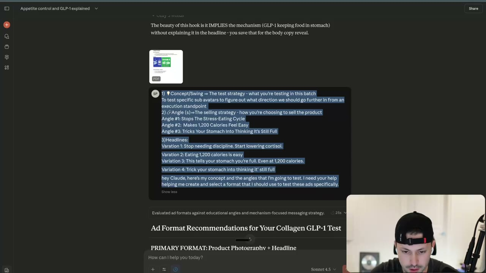
*Claude chat: the concept, three angles and four headline variations pasted as one message, ending "hey Claude, here's my concept and the angles that I'm going to test. I need your help helping me create and select a format..."; the reply heading "Ad Format Recommendations for Your Collagen GLP-1 Test" is below. [18:07]*

- He then goes visual-first on the "Winning Ads Templates" Canva deck ("13+ Winning Static Ads Templates") and picks a simple product-photo template. [12:27–14:32]

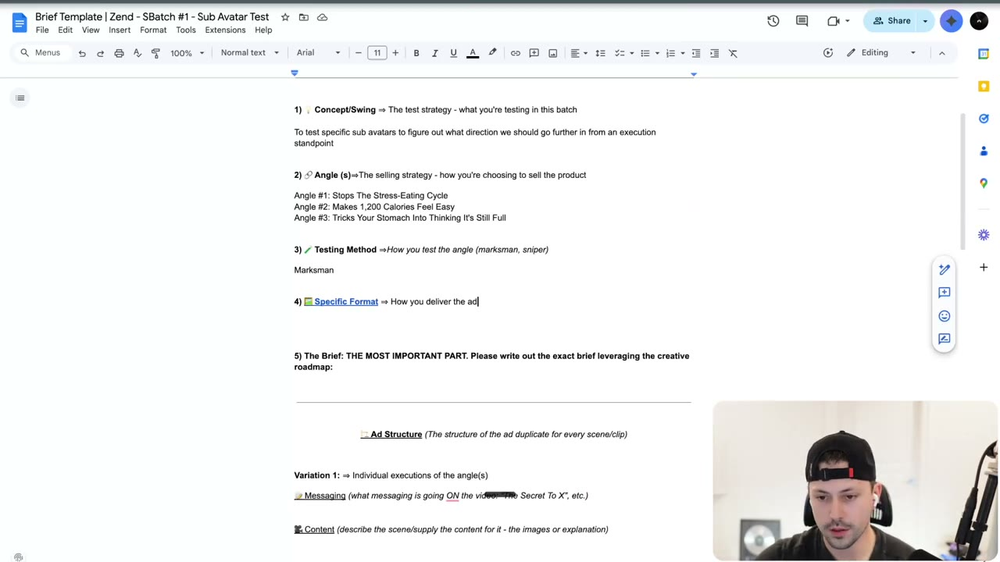
*The concept brief (Google Doc "Brief Template | Zend - SBatch #1 - Sub Avatar Test"): concept/swing, three angles, testing method "Marksman", and the start of the brief. [12:52]*

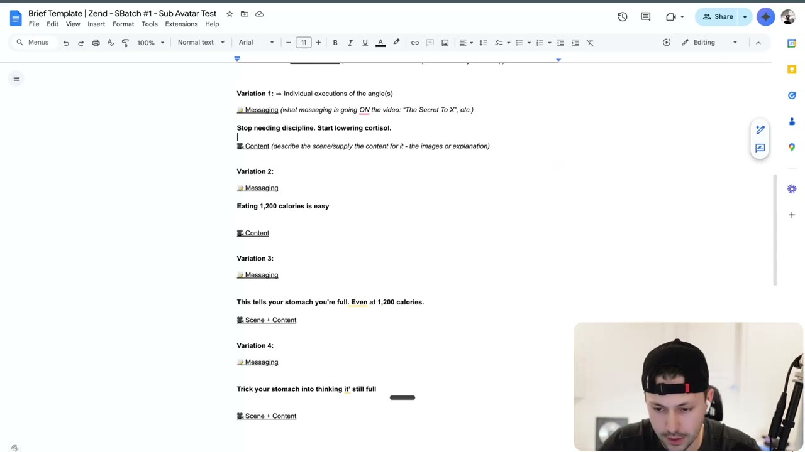
*The four "Messaging" variations typed into the brief, with "Content"/"Scene + Content" left to fill: "Stop needing discipline. Start lowering cortisol.", "Eating 1,200 calories is easy", "This tells your stomach you're full. Even at 1,200 calories.", "Trick your stomach into thinking it' still full". (The on-screen typo "it' still" is as shown.) [14:06]*

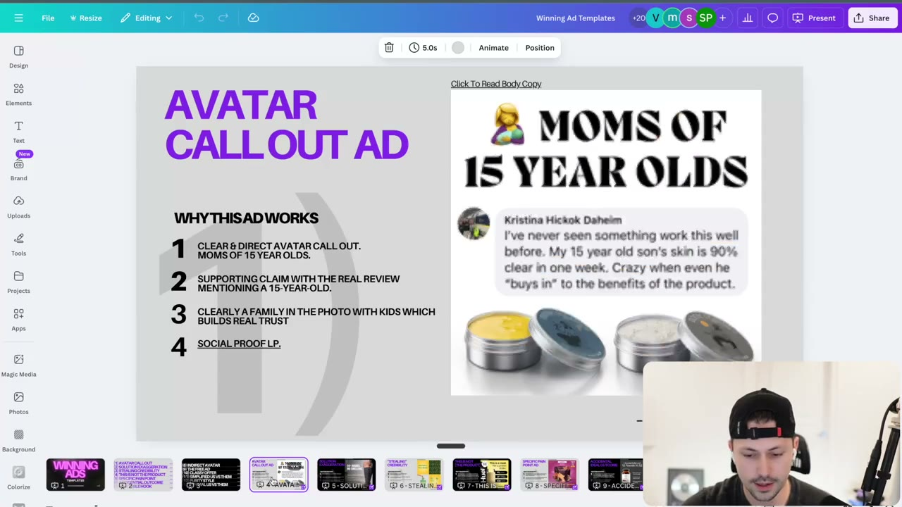
*The "Winning Ad Templates" Canva deck (cover: "Winning Ads Templates"). Each slide is a named template with a numbered "Why this ad works" list; this one is "Avatar Call Out Ad". [13:51]*

### 6. Build the visual in the template [13:59–17:06]
- Make your own copy of the Canva file; with a copy you "have the ability to edit this however you want." The template used has a product image (powder scoop pouring into a cup) off to one side and four callout lines: placeholder text "Reduces pain point / Improves benefit / Enhances desire / Provides desire". [13:59–14:32; frame 19:48]
- Replace the headline text with the first variation; take the image from the client's Google Drive; if you need text extracted from an image, ChatGPT can do it ("I didn't even know ChatGPT could do this"). A background remover is part of Canva Pro (about $16/month, instructor). [14:32–15:29]
- **Brand colors:** use a color-picker extension to "snipe a color from your website" and apply it to the background. "Use the colors from your website... follow your brand guidelines, although most of you probably don't have them." If the lifestyle photo clashes, make the photo background white; a plain white background is "really boring" so he reverts to brand blue. [15:29–17:06; 21:25]
- "It's okay to have ugly ads"; he will have his graphic designer remake them; the point is to show how to make them. [22:02]

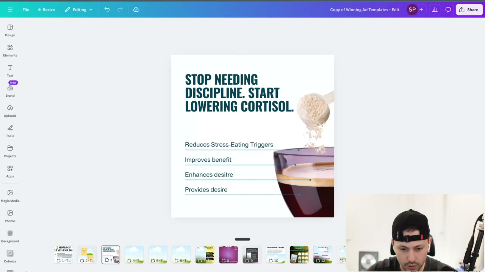
*Working copy of the template: headline replaced ("Stop needing discipline. Start lowering cortisol."), four placeholder bullets still to write ("Reduces pain point / Improves benefit / Enhances desire / Provides desire"), product photo placed at the right edge. [19:48]*

### 7. Write the bullets with Claude and the research [18:02–21:25]
- Screenshot the in-progress ad, give Claude the inspiration ad, and ask: "hey Claude, I need three bullet points for this headline specifically; write them here similar to how this ad has it; I have attached the inspo ad so you can see how it works." [18:02]
- **Research is required.** "I want you guys to do one very important thing here... make sure that you have your research." He pastes the sub-avatar's quotes (doc text, frame 22:23: "I eat so much junk I feel sick and I just feel regretful afterwards", "I just have the urge all day to eat and eat and eat. Like im an empty pit", "I have to eat apples instead of extra servings"; further down the tab: "Food is my comforter...the only thing that calms me down") so the bullets "reduce stress eating triggers" echo real language. [18:56–20:11]
- Claude first returned two bullets because he had asked for two ("I don't have to say I need four... Whoops"). [20:11]
- Claude's first answer followed the inspiration ad's pattern (each bullet verb-led: Reduces / Improves / Enhances / Provides), e.g. "reduced stress eating triggers", "calm mood without drowsiness", "lowers cortisol naturally", "breaks the stress eating cycle". [18:56]
- **Edit for belief.** He trims Claude's four bullets ("Reduces All-Day Food Urges / Improves Stress Response & Sleep Quality / Enhances Emotional Control Without Willpower / Provides Natural Calm Without Turning To Food", on screen) to "Reduces Stress-Eating Triggers / Improves Stress Response / Enhances Emotional Control / Provides Natural Calm", and warns: "be careful what you guys are claiming because if you're claiming like it's a wonder drug, again, you're going to run into belief issues." [20:54]

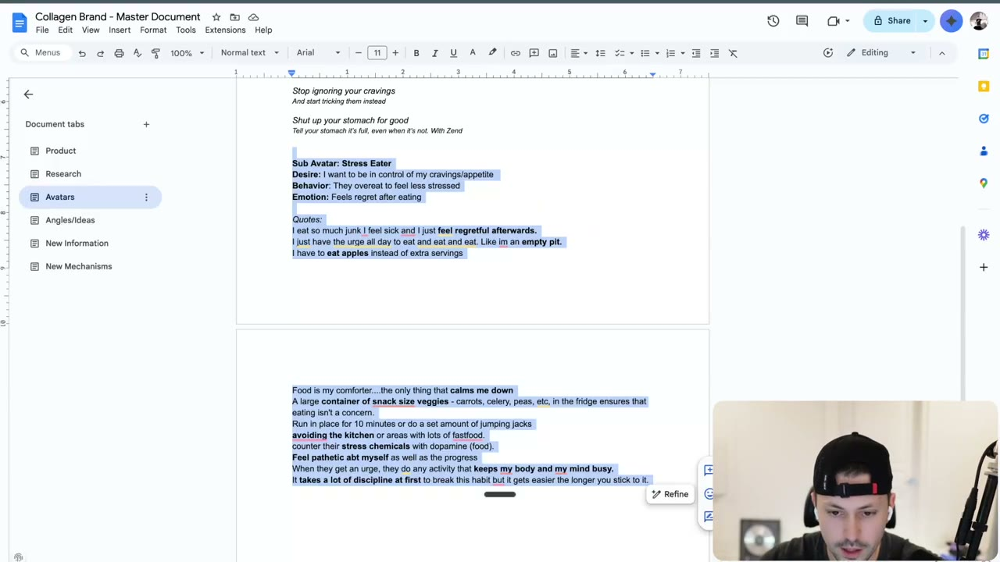
*Master Document, Avatars tab: "Sub Avatar: Stress Eater" with Desire "I want to be in control of my cravings/appetite", Behavior "They overeat to feel less stressed", Emotion "Feels regret after eating" and real quotes that are pasted into Claude for bullets. [22:23]*

### 8. Repeat for the next headline: the "easy 1,200 calories" ad [21:25–26:40]
- Second headline: "Eating 1,200 calories is easy" with a sub-line. He writes "...With Dyglomera®" and copies the registered mark from the product page ("I might try to position myself as an authority here"). [22:02–23:40]
- Claude is again given the new sub-avatar ("addicted to junk food") and quotes. His reaction to Claude's bullets: "Reduces hunger and cravings without torture. Oof, love it. Banger"; "Improves natural fullness signals. Love it"; "Enhances ability to say no to junk. I love that"; "Provides lasting satisfaction all day. Not sure if I'm a fan." [23:40–24:37]
- He lifts research wording that fits ("tells your stomach it's full") and then goes to the product doc, where he finds a stat line (triple action; "natural GLP-1 production by 68%"), which he adds as the first bullet because "now we're leading with a fact." [24:37–26:09] (The product page chart on screen at 23:13 reads "+56% Participants on average increased GLP-1 by 56%" and "-59% ... reduced DPP-4 by 59%". The final ad says 56% while the product-doc line he read says 68%; see the Limitations note.)
- Final bullets for that ad: "Increases natural GLP-1 by 68%", "Improves natural fullness signals", "Reduces cravings without torture", "Enhances ability to say no to junk". [26:09–26:40]

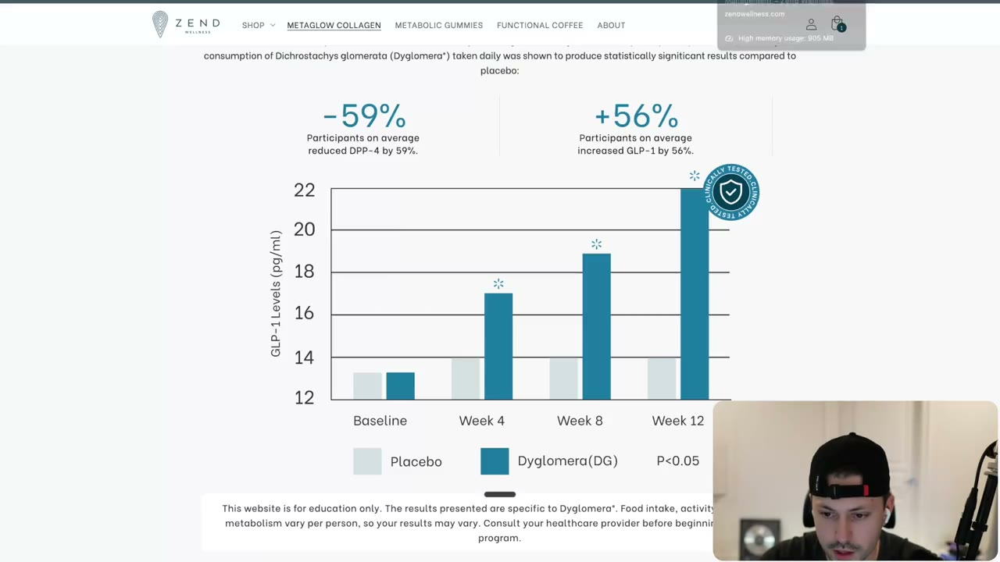
*Zend product page chart he scrolls past while writing: "-59% ... reduced DPP-4 by 59%", "+56% ... increased GLP-1 by 56%" (Dyglomera vs placebo at weeks 4, 8, 12, "P<0.05"). The source of the 56% figure that ends up in the published ads. [23:13]*

### 9. Export, time cost, no excuses [26:40–29:14]
- Download only the page you need ("we don't download old pages, just download page four"). [26:40]
- First ad took about an hour and a half; "is this ad hideous? Yes... But guess what? The information in it is damn good." It is a test ("an S batch") to learn direction. [27:26]
- "I don't think there's anybody here that can't make the ad that I just made... if you don't have a photo of the powder pouring into the cup, then just put the product image there." [28:18]
- Video ads are a separate, more complex module; he does not edit video and will show how to delegate (paying a video editor per concept). "The script writing wasn't even that intense. We just took some inspo, we filled it in." [28:18–29:14]

## Steps / framework (the Part 1 static-ad process)

| # | Step | Detail | Time |
|---|---|---|---|
| 0 | Master Document | Product, Research, Avatars (desire, behavior, emotion, quotes), Angles/Ideas, New Information, New Mechanisms tabs | [00:00] |
| 1 | Angle prompt in Claude | Prompt + product info + sub-avatars -> 3 angles x 3 hooks per sub-avatar, ranked | [00:54–03:30] |
| 2 | Pick angles / concept | Keep emotionally powered or contrast angles; check numbers with ChatGPT; decide marksman (several angles) or sniper (one angle) | [03:30–06:26] |
| 3 | Refine the sniper angle | Tell Claude who the avatar is, what they believe, what to simplify; ask for shorter, punchier hooks modelled on winning examples | [06:26–10:38] |
| 4 | Concept brief | Copy the template; fill concept, angle(s), testing method, format, variations (headlines) | [10:38–13:59] |
| 5 | Pick a visual template | Browse the winning-ad templates; take a simple product + callouts layout | [12:27–14:32] |
| 6 | Build in Canva | Copy file; headline; product image from client drive; brand color via color picker | [14:32–17:06] |
| 7 | Bullets | Screenshot ad + inspo ad + research quotes -> Claude; state the bullet count; edit claims | [18:02–21:25] |
| 8 | Sub-line + stat | Add "...With <ingredient/brand>" line; lead bullets with a product-doc fact | [22:02–26:40] |
| 9 | Export + test | Export the single page as PNG; run as an "S batch" sub-avatar test | [26:40–27:26] |

## Concepts and angles (from the linked angle-prompt document)
These definitions are the "Knowledge" section of the angle prompt (document; written in the instructor's voice).
- **Concept** = the big idea you test; about you / your test strategy (internally focused). Examples: testing a video version, Us vs Them, an iteration, buy-it-for-life, "vets trust us".
- **Angle** = how you choose to sell the product; about the customer's reason to buy (externally focused). "If the concept doesn't give the customer a reason to buy, it's not an angle yet."
- "Us vs Them", "Before & After", "Problem-Aware Angle Ads" and "'Post It Note' Ads" are named as concepts or formats, not angles; "the 'What' is the angle" (compare what? transform what? which problem?).
- Examples labelled "This is an angle": "Stops tossing and turning", "Brings back your energy". "Video version", "Iteration", "Us vs Them" alone are not.
- Concepts and angles coincide only when the concept is "test angle X" (e.g. "Test Buy It For Life Angle" -> angle "Buy It For Life"). Best practice: write the angle (the reason someone should buy) for every concept.
- Angles sit on a spectrum like avatars: "Want better sleep?" is an angle but a weak, broad one; sub-avatars give more specific angles. "KEEP THEM ACTIONABLE."
- **Hook / headline** = how the angle is communicated. Until you are advanced, make it "direct instead of indirect": angle "Stops swelling" -> "14+ Hours. No Swelling"; "Keeps you full like a meal" -> "This is a meal. Not a protein shake"; "Stops you from snapping at people" -> "5 minutes to install. No more snapping".

## Examples

### Ads built in the lesson
| Variation | Headline | Sub-line | Bullets (final, as published) | Source |
|---|---|---|---|---|
| 1 | STOP NEEDING DISCIPLINE. START LOWERING CORTISOL. | With Suntheanine® | Lowers your stress-eating hormone / Equivalent to 10 cups of green tea / Provides natural calming | final ad image; [41:35 in Part 2] |
| 2 | EATING ONLY 1,200 CALORIES IS EASY | ...With Dyglomera® | Increases GLP-1 production by 56% / Improves natural fullness signals / Reduces cravings without torture / Enhances ability to say no to junk | final ad image |
| 3 | TRICK YOUR STOMACH INTO STAYING FULL. | with MetaGlow™ | Increases GLP-1 production by 68% / Reduces constant hunger signals / Enhances fullness between meals / Ends the eat-regret-repeat cycle | final ad image |
| 4 | "I JUST IGNORE MY CRAVINGS NOW" | — | Increase GLP-1 production by 56% / Reduce constant hunger signals / Enhance fullness between meals / End the eat-regret-repeat cycle | final ad image; added after a break [43:12 in Part 2] |

Variation 3 and 4 were not built on screen in Part 1; they exist in the final images and are discussed in [Part 2](68-how-to-write-image-ads-part-2.md).

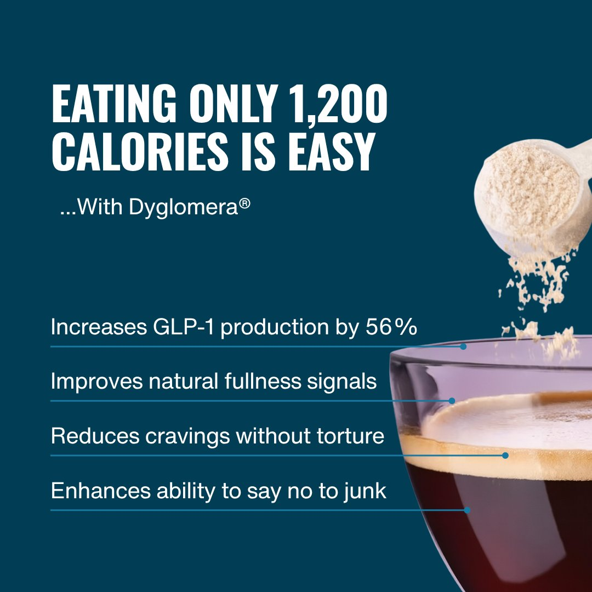
*Final ad 1 (Skool "Final Ads (After some revisions)"): "Eating only 1,200 calories is easy ...With Dyglomera®" with four bullets and the scoop-into-cup product image on brand blue.*

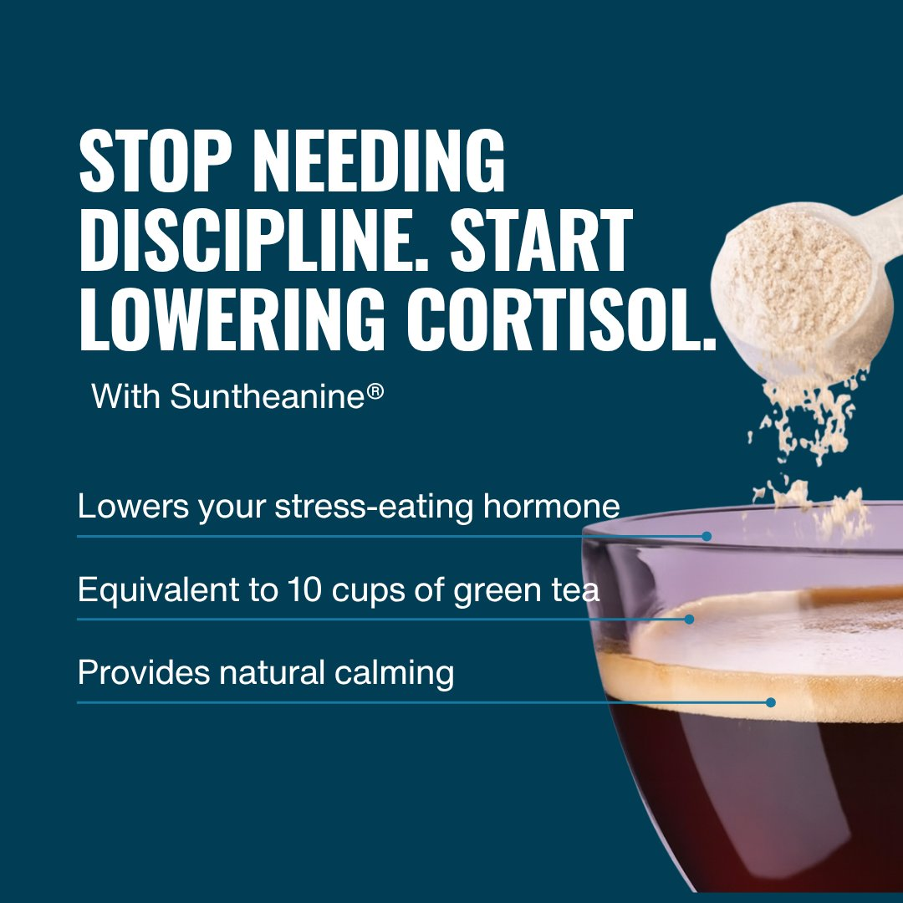
*Final ad 2: "Stop needing discipline. Start lowering cortisol." With Suntheanine®, three bullets including the green-tea equivalence claim.*


*Final ad 3: "Trick your stomach into staying full." with MetaGlow™; note the 68% figure, which differs from the 56% in ads 1 and 4.*

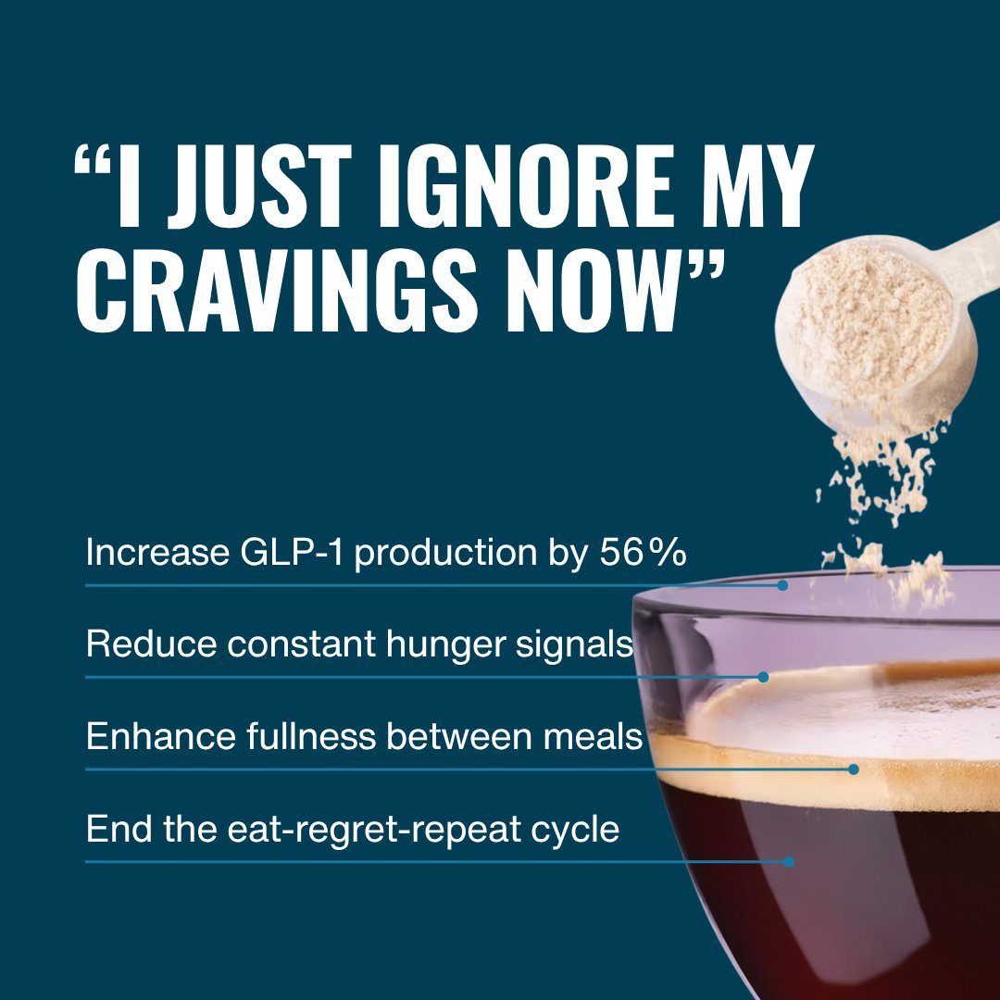
*Final ad 4: the customer quote "I just ignore my cravings now" as the headline, same layout and bullets in imperative form.*

### Claude's hook output (on-screen, Stress Eater, frame 03:28)
Angle 2 "Fills The Empty Pit Without Food" - Reason to Buy: "Tells your brain you're actually full by boosting the same hormone as Ozempic, naturally. Stop feeling like an empty pit all day." Hooks: "Tell your stomach it's full. Even when it's not." (Inspired by: Direct command format + specific outcome); "Boosts GLP-1 by 68%. Stops the empty pit feeling." (Inspired by "14+ Hours. No Swelling" - Specific metric + outcome); "This isn't collagen. This is appetite control." (Inspired by "This is a meal. Not a protein shake" - Product redefinition).
Angle 3 "Eliminates The Regret Cycle" - Reason to Buy: "When you're not constantly fighting stress-eating urges, you stop the binge-regret-shame spiral that makes you feel pathetic." Hooks: "One ingredient. Zero regret after eating." (Simple math + emotional outcome); "Calms your cortisol in 30 minutes. Ends the regret in 7 days." (Inspired by "Drains double chin in 7 days" - Dual timeline showing progression); "Stop fighting the urge. Start lowering the hormone." (Discipline removal + root cause focus).
Angle 1 hooks (partial; first line scrolled off): "This lowers cortisol. This stops the cycle." (Inspired by "This is bread. This is breakfast"); "Stop needing discipline. Start lowering cortisol." (Inspired by "Don't change your life, just change lunch" - Removes the burden of willpower).

## Structured units

### Hooks
| Hook | Heuristic(s) | Emotion / zone | Self targeted | Why it works | Source |
|---|---|---|---|---|---|
| "14+ Hours. No Swelling." | — | — | — | Bold statement stops the scroll; emphasizes effectiveness of the solution (14+ hours) for the problem (swelling) | Angle doc, ref ad 1 |
| "This is a meal. Not a protein shake." | — | — | — | Wordplay: call the product something it is NOT at first glance; curiosity gap that is then closed; "has to make sense. Do not overstretch it" | Angle doc, ref ad 2 |
| "Don't change your life, just change lunch" | — | — | — | Leans into the dieting problem (change everything you eat); user sacrifices "less" to get the outcome; tied to the Hormozi value equation (slide) | Angle doc, ref ad 3 |
| "Sleep like a baby" | — | — | — | Common saying that stands out to people who struggle with sleep; photo is not obviously connected so the reader reads more | Angle doc, ref ad 4 |
| "Drains double chin in 7 days" | — | — | — | Visual keyword "DRAINS"; avatar-specific problem; timeline hits "speed" from the value equation; sharpie-on-face stops the scroll | Angle doc, ref ad 5 |
| "This is bread. This is breakfast" | — | — | — | Common thing everyone understands; simplified headline and congruent visual; "1964" adds credibility | Angle doc, ref ad 7 |
| "Grab life by the bowls" | — | — | — | Common saying people know; emphasizes the core USP | Angle doc, ref ad 8 |
| "I accidentally lost 12 pounds at 52" | — | — | — | "Accidentally" creates curiosity; visual language; "unique numbers" (12, 52, 56.4%) feel more believable than round ones | Angle doc, ref ad 9 |
| "I flushed 19 pounds of hormonal weight" | — | — | — | Very visual keyword "FLUSHED"; specific kind of weight; mechanism named "Hormone Harmony" | Angle doc, ref ad 10 |
| "Teen always grumpy?" | — | — | — | Painful pain point for parents; educational "new hope" angle; clear visual of vitamins in the product | Angle doc, ref ad 11 |
| "3 signs your hair is actually wavy" | — | — | — | Educational curiosity hook for an unaware audience; "you -> me -> brand" flow | Angle doc, ref ad 12 |
| "Ever wonder why tick preventatives don't work anymore?" | — | — | — | Calls out a failed mechanism; vets revelation builds credibility; suspense and curiosity | Angle doc, ref ad 13 |
| "3 red flags of vitamin deficiency in kids" | — | fear (slide: "Fear is a great motivator") | — | "This could be bad..." call-out; relatable vulnerability | Angle doc, ref ad 14 |
| "Watch for these ingredients when buying shampoo" | — | — | — | "Weird" hook (what are they doing?) that works when the goal is only to get the text read; trust before recommendation | Angle doc, ref ad 15 |
| "Why millennials are ditching their old wallets" | — | fear (slide: "not malicious... I am not recommending fear-mongering at all") | — | Specific but still broad audience; educational hook and visual | Angle doc, ref ad 16 |
| "Moms of 15 year olds" | — | — | parent of a teenager | Clear and direct avatar call-out supported by a real review mentioning a 15-year-old | Angle doc, Avatar Call Out slide |
| "Eating 1,200 calories is easy" (-> "Eating only 1,200 calories is easy") | — | — | the dieter | Contrast: a known-hard thing called easy; curiosity | [05:01] |
| "Trick your stomach into thinking it's full." | — | — | the person who has heard of GLP-1 but not how it works | Simplifies the mechanism; implies the mechanism in the headline and explains it in the bullets | [10:38]; frame 18:07 |

### Angles
| Angle | Core desire / pain | Heuristic(s) | Best format | Example line | Source |
|---|---|---|---|---|---|
| Stops The Stress-Eating Cycle | Control cravings / stop stress eating | — | Static headline + callout bullets | "Stop needing discipline. Start lowering cortisol." | [01:37] |
| Makes 1,200 Calories Feel Easy | Dieters who find a low-calorie target hard | — | Static | "Eating 1,200 calories is easy" | [03:30; 05:01] |
| Tricks Your Stomach Into Thinking It's Still Full | Person who has heard of GLP-1 but not how it works | — | Static (sniper) | "Trick your stomach into thinking it's full." | [07:18; 10:38] |
| Eliminates The Regret Cycle | Stop binge-regret-shame spiral | — | — | "One ingredient. Zero regret after eating." | [01:37; frame 03:28] |
| Fills The Empty Pit Without Food | Feeling empty / hungry all day | — | — | "Tell your stomach it's full. Even when it's not." | [02:34; frame 03:28] |
| Shuts Up Your Stomach For Good | Control appetite | — | Sniper candidate | "Shut up your stomach in 7 days" (Claude draft, spoken) | [05:38] |
| Lets You Say No Without Willpower | Not relying on discipline | — | — | "This isn't willpower. This is hormones." | [06:26; frame 06:17] |
| (Worked example from the angle prompt doc, "Total Blackout Blinds"): Stops You From Snapping At People | Short-fuse avatar | — | — | "5 minutes to install. No more snapping." | Angle doc, "Example Of Perfect Output" |

### Ad teardowns
Rows 1-16 are the winning ads embedded in the angle-prompt document ("Additional Context on why this ad works" is empty in the exported text; the explanation text is on the slide images, read from the images). Format, awareness stage and market labels are the slide labels. Images are in the "Reference ads" gallery below.

| Brand / product (niche) | Format | Hook / opening | What works | What fails | Fix suggested | Principle | Source |
|---|---|---|---|---|---|---|---|
| Alpaca compression socks (health) | Static ad; Problem aware; Health | "14+ HOURS. NO SWELLING." | Bold statement stops the scroll; stresses effectiveness of the solution for the problem; body copy completes the ad and gives clarity on product + "hot mechanism" (compression socks) | — | — | Solution Exaggeration | Ref slide 1 |
| Huel Black Edition (protein shake, health) | Static; Product aware; Health | "This is a meal. Not a protein shake." | Clever wordplay: product called something it is NOT at first glance, creating a curiosity gap, then brought back around; reads as another shake but shows it is MORE; supporting claims 40g protein / 27 vitamins + minerals / 400 calories; "17 meals for $2.65 per meal" badge | Slide warns: if the dots don't connect "the ad will flop" | "Do not overstretch it" | This is NOT [the product] | Ref slide 2 |
| Huel (ready meals, health) | Static; Problem aware; Health | "Don't change your life, just change lunch" | Leans into the problem that "dieting" means changing everything you eat; Huel shows you only change lunch, so the user sacrifices "less"; named after Hormozi's value equation | — | Pro tip on slide: think about what your customer HAS to sacrifice to get the desire and see if you can help them keep it | Don't Sacrifice X For Y | Ref slide 3 |
| Ryze (mushroom cocoa, health) | Static; Unaware; Health | "Sleep Like A Baby" | Common saying stands out to people who STRUGGLE with sleep; then sells the functional outcome | No clear connection between the photo (a "tasty" cup of hot chocolate) and the headline, which "forces the user to read more" | — | Ideal Outcome Analogy | Ref slide 4 |
| Happy Mammoth Hormone Harmony (per bottle label; double chin / puffy face) | Static (UGC photo); Problem aware; Health | "Drains Double Chin In 7 Days" written on a model's face | Something "written on their face" (marker + face) stops the scroll; very visual keyword "DRAINS"; avatar-specific problem; timeline (7 days = speed); model is proof of the outcome and holds the mechanism | — | — | Visual Key Word + Problem + Timeline | Ref slide 5 |
| Norse Organics (teen acne) | Static; Solution aware; Relationships | "MOMS OF 15 YEAR OLDS" | Clear and direct avatar call-out; supporting claim is a real review mentioning a 15-year-old ("even he buys in to the benefits"); a family in the photo; social-proof landing page | — | — | Avatar Call Out | Ref slide 6 (labelled "double chin" in the doc; see Limitations) |
| Nutella (spread) | "World class statics"; Product aware; Wealth | "This is bread. This is breakfast." | Uses something everyone understands (bread); simplified headline; congruent simple visual; "since 1964" adds credibility | — | — | Simplified Us vs Them | Ref slide 7 |
| Huel (bowls, health) | World class statics; Brand aware; Health | "Grab life by the bowls" | Leverages a common saying ("grab life by the balls"); emphasizes the core USP of helping health goals | Third "what we like" bullet is empty on the slide | — | The Common Saying #2 | Ref slide 8 |
| Happy Mammoth Ultimate Weight Control (weight) | Static; Problem aware; Health | "I Accidentally Lost 12 Pounds At 52" | "Accidentally" creates curiosity; very visual language ("blocks fat cells from forming", "dissolves old fat"); "unique numbers" (12, 52, 56.4%) are more believable than round numbers | — | — | Accidentally Got Ideal Outcome | Ref slide 9 |
| Happy Mammoth Hormone Harmony (weight) | Static; Problem aware; Health | "I Flushed 19 Pounds of hormonal weight" | Visual keyword "FLUSHED"; backed by a call-out of the specific kind of weight; clear shot of the mechanism with a name ("hormone harmony") that emphasizes the ideal outcome | — | — | Visual Key Word + Problem | Ref slide 10 |
| First Day teen multivitamin (kids' health) | Static + advertorial; Problem aware; Health | "TEEN ALWAYS GRUMPY?" | Extremely painful pain point for parents; educational "new hope" based on chemical imbalance and bad nutrition; clear visual of the vitamins packed into the product; "insanely dialed" advertorial | — | — | Indirect Avatar Call Out | Ref slide 11 |
| Prose (custom hair care) | UGC video; Unaware; Health | "3 signs your hair is actually wavy" | "A masterclass" showing expertise; user keeps nodding "yes this is me"; flow is "You" -> "Me" (relatable creator story) -> "Brand" | — | — | Educational - Curiosity Hook | Ref slide 12 |
| Tick-preventative product (pet; brand not named on slide) | AI voiceover; Solution aware; Health | "Ever wonder why tick preventatives don't work anymore?" | Intense hook that shows pain and "makes you cringe"; calls out failed mechanism; vets revelation builds credibility; "pet care industry doesn't want you to know" builds suspense; storytelling begins | — | — | Sophisticated New Mechanism | Ref slide 13 (ad copy shown beside it is for Pair Eyewear; see Limitations) |
| First Day kids' multivitamin | Voiceover video; Unaware; Relationships | "3 red flags of vitamin deficiency in kids" | Another "this could be bad..." call-out; fear is a motivator; "eating chicken nuggets" is a common thing parents never question; relatability and vulnerability ("I always thought these were normal?"); dialed landing page | — | — | Educational - Fear Angle | Ref slide 14 |
| Prose (shampoo) | Text overlay; Unaware; Health | "Watch for these ingredients when buying shampoo..." | Informative/educational angle with a "weird" hook (works when the goal is only to get the text read); then "here's what to use instead" after gaining trust; makes the brand feel trustworthy before recommending | — | — | Educational - Watch Out Angle | Ref slide 15 |
| Wallet brand (RFID/AirTag; brand not named on slide) | AI voiceover; Unaware; Wealth | "Why millennials are ditching their old wallets" | "Scaring people" but not maliciously; a real thing that happens; calls out a specific but broad audience (millennials); educational hook and visual | Slide: "I am not recommending fear-mongering at all" | — | Educational - Fear Angle | Ref slide 16 |
| Zend MetaGlow collagen (supplement) - built here | Static, product + callout bullets | "Eating only 1,200 calories is easy" | Contrast hook; fact-led bullets; research-language bullets | Ugly layout; mismatch in the stat (56% vs 68%); lots of text on screen per later review | Fix in later round: shorten, show the product more congruently (see Part 2) | Concept vs angle | [27:26]; Part 2 |

### Rewrites
| Before | After | What changed (verb / visual / promise / self / intensity) | Source |
|---|---|---|---|
| Placeholder bullets "Reduces pain point / Improves benefit / Enhances desire / Provides desire" | "Reduces Stress-Eating Triggers / Improves Stress Response / Enhances Emotional Control / Provides Natural Calm" | Pattern kept (verb + benefit); content swapped for sub-avatar language | [18:02–21:25] |
| Claude's four bullets: "Reduces All-Day Food Urges / Improves Stress Response & Sleep Quality / Enhances Emotional Control Without Willpower / Provides Natural Calm Without Turning To Food" | "Reduces Stress-Eating Triggers / Improves Stress Response / Enhances Emotional Control / Provides Natural Calm" | Shortened; removed "& Sleep Quality", "Without Willpower", "Without Turning To Food"; claim softening; first returned only two bullets until he asked for four | [18:56–20:54]; frame 22:39 |
| "Eating 1,200 calories is easy" | "Eating 1,200 calories is easy ...With Dyglomera®" | Added brand/ingredient sub-line with registered mark for authority | [22:02–23:40] |
| Bullets: "Reduces hunger and cravings without torture / Improves natural fullness / Enhances ability to say no to junk / Provides lasting satisfaction all day" | "Increases natural GLP-1 by 68% / Improves natural fullness signals / Reduces cravings without torture / Enhances ability to say no to junk" | Led with a product-doc fact; dropped the vague closer | [23:40–26:40] |
| "One scoop, food stays in your stomach three times longer" (headline candidate) | "Trick your stomach into thinking it's full" | Shorter, simpler, mechanism implied; "three times longer" still to be validated | [09:51–10:38] |
| "Eating 1,200 calories is easy" | "Eating only 1,200 calories is easy" | One word added after a break: the original could be read as "that's easy" bait | [Part 2 41:35] |
| "Trick your stomach into thinking it's (still) full" | "Trick your stomach into staying full." | Simpler verb; shown in the final image | final ad 3; [Part 2 42:29] |
| "Stop needing discipline. Start lowering cortisol." bullets "Reduces Stress-Eating Triggers / Improves Stress Response / Enhances Emotional Control / Provides Natural Calm" | "Lowers your stress-eating hormone / Equivalent to 10 cups of green tea / Provides natural calming" | Replaced generic bullets with a mechanism line found on the client's landing page | [Part 2 41:35–42:29] |

### Templates
| Template | Use for | Example fill | Source |
|---|---|---|---|
| "[Timeline]. No [problem]." | Bold, direct hook for a solution that works for a stated time | "14+ Hours. No Swelling." / "5 minutes to install. No more snapping." | Angle doc |
| "This is [X]. Not [Y]." / "This is [X]. This is [Y]." | Product redefinition | "This is a meal. Not a protein shake." / "This is bread. This is breakfast." | Angle doc |
| "Don't change your [life], just change [X]." | Minimal-sacrifice promise | "Don't change your life, just change lunch." | Angle doc |
| "[Visual verb] [problem] in [N] days" | Visual keyword + problem + timeline | "Drains double chin in 7 days." | Angle doc |
| "[N] signs your [thing] is actually [state]" | Educational curiosity hook for unaware audience | "3 signs your hair is actually wavy" | Angle doc |
| "[Hard thing] is easy." | Contrast hook | "Eating 1,200 calories is easy" | [05:01] |
| "[Number] [problem] are linked to [outcome]: [3 check-mark items]" | iPhone Notes layout, used in Part 2 | see [68](68-how-to-write-image-ads-part-2.md) | Part 2 |

## Prompts / templates (verbatim)

### 1. Angle prompt (Google Doc "Angle Prompts Used (From Avatar Training)")
Verbatim text of the linked document. The images in the document (reference ads) are listed in the gallery after this block; each "[image: ...]" marker shows where an image sat. "Additional Context on why this ad works:" is empty in the text export; the explanations are in the image slides.

```text
Situation

You are a direct response marketing strategist specializing in customer avatar analysis and angle development. You work with businesses to identify the most compelling marketing angles based on deep customer psychology, using sub-avatar frameworks to uncover specific pain points, desires, and emotional triggers that drive purchasing decisions.

Task

The assistant should analyze the provided product information and sub-avatar profiles to generate targeted marketing angles. For each sub-avatar, identify 3 potential marketing angles by examining their most painful or specific attributes, framing these as problems from their perspective, and converting them into compelling "reason to buy" statements that are relatable. Then provide 3 strategic written hooks/headlines that could be used for each angle for proper implementation. You MUST but the strongest angles and the strongest hooks/headlines up at the top first and make sure to remind the user that they do NOT have to test each angle separately. They can do a concept that tests “multiple angles” with the best hook/headline.

Objective

Enable the user to develop data-driven, psychologically-targeted marketing angles that resonate with specific customer segments, allowing them to either test multiple approaches simultaneously or focus resources on the highest-probability angle with multiple execution variations.

Knowledge

Definition of Angle:

- Concept = The big idea (what you're testing)

  - Could be: Testing formats, testing iterations, testing awareness levels, or angles

- Angle = How you choose to sell the product (must always be defined)

  - If your concept is anything but "testing angle(s)" you need to identify the angle

The average marketer's definition of angle oftentimes has NOTHING to do with the customer.

And that’s why most people DON’T MAKE good ads.

They aren’t thinking about the Angle (how we’re going to position the product to the customer). They are just thinking about the idea they want to test.

These are BAD examples of what “Angle” is:

Us vs Them → This is a Concept, with an “assumed” broader angle (comparison)... But Comparing what?? The “What” is the angle

Before & After → Again, this is a Concept. We are “assuming” some kind of broader angle (transformation)... But transformation of what? Again, the “What” is the angle

Problem-Aware Angle Ads → Another CONCEPT. We are going to test problem-aware ads. But of WHAT problem?? The “what” is the angle.

‘Post It Note’ Ads → Some of these are also such basic concepts that become Formats because people don’t understand “Concept” or “Angle”. Post-It Notes is a Native-style image format, but at the end of the day, people put 0 consideration into the ANGLE.

Now, differentiating Concepts from Angles should hopefully make more sense. Again:

Concepts = Our big idea we want to test (more focused on us)
Angles = How we choose to sell the product. (more focused on the customer)

Now, this is where most people get confused:

When your concept IS to test angle(s).

And in this instance, people will begin to use the terms interchangeably.

Example:

- Concept: "Test Buy It For Life Angle" → Angle: "Buy It For Life"

- Concept: “Test Sleep Deprived Angle” → Angle: “Sleep Deprived”

So, if you've ever wondered why people will use concept and angle interchangeably, this is why.

But as a result of this training, hopefully you will start to be able to see that Concepts can be Angles…

But not 100% OF THE TIME.

Let’s look at some examples of concepts to try to identify

Concept = About you/your test strategy (internally focused)

- "I want to test a video version."

- "I want to test Us vs Them"

- "I want to do an iteration on"

- “I want to test buy it for life”

- “I want to test vets' trust us”

Angle = About the customer's reason to buy (externally focused)

If the concept doesn't give the customer a reason to buy, it's not an angle yet.

- Video version → Does not give a customer a reason to buy = Identify the angle(s)

- Iteration → Iteration of what angle? No clear reason = Identify angle(s)

- Stops tossing and turning → This gives a person a reason (it solves their problem) = This is an angle

- Us vs Them → What about Us vs Them? No clear reason = Identify the angle(s)

- Brings back your energy → this gives a person a reason to buy = This is an angle

If your concept is NOT testing an Angle, you NEED to make sure you specify what Angle is you're testing.

But if you just want to avoid making mistakes, the best practice is always to make sure you write down “What the Angle is,” aka THE REASON SOMEONE SHOULD BUY for EVERY concept.

Now with that clear. Let's go deeper on angles themselves.

Now, if you're anything like me, you likely went through this training and you're like, Spencer, I get that Angles are how we choose to sell the product to people.

But at the end of the day…

What TF does that even mean?

It’s way too broad 😭

Because, even after I defined it, and after I went through and did tons of examples, I just kept saying myself, okay…But, what is an angle?

How do I know what the angle is?

What is the difference between an angle and not an angle?

Why are some angles so broad, and why are some so specific?

Well, the truth is, similar to avatars, angles also exist on a spectrum.

But fortunately for you, because you're doing the work of identifying sub-avatars, you're essentially already discovering angles that are specific enough to relate with customers and help you sell your product.

So just like how you could have a Core Avatar like:

Desire: Wants better sleep

You can also pull an angle from that that is very broad.

Literally, you could just write:

“Want better sleep?

Or

“Feel like you’re not getting enough sleep?”

And the truth is, yes, those actually are angles. That's how you're choosing to sell your product.

But they're pretty shitty angles because of how broad they are.

That’s why broad avatars are usually harder to sell to… You have to use broader angles.

Headlines/Hooks

Now, before getting into those examples of extracting avatars, I also want to explain one other final thing of importance, which is what I did above with:

"Feel like you're not getting enough sleep?"

That is something that we would call a Hook or a Headline (or some boomers call them “leads)

The Hook/Headline is how we get attention to sell the product (basically, how you communicate the angle)

Now, until you get to a more advanced level, your hook/headline should always be more direct instead of indirect.

Examples of “Direct” Hooks:

Angle: Stops swelling
Hook: "14+ Hours. No Swelling"
→ Hook directly communicates the angle

Angle: Keeps you full like a meal
Hook: "This is a meal. Not a protein shake"
→ Hook directly communicates the angle

Angle: Stops you from snapping at people
Hook: "5 minutes to install. No more snapping"
→ Hook directly communicates the angle

As a Jr. writer, these are much easier hooks/headlines to write.

We cover more advanced strategies later on in EVOLVE.

Now, with that additional context provided

The KEY to extracting angles from sub avatars is simple:

KEEP THEM ACTIONABLE.

Angles are basically limitless (regarding your product and what it can do)

As long as you're angles are ACTIONABLE, writing will become much easier. And the goal of ALL of this work is to make writing winning ads EASIER.

Additional Context

Below, you have been given winning ads that you will reference when providing your answer for the three specific angles, as well as the three specific hooks and headlines.

Example:
Angle: Stops Swelling
Hook/Headline: 14+ Hours. No Swelling
Additional Context on why this ad works:
[image: ref 1, socks - see Reference ads gallery]

Example:
Angle: How the protein shake keeps you full
Hook/Headline: This is a meal. Not a protein shake
Additional Context on why this ad works:

[image: ref 2, Huel meal - see Reference ads gallery]

Example:
Angle: Don’t sacrifice things you like to be healthy
Hook/Headline: Don’t change your life, just change lunch
Additional Context on why this ad works:

[image: ref 3, Huel lunch - see Reference ads gallery]

Example:
Angle: Sleeping better
Hook/Headline: Sleep like a baby

Additional Context on why this ad works:

[image: ref 4, Ryze - see Reference ads gallery]

Example:
Angle: Getting rid of double chin
Hook/Headline: Drains double chin in 7 days

Additional Context on why this ad works:

[image: ref 5, double chin - see Reference ads gallery]

Example:
Angle: Getting rid of double chin
Hook/Headline: Drains double chin in 7 days

Additional Context on why this ad works:

[image: ref 6, moms of 15 year olds - see Reference ads gallery]

Example:
Angle: Nutella turns bread into breakfast
Hook/Headline: This is bread. This is breakfast

Additional Context on why this ad works:

[image: ref 7, Nutella - see Reference ads gallery]

Example:
Angle: take control of your life with better food
Hook/Headline: Grab life by the bowls

Additional Context on why this ad works:

[image: ref 8, Huel bowls - see Reference ads gallery]

Example:
Angle: losing weight without even trying
Hook/Headline: I accidentally lost 12 pounds at 52

Additional Context on why this ad works:

[image: ref 9, accidentally lost 12 pounds - see Reference ads gallery]

Example:
Angle: losing hormonal weight
Hook/Headline: I flushed 19 pounds of hormonal weight

Additional Context on why this ad works:

[image: ref 10, flushed 19 pounds - see Reference ads gallery]

Example:
Angle: dealing with a grumpy teenager
Hook/Headline: Teen always grumpy?

Additional Context on why this ad works:

[image: ref 11, teen grumpy - see Reference ads gallery]

Example:
Angle: Show people who don’t think they have wavy hair, how to get wavy hair
Hook/Headline: 3 signs your hair is actually wavy

Additional Context on why this ad works:

[image: ref 12, wavy hair - see Reference ads gallery]

Example:
Angle: Showing how tick preventatives don’t work
Hook/Headline: Ever wonder why tick preventatives don’t work anymore?

Additional Context on why this ad works:

[image: ref 13, tick preventatives - see Reference ads gallery]

Example:
Angle: Vitamin deficiency in kids
Hook/Headline: 3 red flags of vitamin deficiency in kids

Additional Context on why this ad works:

[image: ref 14, vitamin deficiency - see Reference ads gallery]

Example:
Angle: Get a Shampoo with better ingredients
Hook/Headline: Watch for these ingredients when buying shampoo

Additional Context on why this ad works:

[image: ref 15, shampoo - see Reference ads gallery]

Example:
Angle: A wallet that is RFID proof
Hook/Headline: Why millennials are ditching their old wallets

Additional Context on why this ad works:

[image: ref 16, wallet - see Reference ads gallery]

Example Of Perfect Output

Marketing Angles & Hooks

## Total Blackout Blinds - Restorative Sleep Avatar

## PRIORITY NOTE:

You do NOT have to test each angle separately. Test the #1 hook from Sub-Avatar #3 first—it carries the most emotional weight. You can layer in supporting benefits from other angles in your body copy.

## SUB-AVATAR #3: Short Fuse Avatar ⭐ STRONGEST

Angle 1: Stops You From Snapping At People

Reason to Buy: Complete darkness lets your nervous system actually recover, so you stop being irritable and short-tempered with the people you care about.

Hook: "5 minutes to install. No more snapping."

Inspired by: "14+ Hours. No Swelling" - Timeline + Specific outcome elimination

Angle 2: Restores Your Patience

Reason to Buy: Your brain needs pitch-black sleep to reset your nervous system. Get that, get your patience back.

Hook: "This blocks light. This saves relationships."

Inspired by: "This is bread. This is breakfast" - Simple "This does X. This does Y" pattern

Angle 3: Eliminates The "On Edge" Feeling

Reason to Buy: Stop feeling wired and irritable all day by giving your body the complete darkness it needs to actually repair while you sleep.

Hook: "Seals 100% of light. Restores 100% of patience."

Inspired by: "14+ Hours. No Swelling" - Specific percentage + outcome promise

## SUB-AVATAR #1: Cool Sleeper ⭐ SECOND STRONGEST

Angle 1: Completes Your Cool Sleep Setup

Reason to Buy: You already have the fan and AC. This is the missing piece that blocks heat AND light so your room stays cool and dark all night.

Hook: "You have the fan. You have the AC. You need this."

Inspired by: "Don't change your life, just change lunch" - Minimal change, maximum impact framing

Angle 2: Keeps Room Cooler Than AC Alone

Reason to Buy: These block heat transfer from the sun, so your room stays cooler without cranking the AC. Better sleep, lower energy bills.

Hook: "This is a curtain. This is a cooling system."

Inspired by: "This is a meal. Not a protein shake" - Product redefinition pattern

Angle 3: The Final Sleep Optimization Step

Reason to Buy: You've optimized temperature. Now optimize light. This is what serious sleep optimizers add after mastering cooling.

Hook: "Cool room in 5 minutes. Deep sleep in 8 hours."

Inspired by: "Drains double chin in 7 days" - Dual timeline showing speed + result

## SUB-AVATAR #2: Night Faster ⭐ THIRD PRIORITY

Angle 1: Matches Your Sleep Discipline

Reason to Buy: You're disciplined enough to fast before bed. Now use equipment that's equally serious about blocking 100% of light.

Hook: "Serious about fasting? Serious about darkness."

Inspired by: "Moms of 15 year olds" - Direct avatar call-out with identity match

Angle 2: Protects Your Melatonin Production

Reason to Buy: Your fasting discipline is wasted if light is destroying your melatonin production every morning. Protect both.

Hook: "0% light. 100% melatonin production."

Inspired by: "14+ Hours. No Swelling" - Percentage-based outcome promise

Angle 3: Professional Tools For Serious Sleepers

Reason to Buy: People who fast before bed aren't casual about sleep. Stop using casual blackout curtains.

Hook: "This is a blackout curtain. This is a sleep protocol."

Inspired by: "This is bread. This is breakfast" - Elevation from commodity to system

## TESTING PRIORITY:

Start with Sub-Avatar #3, Angle 1. Test that hook first. If it hits, run variations. If not, move to Sub-Avatar #1, Angle 1.
```

### 2. Ad concept and brief template (Google Doc "Here is the brief template for you")
Verbatim text (the example under Variation 1 is part of the template).

```text
[logo image]

—— AD CONCEPT & BRIEF ——

1) 💡Concept/Swing ⇒ The test strategy - what you're testing in this batch

Concept here

2) 🔗Angle (s)⇒The selling strategy - how you're choosing to sell the product

Angle(s) here

3) 🧪Testing Method ⇒How you test the angle (marksman, sniper)

Marksman

Sniper

4) 🖼️Specific Format (link: https://docs.google.com/document/d/1pvdJxpQU7hVv-uy3vU_7hSDmIS9iGnXiHU_qVLK6Si8/edit?usp=sharing) ⇒ How you deliver the ad

Format here

5) The Brief: THE MOST IMPORTANT PART. Please write out the exact brief leveraging the creative roadmap:

🏗️Ad Structure (The structure of the ad duplicate for every scene/clip)

Variation 1: ⇒ Individual executions of the angle(s)

📝Messaging (what messaging is going ON the video: “The Secret To X”, etc.)

After 40, your body makes 3x more of this enzyme.

It's called DPP-4. And it destroys your appetite hormone every two minutes. So your brain never gets the signal to stop eating. That's why every diet feels impossible.

🎥Content (describe the scene/supply the content for it - the images or explanation)

45-year-old woman looking frustrated at bathroom scale, shaking her head.

Variation 2:

📝Messaging

🎥Content

Variation 3:

📝Messaging

🎥Scene + Content

Hold - Everything that comes after the initial hook/bridge (Videos only )

📝Messaging

🎥Content

6) Sizes Needed:

ALWAYS → 1080x1920 (9:16)

Image safe zones:

1080x1080(1:1)

Video Safe Zone:

1080x1350 (4:5)

🧑🏻‍💻Editor Notes (Final notes or comments for the editor)

7) (Optional) - Example Ads + Explanation: Upload an ad link, foreplay link, or screenshot for inspiration & explain what you like from the examples provided:

Ad Example 1:

Ad Example 2:

8) Link to Folder With Additional Files (If needed):

Please create a new Google Drive folder with ALL the assets you want to be used in the ad if the assets are not in one place. 🚨 This is very important and will save time!

9) Facebook Ad Copy For This Ad

Copy 1:

Copy Here

Headline 1:

Copy Here

Copy 2:

Copy Here

Headline 2:

Copy Here
```

### 3. Master Document template (Skool "Master Document Template", and the docx attachment "67. How To Write Image Ads.docx")
The docx attachment and the linked Google Doc are the same template; the docx adds a "Research", "Avatars", "Angles/Ideas", "New Information" and "New Mechanisms" section heading. Verbatim docx text:

```text
Copy and paste product doc here

Research

Desires (Wants/Needs):

- 

Customer Language Snippets

- 

Avatars

Desire-Based Core Avatar:  
Goes here

Mechanism:

Our Specific Mechanism:

Sub Avatar: Name here

Desire: here

Quotes:

Angles/Ideas

Ad Ideas:

New Information

New Information

- 

New Mechanisms

New Mechanisms

-
```

### 4. Prompts typed or spoken in Claude during the lesson
- Format request (on screen, [frame 18:07]): "1) Concept/Swing => The test strategy - what you're testing in this batch / To test specific sub avatars to figure out what direction we should go further in from an execution standpoint / 2) Angle (s) => The selling strategy - how you're choosing to sell the product / Angle #1: Stops The Stress-Eating Cycle / Angle #2: Makes 1,200 Calories Feel Easy / Angle #3: Tricks Your Stomach Into Thinking It's Still Full / 3) Headlines: Variation 1: Stop needing discipline. Start lowering cortisol. / Variation 2: Eating 1,200 calories is easy / Variation 3: This tells your stomach you're full. Even at 1,200 calories. / Variation 4: Trick your stomach into thinking it' still full / hey Claude, here's my concept and the angles that I'm going to test. I need your help helping me create and select a format that I should use to test these ads specifically."
- Sniper refinement (spoken, near-verbatim, [07:18–07:59]): "For the 3rd avatar, can we refine the final angle based on the context here? ... The avatar that we're testing here has heard of GLP-1, and they know that it helps people lose weight, but they don't really understand how it works... dumb things down, simplify the language, and explain how our product actually delivers the mechanism... some potential headlines: keep food in your stomach longer, trick your stomach into thinking it's full, and slow stomach emptying."
- Punchier headline (spoken, [10:38]): "Hey, I really like this headline, but can we make it pack more of a punch and make it shorter and to the point, kind of like the example."
- Bullet request (spoken, [18:02]): "Hey Claude, I need three bullet points for this headline specifically. Write them here similar to how this ad has it. I have attached the inspo ad so you can see how it works... My headline is..." followed by the research quotes.
- Machine-transcription note: the product and ingredient names are Whisper's guesses; on-screen spellings are Dyglomera, Suntheanine, MetaGlow, Zend.

## Reference ads in the angle-prompt document (screenshots)
The 16 images embedded in the angle prompt, with the slide labels (format, awareness stage, market) and "Why this ad works" text as printed on the slides (see the teardown table). The doc's "Additional Context" text for the second double-chin entry is missing; its image is the "Moms of 15 year olds" avatar-call-out slide.

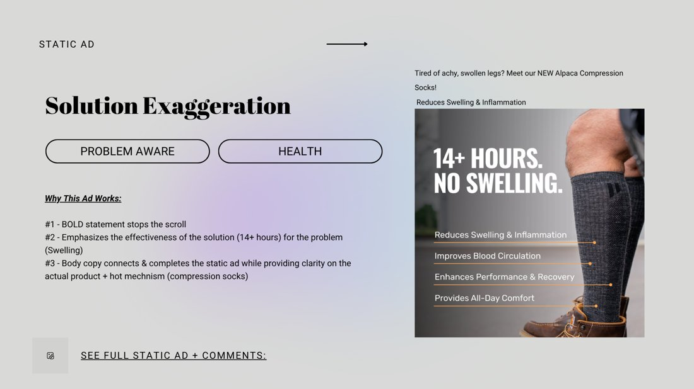
*Ref 1. "Solution Exaggeration" - Problem aware / Health. Numbered reasons: bold statement stops scroll; effectiveness of the solution; body copy clarifies product and hot mechanism.*

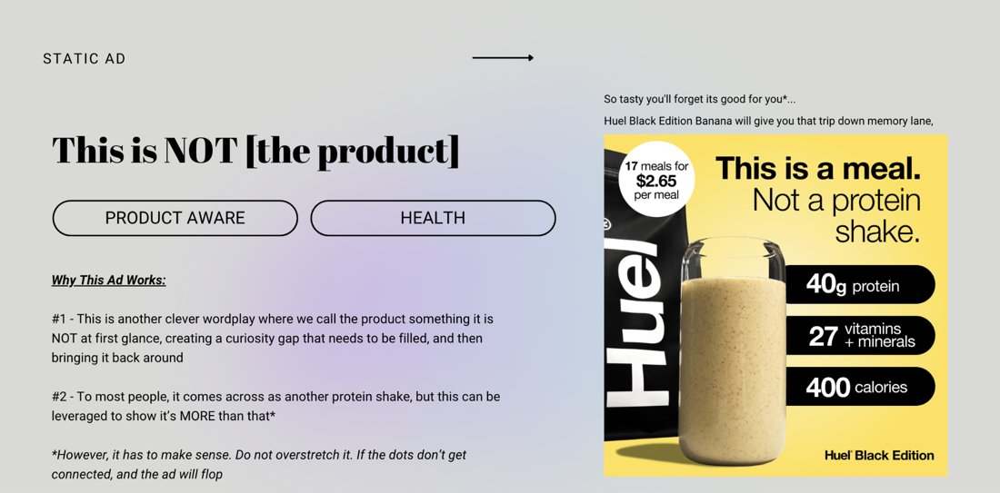
*Ref 2. "This is NOT [the product]" - Product aware / Health. Wordplay with curiosity gap; caution not to overstretch.*

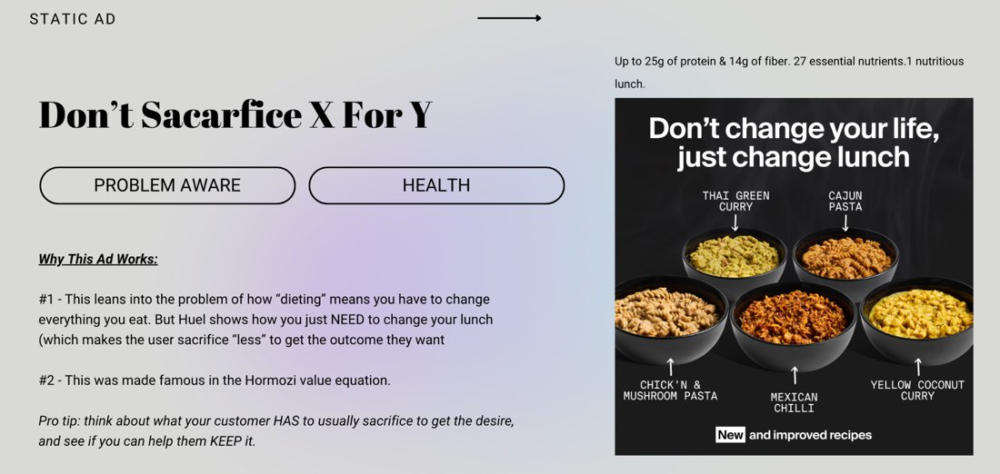
*Ref 3. "Don't Sacrifice X For Y" - Problem aware / Health. Pro tip: think about what the customer usually has to sacrifice and let them keep it.*

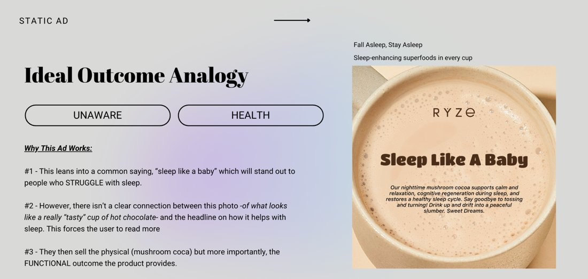
*Ref 4. "Ideal Outcome Analogy" - Unaware / Health. Common saying; weak photo-headline link forces reading.*

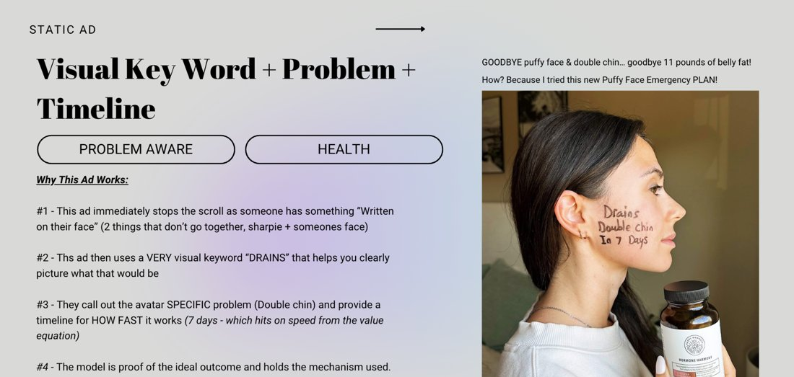
*Ref 5. "Visual Key Word + Problem + Timeline" - Problem aware / Health. Marker-on-face stops scroll; "DRAINS"; timeline hits speed from the value equation.*

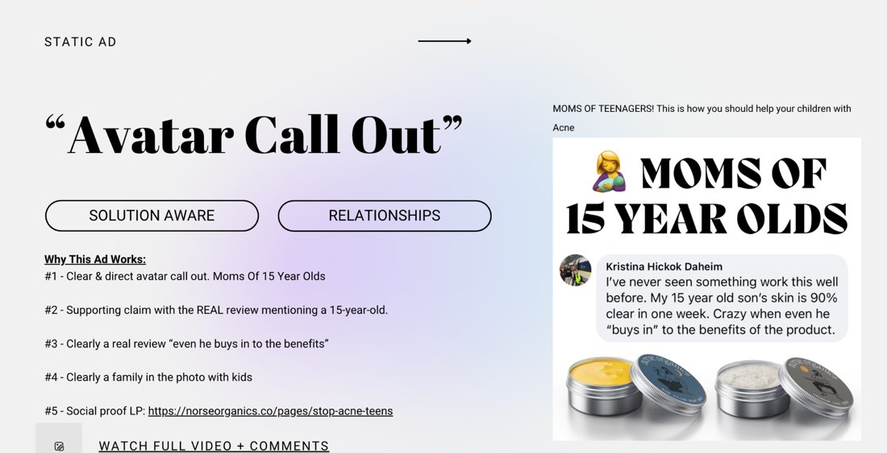
*Ref 6. "Avatar Call Out" - Solution aware / Relationships. Clear avatar call-out, real review, family photo, social-proof landing page.*

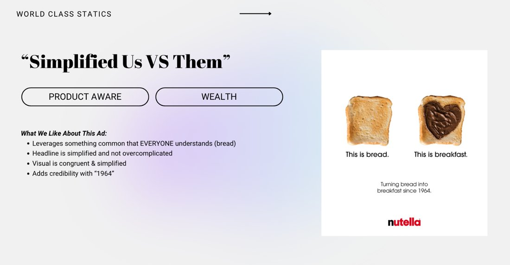
*Ref 7. "Simplified Us VS Them" (World Class Statics) - Product aware / Wealth. Everyone understands bread; simplified headline; congruent visual; "since 1964" credibility.*

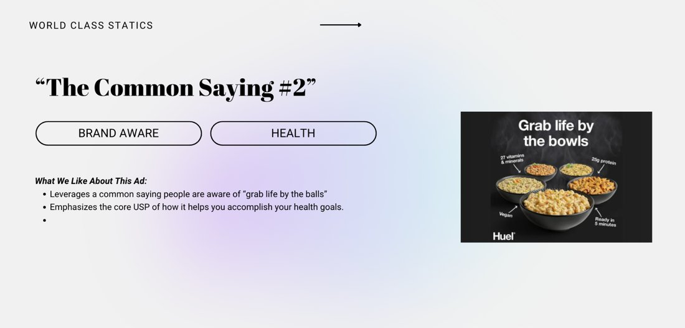
*Ref 8. "The Common Saying #2" (World Class Statics) - Brand aware / Health. "Grab life by the bowls" riffs on a known phrase.*

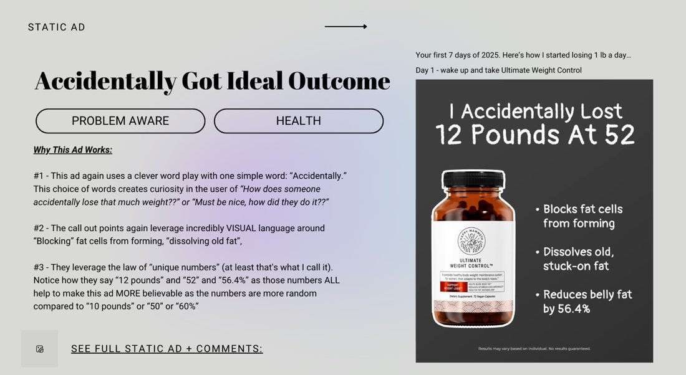
*Ref 9. "Accidentally Got Ideal Outcome" - Problem aware / Health. One-word wordplay, visual call-outs, "unique numbers".*

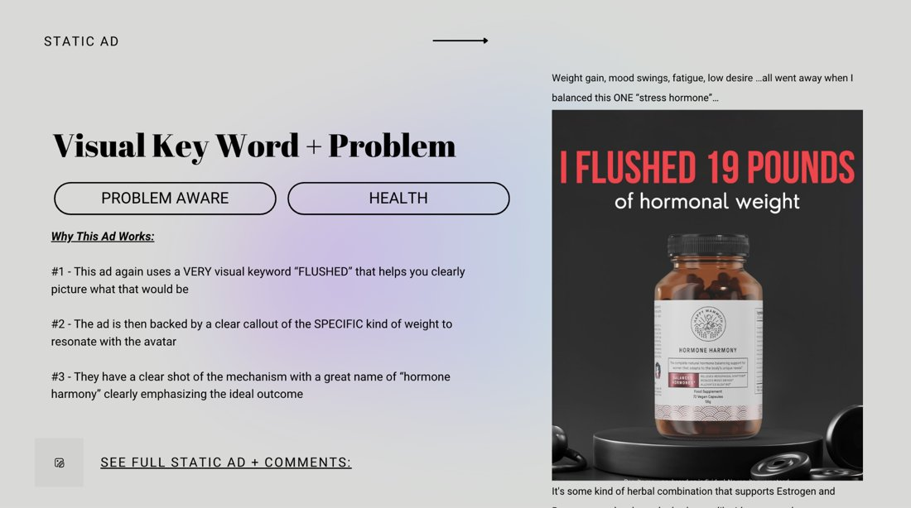
*Ref 10. "Visual Key Word + Problem" - Problem aware / Health. "FLUSHED"; specific kind of weight; named mechanism.*

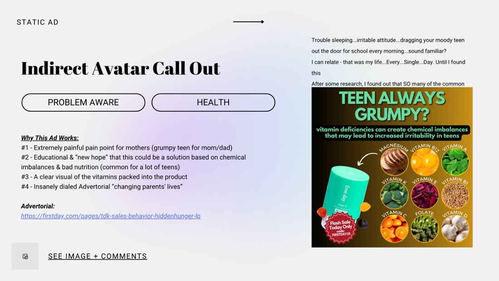
*Ref 11. "Indirect Avatar Call Out" - Problem aware / Health. Parent pain point plus an educational "new hope"; advertorial landing page.*

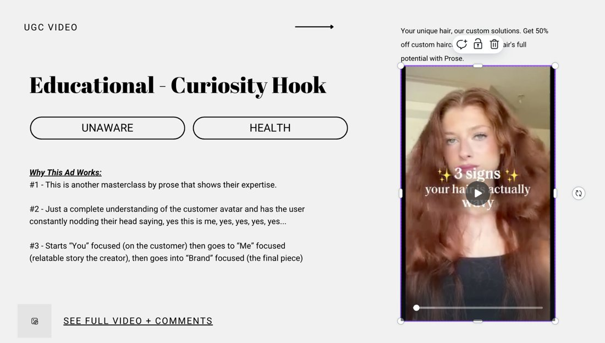
*Ref 12. "Educational - Curiosity Hook" (UGC video) - Unaware / Health. You -> Me -> Brand flow.*

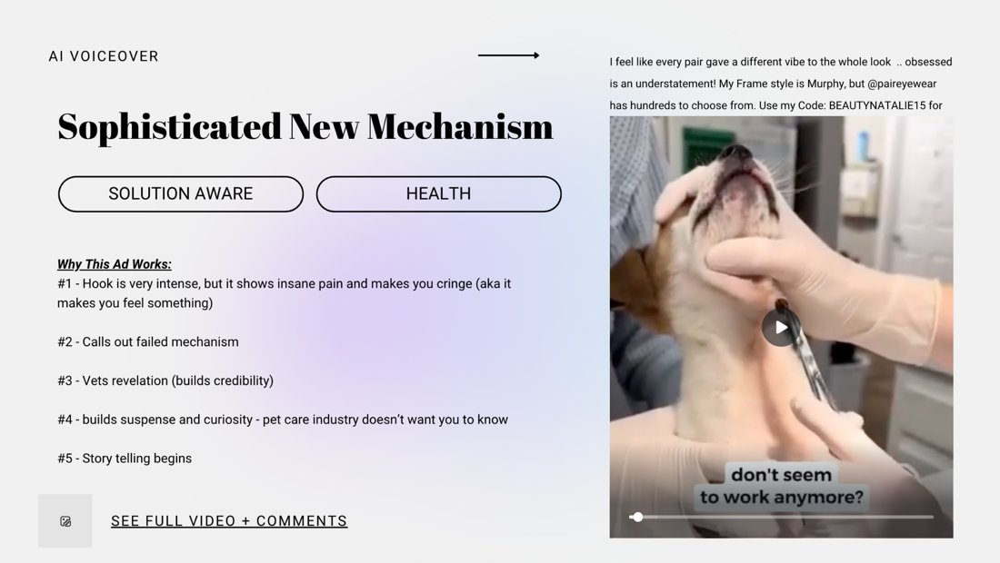
*Ref 13. "Sophisticated New Mechanism" (AI voiceover) - Solution aware / Health. Failed-mechanism call-out, vets revelation, suspense.*

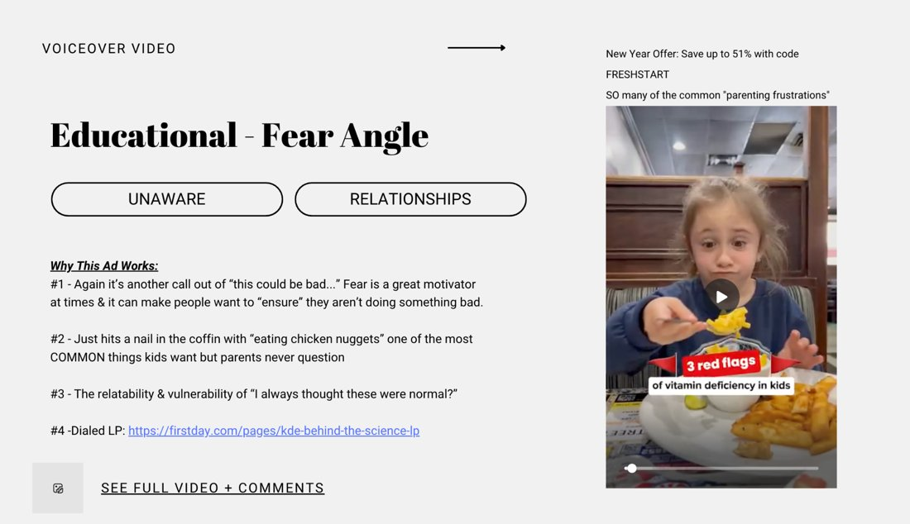
*Ref 14. "Educational - Fear Angle" (voiceover video) - Unaware / Relationships.*

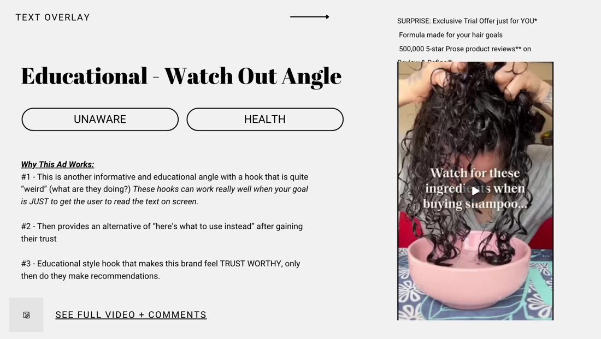
*Ref 15. "Educational - Watch Out Angle" (text overlay) - Unaware / Health. "Weird" hook; trust first, recommendation second.*

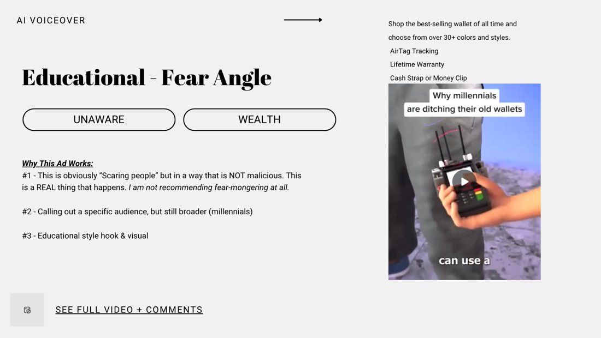
*Ref 16. "Educational - Fear Angle" (AI voiceover) - Unaware / Wealth. Fear that is real, not malicious.*

## Worked example from the angle prompt (output the prompt is meant to produce)
The doc ends with an "Example Of Perfect Output" for "Total Blackout Blinds - Restorative Sleep Avatar", with a PRIORITY NOTE ("You do NOT have to test each angle separately. Test the #1 hook from Sub-Avatar #3 first...") and three sub-avatars: #3 Short Fuse (strongest), #1 Cool Sleeper, #2 Night Faster. It is included verbatim at the end of the angle prompt above; each hook carries an "Inspired by:" line citing one of the reference ads. Examples: "5 minutes to install. No more snapping." (Inspired by "14+ Hours. No Swelling" - Timeline + Specific outcome elimination); "This blocks light. This saves relationships." (Inspired by "This is bread. This is breakfast"); "You have the fan. You have the AC. You need this." (Inspired by "Don't change your life, just change lunch"). Testing priority: "Start with Sub-Avatar #3, Angle 1. Test that hook first. If it hits, run variations. If not, move to Sub-Avatar #1, Angle 1."

## How to apply
- [ ] Assemble the master doc: product info, research quotes per sub-avatar (desire, behavior, emotion, quotes), new information, new mechanisms.
- [ ] Run the angle prompt per sub-avatar; keep the top angle and hook per sub-avatar; require an "Inspired by" reference for each hook.
- [ ] Write the angle (reason to buy) for each concept before writing any copy; reject "concepts" (Us vs Them, before/after, post-it) that lack one.
- [ ] Check every number and claim in headlines/bullets against the product doc and public data; note the source for each.
- [ ] Choose marksman (several angles, one hook each) or sniper (one angle, several hooks) and record it in the brief.
- [ ] Fill the brief template: concept, angle(s), testing method, format, one "Messaging" and one "Content" entry per variation; delete "Hold" for static.
- [ ] Build one ad first; get bullet copy from Claude using the inspiration ad, the headline and the verbatim research; state the bullet count.
- [ ] Edit every claim to be believable; lead with a verifiable fact.
- [ ] Keep font, color and layout consistent across variations; take brand colors from the site.
- [ ] Export one page per variation as PNG; label the batch (e.g. "S batch - sub avatar test").
- [ ] (derived, for UGC video) Convert each variation headline into a first-3-seconds hook, keep the same angle, and use the bullets as the proof/benefit beats of the script.

## Related
- Previous: [66. Learn more about copywriting](66-learn-more-about-copywriting.md) · Next: [68. How To Write Image Ads - Part 2](68-how-to-write-image-ads-part-2.md) · [69. Action item](69-action-item-write-your-image-ad-briefs.md)
- [18. Being aware of angles](18-being-aware-of-angles.md) · [Creative testing system](../../../../frameworks/creative-testing-system.md) · [Iteration vs variation](../../../../concepts/iteration-vs-variation.md) · [Customer research stack](../../../../frameworks/customer-research-stack.md)

## Sources and limitations
- Transcript: [67. How To Write Image Ads - Part 1 ... .txt](<../../../../../raw/evolve/copywriting/_transcripts/✍️ Evolve Copywriting (NEW)/67. How To Write Image Ads - Part 1 ✍️ Evolve Copywriting (NEW) Evolve.txt>) · Page text: [67 ... .html.md](<../../../../../raw/evolve/copywriting/_extracted/✍️ Evolve Copywriting (NEW)/67. How To Write Image Ads - Part 1_✍️ Evolve Copywriting (NEW)_Evolve.html.md>) · Attachment: [67. How To Write Image Ads.docx.md](<../../../../../raw/evolve/copywriting/_extracted/✍️ Evolve Copywriting (NEW)/67. How To Write Image Ads.docx.md>) · Linked Google Docs: [Master Document template](<../../../../../raw/evolve/copywriting/_extracted/_linked/google/67-document-1HqmKhRnQE.docx.md>) (same template as the docx and as lesson 69's linked doc), [brief template](<../../../../../raw/evolve/copywriting/_extracted/_linked/google/67-document-1nDnGxTxPo.docx.md>), [angle prompt](<../../../../../raw/evolve/copywriting/_extracted/_linked/google/67-document-1apOBJnwgJ.docx.md>) · Skool images: [67-img01..04](<../../../../../raw/evolve/copywriting/linked/skool-images/67/67-img01.png>).
- Machine transcription (Whisper large-v3-turbo). The full recording is covered (last segment 29:14 of a 29:14 video). Whisper garbles product and ingredient names: "Diaglomera / Diaglomerate" = Dyglomera (on-screen), "Zen wellness / Metaglow / Meta glow" = Zend / MetaGlow, "Suntheanine" is on the final ad, "GPM1 / GOP1 / GP1" = GLP-1, "blister" = "discipline" at [03:30], "ChadGBT" = ChatGPT, "camera pro" probably Canva Pro, "graph designer" = graphic designer. Quotes above are cleaned only for these obvious mishearings.
- The 68% / 56% GLP-1 figure: the instructor reads "68%" from the product doc [25:38] and writes 68% on ad 3 and in the Claude hook, while ads 1 and 4 and the product-page chart show 56%. In Part 2 he admits "this is meant to be 56%" for the ad that still says 68% [43:12 in Part 2]. Treat the figure as unverified and do not copy either number into a new ad without checking the source.
- The angle-prompt document lists "Getting rid of double chin" twice; the second image is the "Moms of 15 year olds" slide, so the angle/hook text for that entry in the doc is mislabelled. The tick-preventative slide shows ad copy for a different brand (Pair Eyewear) beside the video; the product behind the video is not named on the slide.
- The Skool page's "Chrome Extension" link is ColorPick Eyedropper; Milanote is mentioned as an alternative to the Google-Doc brief ("explained and shown in the Video section"), but the Milanote walkthrough is not in this video. The "13+ Winning Static Ads Templates" are a separate Skool lesson (classroom link) and are only shown on screen here; this page does not reproduce them.
- Ad figures such as "3x longer", "equivalent to 10 cups of green tea", "GLP-1 by 68%" are instructor-supplied claims about the client's product ("instructor claim"); none is independently verified in the course files.
- The jazz-music tangent at [00:00-00:54] is omitted.
