# 68. How To Write Image Ads - Part 2
> The "image-first" method for static ads: dig deeper on sub-avatars with Reddit quotes, pick a proven ad style from a template library (Creative OS), have Claude rewrite that ad's headline and check-mark bullets for each sub-avatar, correct Claude where it is wrong, then review the earlier ads with fresh eyes after a break and optionally use Nano Banana to make the product image match the headline.

## 🤖 Agent use
- **Use when:** you have sub-avatars and a product doc and want many distinct static-ad concepts fast; you need a structure to copy ("copy the mechanism, not the asset"); you need to QA AI-written ad copy for claim accuracy and congruence; you are deciding whether to ship a batch or let it rest.
- **Inputs → outputs:** sub-avatars with verbatim Reddit/forum quotes + product doc + a screenshot of a winning ad (template) → per sub-avatar 3 headlines, a sub-heading, and one list of check-mark bullets, written "exactly like the ad itself" -> a Creative OS/Canva build for each -> corrected, product-true copy -> a post-break revision pass -> (optional) AI-generated product image that matches the headline.
- **Rules:**
  - **DO** go deeper on each sub-avatar by Googling its behavior plus "reddit" ("I'm on a diet and can't control cravings reddit"; "I'm drinking lots of water and it's not helping my cravings reddit"; "I eat when I'm bored and get cravings when I'm bored reddit") and copying the exact quotes, emotions and behaviors into the doc. [00:00–03:32]
  - **DO** write while you research: "don't restrict yourself... if you feel the flow, go into flow." Even a loose script draft written from research and general knowledge can be "70% of a script". [03:32–06:58; 08:27]
  - **DO** pick a creative style by screenshotting a winning ad, then ask Claude to rewrite that ad's headline, sub-heading and check-mark bullets for each sub-avatar. [09:25–10:18; 14:57–16:52]
  - **DO** give Claude (a) the inspiration screenshot, (b) the sub-avatar quotes as the "real ones that stood out to me and should be integrated in the copy", (c) the product info, and (d) "a fifth grade reading level" (he checks with the Hemingway app). [16:52–17:23; 45:40]
  - **DO** write "exactly like the ad itself, just plugged in with our specific product and customer research": the exact headline pattern is the template you fill in. [18:39]
  - **DO** give Claude feedback with a reason: say which headline you like and why ("how SPECIFIC it is... I know the internal conversation they are having in their head"), then ask for more like it. [20:21; 22:47–23:45]
  - **DO** pick the most visual, specific, aggressive verb or behavior ("chugging" beats "drinking"; "toddler-sized portions") and tweak the line breaks so the headline fits. [24:27; 26:18–27:09]
  - **DON'T** let Claude call things "hormones" that are not hormones, or name hormones the product does not support. "Be a marketer, don't be an AI regurgitator." [24:27; 30:59–32:30]
  - **DO** verify the claim with the product document; prefer "two hormones and one enzyme" (true to the product) over "three hormone imbalances" (not true). [31:58–34:44]
  - **DO** be careful with the phrase "root cause" in Meta ads; "I'm not even sure if that's compliant on Meta. I did a random Google search and said it is." (instructor, unverified) [34:44]
  - **DO** add a short plain-English gloss to jargon, e.g. "(hunger hormone)", "(stress hormone)", "(breaks down GLP-1)". [35:41–36:28]
  - **DO** take a break (20-30 minutes, a lunch, or a day) before final submission and revisit the ads you already made instead of making more. [39:59–44:02]
  - **IF** the ads use the same template **THEN** they are still "big enough swings" when they target different sub-avatars; congruent visuals are a nice-to-have. [44:46–45:40]
  - **IF** the headline needs a specific image (tiny plate, jug of water) and you have no designer **THEN** generate the image with Nano Banana and drop it into the template. [46:36–50:33]
  - **(derived)** For UGC: each sub-avatar's behavior line ("chugging water instead of eating?", "eating because there's nothing else to do?") is a ready opening-scene and hook for a creator video; the same headline/bullet structure can be spoken as a hook plus a three-item list.
- **See also:** [67. How To Write Image Ads - Part 1](67-how-to-write-image-ads-part-1.md) · [69. Action item: write your image ad briefs](69-action-item-write-your-image-ad-briefs.md) · [34. How to write with labels (customer language)](34-how-to-write-with-labels-customer-language.md) · [Static ad creation playbook](../../../../playbooks/static-ad-creation.md) · [Competitor ad teardown playbook](../../../../playbooks/competitor-ad-teardown.md) · [Customer research stack](../../../../frameworks/customer-research-stack.md)

Lesson page text (Skool): chapters "0:00 Research + Flow", "9:04 Image First Training", "39:50 Reviewing Part 1 Designs", "44:40 Answer FAQs", "46:30 Making a Congruent Image With Nano Banana AI". A "Pro Tip": "Rather than making more ads after a break, just optimize the existing ads you previously made. Give your brain SPACE to marinate ideas and come back with fresh eyes." Tools: Creative OS (the page says to use code EVOLVE for 10% off) and Nano Banana (Google AI Studio). FAQ answers: "Are those big enough swings if you use the same template? Yes." and "Can you test different visuals (Like the Carepod method)? Yes.. But I would only recommend it if you have a graphic designer who can make congruent ads". The page also carries the same "May 2026" disclaimer as lesson 67 (modules filmed before the copywriting program; "post copywriting" modules coming). "Final Ads From Part 2" are three images (shown below). No docx attachment belongs to this lesson.

## Key ideas

### 1. Research and flow: sub-avatars from Google + Reddit [00:00–09:04]
- Start from one core desire ("how to deal with food cravings on a diet") and look for the people inside it. Three sub-avatars in the Master Document: "the dieter", "the water drinker", "the bored eater". [00:00]
- Method: Google a first-person sentence with "reddit" at the end ("I'm on a diet and can't control cravings reddit"), open the threads, copy the real quotes. The water-drinker thread was 60+ comments; the boredom thread 620+ comments. [00:00–01:38]
- Record behaviors first, then demographics, emotions and experiences ("I'm looking for more of these quotes because these quotes are what's going to really give us the ammunition... to write really great ads"). [01:38]
- The dieter sub-avatar in the doc (frame 02:42): Desire "I want to be in control of my cravings/appetite", Behavior "eating fewer calories due to a diet", Emotions "Frustrated that they have to be mindful of what they eat" and "Gets angry when they can't eat more", and quotes such as "I can't think of anything but food", "If you continually restrict yourself from those cravings, you're much more likely to fall back on binging those foods", "I've had a bad relationship with food my whole life", "'Deficits suck'", "my portion size will be meant for a toddler", "Food has become numbers.", "My motivation lasts about a week", "My willpower is almost nonexistent". [02:37–03:32]
- Headline ideas he jotted for the bored eater: "chewing gum to stop cravings, try coffee instead, eating because your mouth is bored". [02:37]
- A tangent found in the water-drinker thread (intermittent fasting helps) became a fourth sub-avatar that he chose not to pursue. [02:37]

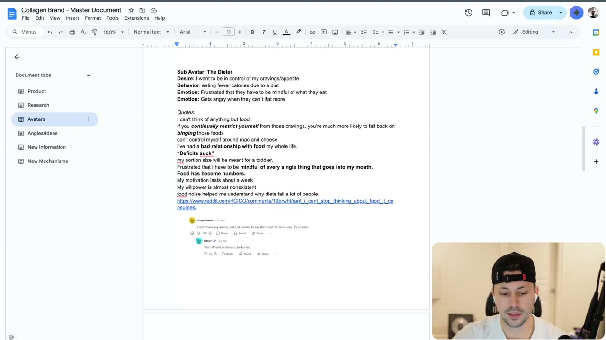
*Master Document "Avatars" tab: the Dieter sub-avatar with desire, behavior, two emotions and the Reddit quotes later pasted into Claude. [02:42]*

### 2. Write while you research (the "flow" draft) [03:32–08:27]
- "If you guys are feeling the flow and you have ideas, just start writing... that's something that I feel like you guys restrict yourself from doing and you feel like you have to do research and then you have to write." [03:32]
- Example: a Reddit post title "calorie deficits suck" becomes the hook; the explanation uses what he finds ("when your body enters a calorie deficit, it doesn't know it needs to produce more GLP-1"); "400 people were like, 'I don't get it... it's draining'", so he educates them. [04:20]
- Draft from the doc (frame 06:53): "Calorie deficits suck. And they suck because when your body enters a calorie deficit. It doesn't know it needs to produce more GLP-1. / So you eat less, but your body is expecting more. / It's not even your fault. / Because you eat more, your body NATURALLY produces less GLP-1..." then "GLP-1 is the hormone in your stomach that tells your brain 'I'm good'", "a lot of synthetic GLP-1 solutions have no known sideeffects yet around what they actually do", "natural alternatives don't actually have any scientific proof that they increase GLP-1", "And so you feel even angrier and you turn to food", "But what if there was a better way?" [05:10–08:27; frames 06:53, 14:17]
- He says the draft is partly "pretty garbage... don't take inspo from this" and must be validated; a Google AI overview says eating more can mean the body produces less GLP-1 "especially in response to carbohydrates" (research "mixed"). [05:10–06:58]
- "You might get 70% of a script done without even using AI, just using research and general knowledge." He would run a sniper ad on the dieter with it; it ties back to a new GLP-1 mechanism and uses emotion ("you feel even angrier"). He previews that market awareness levels come in the video-script module. [06:08–08:27]

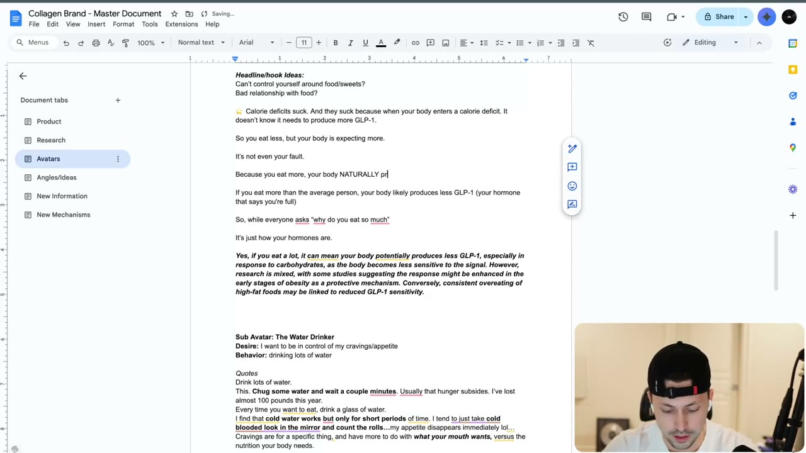
*The "flow" script draft inside the avatars tab: "Calorie deficits suck... So you eat less, but your body is expecting more. It's not even your fault. Because you eat more, your body NATURALLY pro..." typed live. [06:53]*

### 3. Image-first: pick a creative style, not a format [08:27–14:57]
- Set up another marksman test (a new batch row: "Batch number two... sub avatar test"). Instead of picking a format first, he picks a "creative style": "Us versus them is a creative style. I wouldn't call that a format." [08:27–09:25]
- He scrolls the 13+ Winning Static Ads templates in Canva ("maybe we like the 12 hour shoe one... a puberty [Pubity] style ad... Us versus them, I'm not sure I'm a big fan of") and screenshots one he likes. [09:25–10:18; frames 09:51–10:07]
- Problem: "I only have 13 ads here; I'm going to run out." Answer: Creative OS. [10:18–11:04]
- **Creative OS** (instructor description): a tool that "used to be in Figma templates and now they have their own software"; "basically Spencer's swipe file but on steroids"; click an ad, "customize template" and it "turns into a Canva doc"; "basically Canva and Foreplay all in one"; includes stock images, shapes, icons, a background remover, saved collections and brand pages (e.g. Grüns ads, emails, landers). [11:04–12:34]
  - Search tip: scroll or search for people NOT in your direct industry ("I'm not a big fan of copying exactly what people are doing in my industry"). He uses it "instead of Atria to find ads". [11:55–12:34]
  - Make sure you are in the **Templates** section, not the **Inspiration** section, when you want an editable ad. [17:23]
  - Pricing as spoken: "if you want the unlimited one it's $99 a month, there's this Ignite one which is $49 a month"; 10,000 static ad templates, three collections and a creative toolkit on the cheaper plan; a one-time lifetime payment is possible; "I'll have to confirm". The pricing page on screen showed Spark $19/mo, Ignite $49/mo, Pro $99/mo, Lifetime Pro $599. [12:34–14:08; frames 13:55-14:17]
  - It doubles as competitive research: "people are just using product images with strong headlines". [14:08]
- Ads glimpsed while browsing (no analysis by the instructor): "Double Chin - Finally Gone" (he calls it "rage bait... geniuses"); Grüns ads ("Better poop in just five days", "Best-selling kids gummies. I've only been taking them for a week", "Normal poops for the first time in years", "Ozempic's new bestie"); "MB1 supports GLP-1 naturally"; a Post-it style ad. [11:55–14:57]

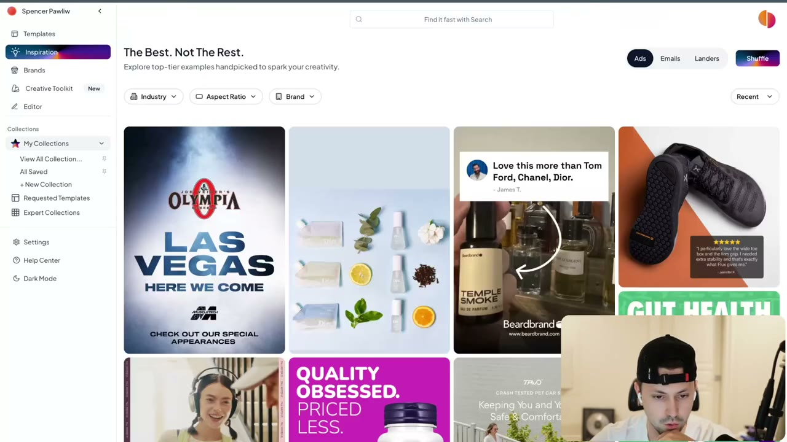
*Creative OS "Inspiration" section ("The Best. Not The Rest."): an ad library you can filter by industry, aspect ratio and brand; the "Templates" section is the editable one. [14:22]*

### 4. Claude rewrites the inspiration ad for each sub-avatar [14:57–20:21]
- Download the chosen ad, open the Claude chat ("Hey Claude, remember my product info" — product details saved earlier), attach the ad image and the three sub-avatars. [14:57–16:52]
- The prompt (see Prompts, near-verbatim on screen) asks for three headlines per sub-avatar and one list of check-mark bullets, copying how the headline, sub-heading and bullets are written; if the ad has no checks (only a headline + sub-heading, or just a photo and branding), adapt the request. [15:57]
- First output used the "92 Nutrients. One Scoop." style: Dieter "3 Hormones. One Coffee.", "Stop Counting Calories. Start Controlling Hunger.", "1,200 Calories Feels Like Enough."; Water Drinker "Water Works For 20 Minutes. This Works For 6 Hours."; (Claude reported it failed to fetch the Reddit link and "pivoted to provided quotes"). He likes "stop counting calories, start controlling hunger" but will not test it because he is already testing something similar. [17:23–17:59; frames 17:45]
- Second template: First Day's "Kids constantly being rude?" iPhone Notes ad. Prompt: write it "exactly like the ad itself, just plugged in with our specific product and customer research". Claude returned for the Dieter "Can't stop thinking about food?" / "3 hormone imbalances are linked to constant cravings:" / Low GLP-1, High Cortisol, Poor Sugar Metabolism / CTA "Flash Sale Today Only code: [YOUR CODE]"; Water Drinker "Constantly chugging water?" / "...linked to fake fullness" / Low GLP-1, Fast Stomach Emptying, High Cortisol; Bored Eater "Eating constantly when bored?" / "...linked to food noise" / Low GLP-1, High Cortisol, Broken Satiety Signals. He is "definitely a fan". [18:39–20:21; frames 20:07]
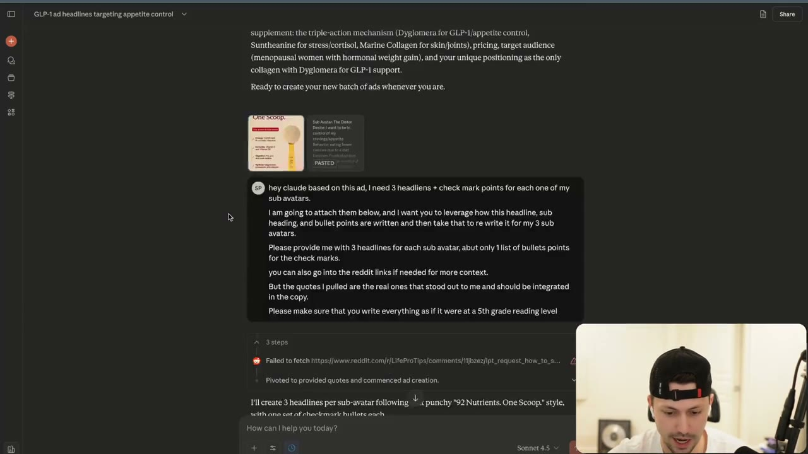
*The typed prompt (inspiration ad pasted as an image plus the sub-avatars pasted as text): "hey claude based on this ad, I need 3 headlines + check mark points for each one of my sub avatars..." Claude's tool line shows it "Failed to fetch" the Reddit URL and "Pivoted to provided quotes". [17:48]*

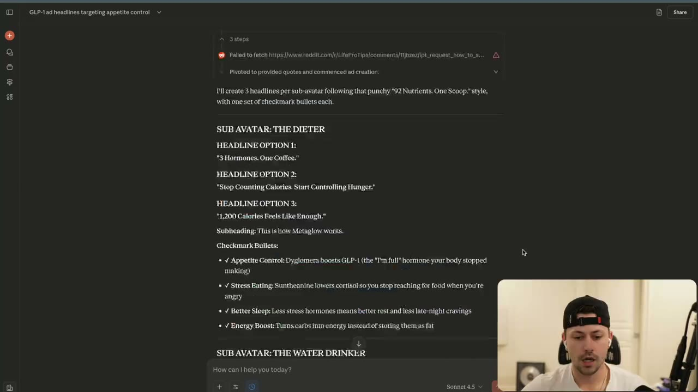
*Claude's first reply, Dieter sub-avatar: "3 Hormones. One Coffee.", "Stop Counting Calories. Start Controlling Hunger.", "1,200 Calories Feels Like Enough.", sub-heading "This is how Metaglow works." and checkmark bullets (Appetite Control: Dyglomera boosts GLP-1; Stress Eating: Suntheanine lowers cortisol; Better Sleep; Energy Boost). [17:45]*

- "If you feel like, gosh, I have no idea what to write, just see what Claude writes first, and then... tell it to optimize based on the ones that you like." [19:35]

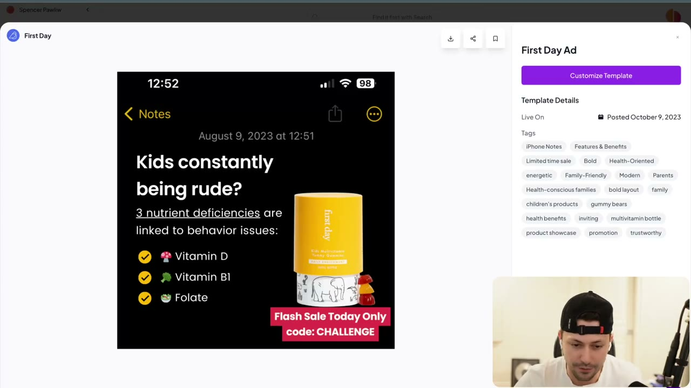
*The inspiration template in Creative OS: First Day "Kids constantly being rude? 3 nutrient deficiencies are linked to behavior issues: Vitamin D, Vitamin B1, Folate", an iPhone Notes screenshot with check-mark emoji bullets, product shot and a red "Flash Sale Today Only code: CHALLENGE" box. Tags include iPhone Notes, Health-Oriented, Parents. [21:41]*

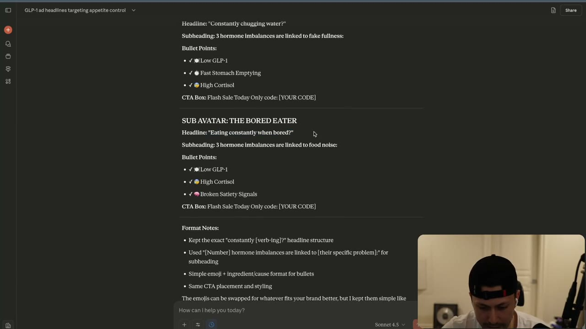
*Claude's template-fill: "Constantly chugging water?" and "Eating constantly when bored?" with "[Number] hormone imbalances are linked to [their specific problem]:" sub-headings, 3 emoji bullets and the "Flash Sale" CTA box. Format notes: "Kept the exact 'constantly [verb-ing]?' headline structure". [20:07]*

### 5. How to talk to the AI: feedback, specificity, human taste [20:21–30:27]
- Give a preference with the reason. First feedback (on screen, see the next screenshot): "definitely a fan of these headlines, claude, great job. how can we implement EVEN more of the research that I granted you for those 3 avatars? And in doing so, write 3 more headlines + subheadings for each sub avatar... I personally like 'Constantly chugging water?'". [20:21; frame 21:57]
- "Even if I just give you a template you need to understand what's going on and you need to talk to it." [21:18]
- Claude's second round for the Dieter: "Food has become just numbers?" / "Can't control yourself around certain foods?" / "Motivation only lasts a week?"; he picks the first: "has food just become numbers... that's going to hit." The other two are "kind of generic, kind of broad... anybody could say that." [21:51–22:47; frame 23:17]
- His follow-up: "I REALLY liked the 'Food has become just numbers?' and I would probably say it as: Has food just become numbers? because of how SPECIFIC it is, and how it shows that I have a CLEAR understanding of this person's specific problems... I know the 'internal conversation' that they are having in their head. I want you now to optimize more headlines like that for all three avatars once more. This time you can just do two each." [22:47–23:45]
- Water drinker options: "Chugging water every time you're hungry?", "Cold water only worked for 20 minutes", "Drinking water instead of eating?". He merges two: "Chugging water instead of eating?" because "chugging" is "visual and more powerful... slightly more aggressive; people can really visualize it." "Be a marketer. Don't be an AI regurgitator." [23:45–24:27]
- Bored eater options: "Is your mouth constantly bored?", "Constantly chewing gum to avoid eating", "Can't stop wanting to crunch something". He likes the gum behavior ("an interesting behavior") but notes none calls out boredom. [24:27–25:25]
- Dieter round three: "Eating toddler-sized portions but still gaining weight" ("a line that I put in there" from his research quote "my portion size will be meant for a toddler"). He prefers it shorter as "Eating toddler-sized portions?" and sets "toddler-sized" on one line: "until you see how the headline looks in the actual ad, sometimes you gotta..." [26:18–27:09]
- Date detail: he updates the template's iPhone Notes date to the current year ("August 9, 2025", the template said 2023), because an old date "is maybe a sign that this ad is a little old school". [27:09; frame 27:35]
- Claude's next options (frames 30:15-30:48): "Eating carrots just for the crunch?", "Cutting your food into tiny pieces to eat less?", "Trying hot water to kill your appetite?" with "Why these work" notes ("= super specific tactic they actually use"). He decides "I liked the other ones better" and tells Claude the bored-eater lines do not mention boredom; Claude's new set includes "Eating even when you're not actually hungry", "Eating because there's nothing else to do?", "Can't tell if you're bored or actually hungry?". He picks "Eating because there's nothing else to do?" ("relatable"); "Can't tell if you're bored or actually hungry" is "not really specific". [28:06–29:57]
- Tip: use voice-to-text when messaging the AI. [29:04]

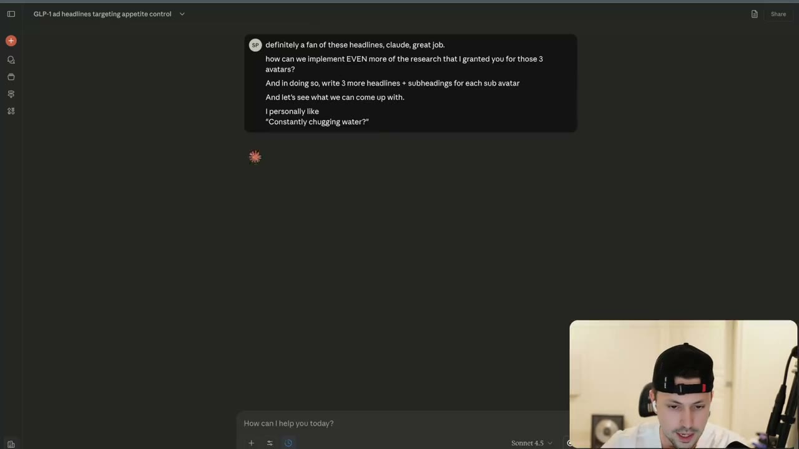
*The feedback message: "definitely a fan of these headlines, claude, great job... how can we implement EVEN more of the research that I granted you for those 3 avatars?... I personally like 'Constantly chugging water?'" [19:54]*

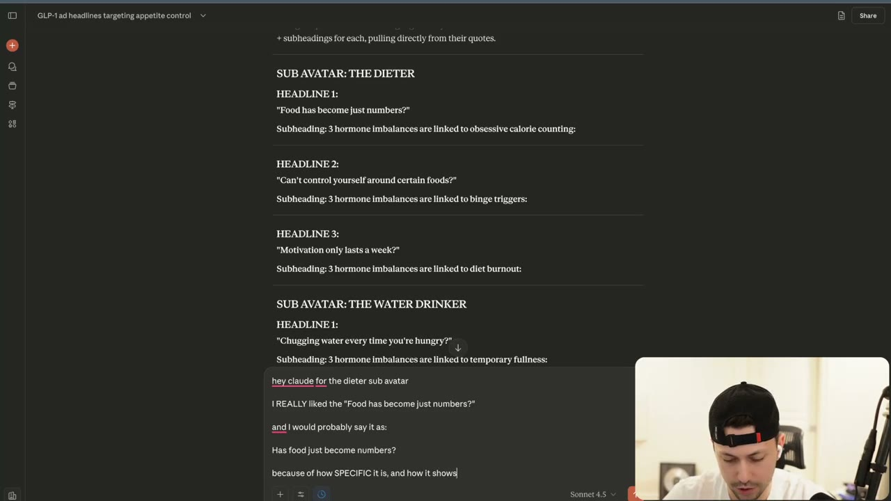
*Claude's second round and his typed feedback: Dieter headlines "Food has become just numbers?", "Can't control yourself around certain foods?", "Motivation only lasts a week?", each with "3 hormone imbalances are linked to ..." sub-headings; below, his feedback message beginning "hey claude for the dieter sub avatar / I REALLY liked the 'Food has become just numbers?'". [23:17]*

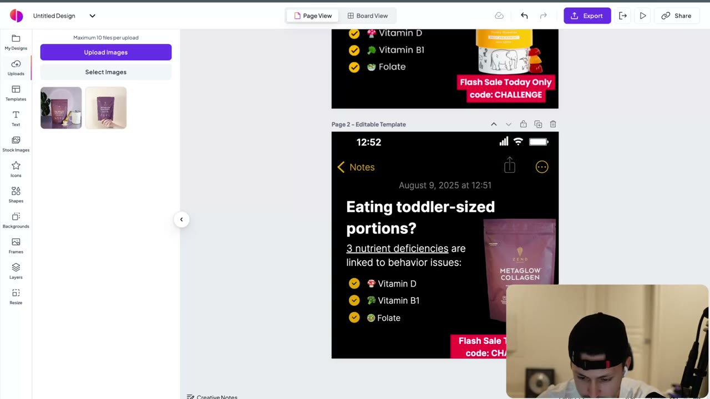
*Creative OS "Page 2 - Editable Template" with the swapped product pouch but the old copy still in place ("Eating toddler-sized portions? 3 nutrient deficiencies are linked to behavior issues: Vitamin D / Vitamin B1 / Folate"); date already changed to 2025. [27:35]*

### 6. Congruent bullets and the "hormone" correction [30:27–38:07]
- Request (on screen): "hey claude, I now need these 3 bullet points for these 3 different sub avatars, please include the emojis as well", attaching screenshots of the three ads. [30:27; frame 30:48]
- Claude produced "3 hormone imbalances are linked to temporary fullness: Low GLP-1, Fast Stomach Emptying, Broken Satiety Signals" and similar. The instructor catches that "these aren't hormones": GLP-1 and cortisol are, metabolism and satiety signals are not. "You need to catch yourself when you're just copy pasting and not being a marketer." He tells Claude: "GLP-1 is a hormone. Cortisol is a hormone... I need to make sure that you do not call out hormones that our product does not support. So make sure you review the product document as well." [30:59–32:30]
- After more rounds he writes: "I'm honestly not a fan of these at all. Are there three hormones that Metaglow actually targets that can support all of the above?" Claude (on screen): "Hormones Metaglow DIRECTLY targets: 1. GLP-1 (via Dyglomera) - hunger/satiety hormone, 2. Cortisol (via Suntheanine) - stress hormone. That's it... Dyglomera also reduces DPP-4 (an enzyme, not a hormone) which breaks down GLP-1... The honest answer: We can't authentically claim 3 hormones because Metaglow only targets 2." Options: keep "3 hormone imbalances" with a mechanism bullet (slightly misleading); change to "3 imbalances/problems/villains"; or keep it at 2 hormones and add a non-hormonal mechanism (most accurate). [32:30–34:44; frame 35:15]
- Result: "Two hormones and one enzyme behind failed restrictions": "Low GLP-1, high cortisol, high DPP-4." Reason: "this is based on the product because we are not scamming people, we are actually trying to help people. So don't just do things because you're like, 'oh, this can make me money,' because guess what, if you do that people will realize it, it won't make the money." [32:30–33:16]
- CTA box: from "Flash Sale Today Only code" to "This one scoop supports all 3." (first ad: "MetaGlow supports all 3 with one scoop."). [33:16–33:59]
- Compliance: Claude's "three root causes" version drew his caution on "root cause": "I'm not even sure if that's compliant on Meta. I did a random Google search and said it is. But you guys just want to be careful." On screen he asks Claude "Can we use a different word other than 'root cause' because that is not always compliant on Meta?" (Claude suggests "villains", "problems"). He also says there are many reasons for weight gain, so "root cause" over-claims. [34:44; frame 35:05]
- Simplify: "Two hormones and one enzyme behind boredom eating. We make it very, very simple for them to understand." Add italic glosses "(hunger hormone)", "(stress hormone)", "(breaks down GLP-1)" in smaller type: "that fifth grade level that we're trying to get". He suggests making one ad first before doing all three because layout issues repeat. [35:41–36:28]
- Final set (Skool "Final Ads From Part 2"): see Examples. He admits "there definitely is a lot of text on screen" on ad 3 but leaves it to test. [37:21]
- If the ads do not work, "this does not mean that these sub-avatars are not good, and that the angles that we're going through are not good"; he forgot to fill the concept sheet and states it as "the concept test... the iPhone Notes ad", angles: drinking water to control cravings; eating smaller amounts; eating because there's nothing else to do (boredom eating). [38:07–39:59]

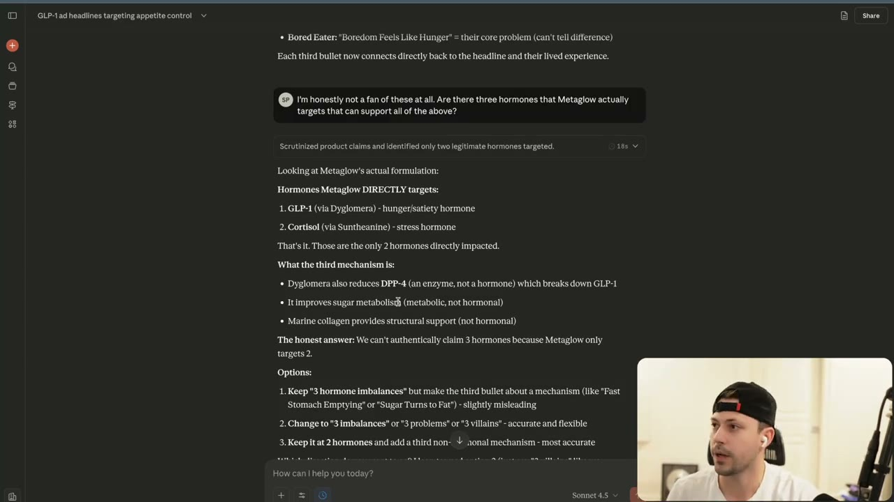
*Claude's product-grounded answer: only two hormones (GLP-1 via Dyglomera, cortisol via Suntheanine) are directly targeted; DPP-4 is an enzyme; options for staying accurate. This replaced "3 hormone imbalances". [35:15]*

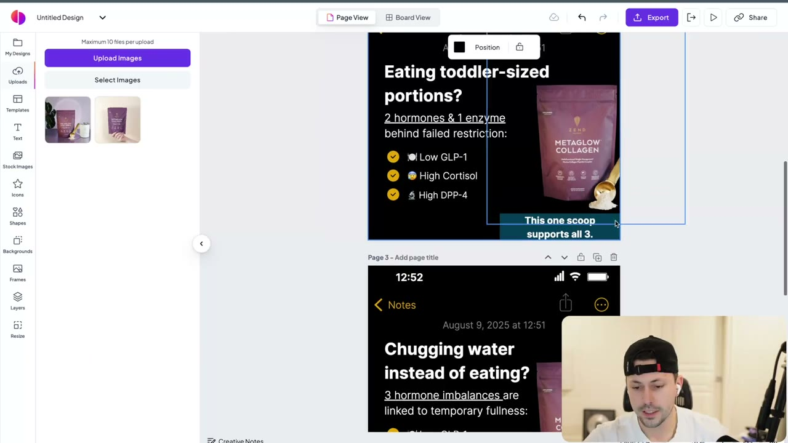
*After the correction: "Eating toddler-sized portions? 2 hormones & 1 enzyme behind failed restriction: Low GLP-1 / High Cortisol / High DPP-4" and CTA "This one scoop supports all 3." The next ad below still shows the earlier "3 hormone imbalances ... temporary fullness" version. [34:35]*

### 7. Review with fresh eyes (the "breather") [39:59–44:46]
- "Rather than coming back and doing another three batches of ads, I want you to come back and look at the ads that you made in the morning because something magical happens when your brain is not thinking about work." [39:59–40:46]
- Changes made on his own Part 1 ads after a break: (a) Ad 1: "Eating 1,200 calories is easy" could read as bait ("you go to Raising Cane's, boom, you got 1,200 calories", people comment "yeah no shit it's easy"); he considered testing it as rage-bait ("rage bait's a big thing right now") but changed it to "Eating only 1,200 calories". (b) Ad 2: found on the landing page "equivalent to 10 cups of green tea" and the "lowers your stress eating hormone" mechanism (from "benefits of green tea... curbing appetite" in the research); he "almost wanted to make an entire ad just around this" and notes you would need studies to make the claim. He also says a "provides natural calm" bullet he had used on one ad "is not really congruent" and puts "natural calming" on the stress-eating ad. (c) Ad 3: "Trick your stomach into staying full" with MetaGlow™; "increases GLP-1 by 68%... this is meant to be 56%. I kind of screwed that up." (d) A fourth ad from a research quote he had not used: "I just ignore my cravings now" ("I eat just enough to not feel hungry, and then I ignored it"). [40:46–43:12]
- "What most people do is they come back, they just make more ads. They don't even look at the ads that they had made before." Breather: even 20-30 minutes helps; "if you take like an hour... sleep on it, take a day." At his agency the script writer writes briefs Thursday and Friday, takes the weekend off, then re-reads on Monday before shipping; "a lot of times she's like, 'Oh God, I got to rewrite this whole thing'." [43:12–44:46]

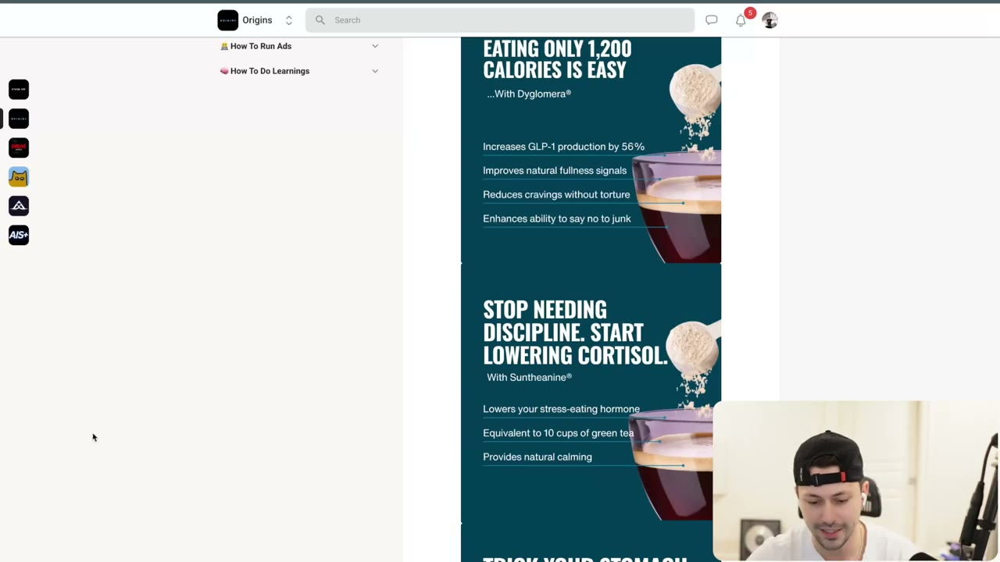
*The final Part 1 ads shown on the Skool lesson page during the review: "Eating only 1,200 calories is easy" and "Stop needing discipline. Start lowering cortisol." [42:45]*

### 8. FAQ: same template, congruence, visuals [44:46–46:36]
- "Are those big enough swings if you use the same template?" Yes. "A lot of you guys do not have graphic designers... I want you more focused on what is inside." The headlines target different people, so they are different swings. [44:46–45:40]
- Could the visuals be more congruent? "100%": a tiny plate of food for "toddler-sized portions", a gallon jug for "chugging water", a bored person for the boredom ad. "If you guys have a graphic designer, then please do make them congruent." [44:46]
- "Can you test different visuals (like the Carepod method)? Yes", ideally only with a graphic designer who can make congruent ads. [45:40; Skool page]

### 9. Nano Banana: a congruent product image without a designer [46:36–50:33]
- Google AI Studio, model "Nano Banana" (gemini-2.5-flash-image on screen). First prompt ("give me a photo of Metaglow next to a really small portion of food on a big plate...") returned a funny, wrong image; he started fresh by attaching the ad and the product photo, marking the area to replace in red. [46:36–47:54]
- Working prompt (on screen): see Prompts. It "kind of nailed it on the first try." [47:54]
- Then: "This looks good. Please now just remove the background and remove the hand and arm holding the Meta Glow package." [frame 48:17] and "Can you please shrink down the plates a little bit more so the Meta Glow is bigger. keep everything else the same." [48:37; frame 48:58] Then he drops the image into the Creative OS template and uses its background remover. "It looks a little bit odd... but it visualizes it." [48:37–49:33]
- Repeated for "chugging water" with a jug of water and water puddles. [49:33–50:33]
- Wrap: "Don't get too lost in the saucepan with AI all day... testing the initial concept is more important. The messaging is more important than anything else. But a little bit of extra congruence doesn't hurt." [50:33]

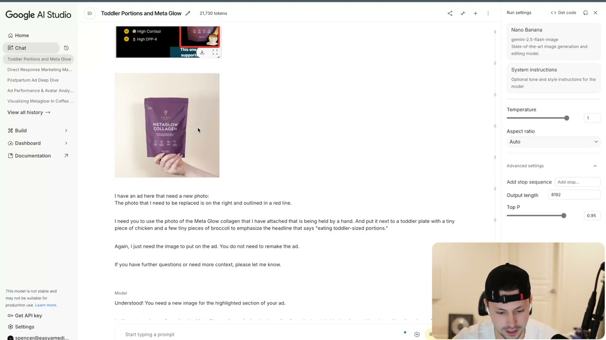
*Google AI Studio, "Nano Banana (gemini-2.5-flash-image)": the screenshot of the ad, the product-in-hand photo and the working prompt: "I have an ad here that need a new photo: The photo that I need to be replaced is on the right and outlined in a red line..." [47:57]*

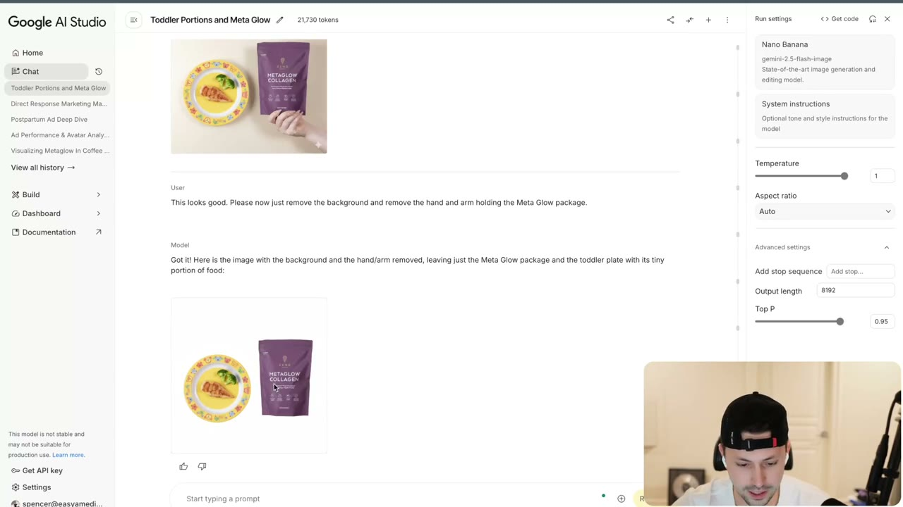
*Result after asking to remove the background and the hand: a toddler plate with chicken and broccoli next to the MetaGlow pouch, ready to place into the ad. [48:17]*

## Steps / framework (image-first method)
| # | Step | Detail | Time |
|---|---|---|---|
| 1 | Deepen sub-avatars | First-person Google query + "reddit"; copy quotes, behaviors, emotions into the Avatars tab | [00:00–03:32] |
| 2 | Write in flow | Draft hook/script lines as soon as an idea appears; validate claims afterward | [03:32–08:27] |
| 3 | Choose a creative style | Screenshot a winning ad from the template deck or Creative OS (templates section) | [09:25–14:57] |
| 4 | First Claude pass | Inspo screenshot + sub-avatars + quotes + product memory -> 3 headlines + 1 bullet list per sub-avatar, "fifth grade reading level" | [14:57–17:59] |
| 5 | Copy-the-template pass | "Write it EXACTLY like the ad itself" for a second structure | [18:39–20:21] |
| 6 | Feedback loop | Tell Claude which line you like and why (specific, visual, internal conversation); ask for more of that | [20:21–25:25] |
| 7 | Build | Customize template; swap product image; background remover; brand color; headline on fitting lines; update dates | [21:41–29:57] |
| 8 | Bullets + congruence check | Check every bullet against the product doc and the headline's promise (hormone vs not); simplify with glosses | [30:27–36:28] |
| 9 | Break and review | 20 min to a day; revisit the ads before making new ones; fix claims and mismatched numbers | [39:59–44:46] |
| 10 | Optional image upgrade | Nano Banana for a headline-matching product image | [46:36–50:33] |

## Examples

### Final ads from Part 2
| # | Headline | Sub-line | Bullets | CTA box | Source |
|---|---|---|---|---|---|
| 1 | Eating toddler-sized portions? | 2 hormones & 1 enzyme behind always being hungry: | Low GLP-1 / High Cortisol / High DPP-4 (with emoji) | MetaGlow™ supports all 3 with one scoop. | final image 1 (video build said "behind failed restriction") |
| 2 | Chugging water instead of eating? | 2 hormones & 1 enzyme behind fake fullness: | Low GLP-1 / High Cortisol / High DPP-4 | This one scoop supports all 3. | final image 2 |
| 3 | Eating because there's nothing else to do? | 2 hormones & 1 enzyme behind boredom eating: | Low GLP-1 (hunger hormone) / High Cortisol (stress hormone) / High DPP-4 (breaks down GLP-1) | This one scoop supports all 3. | final image 3 |

All three use a black iPhone Notes layout (time 12:52, "August 9, 2025 at 12:51"), the Zend MetaGlow Collagen pouch, and a teal CTA box. Only ad 1 shows the toddler plate image in the final images; ad 2 keeps the pouch with scoop (the water-jug image was generated on screen but is not in the Skool final image).

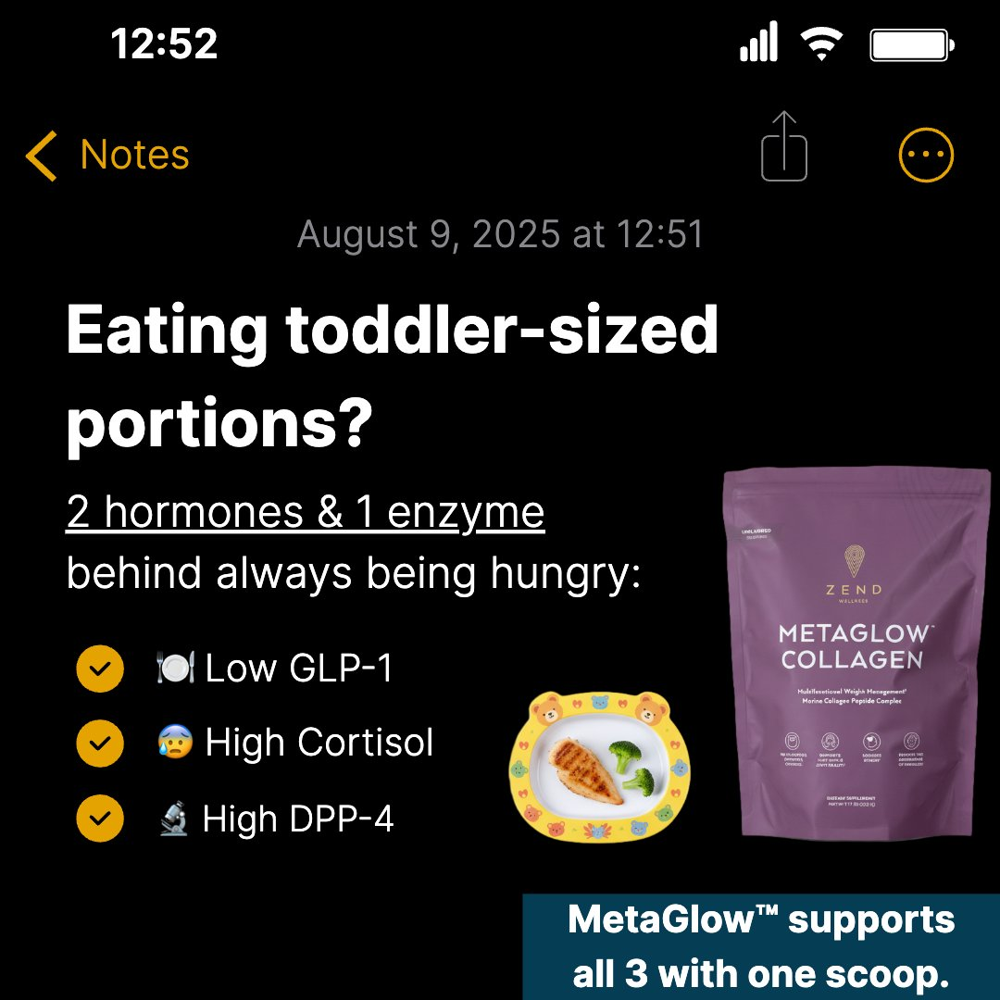
*Final ad 1 (Skool "Final Ads From Part 2"): toddler-sized portions, with the generated toddler plate placed beside the pouch.*

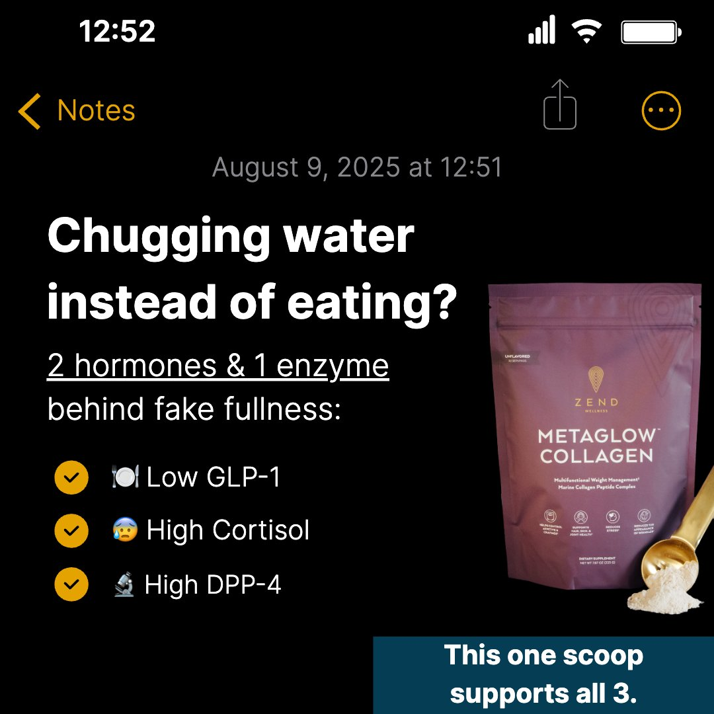
*Final ad 2: "Chugging water instead of eating?" with "2 hormones & 1 enzyme behind fake fullness".*

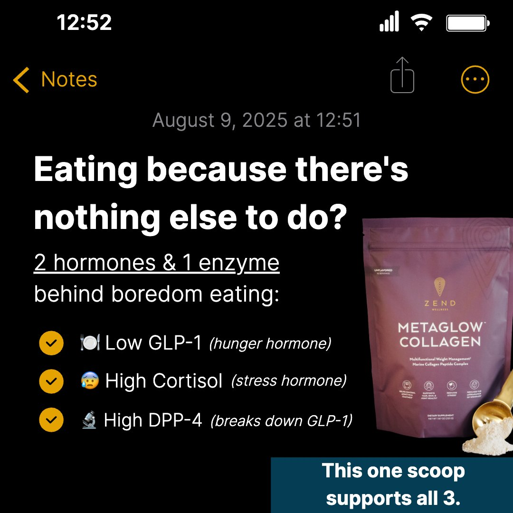
*Final ad 3: "Eating because there's nothing else to do?" with the italic glosses (hunger hormone / stress hormone / breaks down GLP-1).*

## Structured units

### Hooks
| Hook | Heuristic(s) | Emotion / zone | Self targeted | Why it works | Source |
|---|---|---|---|---|---|
| "Has food just become numbers?" | — | frustration (derived) | the dieter | "SPECIFIC"; shows you know their internal conversation | [22:47–23:45] |
| "Chugging water instead of eating?" | — | — | the water drinker | "chugging" is visual, slightly aggressive; names a behavior, not a state | [24:27] |
| "Eating because there's nothing else to do?" | — | — | the bored eater | relatable; calls out boredom, the actual driver | [28:06–29:57] |
| "Eating toddler-sized portions?" | — | — | the dieter | direct customer quote ("my portion size will be meant for a toddler"); extremely specific visual | [26:18; frame 29:57] |
| "Constantly chewing gum to avoid eating?" (not used) | — | — | the bored eater | specific behavior; "an interesting behavior" | [24:27] |
| "Calorie deficits suck" (script hook) | — | — | the dieter | relatable ("everyone's going to be like, God, that's relatable"), then educates on GLP-1 | [04:20] |
| "Stop counting calories. Start controlling hunger." (Claude; not used) | — | — | the dieter | liked, but too similar to a variation already in test | [17:59] |
| "I just ignore my cravings now" | — | — | the dieter / stress eater | real quote from research that "came up a lot" | [43:12] |

### Angles
| Angle | Core desire / pain | Heuristic(s) | Best format | Example line | Source |
|---|---|---|---|---|---|
| Drinking water to control cravings (water drinker) | In control of appetite; water only works briefly | — | iPhone Notes static | "Chugging water instead of eating?" | [38:07–39:00] |
| Eating smaller amounts to lose weight (dieter) | Control cravings under restriction; frustration/anger | — | iPhone Notes static | "Eating toddler-sized portions?" | [38:07–39:00] |
| Eating because there's nothing else to do (bored eater) | Cravings from boredom | — | iPhone Notes static | "Eating because there's nothing else to do?" | [38:07–39:00] |
| "Your body is expecting more" - why dieters crave (script) | Education: calorie deficit and GLP-1 | — | sniper video/static script | "Calorie deficits suck" | [04:20–08:27] |

### Ad teardowns
Rows 1-8 are slides from the "Winning Ad Templates" Canva deck shown on screen (the "Why this ad works" text is the slide text read from frames; it is the same deck as the "13+ Winning Static Ads Templates" lesson). Ads built in this lesson follow.

| Brand / product (niche) | Format | Hook / opening | What works | What fails | Fix suggested | Principle | Source |
|---|---|---|---|---|---|---|---|
| Grüns (gummy greens) | Static; template "Stealing Credibility" | "Ozempic's New Bestie" | Steals credibility from a familiar and "effective" mechanism; curiosity and scroll-stop from the "army" of gummy bears; body copy connects and completes the ad with clarity | — | — | Borrowed credibility | frame 09:51 |
| Ryze (mushroom coffee) | Static; "Specific Pain Point Ad" | "LOSE THE MUFFIN TOP FOR GOOD" ($36 struck to $27) | Leans into a saying often used to "offend people" and a very specific pain point; creates a visual in the person's mind; strong price-slash tactic | — | — | Specific pain point + price slash | frame 09:52 |
| 12-hour shift shoes (healthcare workers) | Static + advertorial; "Relatable Hook Ad" | "12-HOUR SHIFT SHOES" with a plus-sign benefit list | Visualizes a painful, relatable feeling; "sock-like" look implies comfort; customer-written, story-focused copy; congruent customer journey; advertorial link | — | — | Relatable hook | frame 09:55 |
| Primal Queen (female-focused supplement) | Static; "The Free Ad" | "GET 4 FREE GIFTS" over a pouch with outcome call-outs (Better periods, Feel stronger, More energy, Balanced hormones, Weight loss, Better sex drive) | People love "free"; call-outs focus on outcomes and desires; bold branding with identity; body copy strikes a new mechanism ("female focused beef organ") | — | — | Free offer + new mechanism | frame 10:03 |
| Watches (jewelry) | Static; "Classy Offer Ad" | "Left or right?" ... "Just add both to cart." | Clearly communicates the offer in an elevated way; lets you run a "sales ad" with a higher-class, less salesy approach | — | — | Classy offer | frame 10:04 |
| Achilles protection (sports) | Static; "Pubity Style Ad" | "WHY RISK YOUR CAREER WITH EVERY GAME? THIS IS THE ACHILLES PROTECTION TRUSTED BY THE BEST IN THE ..." (cut off) | Familiar ad format that is camouflage for Instagram/Facebook feeds; small top-right photo drives curiosity and storytelling; headline gives a reason to click through | — | — | Native-feed camouflage | frame 10:05 |
| Carepod (humidifier, per the slide image) | Static; "The Minimal Us vs Them" | Them (a competitor humidifier with pain-point labels) vs Carepod "None of that." | Simple, easy-to-digest format; reverses the usual us-vs-them by calling out only pain points; "None of that" amplifies the product's simplicity; familiar top-seller comparison image | — | — | Minimal us vs them | frame 10:07 |
| First Day kids' multivitamin | Static; iPhone Notes | "Kids constantly being rude?" + "3 nutrient deficiencies are linked to behavior issues:" Vitamin D / B1 / Folate | Template chosen for this lesson; question hook, specific cause, check-mark emoji bullets, product, red CTA; (tags: iPhone Notes, Health-Oriented, Parents) | Date reads 2023 on the template, which looks dated | Update the date to the current year | iPhone Notes native format | [18:39; 27:09; frame 21:41] |
| "92 Nutrients. One Scoop." (supplement; brand not identified) | Static; headline + check-mark bullets | "92 Nutrients. One Scoop." | Punchy two-sentence headline; used as the first template Claude imitated ("3 Hormones. One Coffee.") | — | — | Compact "X. One Y." pattern | [15:57; 17:23; frame 17:45] |
| Zend MetaGlow (built here), iPhone Notes ads 1-3 | Static; iPhone Notes | see Examples | Specific behavior headlines; true-to-product mechanism ("2 hormones & 1 enzyme"); glossed jargon | "A lot of text on screen" (ad 3); visuals not congruent (no tiny plate/jug in ads 2-3); date and layout fiddly | Show a tiny plate, a gallon jug, a bored person | Congruence; specificity | [37:21; 44:46] |

### Rewrites
| Before | After | What changed (verb / visual / promise / self / intensity) | Source |
|---|---|---|---|
| "Can't control yourself around certain foods?" (Claude) | "Has food just become numbers?" | Generic -> specific internal conversation (instructor: "anybody could say that") | [21:51–23:45] |
| "Drinking water instead of eating?" / "Constantly chugging water?" | "Chugging water instead of eating?" | Verb made visual and more aggressive; behavior + cost | [24:27] |
| "Eating toddler-sized portions but still gaining weight" | "Eating toddler-sized portions?" | Shortened; "toddler-sized" kept on one line; question form | [26:18–27:09] |
| "Eating carrots just for the crunch?" / "Cutting your food into tiny pieces to eat less?" / "Constantly chewing gum to avoid eating" | "Eating because there's nothing else to do?" | Behavior -> the actual boredom driver | [28:06–29:57] |
| "3 hormone imbalances are linked to failed restriction" with Low GLP-1 / High Cortisol / Poor Metabolism | "2 hormones & 1 enzyme behind failed restriction" with Low GLP-1 / High Cortisol / High DPP-4 | Accuracy to product (GLP-1 and cortisol are hormones; DPP-4 an enzyme); simpler | [31:58–34:44] |
| "3 hormone imbalances are linked to temporary fullness: Low GLP-1 / Fast Stomach Emptying / Broken Satiety Signals" | "2 hormones & 1 enzyme behind fake fullness: Low GLP-1 / High Cortisol / High DPP-4" | Same fix; "fake fullness" wording | frame 31:34; final ad 2 |
| "Low GLP-1 / High Cortisol / High DPP-4" | "Low GLP-1 (hunger hormone) / High Cortisol (stress hormone) / High DPP-4 (breaks down GLP-1)" | Added plain-English glosses | [35:41–36:28] |
| "Flash Sale Today Only code: [YOUR CODE]" | "This one scoop supports all 3." / "MetaGlow™ supports all 3 with one scoop." | CTA box turned into a promise that closes the loop | [33:16–33:59] |
| "August 9, 2023 at 12:51" | "August 9, 2025 at 12:51" | Freshness | [27:09] |
| "Eating 1,200 calories is easy" (Part 1 ad) | "Eating only 1,200 calories is easy" | One word to reduce an "obviously easy" misreading | [41:35] |
| "Trick your stomach into thinking it's full" (Part 1 ad) | "Trick your stomach into staying full." | Simpler verb; benefit | [42:29]; final ad |
| "Provides natural calm" bullets (Part 1 ad 2) | "Lowers your stress-eating hormone / Equivalent to 10 cups of green tea / Provides natural calming" | Mechanism line from the landing page replaces generic bullets | [41:35–42:29] |
| "Increases GLP-1 production by 68%" (ad 3) | should read 56% per instructor | Numeric mismatch he flagged but the final image still shows 68% | [42:29] |

### Templates
| Template | Use for | Example fill | Source |
|---|---|---|---|
| "[Behavior the avatar does]?" + "[Number] [problem word] are linked to [their specific problem]:" + 3 check-mark emoji bullets + red/teal CTA box | iPhone Notes static for sub-avatar tests | "Chugging water instead of eating? / 2 hormones & 1 enzyme behind fake fullness: / Low GLP-1 / High Cortisol / High DPP-4 / This one scoop supports all 3." | [18:39; final ads] |
| "Constantly [verb-ing]?" | Behavior call-out headline | "Constantly chugging water?" (Claude's format note: "Kept the exact 'constantly [verb-ing]?' headline structure") | frame 20:07 |
| "Has [thing] just become [flat label]?" | Specific internal-conversation question | "Has food just become numbers?" | [22:47] |
| "[Calorie-like claim] is easy" | Contrast hook | "Eating only 1,200 calories is easy" | [41:35] |

## Prompts / templates (verbatim)

### 1. Headlines + bullets from an inspiration ad (typed in Claude; on-screen text, [frame 17:48])
```text
hey claude based on this ad, I need 3 headlines + check mark points for each one of my sub avatars.

I am going to attach them below, and I want you to leverage how this headline, sub heading, and bullet points are written and then take that to re write it for my 3 sub avatars.

Please provide me with 3 headlines for each sub avatar, abut only 1 list of bullets points for the check marks.

you can also go into the reddit links if needed for more context.

But the quotes I pulled are the real ones that stood out to me and should be integrated in the copy.

Please make sure that you write everything as if it were at a 5th grade reading level
```
(The text on screen is as above, including the typos "abut", "re write". Spoken version [15:57–17:23] ends with "using the Hemingway app".)

### 2. "Exactly like the ad itself" template-fill (on screen, [frames 19:47, 20:07])
```text
hey claude we need to now do the same thing for this ad here

But I want you to try to write it EXACTLY like the ad itself. Just plugged in with our specific product + customer research.

So the exact headline "Kids constantly being rude"

should be the template that we fill in for our customer and product.

Same with the bullet points.

However, if we need to optimize this slightly, we can, but I want to make sure that we are also taking heavy reference from this creative.
```
(First line is from the screen text at the start of the message; the remaining lines are as captured in the output frame. Whisper reads "kids constantly being rude" at [18:39].)

### 3. Feedback + "more research" turn (on screen, [frame 21:57])
```text
definitely a fan of these headlines, claude, great job.

how can we implement EVEN more of the research that I granted you for those 3 avatars?

And in doing so, write 3 more headlines + subheadings for each sub avatar

And let's see what we can come up with.

I personally like
"Constantly chugging water?"
```

### 4. Feedback on a specific headline (on screen, [frame 23:17]; truncated at the end of the frame)
```text
hey claude for the dieter sub avatar

I REALLY liked the "Food has become just numbers?"

and I would probably say it as:

Has food just become numbers?

because of how SPECIFIC it is, and how it shows ...
```
(Spoken continuation [22:47–23:45]: "...that I have a clear understanding of this person's specific problems, and... that I know the internal conversation that they are having in their head. I want you now to optimize more headlines like that for all three avatars once more. This time you can just do two each.")

### 5. Bullets for the finished headlines (on screen, [frame 30:48])
```text
hey claude, I now need these 3 bullet points for these 3 different sub avatars, please include the emojis as well
```

### 6. Product-grounding correction (spoken, [31:58–32:30]) and honesty check (on screen, [frame 35:15])
- Spoken: "GLP-1 is a hormone. Cortisol is a hormone... And important here, Claude, I need to make sure that you do not call out hormones that our product does not support. So make sure you review the product document as well."
- On screen: "I'm honestly not a fan of these at all. Are there three hormones that Metaglow actually targets that can support all of the above?"
- On screen: "Can we use a different word other than 'root cause' because that is not always compliant on Meta?" [frame 35:05]

### 7. Nano Banana image prompt (on screen, [frame 47:57])
```text
I have an ad here that need a new photo:
The photo that I need to be replaced is on the right and outlined in a red line.

I need you to use the photo of the Meta Glow collagen that I have attached that is being held by a hand. And put it next to a toddler plate with a tiny piece of chicken and a few tiny pieces of broccoli to emphasize the headline that says "eating toddler-sized portions."

Again, I just need the image to put on the ad. You do not need to remake the ad.

If you have further questions or need more context, please let me know.
```
Follow-ups (on screen): "This looks good. Please now just remove the background and remove the hand and arm holding the Meta Glow package." / "Can you please shrink down the plates a little bit more so the Meta Glow is bigger. keep everything else the same." For the water ad (low-resolution frame 50:15): a request to do the same for the other ad, "make it a jug of water and maybe have some water puddles around it", "Could be congruent with the headline: 'Chugging water instead of eating'".

### 8. Templates referenced
- Master Document template and the brief template are the same files as in [lesson 67](67-how-to-write-image-ads-part-1.md) (see its "Prompts / templates"); the Creative OS and Nano Banana prompts above are not included as files in the course.

## Screenshots (template deck seen at the start of the image-first section)
The "Winning Ad Templates" deck, as shown at [09:25–10:18]. Each slide has the template name, a numbered "Why this ad works" list and an example ad.

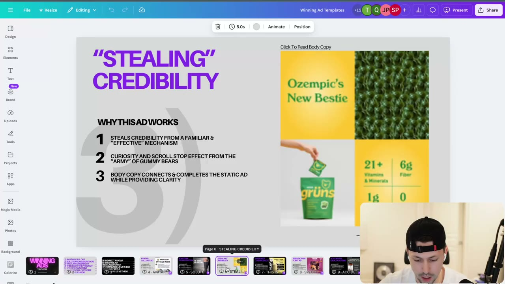
*Template 3, "Stealing" Credibility: Grüns "Ozempic's New Bestie". [09:51]*

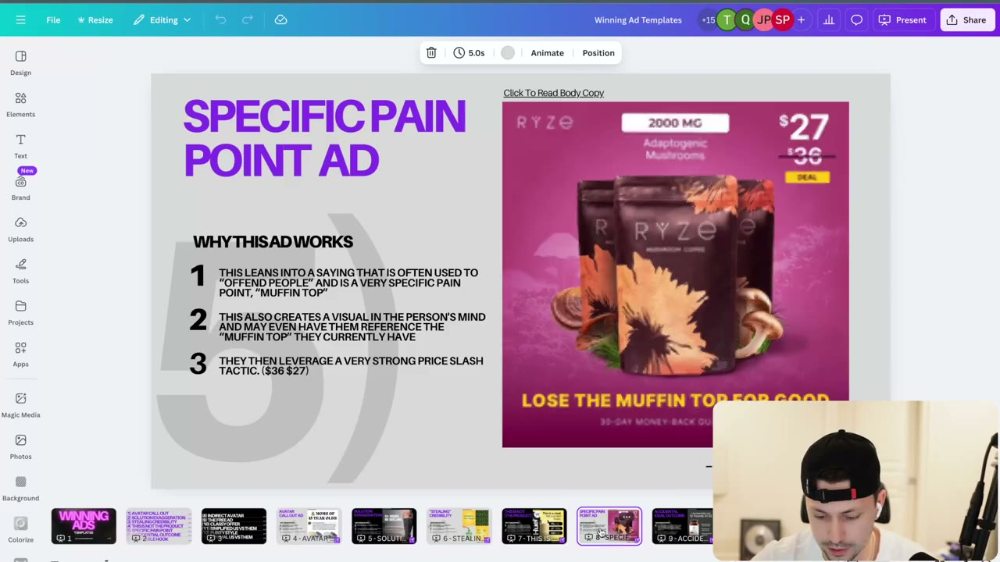
*Template 5, Specific Pain Point Ad: Ryze "Lose the muffin top for good" with a $36 -> $27 price slash. [09:52]*

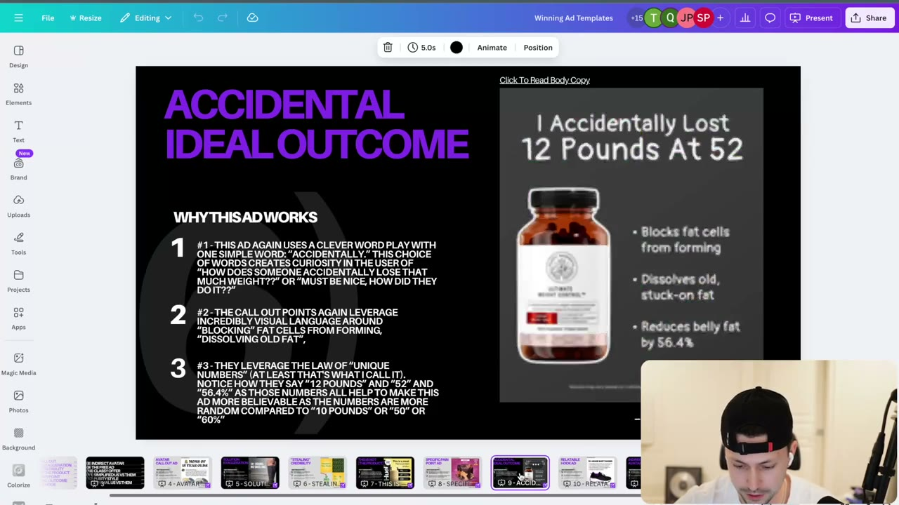
*Template 6, Accidental Ideal Outcome: "I Accidentally Lost 12 Pounds At 52" with the three reasons (clever one-word wordplay; visual call-outs; "unique numbers"). [09:54]*

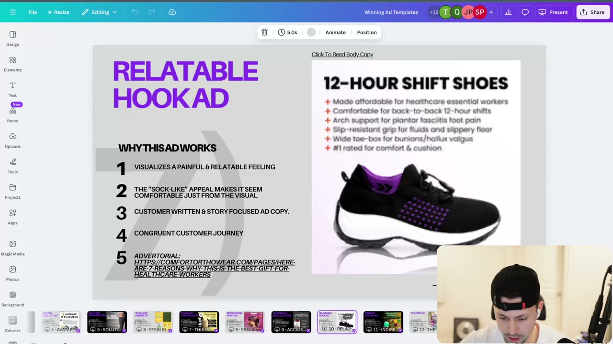
*Template 7, Relatable Hook Ad: "12-hour shift shoes" with benefit list and advertorial link. [09:55]*

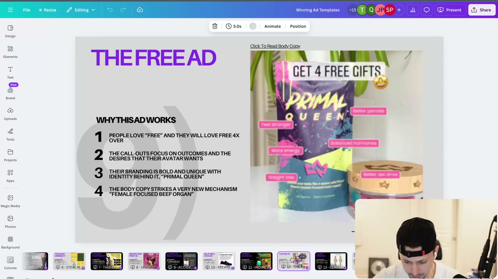
*Template 9, The Free Ad: Primal Queen "Get 4 free gifts". [10:03]*

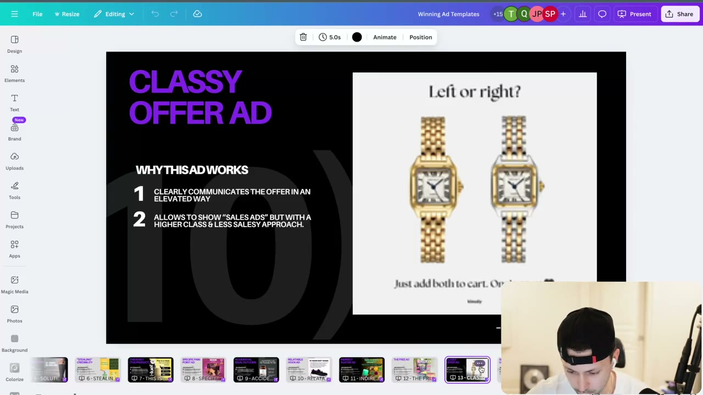
*Template 10, Classy Offer Ad: two watches, "Left or right?". [10:04]*

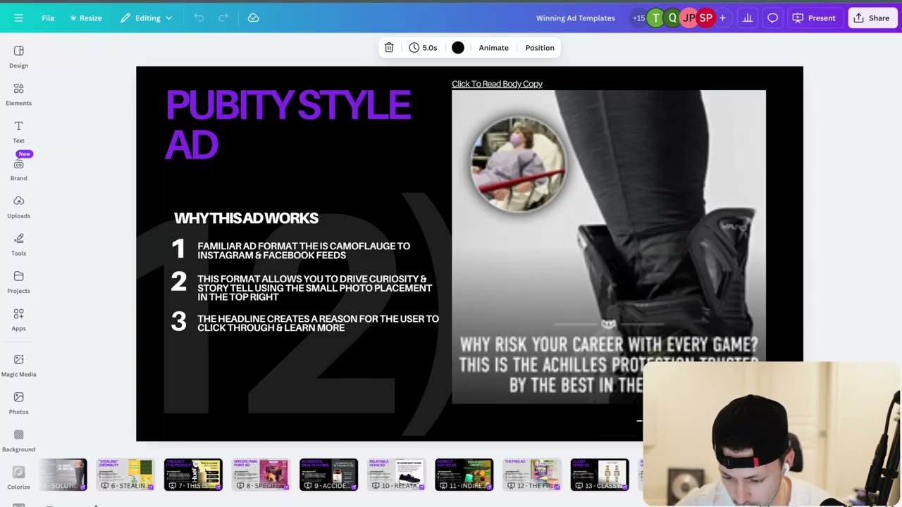
*Template 12, Pubity Style Ad: sport-protection ad with a small top-right photo. [10:05]*

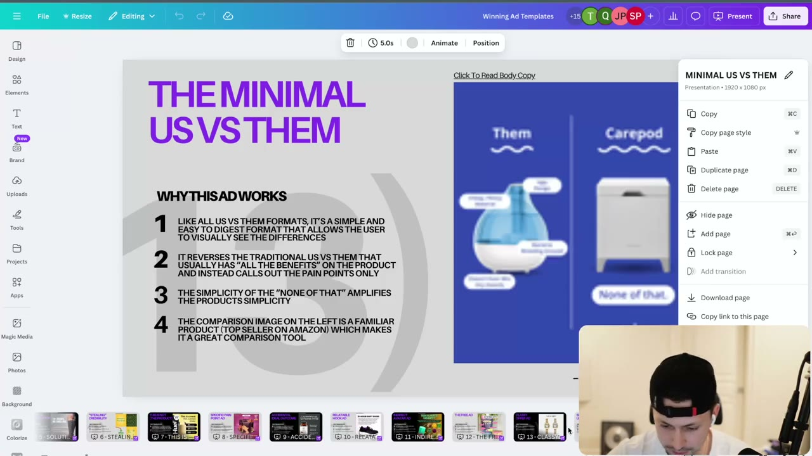
*Template 13, The Minimal Us vs Them: humidifier vs Carepod, "None of that." (A Canva context menu overlaps the right edge.) [10:07]*


## How to apply
- [ ] For each sub-avatar, collect 5-10 verbatim quotes with the behavior and emotion; label each source.
- [ ] Choose 1-3 proven ad structures (not only from your own niche) and screenshot them; record the structure in one line (e.g. "question headline + cause sub-line + 3 check bullets + CTA box").
- [ ] Prompt Claude with: inspiration screenshot, sub-avatars with quotes, product doc, reading level, and "write it exactly like the ad itself"; request N headlines and the exact bullet count.
- [ ] Rate each output line for specificity (does it name a behavior or internal quote?) and give Claude the winners plus the reason; request more like them.
- [ ] Check every factual term in each bullet against the product doc (hormone vs enzyme, ingredient names, numbers). Replace any unsupported item.
- [ ] Add short glosses to jargon; keep reading level at grade 5-6 (check with a readability tool).
- [ ] Build one ad first, fix layout, then duplicate; update template dates/details.
- [ ] Wait before shipping (20 minutes minimum; a day is best), then reread each ad for tone, claim accuracy, and number mismatches.
- [ ] If a headline implies a visual (tiny plate, jug, bored person), generate or shoot that image; otherwise ship and test the message.
- [ ] (derived) For UGC: turn each behavior headline into a creator's opening line and on-screen text; make the three check-mark bullets the three proof beats; keep the same product-truth check on every spoken claim.

## Related
- Previous: [67. How To Write Image Ads - Part 1](67-how-to-write-image-ads-part-1.md) · Next: [69. Action item: write your image ad briefs](69-action-item-write-your-image-ad-briefs.md) · Later: [70. How To Write Video Ads - Part 1](70-how-to-write-video-ads-part-1.md)
- [18. Being aware of angles](18-being-aware-of-angles.md) · [Creative testing system](../../../../frameworks/creative-testing-system.md) · [Iteration vs variation](../../../../concepts/iteration-vs-variation.md) · [Angle remix](../../../../playbooks/angle-remix.md)

## Sources and limitations
- Transcript: [68. How To Write Image Ads - Part 2 ... .txt](<../../../../../raw/evolve/copywriting/_transcripts/✍️ Evolve Copywriting (NEW)/68. How To Write Image Ads - Part 2 ✍️ Evolve Copywriting (NEW) Evolve.txt>) · Page text: [68 ... .html.md](<../../../../../raw/evolve/copywriting/_extracted/✍️ Evolve Copywriting (NEW)/68. How To Write Image Ads - Part 2_✍️ Evolve Copywriting (NEW)_Evolve.html.md>) · Skool images: [68-img01..03](<../../../../../raw/evolve/copywriting/linked/skool-images/68/68-img01.png>).
- Machine transcription (Whisper large-v3-turbo). The full recording is covered (last segment 50:58 of a 50:58 video). Whisper mishearings fixed in prose from on-screen text: "taller size portions" = "toddler-sized portions"; "board eater" = "bored eater"; "GP1 / GOP1 / GLP one" = GLP-1; "Diaglomera" = Dyglomera; "Zen wellness" = Zend; "kids constantly being rude" is correct; "puberty style" = Pubity Style; "Grunz" = Grüns; "Carepod" is the slide name; "ChadGBT" = ChatGPT; "camera pro" = probably Canva Pro (said in lesson 67). The speaker says "Chase" may come to explain Creative OS pricing: not in the files.
- Pricing, plan limits and discount code for Creative OS are as stated by the instructor and the on-screen pricing page; the code "EVOLVE" for 10% is from the Skool page. Treat as unverified and subject to change.
- "Root cause" being Meta-compliant is the instructor's unverified Google search result; do not treat as a compliance ruling.
- The final images differ from the build on screen: ad 1's sub-line is "behind always being hungry" (video: "behind failed restriction"); the water-jug image shown in the video does not appear in the Skool final image for ad 2.
- The statement of the "68%" GLP-1 figure and the unverified claim "equivalent to 10 cups of green tea" are instructor/product-page claims; see the limitation note in [lesson 67](67-how-to-write-image-ads-part-1.md).
- The Master Document and the concept brief template are not duplicated here; the sub-avatar research doc shown on screen is the client's own doc (only the visible quotes are quoted). The slide text for the template deck was read from screen frames (some words are small or partially hidden).
- Frame labels are the video times of the frame files; transcript timestamps are paragraph starts from the compact reader, so a cited moment may start up to ~30 seconds before the exact line.
