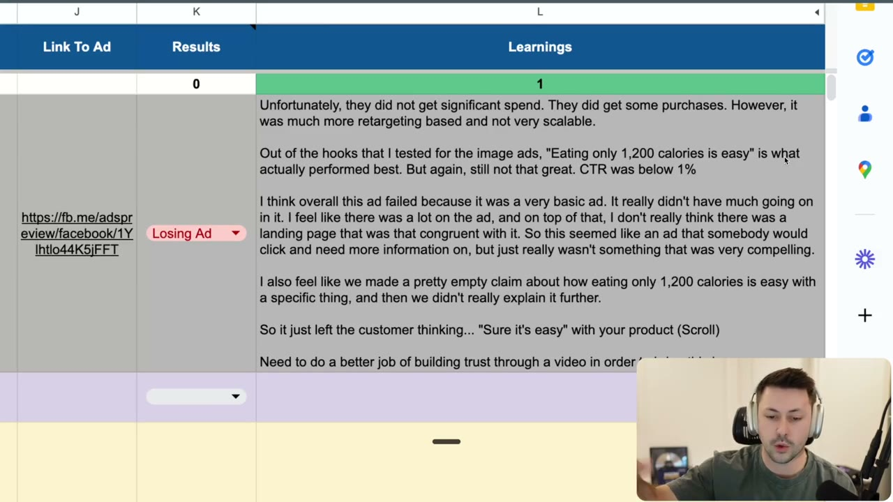
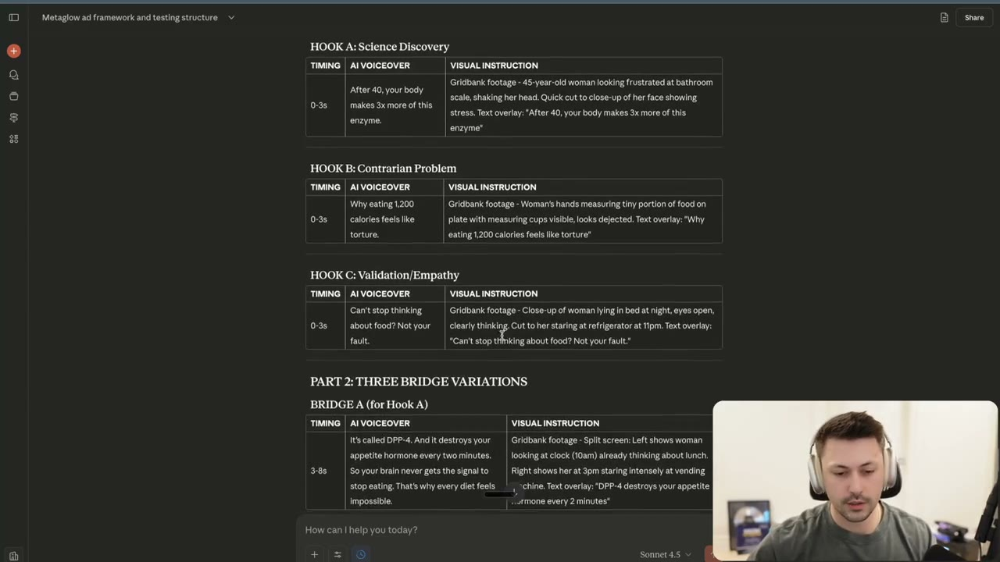
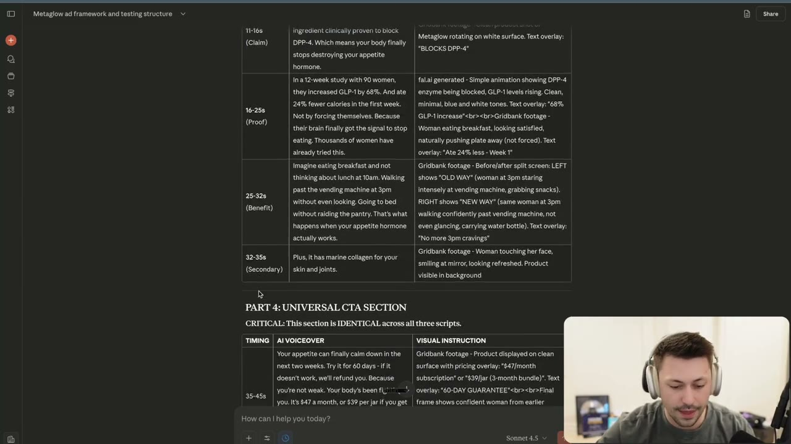
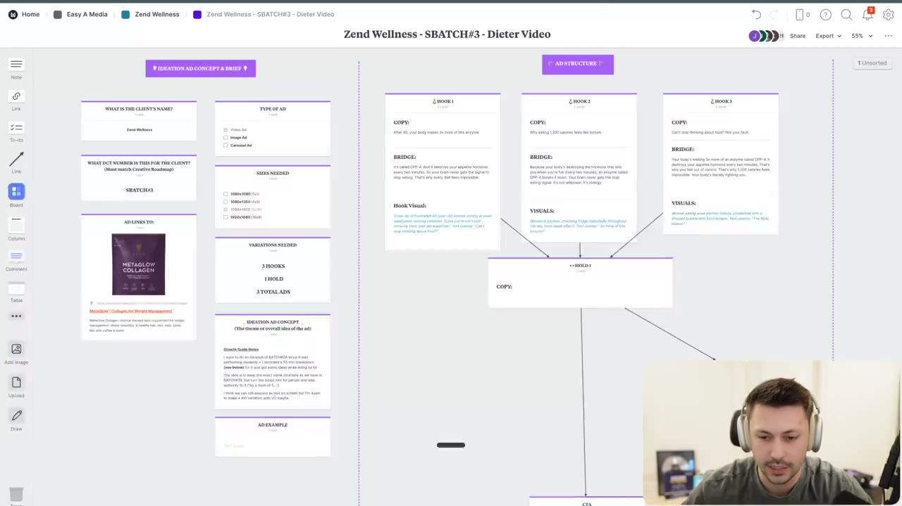

# 70. How To Write Video Ads - Part 1
> Spencer runs the course's "mega prompt" (the EVOLVE OPTIMIZED VIDEO AD SCRIPT prompt) in Claude on a real supplement brand, showing the feedback-loop questions, the input documents it needs, the modular output (3 hooks + 3 bridges + 1 universal hold + 1 universal CTA) and why that first output is only a 70-80% draft.

## 🤖 Agent use
- **Use when:** writing a first-draft short video ad script (30-45 s, B-roll + AI voiceover) for a Problem-Aware or Product-Aware audience, or when building a video-ad brief for an editor. This is the process lesson; the polishing lesson is [71](71-how-to-write-video-ads-part-2.md) and the fill-in template with the full prompt is [72](72-action-item-write-your-video-ad-briefs.md).
- **Inputs → outputs:** (1) learnings from any previous test of this angle (pasted scripts, which hook got spend, which metrics were off, why people did or did not care), (2) four documents: Product, New Mechanism, New Information Output, Customer Data, plus angle/avatar and a hypothesis → (3) three hooks, three matched bridges, ONE universal hold, ONE universal CTA, per-line visual instructions, and a strategic explanation. Then human editing to ~100%.
- **Rules:**
  - **DO** do more research after you get direction from a test, before writing the next ad. [00:00–00:53]
  - **DO** judge on spend and scale, not on "some purchases": "all I care about ... is an ad that scales." [01:47] (The instructor's example ad got purchases but under 10% of spend and was labelled a losing ad.)
  - **DO** answer the feedback-loop questions before any script is written: previous scripts, best/worst hook, off metrics, why people did or did not care, new learnings. [06:31–09:27; docx "Feedback Loop Protocol"]
  - **DO** supply the four documents (product, new mechanism, new information, customer data) plus angle/avatar and hypothesis. If you have no reviews, say so and tell the model to use only what is in the other documents. [09:27–12:44]
  - **DO** state real social-proof volume when the model asks; it offers fallbacks (clinical-trial data, or skip volume claims). Do not let it assume "12,000 women". [12:01–12:44; docx "Social Proof Scaling System"]
  - **DO** test hook + bridge together; keep the hold and CTA identical across the three variants so the test isolates the hook/bridge. [16:39; docx "Testing Reminder"]
  - **DO** SHOW that something is easy instead of saying "it's easy": e.g. "I had breakfast and I'm still not even hungry by dinner. Sometimes I just skip lunch." [05:38]
  - **DON'T** treat the AI output as final. Claude gets you "70, 80% of the way there"; you take it to 100% with customer language and research. [24:58; also 11:06]
  - **DON'T** accept generic objection lines. "I know what you're thinking. You've tried supplements before. They didn't work" is "a terrible line ... not specific enough"; find what they actually tried (Reddit threads). [23:07–24:04]
  - **IF** the hook + bridge feel thin **THEN** extend hook and bridge to about 8 seconds together so all of the emotional set-up is communicated and the three ads read as different to Meta. [15:59–16:39]
  - **IF** you have no creator or do not want to film **THEN** use the B-roll compilation + AI voiceover model (no talking heads) and source stock footage (Gridbank is named first). [00:00; 14:19; docx "Visual Execution System"]
- **See also:** [71. Part 2 (optimising the script)](71-how-to-write-video-ads-part-2.md) · [72. Brief template + full prompt](72-action-item-write-your-video-ad-briefs.md) · [69. Image ad briefs](69-action-item-write-your-image-ad-briefs.md) · [27. How to write a bridge](27-how-to-write-a-bridge.md) · [31. Show, don't tell](31-how-to-create-ads-that-show-dont-tell.md) · [14. Unique mechanisms](14-why-you-need-to-use-unique-mechanisms.md) · [Creative testing system](../../../../frameworks/creative-testing-system.md) · [Creator brief playbook](../../../../playbooks/creator-brief.md)

Lesson page text: only the link "Here is the prompt" to a Google Doc. The Google Doc is identical in text to the attached `How To Write Video Ads.docx` (same file is attached to lessons 70, 71 and 72); the full verbatim text is reproduced once, on [lesson 72](72-action-item-write-your-video-ad-briefs.md#the-prompt-verbatim).

## Key ideas

### 1. Learn from the previous test before writing the next ad [00:00–04:39]
- The prompt is "beginnerified" so it is actionable for people who "don't have probably a lot of content ... probably don't have a content creator ... don't want to film it". [00:00]
- Spencer has a master doc (research) and a Growth Guide sheet. He stresses doing more research after a test gives direction ("this sub avatar test is over"). [00:00–00:53]
- Batch 1 was three image-ad angles. The winner was the headline "Eating only 1,200 calories is easy with Dyglomera" (Whisper writes "Diaglomera"; the sheet and PDF spell it **Dyglomera**). It got a minority of spend (said as "less than 5% ... or 5%" at [00:53], then "less than 10% of the total ad spend" at [01:47]) and some profitable purchases, but did not scale. He logs it as **Losing Ad**. [00:53–02:31]
- His logged learnings (read on screen, [02:18], and spoken [01:47–04:07]):
  - It got "much more retargeting based" delivery; he inferred that from a decently high frequency. [01:47]
  - The winning hook of the three also got the only purchases, but CTR was "below one percent". [02:31]
  - Why it failed (his hypothesis): a very basic ad; "a lot of call outs" that are hard to read; no congruent landing page about cravings; and "a pretty empty claim" ("eating only 1,200 calories is easy with a specific thing") that was never explained, leaving the customer thinking "Sure it's easy" with your product. [03:09–04:07]
  - Next step: "a better version of this ad that explains more, aka video", build trust through video, and "do a lot more showing rather than telling". [03:09–04:07]
- **Batch #3 hypothesis (the brief for the script):** same desire, a "1200 calorie iteration" that makes eating fewer calories easy. 1,200 may be too specific, so he flags it as something to consider while writing. Real pain point for the avatar (being in a deficit); the market is skeptical and has "heard everything for cravings". [04:07–05:38]


*The Growth Guide "Learnings" cell for the losing 1,200-calorie image ad: little spend, some retargeting-type purchases, CTR under 1%, basic ad, incongruent landing page, empty claim, need to build trust with video. This is exactly the text he pastes into Claude as the feedback-loop answer. [02:18]*

### 2. Run the prompt: the feedback loop comes first [05:38–09:27]
- He copies the "mega prompt" ("I think ... 38 pages"; he was "a little questionable sharing this") into a fresh Claude window; if you have a Claude project, put it there. [05:38]
- Claude confirms it absorbed the framework and, before writing, asks the **Pre-Script Feedback Questions** (verbatim in the prompt section below): previous performance review, best/worst hook, off metrics, reasons, new learnings. [06:31]
- Spencer answers by pasting screenshots of the image ads and his learnings. Answer pattern he uses: "I have not tested a video script but I did test image ads around this angle ... they did not get significant spend. They did get some purchases, however it was much more retargeting based and not very scalable." Then which hook performed best and the CTR. [07:12–08:33]
- If other ads started getting spend, or he studied a winner and noticed a working hook, those learnings go here too. "What we're doing here is we're trying to complete the feedback loop." [08:33–09:27]
- Prompt's own rule for using the answers: build on winners, avoid losing patterns; low CTR/hook rate -> stronger contrarian hooks and visuals; low hold rate -> simplify mechanism, tighten slippery slope, better B-roll pacing; low conversion -> strengthen offer or trust. (docx, "Using Feedback to Inform Strategy")

### 3. Give it the four documents, the angle and the hypothesis [09:27–12:44]
- Claude asks for four inputs: angle and avatar, hypothesis/angle-specific information, and the required documents. [09:27]
  - **New Mechanism** prompt output. [09:27]
  - **New Information** prompt output (a deep-research prompt run earlier in the course). [10:22]
  - **Angle and avatar:** he pastes everything written about the "Dieter" sub-avatar from the master doc, plus a Reddit screenshot ("I don't have any advice but just wanted to say I feel this so hard"). [10:22]
  - **Hypothesis:** pasted from the Growth Guide notes. [11:06]
  - **Product document** (done earlier in the course) and **customer data**. If you have no reviews or feedback, "that's fine"; he tells Claude to use only the information in the original prompt. [11:06–12:01]
- Claude's reply shows the model reading for subtext: "the customer's language is chef kiss: deficits suck, can't control myself around mac and cheese, food has become numbers". [11:06]
- **Compliance question from Claude:** "I have 12,000 women in memory. Is that accurate? If not, what's the real number?" Spencer answers "a thousand to ten thousand" so it uses "thousands of women". If you have only about a hundred or no data, Claude's offered fallbacks are clinical-trial data (90 women) or skipping volume claims. "Sometimes if you don't have the ability to say thousands of women using this ... then it's probably not a good thing to say." [12:01–12:44]

### 4. The first output: modular hooks, bridges, hold, CTA [12:44–18:32]
- It is Spencer's "first take" with a formatting glitch (table did not render at first). [12:44–13:35]
- **Part 1, three hooks** (each with a Gridbank visual instruction): [13:35–15:05]
  - Hook A, "Science Discovery": "After 40, your body makes 3x more of this enzyme."
  - Hook B, "Contrarian Problem": "Why eating 1,200 calories feels like torture."
  - Hook C, "Validation/Empathy": "Can't stop thinking about food? Not your fault."
- **Part 2, one bridge per hook.** Bridge A: "It's called DPP4. And it destroys your appetite hormone every two minutes. So your brain never gets the signal to stop eating. That's why every diet feels impossible." Bridge B starts "Because your body's destroying the hormone that tells you when you're full ... It's not willpower. It's biology." Bridge C starts "Your body's making three times more of an enzyme called DPP4 ... Your body's literally fighting you." [15:05–16:39] (paraphrased from the spoken read-through)
- **Why bridges are written into the test:** "we are actually kind of extending each hook to almost eight seconds. And this is something that we started doing as of late to try to add more congruence into our ads and in essentially allowing meta to see that they are more different ... we're testing kind of like three different hooks and bridges." An evergreen single hold is fine if you do not want three variations. [15:59–16:39]
- **Part 3, universal hold**, broken into objection, claim, proof, benefit, secondary; then the **CTA** (both read out at [17:13–18:32]). The model's draft includes "I know what you're thinking. You've tried supplements before. They didn't work. But here's what they didn't have. Metaglow has Dyglomera, the first ingredient clinically proven to block DPP4 ..."; proof "In a 12-week study with 90 women, they increased GLP-1 by 68% and ate 24% fewer calories in the first week, not by forcing themselves"; benefit "Imagine eating breakfast and not thinking about lunch at 10 a.m., walking past the vending machines at 3 p.m. without even looking, and going to bed without raiding the pantry"; CTA with "$47 a month, $39 per jar" (Spencer notes "per jar" is wrong, it should be per package) and "tap below". [17:13–18:32]
- **Part 5, how scripts combine** and a strategic explanation (Big 4 analysis, mechanism used, target awareness, Objection-Claim-Proof-Benefit cycle, show don't tell, slippery slope). Total length "about 43 to 45 seconds"; "most of these ads will be max 45 seconds." [18:32–20:20]


*Claude's modular output: three hooks (Science Discovery / Contrarian Problem / Validation-Empathy), each with TIMING, AI VOICEOVER and VISUAL INSTRUCTION columns, followed by Bridge A (3-8s). The visual column names the source (Gridbank), avatar, action and text overlay. [16:29]*


*The universal hold as the model drew it: timed rows 11-16s (Claim), 16-25s (Proof), 25-32s (Benefit), 32-35s (Secondary), then Part 4 Universal CTA 35-45s. Note the visual cells mix "fal.ai generated" animation for the mechanism with Gridbank footage for behaviour. [17:19]*

### 5. Awareness level: the model gets it partly wrong [19:26–20:20]
- Claude labelled the script Product-Aware ("tried supplements before and skeptical"). Spencer says it also reads partly Problem-Aware and that Hook A ("after 40, your body makes 3x more of this enzyme") is "almost kind of like an unaware hook". "Claude will struggle with awareness levels." He points to another Evolve video about it and says it is "not that big of a deal" because the focus is the best script; refining awareness comes at a more advanced stage. [19:26–20:20] (The prompt itself says write ONLY for Problem-Aware or Product-Aware.)
- The model's "show don't tell" examples (walking past a vending machine, going to bed without raiding the pantry) are fine but Spencer says "I think we can do this better" in the refining step. [20:20]

### 6. Move it into a brief the editor can use [20:20–23:07]
- Option A: use the prompt's Google Doc layout: variation one: hook, bridge; then the hold. Copy each part from Claude into it. [20:20–21:02]
- Option B (what he does): a **Milanote** board (about $16/month; he prefers it because it is visual and "nice and open" for editors). Hooks and bridges are separate cards, with one big hold card below; he can send it to an editor. Free alternative: **FigJam**. He has no template to share because Milanote does not allow copy/paste like a Google Doc. [21:35–22:12]
- Do not focus on visuals yet: first get the script in a state where "everything [is] laid out". He deliberately does not make it a one-click copy-paste because "I want you guys to think through each and every single line": the objection line, the claim line, the proof line, the benefit line. The CTA can sit under the hold ("sometimes we separate this"). You do not have to follow this "to a T". [22:12–23:07]
- The brief board has the fields shown on the screenshot (client name, DCT number, type of ad, sizes, link, variations needed, ideation concept / Growth Guide notes, then hook/bridge/hold cards). The same fields are reproduced from the PDF on [71](71-how-to-write-video-ads-part-2.md) and [72](72-action-item-write-your-video-ad-briefs.md).


*The Milanote board "Zend Wellness - SBATCH#3 - Dieter Video": left column = ideation brief (client, DCT number, type of ad, sizes, ad link, variations needed "3 HOOKS / 1 HOLD / 3 TOTAL ADS", ideation concept with Growth Guide notes, ad example); right = AD STRUCTURE with Hook 1-3 (copy, bridge, visual) all feeding one HOLD 1 and a CTA. [22:55]*

### 7. Why the first draft is not a winner [23:07–25:42]
- Example of a bad line: "I know what you're thinking. You've tried supplements before. They didn't work." Spencer: "I hate this ... This is a terrible line. We can get way more specific." What supplements have they tried? Find out from Reddit threads: "You've probably tried relying on your willpower. You've probably tried this ... None of it is really working or you're not sure that you want to trust it." [23:07–24:04]
- "Claude is again going to get you 70, 80% of the way there. You need to ... get it to a hundred percent." Because most students cannot test and spam many ads, "you need to be focusing on intent". Part 2 shows the second pass (deeper research, customer-specific language). [24:58–25:42]
- Troubleshooting note: he had to tell Claude to prompt him on specific things and the table broke; "this is stuff that you guys are going to deal with when you're using AI". [24:58]

## Steps / framework (video-ad drafting process)
Steps are the instructor's workflow from this lesson plus the prompt's own protocol. The "Agent version" column is derived.

| # | Step | Source | Agent version (derived) |
|---|---|---|---|
| 1 | Review the previous test of this angle and log learnings (spend share, metrics, reasons, Losing/Winning label) | [00:53–04:07] | Pull results from the ad account / Growth Guide; write the learnings paragraph before prompting |
| 2 | Write the next-batch hypothesis: same desire, what to change, what to show instead of tell | [04:07–05:38] | Store as "hypothesis" field in the brief |
| 3 | Open the mega prompt in a fresh Claude window or Claude project | [05:38] | Load the prompt text from [lesson 72](72-action-item-write-your-video-ad-briefs.md#the-prompt-verbatim) as the system/first message |
| 4 | Answer the 5 feedback questions | [06:31–09:27] | Fill questions 1-5 from step 1 data; write "N/A" where there is no data |
| 5 | Paste angle/avatar, hypothesis, New Mechanism doc, New Information doc, Product doc, Customer data (or say none) | [09:27–12:01] | Do not start without all four documents; if one is missing say so explicitly |
| 6 | Confirm real social-proof volume / fallbacks | [12:01–12:44] | Choose the tier honestly (see docx tiers); never fabricate |
| 7 | Let it produce 3 hooks, 3 bridges, 1 hold, 1 CTA, visuals, strategic explanation | [12:44–18:32] | Check the "Modular Output Check" (3/3/1/1, hold identical, CTA identical) |
| 8 | Copy into the brief (Google Doc or Milanote/FigJam), one card per line type | [20:20–23:07] | Write the final brief in the template on lesson 72 |
| 9 | Critique line by line; do research (Reddit etc.); rewrite generic lines | [23:07–24:58] | Continue in [lesson 71](71-how-to-write-video-ads-part-2.md) |

## Examples

### Hooks / bridges produced in this lesson (before Spencer's edits)
| Variant | Hook (AI voiceover) | Visual instruction (as given) | Source |
|---|---|---|---|
| A, Science Discovery | "After 40, your body makes 3x more of this enzyme." | Gridbank: 45-year-old woman looking frustrated at bathroom scale, shaking her head; quick cut to close-up of her face showing stress; text overlay "After 40, your body makes 3x more of this enzyme" | [13:35–14:19]; frame [16:29] |
| B, Contrarian Problem | "Why eating 1,200 calories feels like torture." | Gridbank: woman's hands measuring a tiny portion of food on a plate with measuring cups visible, looks dejected; overlay "Why eating 1,200 calories feels like torture" | frame [16:29] |
| C, Validation/Empathy | "Can't stop thinking about food? Not your fault." | Gridbank: close-up of woman lying in bed at night, eyes open, clearly thinking; cut to her staring at refrigerator at 11pm; overlay "Can't stop thinking about food? Not your fault." | frame [16:29] |

- Gridbank demo: searching the site returns clips of a woman getting on a scale and looking up frustrated, one of a woman who "looks like she's full", and others. Of one he says "she's obviously not 40. This would probably be the clip that I would use." (transcript is ambiguous on which clip). He defers how to source and edit footage to a later video. [14:19–15:05]

### Examples inside the DOCX (the prompt)
See the Structured units below; every hook, rewrite and template in the DOCX is listed there with its section.

## Structured units

### Hooks
Heuristic / self columns are not taught in this lesson ("—"). "Big 4" and "Four U's" are the prompt's own labels (docx, "Section A").

| Hook | Heuristic(s) | Emotion / zone | Self targeted | Why it works (as given) | Source |
|---|---|---|---|---|---|
| "After 40, your body makes 3x more of this enzyme." (Hook A, Science Discovery) | — | Big 4: NEW/ONLY + BIG (derived from docx framework) | — | Novel mechanism + age-specific number; creates "what enzyme?" curiosity | [15:05]; docx "Hook Examples" |
| "After 40, your body makes 3x more of the enzyme that destroys your appetite hormone." | — | NEW + SAFE (removes blame) + BIG ("3x") | — | Docx: "Biggest thing happening now" framework; ~2 lines, scannable | docx, Section A "Strong Hook" |
| "Why eating 1,200 calories feels like torture." (Hook B) | — | UNIQUE + USEFUL (+ URGENT implied) | — | Docx: "This is quirky" framework; 1 line; "Why? Tell me why!" | [15:05]; docx, Section A |
| "Can't stop thinking about food? Not your fault." (Hook C) | — | SAFE + BIG dominant (docx's hook-3 recipe: pain-point validation from customer data) | — | Validates the pain, removes blame | [15:05]; docx "Create three distinct hooks" |
| "The easiest way to get rid of dandruff." | — | EASY | — | Docx: problem-aware, direct; "quirky" claim of ease | docx, Section A and Awareness section |
| "Here's why I stopped using regular sheets." | — | NEW (pattern interrupt) | — | Docx: product-aware hook ("what you're doing wrong"); winning-ad line | docx, Awareness section |
| "The viral sheets that regulate body temperature." | — | NEW/ONLY | — | Docx: "Biggest thing happening now" framework ("viral") | docx, Section A, Framework 1 |
| "Your toes will never be cold again" (text overlay example) | — | BIG | — | Docx visual-format example | docx, "Visual Instructions for Hooks" |

### Ad teardowns
| Brand / product (niche) | Format | Hook / opening | What works | What fails | Fix suggested | Principle | Source |
|---|---|---|---|---|---|---|---|
| Zend Wellness MetaGlow Collagen (weight-management supplement) | Static image ad | "Eating only 1,200 calories is easy with Dyglomera" | Best of three tested angles: most spend, only version with purchases; purchases profitable | Under about 10% of ad spend; CTR below 1%; retargeting-like (high frequency); busy, hard-to-read callouts; landing page not congruent; "empty claim" that "easy" without explaining how | Make a video that explains and shows the claim; build trust; more showing than telling | Show don't tell; congruence from ad to landing page | [00:53–04:07]; frame [02:18] |

### Rewrites
Pairs below are the prompt's own before/after examples (docx section in the Source column) unless a timestamp is given.

| Before | After | What changed | Source |
|---|---|---|---|
| "Our product has three ingredients. They work together to help you." | "This product has three ingredients. The first one does something no other supplement can do." | Stopping point -> curiosity gap | docx, Slippery Slope Principle |
| "Regular sheets trap heat. That's why you wake up sweaty." | "Regular sheets trap heat. But that's not the real problem..." | Resolution -> open loop | docx, Slippery Slope; Core Rule 4 |
| "It blocks the enzyme. That helps with appetite." | "It blocks the enzyme destroying your appetite hormone every 2 minutes. Here's why that changes everything..." | Adds specificity + "but wait" moment | docx, Core Rule 4 (Technique 3) |
| "Most people think dandruff comes from dry scalp. They're wrong." | "Most people think dandruff comes from dry scalp. It's actually the opposite..." | Flat contradiction -> pattern interrupt with open loop | docx, Core Rule 4 (Technique 4) |
| "12,000 women used the first supplement with Dyglomera that's easy to take and risk-free and saw results in 3 days." | "12,000 women blocked the enzyme destroying their appetite hormone - and ate 24% less in week one without trying." | Feature-list (forcing all Big 4) -> 2-3 emotions that breathe | docx, Core Rule 1 |
| "Like Ozempic but natural" / "Better than other collagens" / "The best massage gun" / "Theragun alternative" | "The first supplement that blocks the enzyme destroying your appetite hormone" / "The only recovery device that reads your muscle tension and adjusts pressure automatically" / "The first mattress that adjusts firmness based on your body temperature while you sleep" | Category comparison -> new category via unique mechanism | docx, Core Rule 2 |
| "You'll have more energy and better focus" | "Imagine waking up without hitting snooze three times. Walking past the vending machine at 3pm without even looking at it. Going to bed without the nightly pantry raid." | Telling benefits -> showing behaviour | docx, Core Rule 3 |
| Visual: "Animated enzymes and hormones with scientific diagrams" | Visual: "Gridbank footage - woman confidently walking past vending machine at 3pm, not even glancing at it" | Concept visual -> behavioural visual | docx, Core Rule 3 |
| "Many people struggle with weight management" | "If eating 1,200 calories feels like torture, that's because your body is literally fighting you. And science just proved it's not your fault." | Corporate/vague -> peer-level, validating, blame removed | docx, Core Rule 6 |
| "Our company spent 10 years developing this" | "For 10 years, you've been told it's your fault. It's not." | Company lens -> customer lens | docx, Section B (Self-Interest) |
| "This supplement facilitates enhanced metabolic function" | "This blocks the enzyme destroying your appetite hormone" | Written -> spoken | docx, Core Rule 10 |
| "If you've been struggling with your weight for years and have tried every diet under the sun but nothing seems to work and you're finally ready to discover the real reason why you can't lose weight..." | "After 40, your body makes 3x more of the enzyme destroying your appetite hormone." / "Why eating 1,200 calories feels like torture." | Wall-of-text hook (4+ lines) -> ~5 words, max 2 lines | docx, Section A |
| "If you've been trying to lose weight but can't seem to stop thinking about food all day long and you feel like your willpower is broken, science just discovered why this is happening and it's not your fault." (weak hook) | "After 40, your body makes 3x more of the enzyme that destroys your appetite hormone." | Explanatory mode -> intrigue | docx, Section A "Hook Examples" |
| "Want to lose weight fast and easy with this safe new supplement that thousands love?" (weak hook) | (no direct after given; the prompt contrasts it with the strong hooks above) | Checklist hook -> pick 2-3 levers | docx, Section A "Hook Examples" |
| "It reduces appetite" | "It blocks the enzyme that destroys your appetite hormone every 2 minutes, so your brain finally gets the 'stop eating' signal" | Claim alone -> claim + reason | docx, Section C (Reason-Why) |
| "Scattered: It has Dyglomera which boosts GLP-1, plus Suntheanine for cortisol, plus marine collagen for skin, plus..." | "Metaglow blocks the enzyme destroying your appetite hormone. That's it. One mechanism. Here's why it works..." | Many mechanisms -> one (Law of Focus) | docx, Section C |
| "It reduces calories by 24%. It works well." | "They ate 24% fewer calories in week one. And here's what happened next..." | Fact -> momentum | docx, Section C (Proof) |
| "You'll have better appetite control" | "Imagine eating breakfast and not thinking about lunch at 10am. Imagine walking past the vending machine at 3pm without even looking. Imagine going to bed without raiding the pantry." | Telling -> showing | docx, Section C (Benefit) |
| "Try it now. It's risk-free. Order below." | "Your appetite can finally calm down in the next 2 weeks. Try it free for 60 days - if it doesn't work, keep the first jar anyway. Because you're not weak. Your body's been fighting you. Tap below to fix it." | Dropped momentum -> loop closure to the hook | docx, Section D |
| "Try it risk-free" | "Here's what's crazy: Try it risk-free for 60 days. If it doesn't work, keep the first jar anyway. Why? Because we'd rather lose money than have you think this is another scam supplement." | Generic guarantee -> pattern-interrupt guarantee | docx, Section D |
| "Our coffee has helped over 100,000 people" (if you just started selling it) | "This coffee blend is rated 4.9/5 with over 100,000 reviews" (only if true for the actual brand) / "Customers report better focus within 30 minutes" | Fabricated own proof -> attributable borrowed proof | docx, Borrowed Proof Protocol |
| "I know what you're thinking. You've tried supplements before. They didn't work." (AI draft) | Rewritten in [lesson 71](71-how-to-write-video-ads-part-2.md#examples) as "You've tried GLP-1 supplements, appetite suppressants, and natural alternatives. But the problem is, none of those work long-term" | Generic -> specific, customer-language | [23:07–24:04] |

### Templates
| Template | Use for | Example fill | Source |
|---|---|---|---|
| Hook visual: `VISUAL: [Source] - [Avatar demographic] [specific action/emotion], [context/setting]. Text overlay: "[Hook text]"` | Every hook row | "Gridbank footage - Woman tossing in bed, looking exhausted, checking phone showing 3am. Fast cut to sweaty pillow. Text overlay: 'Here's why I stopped using regular sheets'" | docx, "Visual Instructions for Hooks" |
| Bridge visual: `[Source] - [Specific scenario]. Text overlay: "[Key message]"` | Every bridge row | "Gridbank footage - Woman looking frustrated at scale, shaking head. Cut to her staring at food, internal struggle visible. Text overlay: 'NOT YOUR FAULT'" | docx, Section B |
| New-category claim: "The first/only [thing] that [unique mechanism]" | Hold claim, hooks | "The first mattress that adjusts firmness based on your body temperature while you sleep" | docx, Core Rule 2 |
| Mechanism name: proprietary name | Hold claim | "The Alpine Ice Hack", "The Dyglomera Effect", "The 5-Second Water Method" | docx, Section C (Schwartz naming strategy) |
| Objection line: "I know what you're thinking: '[past attempt].'" / "I know this sounds too good to be true." / "But here's what they didn't tell you..." | Hold, 8-11 s | (the instructor says make the past attempts specific: [23:07]) | docx, Section C |
| Strategic explanation block: Big 4 Analysis; Mechanism Used; Target Awareness Level; Objection -> Claim -> Proof -> Benefit Cycle; Show Don't Tell Execution; Slippery Slope Execution | After every full output | see output at [18:32–20:20] | docx, Output Structure |

## Prompts / templates (verbatim)

The whole prompt is reproduced verbatim on [lesson 72](72-action-item-write-your-video-ad-briefs.md#the-prompt-verbatim). Parts quoted here because lesson 70 walks through them.

**Pre-script feedback questions (docx, "Feedback Loop Protocol"; Claude asks them on screen at [06:31]):**
```
1. Have you tested any video ad scripts for this angle before?
   - If yes, please paste in the specific scripts and clarify if it was a winner (got spend and hit KPI) or a loser (didn't get spend, or didn't hit KPI)
   - If no, just write "N/A"

2. Which scripts performed BEST? Which performed WORST?
   - Out of the hooks tested, which one got the ad spend? (paste all 3 and clarify which one got the spend)
   - If no, just write "N/A"

3. Were there any metrics that were off that you think need to be improved?
   - If it did not get any spend, just say "did not get significant spend"
   - If it did get spend, you can say things like: CTR was low (less than 1%), hook rate was low (less than 25%), hold rate was low (less than 5%), Conversion Rate was low (didn't get any conversions)

4. What are the main reasons you think people DID or DID NOT care about this ad?

5. Do you have any new learnings in general that you can share with me before writing this new ad?
```

**Input slots (docx, "Knowledge"):**
```
Product Document:  """<Replace this text with the PRODUCT DOCUMENT or upload a file>"""
New Mechanism Document:  """<Replace this text with the NEW MECHANISM DOCUMENT or upload a file>"""
New Information Output Document:  """<Replace this text with the NEW INFORMATION DOCUMENT or upload a file>"""
Customer Data Document:  """<Replace this text with the CUSTOMER DATA DOCUMENT or upload a file>"""
```

**Spencer's pasted answer to question 1-3 (spoken, Whisper transcript, [07:52]):** "I have not tested a video script but I did test image ads around this angle specifically and unfortunately they did not get significant spend. They did get some purchases, however it was much more retargeting based and not very scalable."

## Screenshots
See the four images embedded above (learnings sheet [02:18], hooks/bridge output [16:29], hold output [17:19], Milanote board [22:55]).

## How to apply
- [ ] Write the learnings paragraph from the last test of this angle (spend share, CTR / hook rate / hold rate, why) before opening the prompt.
- [ ] Prepare the four documents; state "none" for missing ones instead of letting the model invent.
- [ ] Give the true social-proof tier; never accept "12,000" unless real.
- [ ] Generate 3 hooks + 3 bridges + 1 hold + 1 CTA; verify the hold and CTA are identical across scripts and total length is 30-45 s.
- [ ] Highlight every generic line (objection, proof, benefit) and replace it with customer-language research.
- [ ] Put each part on its own card/row in the brief; leave visuals for after the script is locked, then add them.
- [ ] (derived) For UGC scripts, keep the hook/bridge/hold/CTA split and the 3-hooks-1-hold test design; replace "B-roll + AI voiceover" with the creator's on-camera delivery and keep the "show behaviour" and "spoken 6th grade" rules.

## Related
- Previous: [69. Action Item: Write Your Image Ad Briefs](69-action-item-write-your-image-ad-briefs.md) · Next: [71. How To Write Video Ads - Part 2](71-how-to-write-video-ads-part-2.md) · [72. Action Item: Write Your Video Ad Briefs](72-action-item-write-your-video-ad-briefs.md)
- [27. How to write a bridge](27-how-to-write-a-bridge.md) · [26. How to write open loops](26-how-to-write-open-loops.md) · [13. 6th-grade level](13-why-you-need-to-write-at-a-6th-grade-level.md) · [21. Market awareness](21-being-aware-of-market-awareness.md) · [37. Evolve writing prompts](37-evolve-writing-prompts.md)
- [Creative testing system](../../../../frameworks/creative-testing-system.md) · [Iteration vs variation](../../../../concepts/iteration-vs-variation.md)

## Sources and limitations
- Transcript: [70. How To Write Video Ads - Part 1 … .txt](<../../../../../raw/evolve/copywriting/_transcripts/✍️ Evolve Copywriting (NEW)/70. How To Write Video Ads - Part 1 ✍️ Evolve Copywriting (NEW) Evolve.txt>) · Page text: [….html.md](<../../../../../raw/evolve/copywriting/_extracted/✍️ Evolve Copywriting (NEW)/70. How To Write Video Ads - Part 1_✍️ Evolve Copywriting (NEW)_Evolve.html.md>) · Attachment: [70. How To Write Video Ads.docx.md](<../../../../../raw/evolve/copywriting/_extracted/✍️ Evolve Copywriting (NEW)/70. How To Write Video Ads.docx.md>) · Linked Google Doc (same text): [70-document-11fMpEFheB.docx.md](<../../../../../raw/evolve/copywriting/_extracted/_linked/google/70-document-11fMpEFheB.docx.md>)
- Machine transcription (Whisper large-v3-turbo). Full recording covered (last segment 25:42 of 25:42). Whisper heard "Diaglomera/diglomera" for **Dyglomera**, "Cloud" for **Claude**, "Milano" for **Milanote**, "grid bank" for **Gridbank**, and "copyright" in places. The docx exported text keeps the doc's formatting but the Google Doc shows a "Beginner" tab beside "V2" on screen ([06:03]); only one tab's text is in the export, so it is not verifiable which tab.
- Numbers to treat with care: spend share said as both "5%" and "10%" ([00:53], [01:47]); the model's draft used GLP-1 +68%, and Spencer later corrects figures to match the website ([71 final script](71-how-to-write-video-ads-part-2.md): +56%, 24% fewer calories). "Per jar" in the draft CTA is the model's error per Spencer ([17:45]).
- On-screen image-ad headlines visible in a frame around [07:37-07:42] (not discussed): "STOP NEEDING DISCIPLINE. START LOWERING CORTISOL", "TRICK YOUR STOMACH INTO STAYING FULL", "I JUST IGNORE MY CRAVINGS NOW" (read from video frames).
- Doc claims attributed to Hopkins, Caples, Schwartz (e.g. "5-10X differences in headline results", Schlitz Beer example) are the prompt's own assertions; not verified.
- Tension to note: the DOCX tells the model "never categorize" and keep hooks to about 5 words, while Spencer's own final hooks are 13-17 words and use "first and only collagen" (see [71](71-how-to-write-video-ads-part-2.md#sources-and-limitations)).
