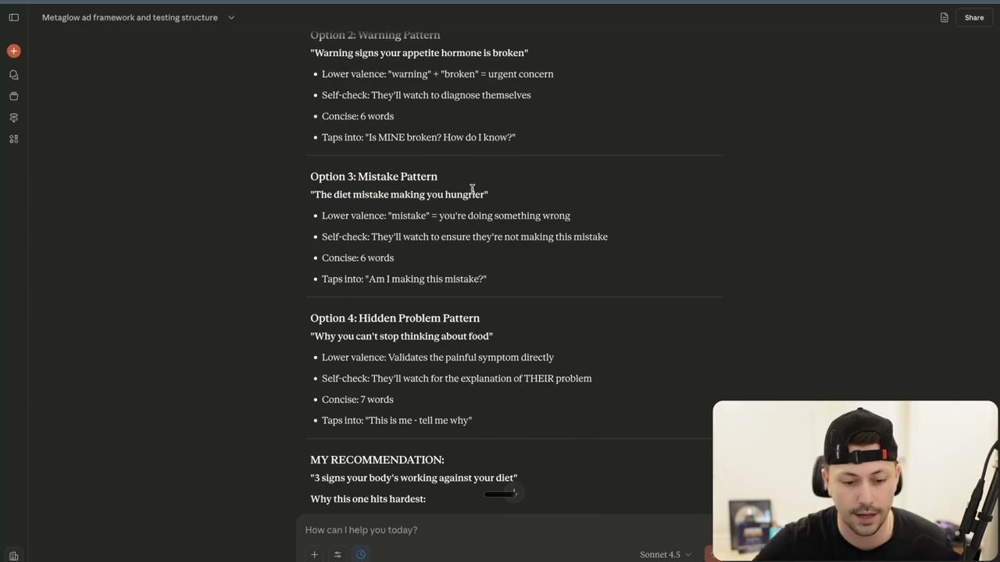
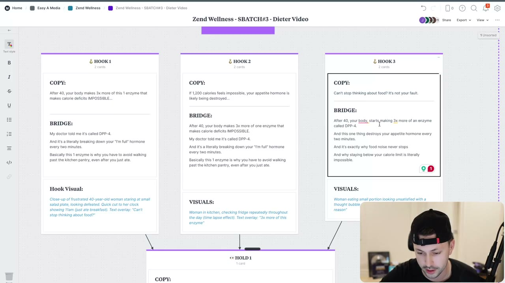
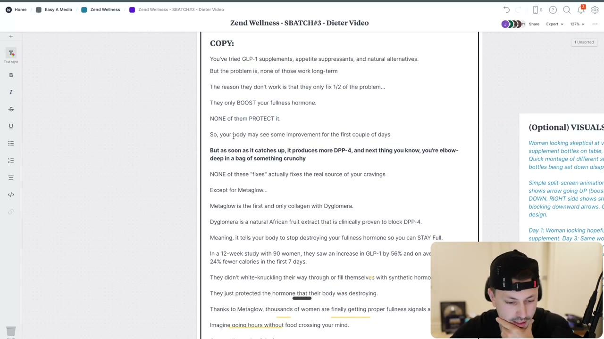
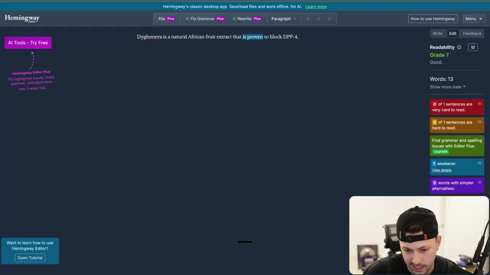

# 71. How To Write Video Ads - Part 2
> Spencer takes the AI first draft from Part 1 and, over about a day of work, rewrites hooks, bridges and hold with Reddit/customer language, fact-checks the AI line by line, and ends with a finished 3-hooks + 1-hold video brief (the PDF "Final Script Written By Spencer") ready for an editor.

## 🤖 Agent use
- **Use when:** editing an AI-generated video-ad script into a final one; checking a script for generic lines, fabricated or wrong facts, categorization, and wording that customers do not use; assembling the final video-ad brief.
- **Inputs → outputs:** AI draft (3 hooks, 3 bridges, hold, CTA) + research doc / Reddit threads / customer quotes + the original prompt → a revised script where each line uses customer language and verified claims, plus visual instructions and a brief card set (see the verbatim final script below).
- **Rules:**
  - **DO** write in a distraction-free block: "your phone ... throw that [away]", phone out of reach, a dedicated writing spot; "it requires 100% absolute focus." Within 5-10 minutes you start writing. [00:00–01:24]
  - **DO** optimize at least one hook for slightly **lower valence**: give people "a reason to watch to make sure that they're not doing something wrong with their diet"; hooking someone to check that nothing is wrong with them "holds attention well". [01:24–02:51]
  - **DO** log good-but-unusable ideas as new concepts for later instead of forcing them in (he logged "three signs your body's working against your diet"). [02:51; 25:52]
  - **DON'T** trust the AI's facts: it called DPP4 a hormone; "this is, again, why you guys can't blindly trust AI ... it fills in a lot of gaps for you, but it's not always right." [03:40]
  - **DO** replace generic lines with a specific one found in research: "kitchen pantry" (not "the kitchen"), "something crunchy", "fullness hormone". "That's where you have to come in and do research while you're writing this." [06:18–06:50; 19:33–22:13]
  - **DO** use the customer's words for the pain: customers said eating that low "feels like torture", so "if 1,200 calories feels impossible" became "feels like torture". [17:32]
  - **DO** ask the AI for the word customers actually use: "I'm full hormone" does not exist in natural language; people say "fullness hormone", and search "GLP-1 supplements" / "GLP-1 booster". Use "fullness hormone" for emotional/explanatory moments, "GLP-1" for clinical credibility. [21:28–22:13]
  - **DO** keep the authority frame but drop the first person when the video is third-person AI voiceover: "My doctor told me it's called DPP-4" became "Scientists call it DPP-4". [16:01]
  - **DO** run your rewritten script back through the prompt: "here's the script that I wrote, let me know where it has issues based off of the prompt". [08:47; 13:45; 18:08]
  - **IF** a rewrite categorizes the product (e.g. "natural weight loss strategies") **THEN** either rephrase or knowingly accept the trade-off for trust; he accepted a slight categorization (GLP-1 supplements, appetite suppressants, natural alternatives) because it is "worth the trade-off ... building more trust". [14:43; 18:46]
  - **IF** you cannot confirm a claim on the product page **THEN** soften or drop it: he checked "rare African fruit" and dropped "rare" because it could not be shown. "Some claims you can push, some claims you don't want to push." [21:28]
  - **DO** write one excellent brief per day rather than five: "I would rather see you spend a whole day on one brief ... one to two really good briefs per day ... one brief, I would say even per day, especially if they're videos." [14:43]
  - **DO** use the final script structure shown in the PDF: 3 hook cards (copy, bridge, visual) feeding one hold card plus optional visuals list. [25:12]
- **See also:** [70. Part 1 (running the prompt)](70-how-to-write-video-ads-part-1.md) · [72. Brief template + full prompt](72-action-item-write-your-video-ad-briefs.md) · [34. Labels / customer language](34-how-to-write-with-labels-customer-language.md) · [31. Show, don't tell](31-how-to-create-ads-that-show-dont-tell.md) · [Valence](../../../../concepts/valence.md) · [Creator brief playbook](../../../../playbooks/creator-brief.md) · [Hooks library](../../../../libraries/hooks.md)

Lesson page text: only "Here Is The Prompt Again" with a link to the same Google Doc as lesson 70. The attached `How To Write Video Ads.docx` is text-identical to lesson 70's (full verbatim text on [lesson 72](72-action-item-write-your-video-ad-briefs.md#the-prompt-verbatim)). The second attachment, `71. Final Script Written By Spencer.pdf` (one page, a Milanote board export), is reproduced below.

## Key ideas

### 1. Get into the zone first [00:00–01:24]
- "Wherever your phone is ... throw that outside ... make sure you just get rid of it." Turn off notifications; "lock yourself in". [00:00–00:30]
- Instructor attributes to Eugene Schwartz the habit of sitting at a desk and, if needed, having a dedicated area for writing; Spencer's version: a dedicated writing spot where all you can do for 30 minutes is write. You may sit for the first five minutes not knowing what to do, but "within five to ten minutes you're going to start writing ... your brain [is] going to get bored." (instructor paraphrase of Schwartz, not verified) [00:30–01:24]
- "It requires 100% absolute focus." [01:24]

### 2. Optimize a hook with lower valence [01:24–04:13]
- He had worked about 20 minutes already. Across the three hooks he wanted one with "slightly lower valence": "I don't want to say fear driven" but tapping into "hey, like this might be a problem" rather than "you're going to lose weight". See [Valence](../../../../concepts/valence.md); he says it is covered "at a higher level later on in Evolve". [01:24–01:58]
- Why: giving people a reason to watch to check they are not doing something wrong "really holds attention well to ensure that they aren't at risk." [01:58]
- He asked Claude to optimize the "Why eating 1,200 calories feels like torture" hook that way. Claude offered patterns (frame at [02:28]): Option 1 "Red Flag": "3 signs your body's working against your diet"; Option 2 "Warning": "Warning signs your appetite hormone is broken"; Option 3 "Mistake": "The diet mistake making you hunger"; Option 4 "Hidden Problem": "Why you can't stop thinking about food". Its recommendation: "3 signs your body's working against your diet". Each option is annotated with lower-valence / self-check / concise (word count) / "taps into" lines. [02:28]
- He liked "3 signs ..." but it is "not actually a concept that I can work with based off what we have so far", so he **adds it as a new concept** in the sheet for later. [02:28–02:51]
- Back to the same-hook thread: Claude suggested "If you think about food all day, your appetite hormone might be broken. If you're always hungry on 1200 calories, your body might be fighting you." Spencer's tweak "If 1200 calories is impossible, you're missing this hormone" was wrong (DPP4 is an enzyme). Claude agreed; the fixed version: "If 1200 calories feels impossible, your appetite hormone is being destroyed." He likes it: "most people are going to say, yeah, that is impossible. But now ... what appetite hormone is being destroyed? I'm interested." He would "bet money that that hook is going to perform the best, but ... sometimes I am wrong." [02:51–04:13]


*Claude's reply when asked to optimize the hook for lower valence plus a "self-check" (the viewer watches to see if something is wrong with them). Options 2-4 and the recommendation "3 signs your body's working against your diet" are visible. [02:28]*

### 3. First optimized hooks and bridges (v1) [04:13–08:47]
- v1 hook 1 (the rewrite he shows): "After 40, your body makes three times more of this one enzyme that makes calorie deficits impossible." He explains the implied demographic: customers "are going to have implied demographics"; the ad account shows 40-plus is a large share of spend, so he goes older. He keeps "after 40" even though it may exclude younger viewers: "I'm not going to lie to people and say well this happens when you're 30 ... I have information that says this." [04:13–07:13]
- v1 bridge 1 (merges the old bridge into new copy): "My doctor told me it's called DPP4, and it's literally breaking down your 'I'm full' hormone every two minutes. Basically this one enzyme is why you have to avoid walking past the kitchen pantry even after you just ate." Original AI bridge had been "it destroys your appetite hormone every two minutes so your brain never gets a signal to stop eating. That's why every diet feels impossible." [04:49–05:31]
- Source of "avoid walking past the kitchen pantry": Reddit reading. "That is again showing, not telling. I'm explaining to them that I understand this pain point." He made it "kitchen pantry", more specific than "the kitchen". [06:18–06:50]
- He opens the Master Doc (customer quotes, e.g. "Sub Avatar: The Dieter") and Reddit threads while editing (frames [06:12], [07:52]).
- Hook 2 v1: "If 1200 calories feels impossible, your appetite hormone is likely being destroyed..." with essentially the same bridge as hook 1. Reason: he likes the hook-1 line as a hook too, and the technique is "in media res" (Whisper: "a media res"): starting "right in the middle ... you just get straight to the point." [07:13–08:10]
- Hook 3 v1: "Can't stop thinking about food? It's not your fault." Bridge: "After 40, your body starts making 3x more [of an enzyme called DPP-4] ... this one thing destroys your appetite hormone every two minutes ... and exactly why food noise never stops and why staying below your calorie limit is literally impossible." [08:10–08:47]


*Milanote board mid-edit: Hook 1 ("After 40, your body makes 3x more of this 1 enzyme that makes calorie deficits IMPOSSIBLE..."), Hook 2 ("If 1,200 calories feels impossible, your appetite hormone is likely being destroyed...") and Hook 3 ("Can't stop thinking about food? It's not your fault."), each with its bridge and visual. [08:22]*

### 4. Rewriting the hold (v1) [08:47–13:45]
- He rewrote most of the hold because he "was really not a fan of how this came out": "I know what you're thinking. You've tried something before and it didn't work. That to me is just not specific enough." [08:47]
- v1 logic: "you've probably seen all of the natural weight loss strategies, but the problem is none of them work long term ... they only fix half of the problem": they "only boost your fullness hormone. None of them protect it." The unique mechanism is **protecting** the hormone (not boosting it) from the enzyme; he found it in the mechanism document ("the natural GLP-1 protection system"): "Everyone knows this, but nobody's ever mentioned this enzyme that destroys GLP-1." [08:47–10:17]
- Body catches up, "produces more DPP-4", "you're back to cravings". Then "None of ... fixes the real source ... except for Metaglow." [10:17–11:05]
- Claim: "Metaglow is the first collagen to have [Dyglomera] inside" and Dyglomera is a "rare Afghan [sic] fruit" "the only ingredient ... clinically proven to block DPP4"; he flags "I need to validate these claims". [11:05–11:36]
- Proof: "In a 12-week study with 90 women, they saw an increase of GLP-1 by 58% [as transcribed; final PDF says 56%] ... and on average they ate 25% fewer calories [final: 24%] in the first seven days, not by white-knuckling their way through or filling themselves with synthetic hormones." He is "digging in the knife for those Ozempic takers". [11:36–12:14]
- Benefit: "Imagine actually being satisfied while in a deficit or no longer having to stay busy just so you can stop thinking about food." Secondary: "Plus it has marine collagen for your skin and joints. And if you're over 40 ... your skin and joints need all the love they can get." [12:14–12:47]
- Close in the third person: "This company is so confident you'll love Metaglow ..." He writes as "kind of a reporter on this" rather than as the company. "Your body has been fighting against your diet. Metaglow helps you fight back. Try it for less than $2 a day." [12:47–13:45]
- He notes he is "Spencer-ified" the script (everyone has their own writing style) and will rerun it through the prompt to catch his own mistakes. [13:45–14:43]

### 5. Final version: research, customer language, line-by-line AI conversations [15:19–25:12]
- After roughly 45 more minutes of research ("maybe like 45 minutes or something like that"), the final is shown. Spencer says: "you don't really have an excuse to not get an ad done per day." [15:19]
- Authority and voice: "Scientists call it DPP4 ... I like how this still keeps the authority frame rather than saying a doctor, we just say a scientist ... but it doesn't make this first person because this is not a first person video ... it's a third person AI voiceover thing." [16:01]
- "Fullness hormone" came from Claude research on what people call it plus his pasted Reddit threads. [16:46]
- Hook 2 final: "If 1,200 calories feels like torture, your fullness hormone is likely being destroyed." ("torture" is customer wording). Hook 3 final: "Here's why you can't stop thinking about food all day" (educational). All three are **Problem-Aware**: deficits feeling impossible; calories feeling like torture; can't stop thinking about food. [16:46–18:08]
- **Categorization check with the AI.** "I was like, hey, does this categorize us? And it said yes ... sometimes it's hard to follow them to a T. But you want to try to do your best ... following it to an extent." He kept a slightly categorizing objection ("GLP-1 supplements, appetite suppressants and natural alternatives") as a deliberate trade for more trust, and considered "GLP-1 boosters" but did not want people to think of the injection. [18:08–19:33]
- **Pulling a comedic, specific line from research.** The objection's "something crunchy" came from the master document (a customer-language line about loving crunchy food). He wrote "next thing you know, you're deep in a bag of something crunchy", left it broad (not "chips") because many people want something crunchy. He pasted a Reddit thread into Claude and asked for the most specific/powerful line; Claude said the specific line was "the most specific and powerful". He also asked whether to add "you don't want to inject yourself with synthetics"; Claude hedged. "I was just having conversations with Claude line by line while I'm writing this. And that's why it's important to go through line by line." [19:33–20:31]
- **Fact-check:** "is this an African rare fruit?" Claude: nothing shows it is rare; he dropped "rare". [21:28]
- **Terminology research:** see Agent use ("I'm full hormone" fails; use "fullness hormone" + "GLP-1"). He also asked Claude for "final thoughts on my other two hooks and bridges" and had it scan them. [21:28–22:44]
- **Comedic relief:** he gave Claude the before/after of the line and asked for a specific pain point from the threads. Claude offered a numbered list of options, including "The Elbow-Deep Moment (Most Exaggerated)" (visible on screen, frame ~[23:34]). He says "how about this? ... you're knee deep in a peg [sic, probably 'bag'] of something crunchy" and Claude hyped it; the final reads "elbow-deep in a bag of something crunchy". [23:06–23:47]
- Spelled-out mechanism: "Dyglomera is a natural African fruit extract that is clinically proven to block DPP-4, meaning it tells your body to stop destroying your fullness hormone so you can stay full [longer]." He repeats the explanation again after calling out the villain, "anytime I use scientific knowledge ... clarifying". [23:47]
- **Readability check:** Hemingway "is probably not gonna be happy ... this is grade nine. It's not terrible. Clinically proven is apparently not the right word" but he keeps "clinically": "sometimes you bend it". (Frame shows "Dyglomera is a natural African fruit extract that is proven to block DPP-4." at Grade 7.) [23:47–24:24]
- **Visuals last:** "I took a screenshot of my hooks. I pasted in my hold ... I need you to now give me the visuals. And then it gave me all the visuals." (He also corrected the AI's wrong info "because of what was on the website".) Visuals plus his Growth Guide notes go on the board -> "we have now done a full video script ... ready to go." [25:12–25:52]


*The rewritten Hold 1 copy in the Milanote card (objection "You've tried GLP-1 supplements, appetite suppressants, and natural alternatives", the "BOOST vs PROTECT" claim, the elbow-deep line in bold, "Except for Metaglow...") beside the (Optional) VISUALS card. [19:44]*


*Hemingway Editor check on "Dyglomera is a natural African fruit extract that is proven to block DPP-4." (Grade 7, one weakener flagged on "is proven"). Shows how he checks reading level at the line level. [24:20]*

### 6. New angles logged and the "double sniper" idea [25:52–28:13]
- During the day he logged two new ideas: "three signs your body's working against you" and a "protect your hormones" mechanism angle. [25:52]
- All of this is one desire ("I want to be in control of my cravings"). The product is also a collagen (skin-tightening desire), but he picks the GLP-1/cravings desire for scalability: "My job is to scale brands." [25:52–26:43]
- **Double sniper approach:** if this script gets a little buzz, test the mechanism first: lead with "how to protect your hormones / your GLP-1 levels" while everyone else says boost, boost, boost; "you don't need to boost more, you can just protect it." [26:43–27:33]

### 7. Operator context (instructor claims) [27:33–30:34]
- The brand has been a client "for about two months"; he no longer goes this deep per brand because he does consulting, and spends time "reviewing the things that work and trying to extract the patterns" to guide the team. (instructor claim) [27:33]
- Claims: told the team to imitate a working ad and focus on two or three angles; on launch day it was the second top spender. Another time he suggested an angle that "amplified how easy it was to get the thing that they want" and it was the top spender "right away". (instructor claims, no data shown) [28:13]
- Supplement brands are "the hardest brands to crack"; the same approach applies to beauty, fashion (less mechanism-heavy) and tech/gadgets. [28:13–29:13]
- Video execution matters as much as script, but "having all the research done and writing the copy very, very strong sometimes can carry bad video execution, but it has to be really, really strong." The editing module follows. [29:13–30:11]

## Steps / framework (editing pass on an AI video script)
| # | Step | Source |
|---|---|---|
| 1 | Remove distractions; sit in a dedicated spot | [00:00–01:24] |
| 2 | Pick a hook to optimize for lower valence (self-check: "is something wrong with me?") | [01:24–02:51] |
| 3 | Catch AI factual/terminology errors (enzyme vs hormone) | [03:40] |
| 4 | Pull specifics from Reddit / master doc: pantry, crunchy, torture | [06:18–06:50; 16:46–17:32; 19:33] |
| 5 | Rewrite the hold: specific objection -> "only fix half" reason -> unique mechanism -> proof -> show benefit -> CTA | [08:47–13:45] |
| 6 | Run the rewrite back through the prompt (categorization, specificity, show-don't-tell checks) | [13:45; 18:08] |
| 7 | Resolve terminology ("fullness hormone" + "GLP-1") | [21:28–22:13] |
| 8 | Verify product claims against the website; drop "rare" | [21:28; 25:12] |
| 9 | Readability check (Hemingway) | [23:47–24:24] |
| 10 | Ask for visuals for the final copy; place in brief with growth-guide notes | [25:12] |
| 11 | Log spin-off angles/concepts | [25:52–27:33] |

## The final script: verbatim PDF + structure annotation

### Verbatim: `71. Final Script Written By Spencer.pdf` (1 page, Milanote board; text extracted by PyMuPDF; line breaks restored to match the page image)
```
WHAT IS THE CLIENT'S NAME?
Zend Wellness

WHAT DCT NUMBER IS THIS FOR THE CLIENT?
(Must match Creative Roadmap)
SBATCH#3

TYPE OF AD
Video Ad   [checked]
Image Ad
Carousel Ad

SIZES NEEDED
1080x1080 (1x1)
1080x1350 (4x5)
1080x1920 (9x16)   [checked]
1920x1080 (16x9)

AD LINKS TO:
https://www.zendwellness.com/collections/metaglow-collagen/
MetaGlow™ Collagen for Weight Management
MetaGlow Collagen: science-backed daily supplement for weight management, stress reduction, & healthy hair, skin, nails, joints. Mix with coffee & more!

IDEATION AD CONCEPT & BRIEF

AD STRUCTURE

VARIATIONS NEEDED
3 HOOKS
1 HOLD
3 TOTAL ADS

IDEATION AD CONCEPT
(The theme or overall idea of the ad)
Growth Guide Notes
I'm recreating this ad because I saw that it did actually get traction, and I think this is a real pain point for this specific avatar around being in a deficit.

And so I know most people trying to lose weight obviously need something to support them through the deficit. And so I want to help them understand how eating 1200 calories is actually easy and leverage the information that I have to build belief around our mechanism.

This is a very skeptical market that's heard everything for cravings, and so I want to make sure that I really show my understanding of what they're doing rather than telling them something is easy with no additional context.

HOOK 1
COPY:
"After 40, your body produces 3x more of the enzyme that makes calorie deficits feel IMPOSSIBLE
BRIDGE:
Scientists call it DPP-4.
And it's literally breaking down your fullness hormone every two minutes.
This one enzyme is why you have to avoid walking past the kitchen pantry, even after you just ate.
Hook Visual:
45-year-old woman looking frustrated at bathroom scale, shaking her head. Quick cut to close-up of her face showing stress and exhaustion.

HOOK 2
COPY:
If 1,200 calories feels like torture, your fullness hormone is likely being destroyed...
BRIDGE:
After 40, your body makes 3x more of one enzyme that makes calorie deficits IMPOSSIBLE.
Scientists call it DPP-4.
And it's literally breaking down your fullness hormone every two minutes.
This one enzyme is why you have to avoid walking past the kitchen pantry, even after you just ate.
VISUALS:
Woman's hands measuring tiny portion of food on plate with measuring cups and food scale visible, looks defeated and frustrated.

HOOK 3
COPY:
Here's why you can't stop thinking about food all day
BRIDGE:
After 40, your body, starts making 3x more of an enzyme called DPP-4.
And this one thing destroys your fullness hormone every two minutes.
And it's exactly why food noise never stops
And why staying below your calorie limit is literally impossible.
VISUALS:
Close-up of woman's face looking distracted,  and a thought bubble thinking of really delicious foods like chips or anything crunchy. (specifically crunchy)

HOLD 1
COPY:
You've tried GLP-1 supplements, appetite suppressants, and natural alternatives.
But the problem is, none of those work long-term
The reason they don't work is that they only fix 1/2 of the problem...
They only BOOST your fullness hormone.
NONE of them PROTECT it.
So, your body may see some improvement for the first couple of days
But as soon as it catches up, it produces more DPP-4, and next thing you know, you're elbow-deep in a bag of something crunchy
NONE of these "fixes" actually fixes the real source of your cravings
Except for Metaglow...
Metaglow is the first and only collagen with Dyglomera.
Dyglomera is a natural African fruit extract that is clinically proven to block DPP-4.
Meaning, it tells your body to stop destroying your fullness hormone so you can STAY Full longer.
In a 12-week study with 90 women, they saw an increase in GLP-1 by 56% and on average, they ate 24% fewer calories in the first 7 days.
They didn't white-knuckling their way through or fill themselves with synthetic hormones
They just protected the hormone that their body was destroying.
Thanks to Metaglow, thousands of women are finally getting proper fullness signals again.
Imagine going hours without food crossing your mind.
Or actually staying full after you eat
That's what happens when you protect your hormone, and not just boost it.
This company is so confident you'll love Metaglow that you can try it for 60 days 100% risk-free
If it doesn't work, they'll refund you.
Your body has been fighting you.
Metaglow helps you fight back.
Try it risk free for less than $2/day

(Optional) VISUALS:
Woman looking skeptical at various supplement bottles on table, shaking head. Quick montage of different supplement bottles being set down disappointedly
Simple split-screen animation: LEFT side shows arrow going UP (boost) then quickly DOWN. RIGHT side shows shield icon blocking downward arrows. Clean, minimal design.
Day 1: Woman looking hopeful with supplement. Day 3: Same woman sitting on couch at night with hand literally deep in chip bag, looking defeated but mid-crunch. Comedic timing.
Quick cuts of failed supplement bottles being pushed aside. Clean product shot of Metaglow appears, centered on white surface
Clean product shot of Metaglow rotating on white surface.
Simple animation showing shield blocking DPP-4 enzyme, protecting fullness hormone. Blue and white tones, clean aesthetic
Clean data visualization showing "56% GLP-1 increase" and "24% fewer calories" in minimal design
Woman eating breakfast, looking genuinely satisfied, naturally pushing plate away (not forced). Smiling, relaxed.
shows same Woman from the beginning but without the food bubble
Product displayed on clean surface with guarantee badge visible.
Final frame shows confident woman from earlier scenarios now smiling, eating normally, looking peaceful and satisfied.
```


*PDF page 1: left column = brief fields (client, DCT number, type of ad, sizes, link, variations, ideation concept with Growth Guide notes); right = Hook 1-3 cards (copy, bridge, visual) feeding Hold 1, with an (Optional) VISUALS card. [PDF p.1]*

### Structure annotation (derived mapping; the PDF has no section labels)
Section names and timings come from the DOCX (Hook 0-3 s; Bridge 3-8 s; Hold 8-35 s with Objection 8-11, Claim 11-16, Proof 16-25, Benefit 25-32, Secondary 32-35; CTA 35-45 s). Spencer says the CTA can sit inside the hold card: "sometimes we separate this as well" ([23:07] of lesson 70). The mapping below is mine, using his comments where noted.

| Part | Text (final PDF) | Role / what it does | Course source for the role |
|---|---|---|---|
| **Hook 1** | "After 40, your body produces 3x more of the enzyme that makes calorie deficits feel IMPOSSIBLE" | New-information hook: age + number + mechanism ("Biggest thing happening now"). Implied demographic: 40+ | [04:13–07:13]; docx Section A |
| **Bridge 1** | "Scientists call it DPP-4. And it's literally breaking down your fullness hormone every two minutes. This one enzyme is why you have to avoid walking past the kitchen pantry, even after you just ate." | Names the villain (enzyme), then shows the pain through a specific behaviour (pantry) rather than telling | [16:01; 06:18–06:50]; docx Section B |
| **Hook 2** | "If 1,200 calories feels like torture, your fullness hormone is likely being destroyed..." | Lower-valence "is something wrong" hook in customer wording ("torture") | [01:24–04:13; 17:32] |
| **Bridge 2** | Hook 1's hook line + Bridge 1 | "In media res": gets "straight to the point"; re-uses the same explanation | [07:13–08:10] |
| **Hook 3** | "Here's why you can't stop thinking about food all day" | Educational / Problem-Aware hook | [17:32–18:08] |
| **Bridge 3** | "After 40, your body, starts making 3x more of an enzyme called DPP-4. And this one thing destroys your fullness hormone every two minutes. And it's exactly why food noise never stops And why staying below your calorie limit is literally impossible." | Same villain explanation, different framing; ties to the "calorie limit" pain | [08:10–08:47] |
| **Hold: objection** | "You've tried GLP-1 supplements, appetite suppressants, and natural alternatives. But the problem is, none of those work long-term" | Specific past attempts (replaces "You've tried supplements before. They didn't work."), accepted slight categorization for trust | [14:43; 18:46; 23:07 of lesson 70] |
| **Hold: reason-why / claim set-up** | "The reason they don't work is that they only fix 1/2 of the problem... They only BOOST your fullness hormone. NONE of them PROTECT it. So, your body may see some improvement for the first couple of days But as soon as it catches up, it produces more DPP-4, and next thing you know, you're elbow-deep in a bag of something crunchy. NONE of these "fixes" actually fixes the real source of your cravings" | Introduces the unique mechanism (protect vs boost) as the missing half; comedic, specific relapse line from customer data. Spencer: "talking now into the claim, where I'm saying they only fix half the problem. That's why they didn't work" | [13:45–14:43; 19:33] |
| **Hold: claim** | "Except for Metaglow... Metaglow is the first and only collagen with Dyglomera. Dyglomera is a natural African fruit extract that is clinically proven to block DPP-4. Meaning, it tells your body to stop destroying your fullness hormone so you can STAY Full longer." | New-mechanism claim + reason; "first and only" ownership | [23:47]; docx Section C (claim) |
| **Hold: proof** | "In a 12-week study with 90 women, they saw an increase in GLP-1 by 56% and on average, they ate 24% fewer calories in the first 7 days. They didn't white-knuckling their way through or fill themselves with synthetic hormones They just protected the hormone that their body was destroying. Thanks to Metaglow, thousands of women are finally getting proper fullness signals again." | Study numbers, mechanism restated, social proof at the "thousands" tier | [24:24]; [12:44 of lesson 70] |
| **Hold: benefit** | "Imagine going hours without food crossing your mind. Or actually staying full after you eat. That's what happens when you protect your hormone, and not just boost it." | Shows the outcome as behaviour; ties back to protect-vs-boost | [24:24]; docx Section C (benefit) |
| **Secondary benefit** | (dropped) | The v1 line "Plus it has marine collagen for your skin and joints" [12:14] is not in the final PDF | [12:14–12:47] |
| **CTA / offer** | "This company is so confident you'll love Metaglow that you can try it for 60 days 100% risk-free. If it doesn't work, they'll refund you. Your body has been fighting you. Metaglow helps you fight back. Try it risk free for less than $2/day" | Third-person reporter voice; risk reversal; loop closure ("fighting you" echoes the hooks); price framed per day. No "tap below" line and no price tiers. | [12:47–13:45; 24:24] |
| **Visuals** | The (Optional) VISUALS card, 11 entries in the order printed | The PDF does not attach each visual to a line (derived: roughly follows hold order: skeptical bottles montage, boost/protect split-screen, Day 1/Day 3 chip bag, product shot, shield animation, data viz, breakfast, guarantee badge, final satisfied frame) | PDF p.1; [25:12] |

## Examples

### Evolution of each line: AI draft -> Spencer v1 -> final
| Element | AI draft (Part 1) | Spencer v1 (this lesson) | Final (PDF) | Why changed |
|---|---|---|---|---|
| Hook 1 | "After 40, your body makes 3x more of this enzyme." | "After 40, your body makes three times more of this one enzyme that makes calorie deficits impossible." [04:13] | "After 40, your body produces 3x more of the enzyme that makes calorie deficits feel IMPOSSIBLE" | Name the stake (deficits), keep new information |
| Bridge 1 | "It's called DPP4. And it destroys your appetite hormone every two minutes. So your brain never gets the signal to stop eating. That's why every diet feels impossible." | "My doctor told me it's called DPP4, and it's literally breaking down your 'I'm full' hormone every two minutes. Basically this 1 enzyme is why you have to avoid walking past the kitchen pantry, even after you just ate." | "Scientists call it DPP-4. And it's literally breaking down your fullness hormone every two minutes. This one enzyme is why you have to avoid walking past the kitchen pantry, even after you just ate." | Show behaviour from Reddit; third-person authority; customer term |
| Hook 2 | "Why eating 1,200 calories feels like torture." | "If 1,200 calories feels impossible, your appetite hormone is likely being destroyed..." | "If 1,200 calories feels like torture, your fullness hormone is likely being destroyed..." | Lower valence; customer word "torture"; "fullness hormone" |
| Hook 3 | "Can't stop thinking about food? Not your fault." | "Can't stop thinking about food? It's not your fault." | "Here's why you can't stop thinking about food all day" | Educational Problem-Aware framing |
| Hold objection | "I know what you're thinking. You've tried supplements before. They didn't work. But here's what they didn't have." | "You've probably seen all of the natural weight loss strategies, but the problem is none of them work long term." [08:47–09:42] | "You've tried GLP-1 supplements, appetite suppressants, and natural alternatives. But the problem is, none of those work long-term" | Specific past attempts; accepted slight categorization for trust [18:46] |
| Relapse line | (not in the AI hold) | "... all of a sudden ... you're back to cravings" [10:17] | "...next thing you know, you're elbow-deep in a bag of something crunchy" | Plain statement -> comedic, specific relapse image from customer language [19:33; 22:13–23:47] |
| Mechanism | "Metaglow has Dyglomera, the first ingredient clinically proven to block DPP4" | "first collagen to have [Dyglomera] ... rare Afghan fruit ... only ingredient ... clinically proven" | "first and only collagen with Dyglomera ... natural African fruit extract that is clinically proven to block DPP-4" | "Rare" dropped (unverifiable); fixed fruit origin |
| Proof numbers | "increased GLP-1 by 68% and ate 24% fewer calories in the first week" | "58% ... 25% fewer calories ... first seven days" (as transcribed) | "increase in GLP-1 by 56% ... 24% fewer calories in the first 7 days" | Corrected to match website [25:12] |
| CTA | "Your appetite can finally calm down in the next two weeks. Try it for 60 days. If it doesn't work, we'll refund you because you're not weak ... $47 a month, $39 per jar ... tap below" | "This company is so confident you'll love Metaglow that you can try it for 60 days risk-free ... less than $2 a day" | adds "100% risk-free", "Your body has been fighting you. Metaglow helps you fight back." | Third-person reporter voice; per-day price |

## Structured units

### Hooks
| Hook | Heuristic(s) | Emotion / zone | Self targeted | Why it works | Source |
|---|---|---|---|---|---|
| "After 40, your body produces 3x more of the enzyme that makes calorie deficits feel IMPOSSIBLE" (final Hook 1) | — | — (new information; docx Big 4: NEW + BIG) | — | Implied demographic from account data; novel enzyme; a stake the avatar feels | PDF p.1; [04:13–07:13] |
| "If 1,200 calories feels like torture, your fullness hormone is likely being destroyed..." (final Hook 2) | — | Lower valence: "is something wrong with me?" | — | Customer word "torture"; hooks a self-check; curiosity about which hormone | PDF p.1; [01:24–04:13; 17:32] |
| "Here's why you can't stop thinking about food all day" (final Hook 3) | — | — | — | Educational, Problem-Aware | PDF p.1; [17:32–18:08] |
| "3 signs your body's working against your diet" (logged, not used) | — | Lower valence + self-check | — | AI's top recommendation; keeps attention by asking viewer to check themselves; not usable with current information | [02:28–02:51] |
| "Warning signs your appetite hormone is broken" / "The diet mistake making you hunger" (Claude options, not used) | — | Lower valence | — | Claude's pattern options | frame [02:28] |
| "Here's how to protect your hormones / your GLP-1 levels" (mechanism-first idea, untested) | — | — | — | Contrasts with "everyone's trying to boost, boost, boost" | [26:43–27:33] |

### Ad teardowns
| Brand / product (niche) | Format | Hook / opening | What works | What fails | Fix suggested | Principle | Source |
|---|---|---|---|---|---|---|---|
| Zend Wellness MetaGlow (weight-management collagen) | Video ad script (not yet tested at recording time) | 3 hooks above | Specific villain, behaviour-based pain, customer wording, honest social-proof tier | Not yet validated: "I'm very confident in the script" (no results shown) | Test hooks+bridges with one identical hold | Hook/bridge test, constant hold | [30:11]; PDF |

### Rewrites
(See the line-by-line evolution table above for the full set. Additional pairs:)

| Before | After | What changed | Source |
|---|---|---|---|
| "If you think about food all day, your appetite hormone might be broken." / "If you're always hungry on 1200 calories, your body might be fighting you." (Claude suggestions) | "If 1200 calories feels impossible, your appetite hormone is being destroyed." (after fixing his "you're missing this hormone") | Wrong claim (missing hormone) -> accurate claim (hormone destroyed by enzyme) | [02:51–04:13] |
| "kitchen" | "kitchen pantry" | Generic -> specific (Reddit) | [06:18–06:50] |
| "I'm full hormone" | "fullness hormone" | Phrase customers do not use -> phrase they do | [21:28–22:13] |
| "a doctor told me" | "Scientists call it DPP4" | First person -> third person, authority kept | [16:01] |

### Templates
| Template | Use for | Example fill | Source |
|---|---|---|---|
| Video-ad brief card set: client name; DCT number (must match Creative Roadmap); type of ad; sizes needed; ad links to; variations needed ("3 HOOKS / 1 HOLD / 3 TOTAL ADS"); ideation concept + Growth Guide notes; Hook 1-3 (copy, bridge, visual) -> Hold 1 (copy) + optional visuals | The editor-facing brief | Filled example in the verbatim block above; blank version on [lesson 72](72-action-item-write-your-video-ad-briefs.md#brief-card-set-fill-in-template) | PDF p.1 |
| Growth Guide note: "I'm recreating this ad because [it got traction] ... real pain point for [avatar] ... I want to help them understand [claim] and leverage [info] to build belief around our mechanism. [Market] is very skeptical ... show my understanding rather than telling them [claim] with no additional context." | Hypothesis field | PDF "Growth Guide Notes" | PDF p.1 |

## Prompts / templates (verbatim)
- The full prompt: [lesson 72](72-action-item-write-your-video-ad-briefs.md#the-prompt-verbatim).
- The verbatim PDF script is in the block above.
- Instructions Spencer gave Claude (spoken in the recording, Whisper text, not exact chat messages):
  - "here's the script that I wrote, let me know where it has issues based off of the prompt" [08:47]
  - "does this categorize us?" [18:08]
  - "is diglomera actually a rare African fruit extract?" [21:28] (Whisper spelling)
  - "Can you do some deep research around customers that you say 'I'm full hormone'?" [21:28–22:13]
  - "Can I get your final thoughts on my other two hooks and bridges?" [22:13]
  - "I want to add some comedic relief with this line, but I need a specific pain point that's mentioned from one of the threads ... that my customers would say." Then pasted before and after. [22:13–23:06]
  - "I took a screenshot of my hooks. I pasted in my hold ... I need you to now give me the visuals." [25:12]

## Screenshots
Five images are embedded in context above: the lower-valence options [02:28], the v1 hooks/bridges board [08:22], the rewritten hold [19:44], the Hemingway check [24:20], and the PDF board.

## How to apply
- [ ] Block out a distraction-free hour; phone out of reach.
- [ ] Take the AI draft hook with the weakest emotion and re-angle it with lower valence ("is something wrong with me?"); log unusable ideas as concepts.
- [ ] For every claim, confirm against the product page / mechanism document; fix AI terminology (enzyme vs hormone).
- [ ] Replace each generic line with a quote or behaviour from Reddit / reviews (pantry, crunchy, torture).
- [ ] Use the customer's word for the thing ("fullness hormone"); use the clinical term where credibility is needed.
- [ ] Check categorization and the hook/bridge test design (3 matched hook+bridge pairs, 1 hold).
- [ ] Read lines aloud / run a readability check; keep 6th-9th grade.
- [ ] Ask the AI for visuals only after the copy is final; paste into the brief with the Growth Guide notes.
- [ ] (derived) For UGC: swap "Scientists call it" for the creator's own voice only if a real person is on camera; keep the same hook/bridge/hold test split.

## Related
- Previous: [70. How To Write Video Ads - Part 1](70-how-to-write-video-ads-part-1.md) · Next: [72. Action Item: Write Your Video Ad Briefs](72-action-item-write-your-video-ad-briefs.md)
- [34. Labels / customer language](34-how-to-write-with-labels-customer-language.md) · [19. Being aware of mechanisms](19-being-aware-of-mechanisms.md) · [27. How to write a bridge](27-how-to-write-a-bridge.md) · [Iteration vs variation](../../../../concepts/iteration-vs-variation.md)

## Sources and limitations
- Transcript: [71. How To Write Video Ads - Part 2 … .txt](<../../../../../raw/evolve/copywriting/_transcripts/✍️ Evolve Copywriting (NEW)/71. How To Write Video Ads - Part 2 ✍️ Evolve Copywriting (NEW) Evolve.txt>) · Page text: [….html.md](<../../../../../raw/evolve/copywriting/_extracted/✍️ Evolve Copywriting (NEW)/71. How To Write Video Ads - Part 2_✍️ Evolve Copywriting (NEW)_Evolve.html.md>) · PDF: [71. Final Script Written By Spencer.pdf.md](<../../../../../raw/evolve/copywriting/_extracted/✍️ Evolve Copywriting (NEW)/71. Final Script Written By Spencer.pdf.md>) · DOCX: [71. How To Write Video Ads.docx.md](<../../../../../raw/evolve/copywriting/_extracted/✍️ Evolve Copywriting (NEW)/71. How To Write Video Ads.docx.md>)
- Machine transcription (Whisper large-v3-turbo); full recording covered (last segment 30:34 of 30:34). Whisper errors: "Diaglomera/diglomera" for Dyglomera, "Cloud/clot" for Claude, "DDP4" for DPP-4, "a media res" for in medias res, "Afghan" vs the PDF's "African". In [16:01–18:08] a couple of passages name features that are partly obscured by the transcription. The vulgar customer phrase Spencer reads out ([19:33]) is paraphrased as "a customer-language line about loving crunchy food".
- Number discrepancy: the transcript has GLP-1 "58%" and "25% fewer calories" ([11:36]) and the earlier AI draft "68%"; the PDF final has 56% and 24%, and the visible image ads in lesson 70 say "Increases GLP-1 production by 56%". Use the PDF numbers. "Knee deep" ([23:06]) vs "elbow-deep" in the final PDF: see Key ideas section 5.
- Tensions for agents (derived): (1) the DOCX's hook rule is "~5 words (3-7), max 2 lines" and "never categorize", but the final hooks are 13-17 words and the hold says "first and only collagen" and "GLP-1 supplements, appetite suppressants, and natural alternatives". Spencer says hooks and bridges are extended together to about 8 seconds ([70 at 15:59](70-how-to-write-video-ads-part-1.md)) and that it is "hard to follow [the principles] to a T". Treat the 5-word rule as a starting point for the first line; the bridge carries the rest. (2) Performance of this script is not shown; the only results data are the image-ad learnings in lesson 70 and the operator anecdotes at [28:13], which are instructor claims.
- The PDF extraction is verbatim apart from restored line breaks; typos ("They didn't white-knuckling") are as in the source.
