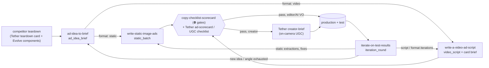

# Evolve Copywriting playbooks hub
> Four end-to-end agent workflows built on Spencer Pawliw's course: turn an idea (competitor ad, own winner, research insight) into a justified brief, write the video script or the statics, pass the copy scorecard, test, and iterate by outcome. They plug into the shared Tether Lab pipeline: Evolve supplies copy craft, the idea memo, briefs and the iteration system; Tether supplies the psychology lenses and production rules.

## 🤖 Agent use
- **Use when:** starting any creative job that should use Evolve's methods; find the entry point below and pass each playbook's output to the next.
- **Inputs → outputs:** whatever you have (a competitor ad, research, a concept, results) → the matching playbook → its YAML artifact → the next playbook.
- **Rules:**
  - **DO** copy the mechanism, not the asset: structures and persuasion moves carry over; competitor lines, footage, characters, claims and stats never do.
  - **DO** keep a product truth sheet (Master Document + facts list with sources); every claim, number and term in an ad needs a `truth_ref`. The 68% vs 56% GLP-1 mismatch on the course's own statics is the reason ([L68 42:29](../lessons/68-how-to-write-image-ads-part-2.md)).
  - **DON'T** fabricate proof, testimonials, authorities, scarcity or stats; use the real social-proof tier ([L70 12:01–12:44](../lessons/70-how-to-write-video-ads-part-1.md)).
  - **DO** run the [copy checklist scorecard](../rubrics/copy-checklist-scorecard.md) gate before production, then the Tether [ad scorecard](../../../../rubrics/ad-scorecard.md).
  - **DO** log every idea and result in the Growth Guide / Ad Roadmap so the feedback loop closes ([L22](../lessons/22-how-to-finalize-your-ad-ideas.md); [L70 06:31–09:27](../lessons/70-how-to-write-video-ads-part-1.md)).
- **See also:** [Rubrics hub](../rubrics/README.md) · [Frameworks: memo](../frameworks/mini-breakthrough-memo-and-growth-guide.md), [static workflow](../frameworks/static-ad-workflow.md), [video workflow](../frameworks/video-ad-script-workflow.md), [ten-step learnings](../frameworks/ten-step-iteration-learnings.md) · Tether: [playbooks hub](../../../../playbooks/README.md)

## Pipeline

Text version: competitor teardown → [ad idea to brief](ad-idea-to-brief.md) (angle, memo, concept brief) → [write static image ads](write-static-image-ads.md) or [write a video ad script](write-a-video-ad-script.md) → [copy checklist scorecard](../rubrics/copy-checklist-scorecard.md) + Tether rubrics → (creator brief) → test → [iterate on test results](iterate-on-test-results.md) → back to scripts, statics or a new idea.

## Entry points
| You have | Start at | Output artifact | Then |
|---|---|---|---|
| A competitor ad that's working, a research insight, or a pitch ("let's do an ad like this") | [Ad idea to brief](ad-idea-to-brief.md) | `ad_idea_brief` (components, transferable mechanism, persuasion chain, memo, Roadmap row, concept brief) | static or video playbook |
| A concept brief with `format: static`, or a video winner to extract statics from | [Write static image ads](write-static-image-ads.md) | `static_batch` | gate → test |
| A concept brief with `format: video`, or a static winner to turn into video | [Write a video ad script](write-a-video-ad-script.md) | `video_script` + card brief | gate → editor or Tether creator brief |
| Results from a test window | [Iterate on test results](iterate-on-test-results.md) | `iteration_round` | briefs back through the script/static playbooks |

## Shared artifacts
| Artifact | Produced by | Key fields | Defined in |
|---|---|---|---|
| `truth_sheet` | research (Master Document) | product doc, facts (brand/product/market + source), objections (product/angle/claim/belief), sub-avatars + quotes, new information, new mechanisms | [L69](../lessons/69-action-item-write-your-image-ad-briefs.md), [L60](../lessons/60-facts-list.md), [L61](../lessons/61-objections-list.md) |
| `persuasion_chain` | ad idea to brief | avatar card, why-they-care, angle, mechanism, authority, awareness, truth_refs | [memo framework](../frameworks/mini-breakthrough-memo-and-growth-guide.md) |
| `ad_roadmap_row` | ad idea to brief; iterate | status, upvote, batch, desire, sub-avatar, angles, memo, awareness, file type, ad type, results, learnings | [memo framework](../frameworks/mini-breakthrough-memo-and-growth-guide.md) |
| `component_audit` | iterate (and teardowns) | nine components planned/executed/status | [nine-component audit](../frameworks/nine-component-audit.md) |
| `learning_record` | iterate | outcome, spend, ad type, hooks verbatim, hypothesis, links | [ten-step learnings](../frameworks/ten-step-iteration-learnings.md) |
| `copy_scorecard` | every gate | ⛔ G1–G6, 24 criteria, band | [copy checklist scorecard](../rubrics/copy-checklist-scorecard.md) |

## How the two courses divide the work
| Pipeline stage | Evolve (this course) | Tether Lab (shared pages) |
|---|---|---|
| Teardown | Hooks verbatim, what each line communicates, nine copy components | [Competitor ad teardown](../../../../playbooks/competitor-ad-teardown.md): zone, self, heuristics, TEEP, winner signals |
| Angle | Persuasion chain, memo with evidence, swap test, positioning | [Angle remix](../../../../playbooks/angle-remix.md): self/zone shifts, fidelity and fit checks |
| Script | Feedback loop, 3 hook/bridge pairs + 1 hold, editing pass, Big 4, categorization | [UGC script writing](../../../../playbooks/ugc-script-writing.md): story frameworks, beat sheet, proof ledger |
| Static | Angle prompt, quote-driven headlines, template fill, truth QA | [Static ad creation](../../../../playbooks/static-ad-creation.md): weight hierarchy, design limits, badges |
| Brief | Concept brief and card brief fields | [Creator brief](../../../../playbooks/creator-brief.md): casting, shot list, seed asset |
| Gate | [Copy checklist scorecard](../rubrics/copy-checklist-scorecard.md) | [Ad scorecard](../../../../rubrics/ad-scorecard.md), [UGC script checklist](../../../../rubrics/ugc-script-checklist.md) |
| Iterate | Outcome labels, ten-step learnings, issue codes, named iterations | [Test and iterate](../../../../playbooks/test-and-iterate.md): learning goals, read-outs, scaling |

Where the courses disagree (test packaging, setup share, hook length, proof wording, one-variable iterations), each playbook's "Combine with Tether Lab" section gives the agent default; all conflicts are also listed in the contradiction notes for the global [contradictions page](../../../../contradictions.md).

## Related
[Course frameworks: nine-component audit](../frameworks/nine-component-audit.md) · [iteration issue codes](../frameworks/iteration-issue-codes.md) · [iteration playbook](../frameworks/iteration-playbook.md) · [positioning exercise](../frameworks/positioning-exercise.md) · [Course libraries](../libraries/README.md)
