# 1. Start Here/ Overview Of Evolve
> A guided tour of the whole Evolve program (what each folder is for, what to watch first, which programs are extra), plus the one loop the instructor says every account follows: study, research, create, test, feedback loop, repeat.

## 🤖 Agent use
- **Use when:** you need to know where a topic lives in Evolve (psychology, research, avatars, planning, execution, testing, scaling, feedback, UGC), which order to use it in, or why a stalled account should go back to research or study instead of "more testing".
- **Inputs → outputs:** an ad-account situation (no winners / winners fatiguing / CPA rising) → which stage of the loop to work on next and which Evolve module family answers it.
- **Rules:**
  - **DO** run the loop in order and re-enter it at the right stage: Study → Research → Create → Test → Feedback Loop, then repeat. [15:33–16:27]
  - **IF** you are not finding winners **THEN** "spend more time on feedback loops"; **IF** still none **THEN** go back to research; **IF** still none no matter what **THEN** go back to study. (Slide text, the instructor says it is "more reminded than taught".) [15:33–16:27; frame 16:10]
  - **IF** CPA rises and winners fatigue **THEN** build 3 more winning ads with the same strategies instead of touching media buying; the example account did this with batches 62, 63, 64. [01:39–02:22]
  - **DON'T** over-invest in media buying to break a plateau: "media buying is very simple, and it's meant to be that way"; to go from 5K or 10K a day to 50K–100K "you have to focus on everything else other than media buying". [11:46–12:37]
  - **DO** treat feedback loops as the scaling lever: "if you don't understand how to properly close feedback loops that is the reason why you cannot scale". (instructor claim) [12:37–13:32]
  - **DO** train editors in the strategy (they are "your do or die"); in the example account the strategy was run by editors the instructor trained. (instructor claim) [08:44–10:22]
  - **DON'T** skip the psychology folder even if you "know" desires and awareness; the instructor rewatches his own modules. [04:58–05:52]
  - **DON'T** read the 51 proof screenshots below as verified results: they are member-posted Discord screenshots and instructor-shown accounts, with no independent check. (derived)
- **See also:** [2. Win The 100k/Day Award](002-win-the-100k-day-award.md) · [4. 100+ Winning Ads Document](004-100-winning-ads-document.md) · [8. Overview Of Psychology](008-overview-of-psychology.md) · [Evolve Copywriting: overview](../../copywriting/lessons/01-overview-of-copywriting-program.md) · [Creative testing system](../../../../frameworks/creative-testing-system.md)

## Key ideas

### Proof the strategy still works (and who did it) [00:00–03:12]
- "In the last few months alone, we have added over 67 new modules. And if you actually look at over the last six months, it's been over 120." (instructor claim) [00:00]
- Account A (own brand): "over the last 30 days, we spent over $2 million in just this account alone." The Ads Manager screenshot shows Total spent $2,017,210.75 across 27,438 purchases for Mar 30–Apr 28, 2026; ad-set names and IDs are blurred. [00:00–00:59; frame 01:00]
- Account B, a higher-ticket product, as the instructor narrates it: Apr 1 2026 = about $4.9K/day spend at a $600 CPA. By Apr 8, CPA halved and spend rose to $7.2K because "batch number 47 … was a new winner that took over the majority of spend". A week later batch 47 had scaled to $10.5K/day with CPA up a little. Then three new winners, batches 62, 63 and 64, back to back. On the day of recording: $16.7K spend and "the lowest CPA we have ever seen in account history". (instructor claim) The on-screen ad-set tables agree with the spend: Apr 8 total $7,258.25 at $329.92 per result; Apr 29 total $16,710.87 at $265.25 per result. [00:59–02:22; frames 01:40, 02:05]
- The instructor says he "literally had nothing to do with" account B: his team has "the exact same access as you" and applied the updated modules and the new copywriting program. [02:22–03:12]
- Later he restates it as "scaled from 5K a day to now 16K a day while slashing our CPA from $600 to $200 … strategized by just our editors" and says editors "more than triple[d]" the account "while cutting our CPA by more than 100%". ($600 → $200 is a 67% cut, so "more than 100%" is a slip; treat the figures as instructor claims.) [09:37–10:22]
- "More than 60% of people right now join Evolve from word of mouth"; Evolve is "the number one community, literally on all of school". (instructor claim) [19:55]

### How to go through Evolve [03:12–15:33]
The instructor walks the Skool classroom top to bottom. Folder names and module titles below are from the sidebar frames. (Section titles use the course's own labels.)

| Order | Folder (sidebar label) | What it is for, per the instructor | Time |
|---|---|---|---|
| Pinned | **Start Here** | 90-second tip, winning ads doc, static templates, master prompt doc ("three pins") | [03:12–04:58] |
| 1 | **Why Ads Work (Psychology)** | Desires, awareness, sophistication, identity and belief; "you need to go back through and refresh this" | [04:58–05:52] |
| 2 | **What Ads To Make (Research)** | How to do proper research and "what ads you need to make"; one of the most valuable sections "after the polls that we've done inside the Evolve community" | [04:58–05:52] |
| 3 | **How To Build Avatars (Research)** | New section because "so many people were actually struggling after doing all that research": turns psychology plus research into actionable avatars that give "hyper relatable angles" | [05:52–07:12] |
| 3a | New Mechanism / New Information modules | "Two of the most powerful sections in this research process"; use the module's prompt to find new mechanisms | [06:28–07:12] |
| 3b | The Evolve Avatar Training | "A must watch if you haven't seen it" (2h37m per the player in frame 06:35) | [07:12] |
| 4 | **How To Plan Ads (Preparation)** | Define terms (concept, angle, batch), angle creation, the 3 testing methods, the 3.0 Evolve Growth Guide | [07:12–07:59] |
| 5 | **How To Make Ads (Execution)** | The execution problem, formats, getting A-player editors and content, then the new copywriting program | [07:59–11:46] |
| 6 | **How To Run Ads (Testing)** | Full media buying strategy, campaign setups, naming templates, KPIs ("the boring stuff") | [11:46–12:37] |
| 7 | **How To Manage Ads (Scaling)** | Scaling Facebook ads up and down, attribution models, rollercoaster performance at smaller budgets, whether to turn ads off | [11:46–12:37] |
| 8 | **How To Analyze Ads (Feedback)** | Feedback loops ("learnings"); "feedback loops are everything" | [12:37–13:32] |
| 9 | **How To Get UGC**, **How To Run Whitelisted Ads** | The UGC system ("we are not fully on" AI avatars; "I'm just not a big fan of … AI pretend[ing] to be people"); whitelisting is "very, very simple stuff" | [13:32–14:17] |
| 10 | **Productivity System & Mindset**, **Product Research**, **Watch If Overwhelmed/Stuck** | Mindset content from Sean; product research; two videos on why overwhelm is a good sign | [14:17–15:04] |

- **Planning definitions** (frame 07:20, "Understanding Ad Definitions", text on the page): "3:2:2 ⇒ 3 creatives, 2 body copies, and 2 headlines. 12-Year-Old Definition: The testing structure we use inside of Meta. … This ENTIRE thing is a Concept. '3' = Variations of that 1 Concept. '2:2' = 2 Headline + 2 Body copy for that Concept that you put inside of Meta." And "Concept/Batch/Test #: The tracking number for this test … Batch #1, Batch #29, Batch #133." The slide text in the video thumbnail also separates **Concept/Swing** (what you are testing in the batch) from **Angle** (the selling strategy), with the note that every ad needs an angle and, for tracking, the instructor prefers to jot the angle down twice (small text, partly legible).
- **Growth Guide:** the 3.0 Evolve Growth Guide is, per the instructor, the system "that has helped brands hit 100K days"; the on-screen page says "This tool is the #1 system that has helped 34+ brands in Evolve Scale to $100k/day." [07:12–07:59; frame 08:10]
- **Execution section = three modules:** (1) The Execution Problem, watched first, gives a high-level view of "why you can't make winning ads or why your ads aren't potentially scaling"; (2) formats (defined back in the planning section); (3) How To Get A-Players Editors & Content, "probably the second most important module". [07:59–08:44]
- **Editors:** junior editors learning the strategies through the sister program "are able to make ads that can spend $15,000 in [a] day"; "your editors need to be your best friends. They are literally your do or die." (instructor claim) [08:44–09:37]
- **Copywriting program** (new): covers "copywriting principles … fundamentals … strategies … storytelling strategies", the "why you need to position your brand" module, and a copywriting toolkit. Action item at the end of the execution section: go to this program. The instructor says: if your research is good but execution is weak, you can jump straight to it; "if you just get better at copywriting … it's almost impossible for you guys not to scale." (instructor claim) [09:37–11:46]
- **Testing section:** "our entire evolved media buying strategy": full outline, graveyard (zombie) campaign setup, 3:2:2 campaign setup, ABO scaling campaigns, naming templates. [11:46–12:37] The media-buying outline page (frame 12:40) lists its own timestamps: 0:20 Updated On 1 CBO Structure 3:2:2:2 Test; 0:55 Important If Spending Less Than $2k/day; 1:45 1 CBO Structure Page# Test; 2:25 NEW Testing/Scaling ABO Campaign; 3:00 NEW Zombie CBO Cost Cap Campaign; 3:12 Raw Content Campaign With Flex Ads; 5:06 Promo Campaign Strategy. The sidebar for "How To Run Ads (Testing)" lists: Evolve Facebook Ads Philosophy; Full Media Buying Strategy Outline (2026); How To Set Up a 3:2:2 Campaign; How To Test Landing Pages 3:2:2:2; How To Set Up Zombie/Graveyard Campaign; How To Set Up ABO Scaling Campaign; How To Set Up Raw Content Campaign; Action Item - Launch Your Campaigns; How To See Ads Performance + Our Columns; How To Set Targets & KPIs; Action Item - Set Your Targets & KPIs; How To Duplicate Ads Into Champion[s]; How To Find Any Post IDs For Winning [Ads]; Action Item - Add Your Winning Ads (frame 11:50).
- **Feedback section list** (frame 12:40): How To Do Learnings Part 1 (Losers), Part 2 (Winning…), Part 3 (Losers), Part 4 (Winning…), Part 5 (Winning…); How To Pull Frameworks From Ads; How To Do Learnings - Questions; Action Item - Review Your Ads; How To Rewrite Losing Ads Into Win[ners]. The Part 5 page also states: "In Evolve, you have these 9 videos included in the 60+ winning ads doc" (frame 14:20, not enlarged).
- **Editor/content tooling** (frame 09:00, page text, prices as shown at the time): Gridbank "$250/month paid quarterly + fastest method to get any generic clip"; Insense "$500/month paid quarterly + (UGC method 100% authentic + potential brand ambassador for filming in the future)"; Arcads "$99/month paid monthly", something the instructor "[doesn't] really endorse", though his "perspective on it is changing" and it is fine "for B-roll purposes"; Fal.ai "the AI tool we are currently using to generate B-Roll clips more than any other"; Film Yourself "$0". An editor training program is advertised at $90/month. A discount code is shown on screen (omitted here).

### The Evolve loop [15:33–16:27]
- "Step one, you're going to do research, which is understand what ads you need to make, build the avatars and find the angles. From there, you're going to plan those ads, prepare those ads. And then from there, you're going to actually execute and make those ads. Once you have them done, you're going to test them. … if you're not scaling, no matter what, you go and you process feedback loops. And then guess what? You do it again." [15:33–15:47]
- The "Watch If Overwhelmed/Stuck" page defines each step (slide text, frame 16:10): see the verbatim block below.
- "Research, create, test, feedback loop. Research, create, test, feedback loop. Now you might see study here": go back to research if loops do not produce results, then back to study. "You have over 200 modules to study." [15:47–16:27]
- Mindset framing: it is hard on purpose; "The fact that it's hard is the reason why it's worth doing"; "the body rejects change"; overwhelm means you are growing. (instructor claim/opinion) [14:17–15:33; 20:39–21:12]

### The other programs inside Evolve [16:27–19:35]
| Program | What the instructor says | Time |
|---|---|---|
| Evolve (Start Here) | The main program (this one). New members' programs stay locked until the onboarding form is filled in (card text "will remain LOCKED until you fill out the onboarding form"; see [17. Overview & Self Onboarding](017-overview-self-onboarding.md)) | [16:27; frame 00:30] |
| Evolve Copywriting (NEW) | Unlocked for members; if it is locked, tell the team to unlock | [16:27] |
| Evolve CRO | $1,500 to unlock; "another 40 to 50 modules" | [16:27–16:59] |
| Evolve Supply Chain Program | Back-end/supply chain; built with partners at a sourcing company (card text) | [16:27–16:59] |
| Evolve Finance | Being built by Grayson; finance is also discussed on the weekly calls | [16:59] |
| Evolve Call Recordings | Unlock "in 30 days as long as your payment goes through"; locked until the second month is paid (the card in frame 18:00 shows "Unlock in 43 days"; the Master Prompt doc in [7. Evolve Master Prompt Doc](007-evolve-master-prompt-doc.md) says "30 days (not 42 days)"). Source of the prompts and weekly-call content | [16:59–17:58] |
| Evolve Q4 | A full program of the Q4 work, "if you're watching this during Q4, there will likely be an updated Q4 program" | [16:59–17:58] |
| Team Building, Systems, Hiring | Hiring mastermind recording; more depth is in the higher program "Apex" (DM Sean, Kean or Graham) | [17:58] |
| Evolve AI | Being redone; $500; "not super deep into cloud code or how to generate instant landing pages with AI"; buyers are "grandfathered" into future AI builds | [17:58–18:56] |
| Origins | Included; "really just for people who are doing less than a hundred K per month" | [17:58–18:56] |
| Evolve Archive (2026) | Older removed videos, not needed | [18:56] |
| Agency program | Small, about handling clients | [18:56] |
| Marrakesh recordings | Only for attendees (at least for now) | [18:56] |
| 100K/day podcast | Casual listening: a Spencer and Sean session also posted on YouTube | [18:56] |

### Final words [19:35–21:12]
- Post wins in the "dubs" (wins) channel; there is a Discord tutorial about the bot. The 100k/day plaque is explained in [2. Win The 100k/Day Award](002-win-the-100k-day-award.md). [21:12]
- Target audience he names: members doing "a couple hundred thousand dollars a month" wanting "a couple million" and some already at "a couple million a month" aiming for 10–20M. [20:39]

## Steps / framework

### The Evolve loop (verbatim slide text, "Watch If Overwhelmed/Stuck" page, frame 16:10)
The right edge of the slide is hidden behind the webcam; "[…]" marks cut text.
```text
What You Have To Do:

Study → Research → Create → Test → Feedback Loop

Study: Learning new information to improve understanding & identify the unknown
Research: Figure out what people want and why they want it.
Create: Communicate via ads, pages, offers how you can help those people get what they want
Test: Launch tests in 1 campaign. If it gets spend = good. If it does not get spend = not good.
Feedback Loop: Make educated guesses on why something is working or not working and keep track of those learnings.

Here Is The Important Part:

Not Finding Winners? --> Spend more time on feedback loops to figure out executi[…]
Still Not Finding Winners? --> Go back to researching again to ensure your underst[…] clear
Still Not Finding Winners No Matter What You Do? --> Go back and study informati[…] to improve your understanding & identify what you don't know and/or what you are […]
(Reminded more than taught)
```

### Decision table: where to go next (derived from [15:33–16:27] and the module map)
| Symptom | Go to | Evolve modules (sidebar names) |
|---|---|---|
| New to the program | Psychology, then Research, then Avatars | Why Ads Work (Psychology) → What Ads To Make (Research) → How To Build Avatars (Research) |
| Ads tested, no spend/winners | Feedback loop, then research | How To Analyze Ads (Feedback) |
| CPA rising, winner fatiguing | Make 3 more winners from the same strategy | How To Plan/Make Ads; iteration (copywriting program) |
| Good research, weak execution | Copywriting program | Evolve Copywriting (NEW) |
| Plateau at 5K–10K/day | Everything except media buying | Research, avatars, creative, editors |

## Examples
- **Account B (Apr 2026):** $4.9K/day at $600 CPA → batch 47 winner → $7.2K/day, CPA halved → $10.5K/day → batches 62–64 → $16.7K/day, lowest CPA ever. Run by the instructor's team, per the instructor. Frames: [batch 47 (Apr 8)](../../../../assets/evolve/start-here/001-start-here-overview-of-evolve/001-proof-batch-47-0140.jpg), [batches 62–64 (Apr 29)](../../../../assets/evolve/start-here/001-start-here-overview-of-evolve/001-proof-batches-62-64-0205.jpg). (instructor claim)
- **Member Discord posts (51 images embedded in the lesson page; dates Nov 8, 2025 to Feb 20, 2026).** All are member self-reports of Shopify, Triple Whale or similar dashboards; none is verified here. Representative entries, paraphrased (usernames omitted):

| Post date | Claim in the post | Numbers visible |
|---|---|---|
| 2026-02-20 | Hit $1M in 50 days in ecom | Total sales $1,005,709, 18.95K orders, 3.84% conversion (last 90 days) |
| 2026-02-11 | "$1m month" | $699,046.52 and $301,936.19 (two 30-day views) |
| 2026-02-04 | Team grateful for Evolve | Total sales US$3,134,055; ads US$1,506,142 (30 days) |
| 2026-02-01 | "$108k/day" after 7 months in Evolve | $81,090 and $27,165.39 (two intraday views) |
| 2026-01-18 | First $30k day after about 8 months; thanks for AI scripts | $38,664.89 yesterday |
| 2026-01-13 | $1M lifetime revenue, 19 years old, first year in e-com | Total sales $1,000,064 |
| 2026-01-05 | "$2m month"; another member: "Q4 was tough… finally back on track" | $2,002,299.85 (Dec 1–31); another post: €40k with "25% net" |
| 2025-12-26 | Biggest lever in a BFCM promo campaign: new creatives | Another post: ad spend $360,477, order revenue $932,082, ROAS 2.59, net profit $270,123 |
| 2025-12-08 | "Finally we hit 100K" | €100,462.32 in a day; €1,760,804.93 in the period |
| 2025-11-28 | Almost a $100K day, "literally at ZERO in August. Found new product, scaled hard" | $95,940.06 |
| 2025-11-29 | Nearly sold the brand for $180K; trademark issues forced a product pivot; launched a new product three weeks earlier, scaled past 10K/day | $40,226.57 yesterday |
| 2025-11-25 | First $100K day from a single store; "Never stop studying customers + lock in on product quality + high intent ads" | $100,045.20 today |
| 2025-11-22 | Did a $100K/day "with statics + advertorial only" | $103,395.15 |
| 2025-11-17 | AOV $93 → $135 with no ad changes: bundles, a clear BOGO offer at checkout, custom post-purchase upsell/downsell; found 40% of buyers were gifts and 20% of non-gift buyers bought extra in bulk | $20,091.71 yesterday |
| 2025-11-18 | First $100K day by testing 2 new offers timed to a local Black Friday-equivalent in Mexico | MX$1,926,755.60 (period) |
| 2025-11-08 | "almost 300k day" | $296,115.47; 6,063 orders; 4.37% conversion |

  The operational patterns repeated across the wall (derived, treat as hypotheses): new creatives as the biggest BFCM lever, offer or bundle testing, product/offer pivots after a plateau, and customer-study before creative. The posts use community slang for "reached 100k/day" that is not repeated here.

## Structured units

### Rules of thumb
- **DO** diagnose before testing more: no spend = creative or understanding problem; use the loop. [15:33–16:27]
- **DON'T** treat media buying as the problem at 5K–10K/day. [11:46–12:37]
- **DO** keep 100K/day as the benchmark the program is organised around (plaque, "Wins" channel). [19:35–21:12]
- **IF** a module list looks like too much **THEN** read the overwhelm videos; the instructor says the volume is a feature. [14:17–15:33]

## Prompts / templates (verbatim)
No prompts are given in the video. The Master Prompt Doc is covered in [7. Evolve Master Prompt Doc](007-evolve-master-prompt-doc.md).

## Screenshots
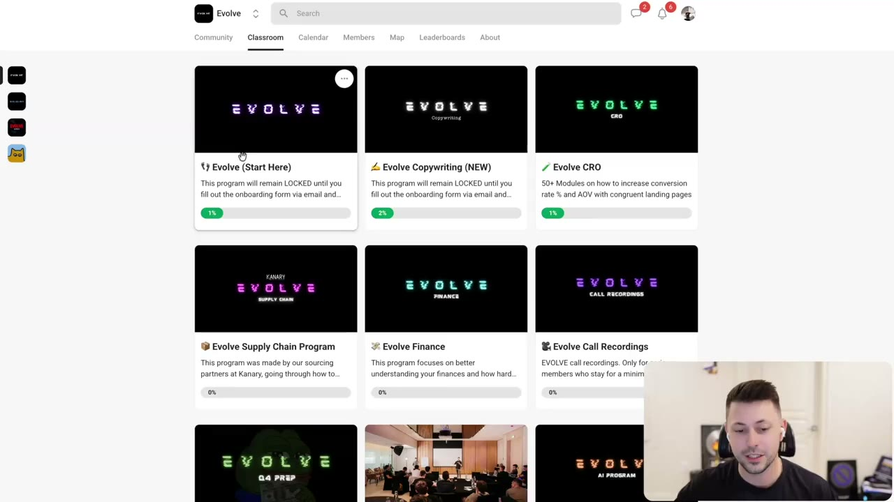
*The Skool classroom tiles for every program; Start Here and Copywriting are locked until the onboarding form is submitted. [00:30]*

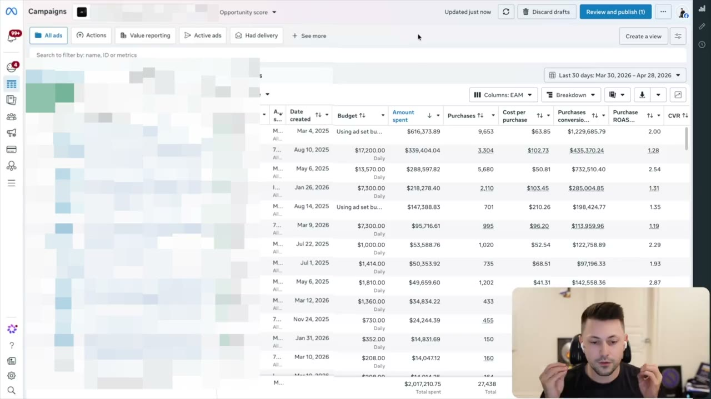
*"Over $2 million in just this account" in 30 days: Total spent $2,017,210.75, Mar 30 to Apr 28, 2026; ad-set identifiers blurred. [01:00]*

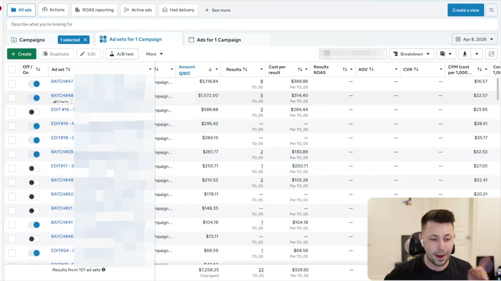
*Apr 8, ad sets of one campaign: BATCH#47 leads spend ($3,118.84, 8 results, $389.86 per result); the table total is $7,258.25 across 101 ad sets, 22 results, $329.92 per result (result = a custom "TO_05" event). Batch numbering is the course's own naming. [01:40]*

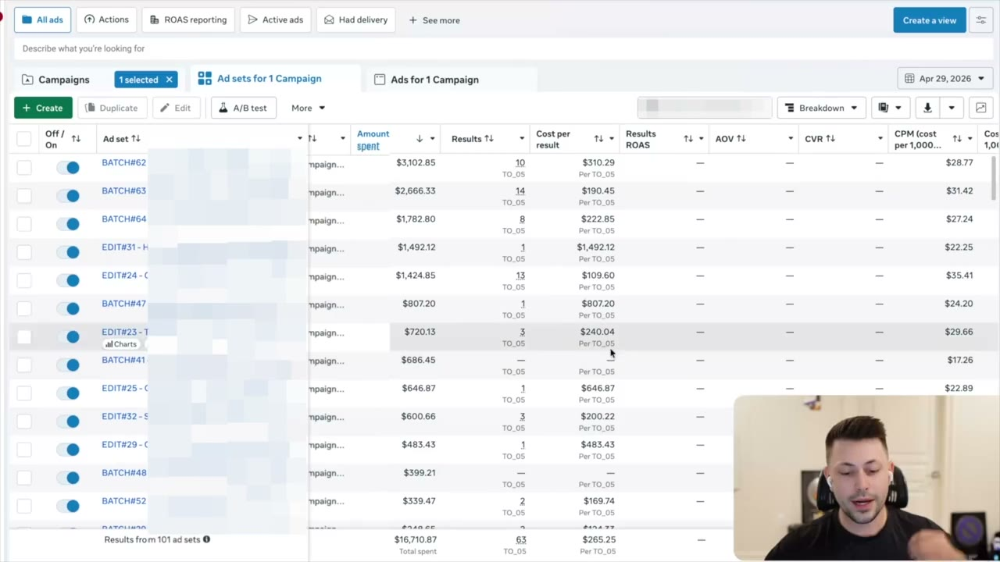
*Apr 29: BATCH#62 ($3,102.85, $310.29 per result), BATCH#63 ($2,666.33, $190.45) and BATCH#64 ($1,782.80, $222.85) lead spend; the table total is $16,710.87 across 101 ad sets, 63 results, $265.25 per result. [02:05]*

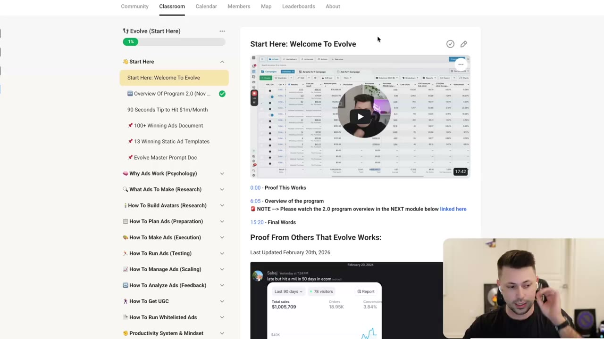
*The folder list: Why Ads Work (Psychology), What Ads To Make (Research), How To Build Avatars, Plan, Make, Run, Manage, Analyze, Get UGC, Run Whitelisted Ads, Productivity System & Mindset. [03:20]*

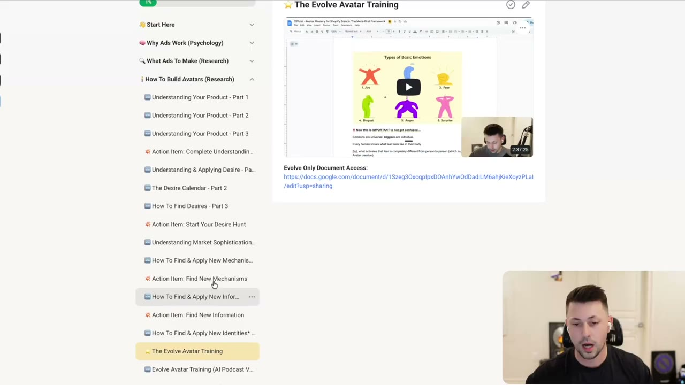
*The avatar section order: Understanding Your Product 1–3, Complete Understanding Product action item, Understanding & Applying Desire, Desire Calendar, How To Find Desires, Start Your Desire Hunt, Market Sophistication, New Mechanisms, New Information, New Identities, The Evolve Avatar Training. [06:35]*

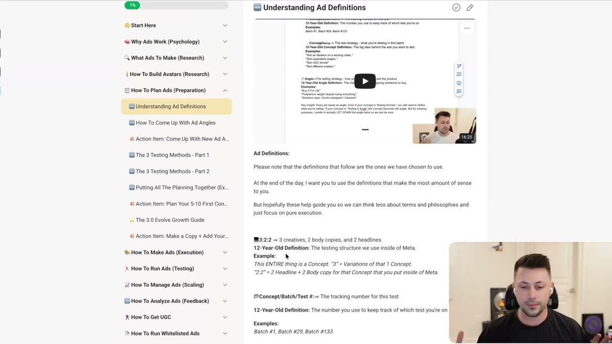
*"3:2:2 = 3 creatives, 2 body copies, and 2 headlines" and the batch tracking number definition. [07:20]*

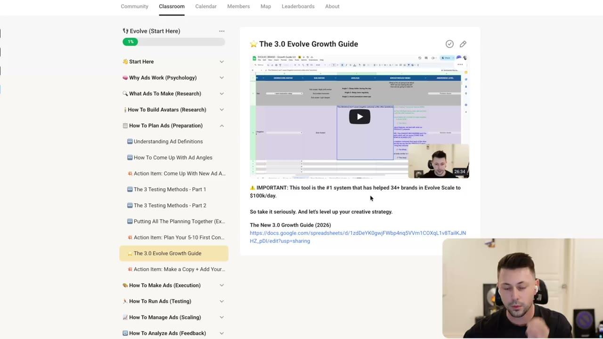
*"IMPORTANT: This tool is the #1 system that has helped 34+ brands in Evolve Scale to $100k/day." (page claim). [08:10]*

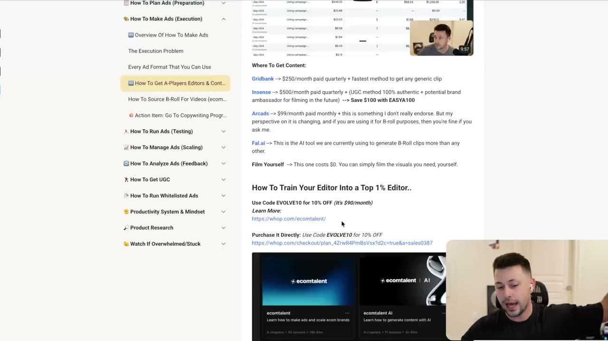
*"Where To Get Content" with monthly prices, plus a paid editor-training program. A promo code on screen is not reproduced. [09:00]*

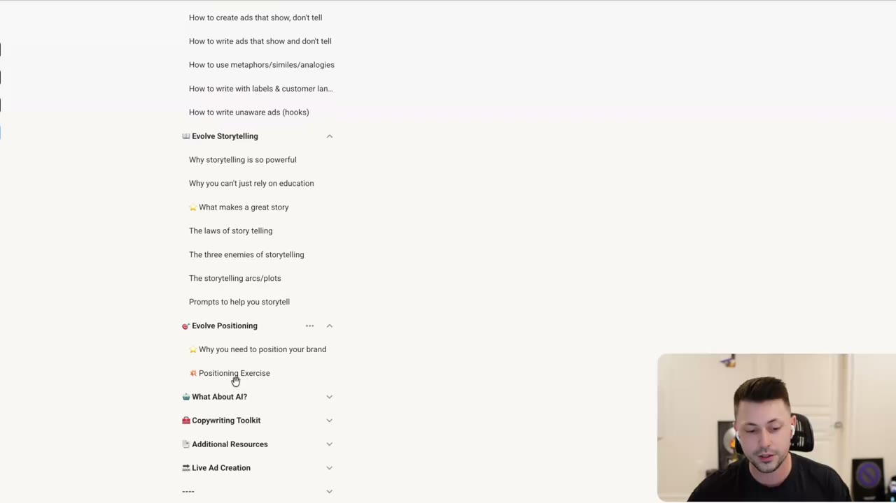
*Copywriting program sections: show-don't-tell, metaphors, labels & customer language, unaware hooks, Evolve Storytelling (7 modules), Evolve Positioning, What About AI?, Copywriting Toolkit, Additional Resources, Live Ad Creation. [10:30]*

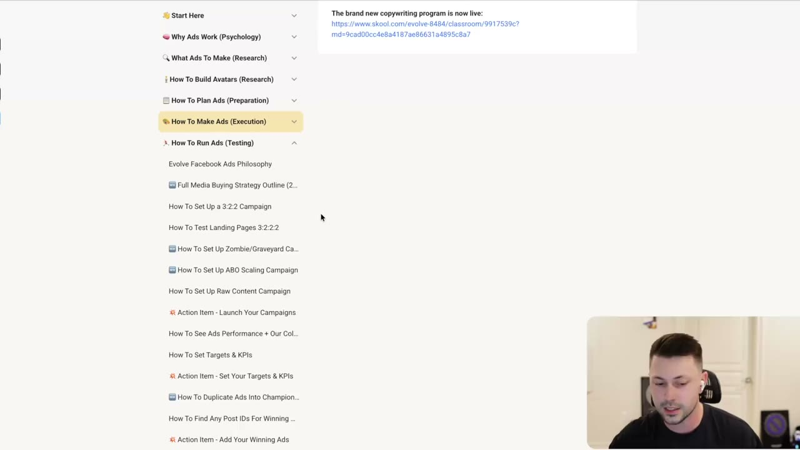
*The testing section module order (3:2:2, 3:2:2:2 landing pages, zombie/graveyard, ABO scaling, raw content, KPIs, duplicate to champions, post IDs). [11:50]*

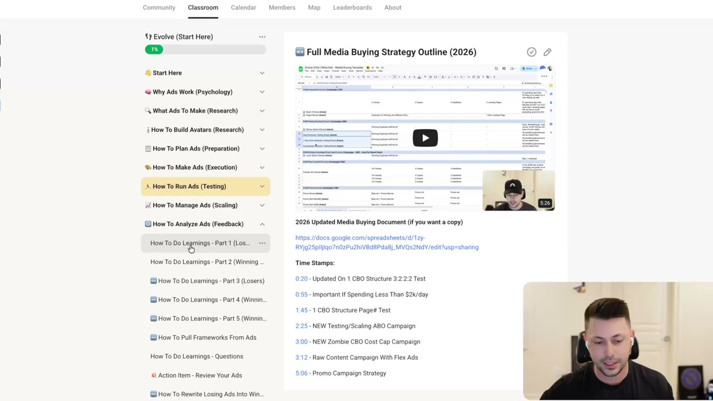
*The media-buying outline video's own chapter list (3:2:2:2 test, under $2k/day note, ABO, zombie CBO cost cap, raw content with flex ads, promo strategy) and the "feedback" folder's learnings modules. [12:40]*

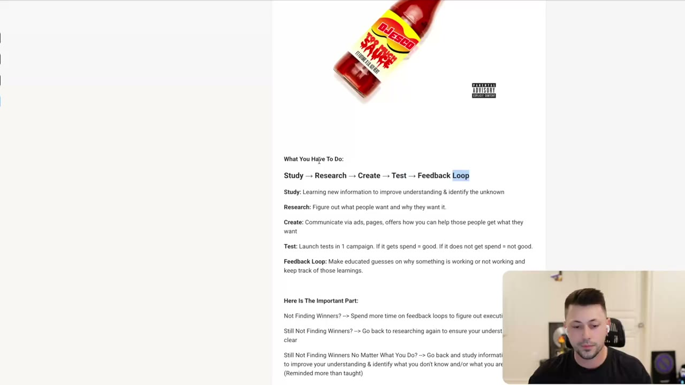
*The loop and the escalation rules (not finding winners → feedback loops → research → study). [16:10]*

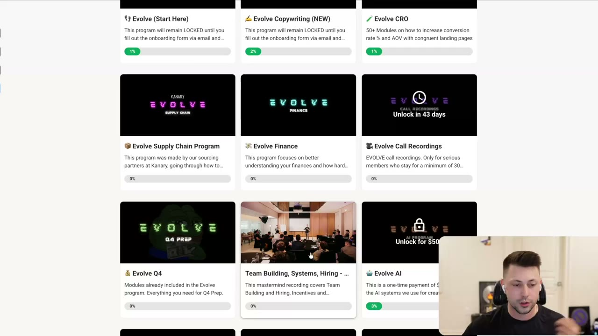
*Locked/unlocked states: CRO "Unlock for $1,500", Call Recordings "Unlock in 43 days", AI Program "Unlock for $500". [18:00]*

## How to apply
- [ ] When a request is vague ("get more winners"), first state which loop stage the account is in (study / research / create / test / feedback).
- [ ] If tests produce no spend winners: write down learnings per batch before launching more; then re-check research; then study.
- [ ] For a rising-CPA winner, plan three new variations/winners from the same concept before changing budgets.
- [ ] Use the folder order (psychology → research → avatars → planning → execution → testing → scaling → feedback) when sequencing any new brand onboarding.
- [ ] Label every performance figure from this lesson as an instructor or member claim; never quote them as benchmarks.

## Related
- Previous: none · Next: [2. Win The 100k/Day Award](002-win-the-100k-day-award.md)
- [3. 90 Seconds Tip to Hit 1m/Month](003-90-seconds-tip-to-hit-1m-month.md) · [4. 100+ Winning Ads Document](004-100-winning-ads-document.md) · [6. 13 Winning Static Ad Templates](006-13-winning-static-ad-templates.md) · [7. Evolve Master Prompt Doc](007-evolve-master-prompt-doc.md)
- Evolve Copywriting: [Overview of the copywriting program](../../copywriting/lessons/01-overview-of-copywriting-program.md) · [Iteration playbook](../../copywriting/frameworks/iteration-playbook.md)
- [Iteration vs variation](../../../../concepts/iteration-vs-variation.md) · [Creative testing system](../../../../frameworks/creative-testing-system.md)

## Sources and limitations
- Transcript: [1. Start Here Overview Of Evolve….txt](<../../../../../raw/evolve/start-here/_transcripts/👣 Evolve (Start Here)/1. 🆕 Start Here Overview Of Evolve 👣 Evolve (Start Here) Evolve.txt>) · Page text: [1. Start Here_ Overview Of Evolve….html.md](<../../../../../raw/evolve/start-here/_extracted/👣 Evolve (Start Here)/1. 🆕 Start Here_ Overview Of Evolve_👣 Evolve (Start Here)_Evolve.html.md>) (a chapter list and 51 embedded images; chapters: 0:00 Welcome, 0:35 How our strategy works, 3:08 How to go through the Evolve program, 15:33 The Evolve loop, 16:40 The other programs, 19:35 Final Words).
- Machine transcription (Whisper large-v3-turbo). The full recording is covered (last segment 21:40 of a 21:40 video). Whisper wrote "Carlo" for a name that is likely "Karlo" (as on the Master Prompt doc), "cloud code" for "Claude Code", and "dubs channel" for the wins channel. The instructor introduces himself as "Spencer", "co-founder and Sean's partner" [00:00]; the surname Pawliw is shown on the plaque in [lesson 2](002-win-the-100k-day-award.md).
- The page text lists chapter times that are about 0–5 seconds off the audio (page says 16:40 for "other programs"; the audio starts it near 16:27). Audio times were used.
- Performance figures (account spend, CPA, member wins, "34+ brands", "60%") are claims shown on screen or said aloud, not audited data. Account IDs and ad names are blurred in the source and are not reproduced.
- The 51 Discord screenshots were read from contact sheets; small numbers may be off by a digit. The dashboard values listed above were the clearly legible ones.
- The frame of the media-buying outline links a Google Sheet (not exported in the course files); its contents are not reproduced here.
