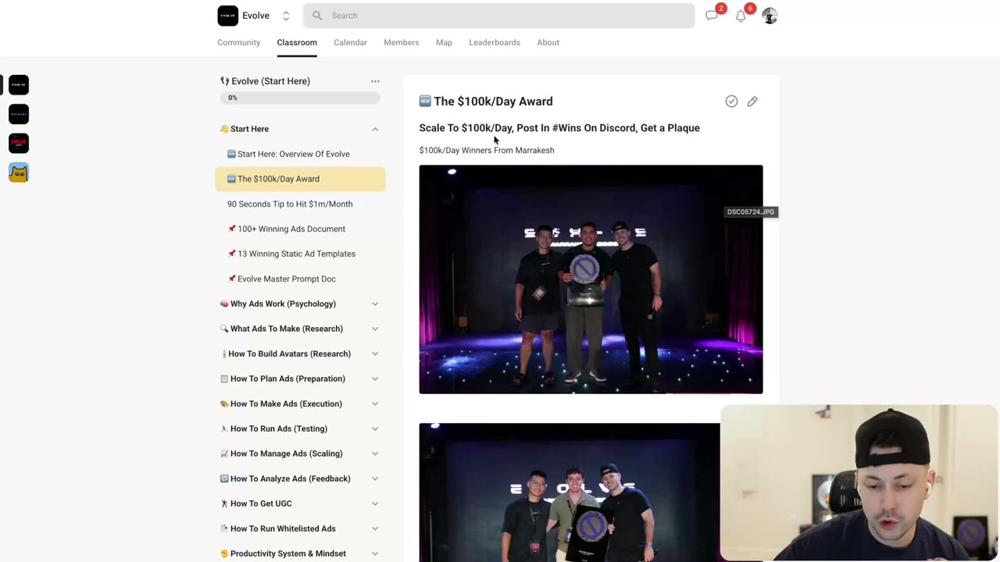
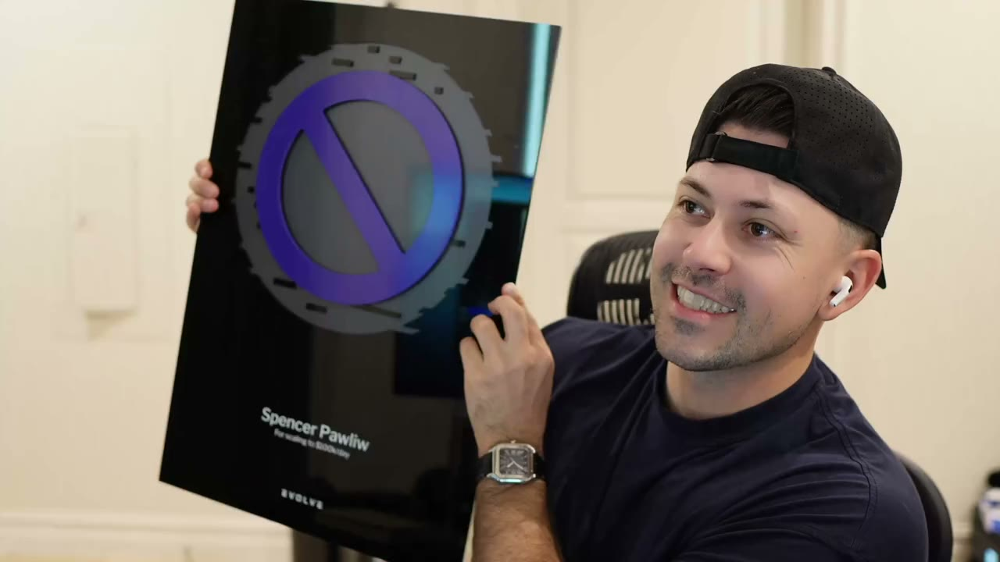

# 2. Win The 100k/Day Award
> Evolve's headline success benchmark is a $100k/day store: hit it, post it in the #wins channel on Discord, and contact the instructors to receive a custom plaque. It tells an agent what the program treats as "scaled".

## 🤖 Agent use
- **Use when:** you need Evolve's definition of the top-line goal (100k/day) or the claim process for the plaque; or you are setting a scale target and want to know what the program benchmarks against.
- **Inputs → outputs:** a store reaching $100k in a day plus a Discord wins post → contact the instructors for a plaque. No ad tactics are taught here.
- **Rules:**
  - **DO** post the milestone in the Discord #wins channel first; that is the stated trigger for the plaque. "If you do hit a 100k day inside of Evolve and you post it in the wins channel on Discord we will send you the 100k per day plaque." [00:00–00:27]
  - **DO** contact "either me or Sean directly" after posting. [00:27–00:55]
  - **DON'T** read the plaque as proof of an average: the criterion is one day at $100k, and winners self-report. (derived)
- **See also:** [1. Start Here/ Overview Of Evolve](001-start-here-overview-of-evolve.md) (member "wins" screenshots, the 100K/day benchmark) · [3. 90 Seconds Tip to Hit 1m/Month](003-90-seconds-tip-to-hit-1m-month.md)

## Key ideas

### The award [00:00–00:55]
- Trigger: hit a $100k day inside Evolve, post it in the wins channel on Discord. [00:00]
- Reward: a custom-made plaque, shown on camera. It reads the member's name, "for scaling to 100k per day" and carries the Evolve logo and "the no sign" that "a lot of you guys already know". The instructor says they "put a lot of time into trying to make them as high quality as possible". [00:00–00:27; frame 00:25]
- Why it exists: "we're very excited to reward people finally for accomplishing the one thing that I think everybody in evolve is you know trying to accomplish." (instructor claim) [00:27]
- How to claim: "you can contact either me or Sean directly and we will get you your very own custom made 100k per day plaque." [00:27–00:55]
- Close: "with that said let's get to work so we can actually make that happen." [00:55]

### Lesson page [page text]
- Heading: "Scale To $100k/Day, Post In #Wins On Discord, Get a Plaque". The caption "$100k/Day Winners From Marrakesh" sits above ten stage photos of award winners holding plaques at the Evolve Marrakesh event, with two presenters. Individual winners are not named in the page text, and none are named here. (Names appear in small print on the plaques in the photos; they are not part of the teaching.)

## Steps / framework
1. Reach one day of $100k in sales for your brand while in Evolve.
2. Post it in the #wins channel on the Evolve Discord. ("Wins" channel is called "dubs" in the Whisper transcript of lesson 1.)
3. Message Spencer or Sean directly. A name and "scaling to 100k per day" plaque is made.

## Examples
- Plaque on camera: black glass-style plaque, Evolve "no sign" logo, the instructor's own name and "For scaling to $100k/day" printed on it (frame 00:25). He holds up his own as the demo.
- Event photos: ten photos of recipients on stage in Marrakesh (single winners and small groups); at least one appears in a pair/group photo. The photos carry no metrics.

## Structured units
### Rules of thumb
- **DO** set 100k/day as the benchmark when reading Evolve advice; the program's own proof posts in [lesson 1](001-start-here-overview-of-evolve.md) are built around it. [00:27]
- **IF** a client asks what "success" looks like in Evolve **THEN** answer with this milestone and the #wins post. [00:00]

## Prompts / templates (verbatim)
None.

## Screenshots

*The lesson page: "Scale To $100k/Day, Post In #Wins On Discord, Get a Plaque", with Marrakesh winner photos. [00:05]*

*The plaque: name line, "For scaling to $100k/day", Evolve mark and the no-sign emblem. Also the on-screen evidence that the speaker is Spencer Pawliw. [00:25]*

## How to apply
- [ ] When setting growth goals for an Evolve-style brand, list "100k/day" as the headline milestone and note it is a single-day mark.
- [ ] Do not invent a plaque eligibility rule beyond "100k day + wins post + message Spencer or Sean".

## Related
- Previous: [1. Start Here/ Overview Of Evolve](001-start-here-overview-of-evolve.md) · Next: [3. 90 Seconds Tip to Hit 1m/Month](003-90-seconds-tip-to-hit-1m-month.md)

## Sources and limitations
- Transcript: [2. Win The $100k Day Award….txt](<../../../../../raw/evolve/start-here/_transcripts/👣 Evolve (Start Here)/2. 🆕 Win The $100k Day Award 👣 Evolve (Start Here) Evolve.txt>) · Page text: [2. ….html.md](<../../../../../raw/evolve/start-here/_extracted/👣 Evolve (Start Here)/2. 🆕 Win The $100k_Day Award_👣 Evolve (Start Here)_Evolve.html.md>) · 10 images in `raw/evolve/start-here/linked/skool-images/02/`.
- Machine transcription (Whisper large-v3-turbo); full recording covered (last segment 0:59 of 0:59). The recorded speaker says "me or Sean" without naming himself; "Spencer Pawliw" comes from the name printed on the plaque he holds (frame 00:25) and from lesson 1, where he introduces himself as Spencer.
- Fix: Whisper's "$100k Day" and "100k per day" are both used in the source; the page title is "Win The $100k/Day Award".
- No metrics, criteria for verification, or dates are given for the award.
