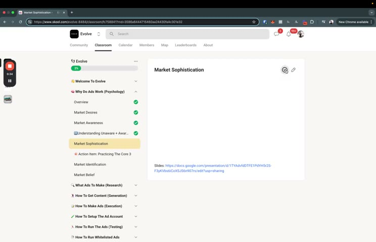

# 3. 90 Seconds Tip to Hit 1m/Month
> A one-minute habit tip: click "Mark as done" after every module and action item, because the progress bar and checkmark give a small reward that keeps you finishing the program.

## 🤖 Agent use
- **Use when:** building a completion checklist for a human or agent working through the Evolve modules, or designing a "done" step into a recurring workflow.
- **Inputs → outputs:** a module list → a tracked, ticked checklist where each item is marked complete only when watched and (for action items) actually done.
- **Rules:**
  - **DO** mark a module complete only after the whole video ends: "whenever you finish watching an entire video and you get to the end … click this little mark is done". [00:00–00:34]
  - **DO** mark action items done too: "when you actually complete an action step and you click done, it's going to trigger a dopamine response". [00:34–01:03]
  - **DON'T** click done early to boost the bar (derived: the instructor's reward only works "when you actually watch an entire module").
- **See also:** [1. Start Here/ Overview Of Evolve](001-start-here-overview-of-evolve.md) (the loop and the module map) · [Evolve Copywriting: How to guarantee you get better at copywriting](../../copywriting/lessons/03-how-to-guarantee-you-get-better-at-copywriting.md) (a similar daily-habit idea)

## Key ideas

### Trick your brain into wanting the next module [00:00–01:27]
- Premise: "just how you can trick your brain to get dopamine". The mechanism is the Skool "mark as done" button, which advances a visible **progress bar** after each completed task. [00:00–00:34]
- Claim: finishing a module or action step and clicking done "is going to trigger a dopamine response in your brain to reward you to continue to do more of what you just did". He admits the way he is demonstrating it "is not really dopamine driven" but "the brain is a crazy thing". (instructor claim; not evidence) [00:34–01:03]
- Result he promises: it "is going to make you addicted to going through this and actually taking action on everything as well." [01:03–01:27]
- The page's definition (page text): "Dopamine is often called the 'feel-good' hormone because it's released in the brain when we experience pleasure or reward. … the chemical messenger that makes you want to do something again because it felt good the first time." Page tagline: "Sounds insane, but it works." / "Good Dopamine >>". The tip is a gamification device; no evidence is given for the neurochemistry.

## Steps / framework
1. Watch the whole video.
2. Click the check-circle ("mark as done") at the top right of the lesson.
3. Watch the progress bar fill after each task.
4. Do the same for each action item once the action is complete.

## Examples
- Demonstration: after completing one module, the sidebar shows green checkmarks beside finished modules and the progress badge rises (on screen it moves from 0% to 2% after Market Desires and Market Awareness are ticked). [00:34]

## Structured units
### Rules of thumb
- **DO** use the progress bar as a lightweight accountability signal. [00:00–01:27]
- **IF** a member is stuck in "watching mode" **THEN** require action items to be ticked, not just videos. [00:34–01:03] (derived from the instructor's emphasis on action steps)

## Prompts / templates (verbatim)
None.

## Screenshots

*After tapping "mark as done", the sidebar shows green ticks for completed modules (Overview, Market Desires, Market Awareness, Understanding Unaware + Awareness Levels) and the top progress badge reads 2%. The recording shows an earlier version of the course layout. [00:35]*

## How to apply
- [ ] Make "mark as done" the last step of every module and action item in your own tracker.
- [ ] Do not mark items done that you only skimmed; the lesson's payoff relies on finishing.
- [ ] Review the bar weekly to spot modules you skipped.

## Related
- Previous: [2. Win The 100k/Day Award](002-win-the-100k-day-award.md) · Next: [4. 100+ Winning Ads Document](004-100-winning-ads-document.md)
- [1. Start Here/ Overview Of Evolve](001-start-here-overview-of-evolve.md)

## Sources and limitations
- Transcript: [3. 90 Seconds Tip to Hit $1m Month….txt](<../../../../../raw/evolve/start-here/_transcripts/👣 Evolve (Start Here)/3. 90 Seconds Tip to Hit $1m Month 👣 Evolve (Start Here) Evolve.txt>) · Page text: [3. ….html.md](<../../../../../raw/evolve/start-here/_extracted/👣 Evolve (Start Here)/3. 90 Seconds Tip to Hit $1m_Month_👣 Evolve (Start Here)_Evolve.html.md>).
- Machine transcription (Whisper large-v3-turbo); full recording covered (last segment 1:26 of 1:27). The speaker is not named in this video (`unverified`); voice and face match the instructor of lesson 1, who introduces himself as Spencer.
- The title says "$1m/Month", but the lesson contains no revenue figures or tactic beyond the progress-bar habit; the link between the tip and $1M/month is rhetorical.
- The screen recording is of an older module layout ("Welcome To Evolve", "Why Do Ads Work (Psychology)"), not the current sidebar.
