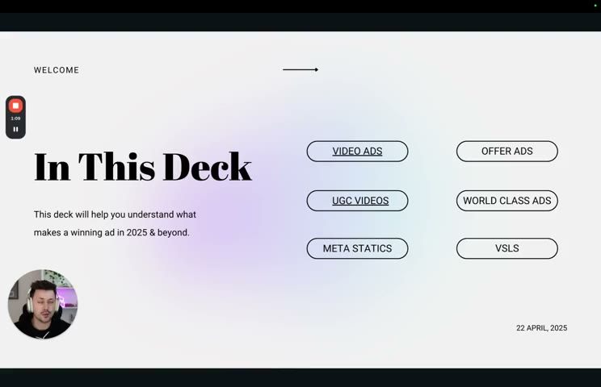
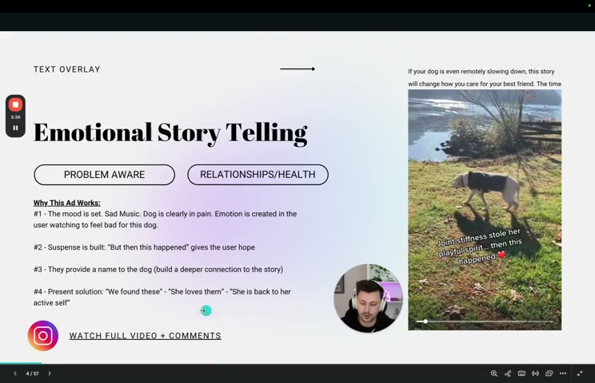
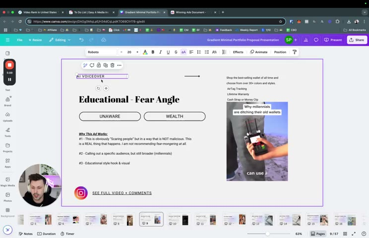
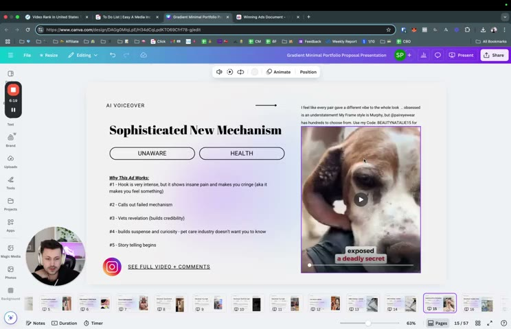
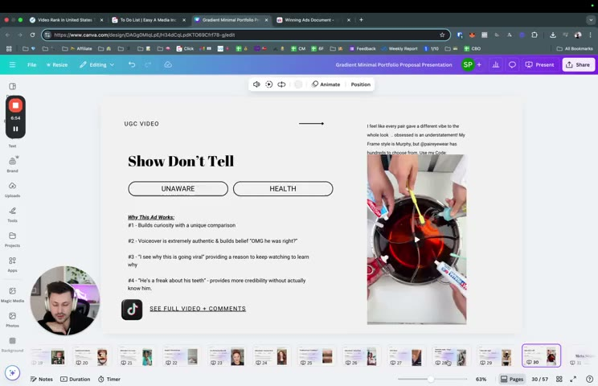
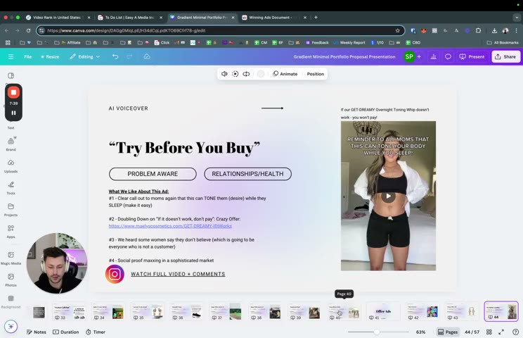
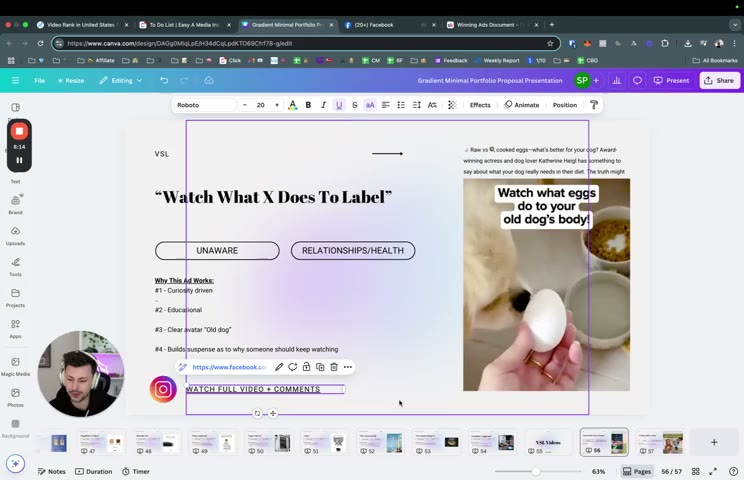

# 4. 100+ Winning Ads Document
> A tour of Evolve's Canva deck of winning ads, where each ad is labelled with its angle, awareness stage, core desire and a "why this ad works" breakdown, so you learn what a winning ad is before you try to make one.

## 🤖 Agent use
- **Use when:** calibrating what "good" looks like before writing or reviewing ads; tearing down a competitor ad with the same labels (angle, awareness stage, core desire, why it works); looking for a pattern to remix.
- **Inputs → outputs:** an ad (video, UGC, static, offer, VSL) → a teardown row: angle, awareness stage, core desire(s), 3–5 numbered reasons it works, and the feeling or curiosity move it makes.
- **Rules:**
  - **DO** use the deck to "correct your lens for what a winning ad is", not as a copy source: "my goal of this is not for you to copy these ads one-to-one." [00:00–00:51]
  - **DO** label every ad the way the deck does: angle (e.g. emotional storytelling), awareness stage (e.g. problem aware), and one to three core desires. [01:30–02:18]
  - **DO** write the "why it works" as a numbered list of specific mechanics (mood, suspense, named subject, solution reveal, CTA). [02:18–03:24]
  - **DO** watch the full ad and read the comments via the links in the deck; the comments show whether it is still live and how people react. [03:24–04:14]
  - **DON'T** judge an ad by how it looks or because it is odd: some ads are included because they are "super weird" yet work for a reason you can name (congruent audio and visuals, relatability). [05:54–06:42]
  - **DON'T** copy the production trick (AI voiceover, text overlay). The point is "that this ad is a great ad", not that it is an AI voiceover. [05:08]
  - **IF** you cannot explain why an ad works **THEN** do not use it as a model; the deck says "you will come back to this document, and EVERYTHING will make sense" after the program. [page text]
- **See also:** [5. 100+ Hook Templates (From Ads Doc)](005-100-hook-templates-from-ads-doc.md) · [6. 13 Winning Static Ad Templates](006-13-winning-static-ad-templates.md) · [10. Market Awareness](010-market-awareness.md) · [9. Market Desires](009-market-desires.md) · [Competitor ad teardown playbook](../../../../playbooks/competitor-ad-teardown.md) · [Evolve Copywriting: market awareness](../../copywriting/concepts/market-awareness.md)

## Key ideas

### What the deck is for [00:00–01:30; page text]
- The video introduces "the new winning ads deck for 2025": "I believe, 57 slides total", built over a long time as the team "really shifted our mindset on … what a winning ad actually looks like." (the first slide on screen is dated "22 April, 2025", slide counter "2/57"). The course page now calls it the "2026 Winning Ads Document" and links a Canva share link; other course lessons and the hook sheet refer to the same deck at 60+, 120+ and 136 pages, so it has grown since this video was recorded. [00:00; frame 01:15]
- Page text rules: "To make a winning ad, you must know what a winning ad is." The deck "may be confusing" now; after the program "you will come back to this document, and EVERYTHING will make sense". "REMINDER: This is NOT meant to be a swipe file of ads to copy. This is meant to help you correct your lens on WHAT a winning ad is & help you better understand WHY it's winning", and to give people "who have never cracked a TRUE winning ad" a comparison point. [page text]
- Categories in the deck: Video Ads, UGC Videos, Meta Statics, Offer Ads, World Class Ads, VSLs (menu on the first slide, frame 01:15). "These four are the core that you're going to want to look at"; world-class ads are for inspiration on "what a great ad really looks like. Not so much on the performance side"; VSLs are at the end and still being built out. (Whisper does not say which four; the deck order suggests the first four.) [01:30]
- It is "organized from … easiest to hardest" only loosely ("I wouldn't say"). [00:51–01:30]
- Entry format: each ad lists the angle, the awareness stage it targets, and one or more of the three core desires (health, wealth, relationships; see [9. Market Desires](009-market-desires.md)), then a numbered "Why This Ad Works" breakdown, a link to the full video/post and the comments. [01:30–02:18]
- Planned: "we're also going to be building frameworks around these patterns", including via the AI program; a weekly call recording will be attached. [08:29–09:04]

### Worked teardown: dog joint-supplement story ad [01:30–04:14]
- Labels on the slide: **Emotional Story Telling**, **Problem aware**, **Relationships/Health** (the relationship with the dog plus its health). Format tag: **Text overlay**. [01:30–02:18; frames 02:20, 03:45]
- Why it works as listed: (1) the mood is set, sad music and a dog in clear pain, so the viewer feels bad for the dog; (2) suspense is built ("But then this happened") and gives hope; (3) the dog is given a name (the on-screen text introduces "Scout") to build a deeper connection to the story; (4) the solution is presented ("We found these", "She loves them", "She is back to her active self"). [02:18–03:24]
- Instructor commentary: "we possess a lot of feelings with names of animals and people because we feel more like we actually know them"; the ad sits in the pain point and "that's how you know it's working." The ad is "133 weeks old" per the comments (one of the oldest in the deck) and may no longer run. [02:18–04:14]
- The deck links the Instagram post ("Watch full video + comments"); he opens it to show it and notes a newer post with "three and a half K shares" and more recent comments. [03:24–04:14]

### Other ads described aloud [04:14–08:29]
- Storytelling, educational and question-style hooks are common; he names "Dr. Squatch" and "Ridge" as brands present. [04:14]
- "This isn't a phone case. It's a 30-cent child manufacturer": starts with confusion (a phone case is on screen), then "gets straight to the next point, which is heavy hitting". Audio is working with it ("plus one for the audio"); it is "extremely educational", makes you reconsider "what you've really bought", and relates to the viewer feeling overwhelmed. Labelled AI voiceover. [05:08–05:54]
- UGC section: a "super weird" video where it works because "the audio is congruent, the visual words, cutest, espresso, under $50". TikTok Shop videos are included. [05:54–06:42]
- Meta statics: ones that look odd ("how is this even converting?") but are relatable; categories: entertainment-based, avatar callouts, indirect avatar callouts, curiosity-to-advertorial, relatable hooks, images with context, **engagement bait** (a brand he believes is called Ruggable) and **contradictory statics** from the same company. [06:42–07:31]
- Offer ads: "an incredible place to be very creative"; world-class statics: "some of my favorite ads of all time" from big brands or "executed extremely well". [07:31]
- VSLs: two at the end, roughly 22–24 minutes ("24 minutes to be exact"); "extremely, extremely long". [07:31]
- Common theme: "a lot of them make you feel something. A lot of them are very educational. A lot of them are driving curiosity." The goal is to trigger attention, build curiosity and suspense, and "give us a reason to keep watching". [08:29–09:04]

## Steps / framework

### Teardown template used by the deck (derived from [01:30–02:18] and the slide frames)
| Field | What to record |
|---|---|
| Format tag | Video / UGC / Meta static / Offer / VSL; production style (text overlay, AI voiceover, talking head) |
| Angle | The selling story (e.g. "Emotional Story Telling", "Educational – Fear Angle", "Sophisticated New Mechanism", "Show Don't Tell", "Try Before You Buy") |
| Awareness stage | Unaware / problem aware / solution aware / product aware / most aware |
| Core desire(s) | Health, wealth, relationships (one or more) |
| Why it works | 3–5 numbered, specific mechanics |
| Links | Full video/post and comments for context |

## Examples

### Slide-by-slide examples visible in the video
Each row transcribes the slide labels and the "why this ad works" lines as shown on screen (small text, may contain minor typos). Brand names are given only where the slide or the instructor names them.

| Slide title (angle) | Format | Awareness / desire | Hook / opening | Why it works (as on the slide) | Source |
|---|---|---|---|---|---|
| Emotional Story Telling | Text overlay (Instagram video) | Problem aware / Relationships, Health | Dog in pain: "Joint stiffness stole her playful spirit… then this happened" | Mood set (sad music, dog in pain); suspense "But then this happened" gives hope; the dog is named; solution shown ("We found these", "She loves them", "She is back to her active self") | [02:18–03:24; frame 03:45] |
| Educational – Fear Angle | AI voiceover | Unaware / Wealth | "Why millennials are ditching their old wallets" | (1) "Scaring people" in a way that is NOT malicious; it is a real thing that happens (slide adds it is not recommending fear-mongering at all); (2) calls out a specific audience, still broad (millennials); (3) educational-style hook and visual | frame 05:15 |
| Educational – Belief Hook | AI voiceover | Problem aware / Health (as labelled) | A phone case shown, then "30-cent child manufactured" | (1) Starts with confusion, then a heavy-hitting point, plus one for the audio; (2) extremely educational and makes you reconsider what you "really" bought; (3) relates to the user, "it feels overwhelming"; (4) strong CTA, "Make a decision, without making a sacrifice" | [05:08–05:54] |
| Sophisticated New Mechanism | AI voiceover | Unaware / Health | Video of a dog with the text "exposed a deadly secret" | (1) Hook is very intense, shows insane pain and makes you cringe (makes you feel something); (2) calls out the failed mechanism; (3) a vet's revelation builds credibility; (4) builds suspense and curiosity: the pet-care industry doesn't want you to know; (5) storytelling begins | frame 06:20 |
| Show Don't Tell | UGC (TikTok) | Unaware / Health | A unique comparison demo (toothbrushes and a dark liquid, TikTok) | (1) Builds curiosity with a unique comparison; (2) voiceover is extremely authentic and builds belief ("OMG he was right?"); (3) "I see why this is going viral" gives a reason to keep watching to learn why; (4) "He's a freak about his teeth" adds credibility without really knowing him | frame 07:00 |
| "Try Before You Buy" | AI voiceover (Instagram) | Problem aware / Relationships, Health | "Reminder to all moms that this can tone your body while you sleep!" | (1) Clear call-out to moms that this can TONE them (desire) while they SLEEP (make it easy); (2) doubling down on "if it doesn't work, don't pay", a crazy offer; (3) "we heard some women say they don't believe", which is everyone who is not a customer; (4) social proof maxxing in a sophisticated market | frame 07:45 |
| "Watch What X Does To Label" | VSL (Facebook) | Unaware / Relationships, Health | "Watch what eggs do to your old dog's body!" | (1) Curiosity-driven; (2) educational; (3) clear avatar, "old dog"; (4) builds suspense as to why someone should keep watching | frame 08:20 |

## Structured units

### Ad teardowns
| Brand / product (niche) | Format | Hook / opening | What works | What fails | Fix suggested | Principle | Source |
|---|---|---|---|---|---|---|---|
| Dog joint supplement (pet health) | Text-overlay story video | "Joint stiffness stole her playful spirit… then this happened" | Mood, named dog, suspense, solution reveal | Old ad (133 weeks), may not run now | — | Emotional story + hope; name the subject | [02:18–04:14] |
| Phone-case maker (ethical goods) | AI-voiceover video | "This isn't a phone case. It's a 30-cent child manufactured…" | Confusion → heavy hit; educational; audio carries it | — | — | Reframe what the product is not; make the viewer reconsider the category | [05:08–05:54] |
| Espresso product (UGC; Whisper heard "cutest, espresso, under $50") | UGC video | On-screen words as described aloud | Audio congruent with visual words | Looks odd/random | — | Congruent audio and visual | [06:42] |
| Rug brand ("Ruggable", per instructor's uncertain recall) | Static | Engagement bait; a second "contradictory" static from the same company | Named by the instructor as a clever tactic (reasons not detailed in audio) | — | — | Engagement-bait statics | [06:42–07:31] |

### Rules of thumb
- **DO** call out the awareness stage and the desire the ad serves; it is the fastest way to spot a pattern. [01:30–02:18]
- **DO** note "what the ad makes you feel": emotion, education or curiosity are the three drivers he repeats. [08:29–09:04]
- **IF** an ad looks wrong but runs **THEN** look for the congruence reason rather than dismissing it. [05:54–06:42]

## Prompts / templates (verbatim)
None in this lesson. The deck's own link (page text): `https://canva.link/vkpkr5fb6smiscr`. The page also notes the 13 static templates are in the execution section ([6. 13 Winning Static Ad Templates](006-13-winning-static-ad-templates.md)).

## Screenshots

*"In This Deck": the six categories of the winning ads deck. The slide is dated 22 April 2025 and the counter shows 2/57. [01:15]*

*The standard slide format: angle, awareness stage, core desire, a numbered "Why This Ad Works", the video and a "Watch full video + comments" link. [03:45]*

*"Educational - Fear Angle", labelled Unaware / Wealth, with the note that the fear is not malicious. [05:15]*

*"Sophisticated New Mechanism", Unaware / Health: intense hook, failed mechanism called out, vet revelation, suspense, story. [06:25]*

*"Show Don't Tell", a UGC TikTok built on a surprising visual comparison. [07:00]*

*"Try Before You Buy": the offer ("if it doesn't work, don't pay") plus social proof in a sophisticated market. [07:45]*

*A VSL entry: Unaware / Relationships, Health, built on curiosity and a clear "old dog" avatar. [08:20]*

## How to apply
- [ ] For each competitor ad pulled, fill the six-field teardown template (format, angle, awareness, desire, why it works, link).
- [ ] Keep an entry only when you can write three or more specific reasons it works.
- [ ] Note feelings it triggers (emotion, education, curiosity) and which one is dominant.
- [ ] Remix the mechanism, not the lines; do not reuse its script or claims.
- [ ] Cross-check with [9](009-market-desires.md) and [10](010-market-awareness.md) after you learn those frameworks; the deck makes more sense afterwards.

## Related
- Previous: [3. 90 Seconds Tip to Hit 1m/Month](003-90-seconds-tip-to-hit-1m-month.md) · Next: [5. 100+ Hook Templates (From Ads Doc)](005-100-hook-templates-from-ads-doc.md)
- [6. 13 Winning Static Ad Templates](006-13-winning-static-ad-templates.md) · [Evolve Copywriting: hooks](../../copywriting/concepts/hooks.md) · [Evolve Copywriting: show don't tell](../../copywriting/concepts/show-dont-tell.md) · [Ad teardowns library](../../../../libraries/ad-teardowns.md)

## Sources and limitations
- Transcript: [4. 100+ Winning Ads Document….txt](<../../../../../raw/evolve/start-here/_transcripts/👣 Evolve (Start Here)/4. 📌 100+ Winning Ads Document 👣 Evolve (Start Here) Evolve.txt>) · Page text: [4. ….html.md](<../../../../../raw/evolve/start-here/_extracted/👣 Evolve (Start Here)/4. 📌 100+ Winning Ads Document_👣 Evolve (Start Here)_Evolve.html.md>).
- Machine transcription (Whisper large-v3-turbo); full recording covered (last segment 9:41 of 9:41). The speaker is not named (`unverified`); same presenter as lesson 1 by voice and face.
- The Canva deck itself is not in the course files; only the slides visible in the video (v. April 2025, 57 slides) were read. "Ruggable" is the instructor's uncertain recall ("I believe they're called Ruggable"). "Dr. Squatch" and "Ridge" are named aloud only; the transcript says "Dr. Squatch in here… We've got Ridge in here".
- The page title says "100+" and "2026", the video speaks of a 2025 deck of 57 slides, and other lessons cite 60+, 120+ and 136 pages: the version in the video is older than the one the course now links.
- Slide text was read from 744-px-wide frames; small words may be off.
- The "133 weeks old" figure for the dog ad is as heard in the audio.
