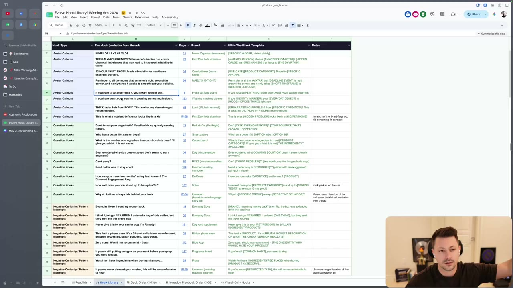
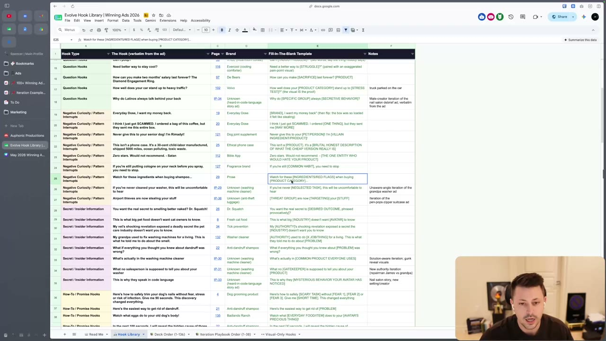

# 5. 100+ Hook Templates (From Ads Doc)
> Introduces the Evolve hook library, a Google Sheet that turns 120+ winning ads into categorized hooks with fill-in-the-blank templates, so you can borrow hook mechanisms from other niches instead of only stealing from direct competitors.

## 🤖 Agent use
- **Use when:** you need a hook and do not know how to phrase it; or you are turning a competitor or cross-category hook into a reusable template for our product.
- **Inputs → outputs:** a hook from any niche (or one of the rows below) + our product, avatar and proof → a template with named slots → a new hook for our product.
- **Rules:**
  - **DO** treat the library as inspiration for mechanisms, not copy-paste: "I'm obviously not the biggest fan of templates. I don't really believe in copy and pasting." [00:00–00:54]
  - **DO** borrow across categories: "you don't just have to steal hooks from your competitors. You can also look across categories and sometimes those are the most powerful ones." [00:54–01:39]
  - **DO** reduce a hook to its slots before reuse: use case + product category + made-for-avatar (nurse-shoe hook); can't + taboo problem ("Can't poop?"); "watch out for these red flags / ingredients when buying [product category]" (shampoo hook). [00:54–01:39]
  - **DON'T** assume the sheet is available: the page says you cannot make a copy of it, and the file is login-blocked in the course files. Say so in outputs and use only the rows recorded in this wiki. [page text]
  - **IF** you do not yet know how to fill the slots **THEN** finish the copywriting program first: "you'll learn how to actually fill these in properly once you go through the entire copywriting program." [01:39]
- **See also:** [Evolve Copywriting 57: 100 Hook Templates](../../copywriting/lessons/57-100-hook-templates-form-winning-ads-deck.md) (same video; rows 2–26 already transcribed there) · [4. 100+ Winning Ads Document](004-100-winning-ads-document.md) · [Evolve Copywriting: hooks](../../copywriting/concepts/hooks.md) · [Hooks library](../../../../libraries/hooks.md)

## Key ideas

### What the library is [00:00–00:54]
- "The Evolve hook library. This is pretty new. This has basically been put together based off of all of the winning ads. There's about 120 of them if you remove some of the individual pages, but like 120 plus ads." They were "categorized by hook type", the actual hook was written out, then each was "turned into templates". [00:00]
- Purpose: "to help you guys think about how you can take these specific hooks or these other ads that aren't in your niche and actually bring them over into your niche." [00:00–00:54]
- Examples he gives on screen: a nurse-shoes hook ("use case, product category, made for specific avatar"); "can't poop" ("can't [taboo problem]"); "watch out for these ingredients when buying shampoo" → "watch out for these red flags when buying [product category]", and "ingredients are great if you're [selling] supplements". Further categories lower down are "POV or relatable ones or symptom talk". [00:54–01:39]

### Where it comes from [01:39–02:28]
- Built from the 100+ winning ads document ([4](004-100-winning-ads-document.md)) and from "our iteration playbook document", which is taught in the copywriting program. "If you're like, I don't know how to say this differently, or I'm not sure what would be a good hook. Well, here is an entire library of them." [01:39–02:28]
- He asks members to report anything odd in the sheet. [02:28]

### Page text
- Sheet link (Google Sheets, login required): `docs.google.com/spreadsheets/d/1PNbydGy-_bgni80Nj7d-J3CEGxEgu_ReeaLDPRz60FE`. "FYI, you will not be able to make a copy of this sheet. With that said, you will be able to still get the fill-in-the-blank templates necessary if you want to have Claude replicate some of these hooks." [page text]

### How the sheet is laid out (from the screen recording) [00:15–02:29]
- Title: "Evolve Hook Library | Winning Ads 2026". Tabs: **Read Me**, **Hook Library**, **Deck Order (1-136)**, **Iteration Playbook Order (1-38)**, **Visual-Only Hooks**. Columns on the Hook Library tab: Hook Type · The Hook (verbatim from the ad) · Page · Brand · Fill-In-The-Blank Template · Notes. The "Page" column is a page number in the winning-ads deck; "IP-xx" values refer to the iteration-playbook order (derived from the tab name). [frames 00:50, 01:20]
- The first video frame shows the Canva deck ("May 2026 Winning Ads Document", slide "AI Ad#4 - Ingredient Talk") that the "Page" values point into. [00:15]
- Hook types visible: Avatar Callouts, Question Hooks, Negative Curiosity / Pattern Interrupts, **Secret / Insider Information**, **How-To / Promise Hooks**.

## Steps / framework
1. Pick a hook from any niche that would stop your avatar's scroll.
2. Tag its hook type (avatar callout, question, negative curiosity / pattern interrupt, secret / insider information, how-to / promise).
3. Write the template: replace niche-specific words with named slots.
4. Fill the slots with our avatar, problem, product category and supportable proof (do not fake claims).
5. Rewrite the visual and line so it is not the same ad (copy the mechanism, not the asset). (steps 1–4 as modelled in the sheet; step 5 is derived)

## Examples
- **Nurse-shoe hook:** niche-specific, but the structure is "[USE-CASE] [PRODUCT CATEGORY]. Made for [SPECIFIC AVATAR]." [00:54]
- **"Can't poop?"**: two words, the taboo problem stated plainly, template "Can't [TABOO PROBLEM]?". [00:54]
- **Shampoo-ingredients hook:** "Watch for these ingredients when buying shampoo…" → "Watch for these [INGREDIENTS/RED FLAGS] when buying [PRODUCT CATEGORY]…". [00:54]

## Structured units

### Templates
Rows 2–26 of the Hook Library tab are already transcribed in [Evolve Copywriting lesson 57](../../copywriting/lessons/57-100-hook-templates-form-winning-ads-deck.md). The scrolled frame at [01:20] shows further rows 26–38, transcribed below from a 1280×720 recording (small punctuation may be off; "Page" is the sheet's own value; Notes are the sheet's notes column; brand labels are the sheet's own and are marked "Unknown" there where it says so).

| Hook type | Fill-in-the-blank template | Brand / niche (as in sheet) | Verbatim hook (example fill) | Page | Notes | Source |
|---|---|---|---|---|---|---|
| Negative Curiosity / Pattern Interrupts | If you've never [NEGLECTED TASK], this will be uncomfortable to hear | Unknown (washing machine cleaner) | If you've never cleaned your washer, this will be uncomfortable to hear | IP-29 | Iteration of the grandpa washer ad | sheet row 26 |
| Negative Curiosity / Pattern Interrupts | [THREAT GROUP] are now [TARGETING] your [STUFF] | Unknown (anti-theft luggage) | Airport thieves are now stealing your stuff | IP-36 | Iteration of the pen-pops-zipper suitcase ad | sheet row 27 |
| Secret / Insider Information | You want the real secret to [DESIRED OUTCOME, phrased provocatively]? | Dr. Squatch | You want the real secret to smelling better naked? Dr. Squatch! | 26 | | sheet row 28 |
| Secret / Insider Information | This is what big [INDUSTRY] doesn't want [AVATAR] to know | Fresh cat food | This is what big pet food doesn't want cat owners to know. | 8 | | sheet row 29 |
| Secret / Insider Information | My [AUTHORITY]'s shocking revelation exposed a secret the [INDUSTRY] doesn't want you to know | Tick prevention | My vet's shocking revelation exposed a deadly secret the pet care industry doesn't want you to know | 34 | | sheet row 30 |
| Secret / Insider Information | My [AUTHORITY] used to [X JOB/THING] for a living. This is what they told me to do about [PROBLEM] | Washer cleaner | My grandpa used to fix washing machines for a living. This is what he told me to do about dirty washers. | 132 | | sheet row 31 |
| Secret / Insider Information | What if everything you thought you knew about [PROBLEM] was wrong? | Anti-dandruff shampoo | What if everything you thought you knew about dandruff was wrong? | 22 | | sheet row 32 |
| Secret / Insider Information | What's actually in [COMMON PRODUCT EVERYONE USES] | Unknown (washing machine cleaner) | What's actually in the washing machine cleaner | IP-30 | Solution-aware iteration; gunk reveal visuals | sheet row 33 |
| Secret / Insider Information | What no [GATEKEEPER] is supposed to tell you about [YOUR PRODUCT] | Unknown (washing machine cleaner) | What no salesperson is supposed to tell you about your washer | IP-31 | New authority iteration (repairman James vs grandpa) | sheet row 34 |
| Secret / Insider Information | This is why [MYSTERIOUS BEHAVIOR YOUR AVATAR HAS NOTICED] | Unknown (heard-in-code-language story ad) | This is why they speak in code language | IP-33 | Nail salon story, new setting/creator | sheet row 35 |
| How-To / Promise Hooks | Here's how to safely [SCARY TASK] without [FEAR 1], [FEAR 2] or [FEAR 3]. Give me [SHORT TIME]. This changed everything | Dog grooming product | Here's how to safely trim your dog's nails without fear, stress or risk of infection. Give me 90 seconds. This discovery changed everything. | 4 | | sheet row 36 |
| How-To / Promise Hooks | Here's the easiest way to get rid of [PROBLEM] | Anti-dandruff shampoo | Here's the easiest way to get rid of dandruff. | 21 | | sheet row 37 |
| How-To / Promise Hooks | Watch what [EVERYDAY FOOD/ITEM] does to your [AVATAR'S PRECIOUS THING]! | Badlands Ranch | Watch what eggs do to your old dog's body! | 135 | | sheet row 38 |

Row 39 begins "In the next 100 seconds, I will reveal the hidden cause of those…" and is cut off in the frame; not transcribed.

### Hooks (selected, using the KB hook schema; heuristics and emotions are not stated in the source, so they are "(derived)" or "—")
| Hook (verbatim or near) | Heuristic(s) | Emotion / zone | Self targeted | Why it works | Source |
|---|---|---|---|---|---|
| "Watch for these ingredients when buying shampoo…" | — | — | — | Cross-category template: "red flags when buying [category]"; transfers to any category with hidden bad ingredients | [00:54–01:39] |
| "Can't poop?" | — | — | — | Two-word taboo naming; template is portable to any taboo problem | [00:54–01:39] |
| "Zero stars. Would not recommend. - Satan" (Bible App; row 23, in lesson 57) | — | — | — | Negative-review inversion; see lesson 57 | [frame 00:50] |

### Rules of thumb
- **DO** keep the "Page" and "Brand" columns when saving a hook so you can find the full ad in the deck. [frame 00:50]
- **DON'T** invent rows for the blocked sheet; extend the library only from what you can legitimately read. (derived)

## Prompts / templates (verbatim)
The fill-in-the-blank templates are the content (see the table). The page text also suggests: "if you want to have Claude replicate some of these hooks", feed the template plus our brand, avatar and facts; no verbatim prompt is supplied for this lesson.

## Screenshots

*The Hook Library tab: Hook Type, The Hook (verbatim from the ad), Page, Brand, Fill-In-The-Blank Template, Notes. [00:50]*

*The same tab scrolled: rows 15–38, including the Secret / Insider Information and How-To / Promise Hooks types (the source of the table above). [01:20]*

## How to apply
- [ ] Copy a hook and write its template with named slots before touching the wording.
- [ ] Pick a template from a category other than our competitors'.
- [ ] Fill every slot with a fact we can support; reject slots we cannot fill truthfully.
- [ ] Record hook type, source page and brand with the template.
- [ ] In any output, state that the full 100+ row sheet is unavailable and which rows were used.

## Related
- Previous: [4. 100+ Winning Ads Document](004-100-winning-ads-document.md) · Next: [6. 13 Winning Static Ad Templates](006-13-winning-static-ad-templates.md)
- [Evolve Copywriting 57](../../copywriting/lessons/57-100-hook-templates-form-winning-ads-deck.md) · [Evolve Copywriting: hooks](../../copywriting/concepts/hooks.md) · [Risk-reduction hooks](../../../../concepts/risk-reduction-hooks.md)

## Sources and limitations
- Transcript: [5. 100+ Hook Templates….txt](<../../../../../raw/evolve/start-here/_transcripts/👣 Evolve (Start Here)/5. 📌 100+ Hook Templates (From Ads Doc) 👣 Evolve (Start Here) Evolve.txt>) · Page text: [5. ….html.md](<../../../../../raw/evolve/start-here/_extracted/👣 Evolve (Start Here)/5. 📌 100+ Hook Templates (From Ads Doc)_👣 Evolve (Start Here)_Evolve.html.md>).
- **Blocked source:** the Google Sheet needs a login (HTTP 401 in the link index) and was not exported; only the rows visible in the recording are transcribed. Nothing else is inferred.
- Machine transcription (Whisper large-v3-turbo); full recording covered (last segment 2:29 of 2:29). The speaker is not named in the audio (`unverified`); the browser profile in the recording reads "Spencer | Main Profile", which is not proof of identity.
- This video is the same recording as Evolve Copywriting lesson 57 (same title, length and screen); the Start Here lesson 1 sidebar links it as a "pinned" module. Rows 2–26 are not repeated here to avoid duplicating that page.
- "Dr. Squatch", "Prose", "Bible App", "De Beers", "Volvo" etc. are brand labels from the sheet, not statements by the instructor.
