# 6. 13 Winning Static Ad Templates
> Thirteen validated static-ad formats, each with a numbered "why this ad works" and an editable Canva template, plus the rule that matters most: understand why a template works for your avatar before you fill it in.

## 🤖 Agent use
- **Use when:** briefing or writing a static (image) ad; choosing a static format; tearing down a competitor static; deciding whether a template fits our product.
- **Inputs → outputs:** product, avatar, real review/comment, offer, fonts and colours → one of 13 static formats chosen on purpose, a headline and body copy written for our avatar, and the reason it should work.
- **Rules:**
  - **DO** choose the template for its mechanism (e.g. avatar call-out, solution exaggeration, stealing credibility, wordplay, us vs them), not its look: "it's not the format that makes it work. It's what the ad is saying with the format that actually makes it convert." [01:00–01:40]
  - **DON'T** fake the review or social proof: "don't fake these reviews … pull a real Facebook ad comment and put this in here." [04:48–05:39]
  - **DO** customise fonts and colours to the brand: "I would not recommend just using the exact same fonts. And that goes even with the colors." [06:36–07:15]
  - **DO** make a copy of the Canva file before editing (file → make a copy), then drag-and-drop your own images. [05:39–06:36]
  - **DON'T** stretch a wordplay template: "This has to make sense. You can't overstretch it … or again, the ad will flop." [10:17]
  - **DO** feed an ad screenshot plus the "why it works" notes and our brand context to Claude/ChatGPT to rewrite the ad for our avatar, but "AI is not going to be able to save you if you don't know what a good headline is." [08:00–09:29]
  - **DO** validate that a static is actually winning before copying it: shares and engagement over the last 90 days, not "an ad that's just running". [01:40–03:15]
  - **IF** you sell to a small, product-aware market **THEN** offer ads (free gift, classy offer) are a strong entry because they "go after a smaller market of people that are very, very product aware and ready to buy." [11:17]
- **See also:** [4. 100+ Winning Ads Document](004-100-winning-ads-document.md) · [5. 100+ Hook Templates](005-100-hook-templates-from-ads-doc.md) · [7. Evolve Master Prompt Doc](007-evolve-master-prompt-doc.md) · [Evolve Copywriting: static ad workflow](../../copywriting/frameworks/static-ad-workflow.md) · [Evolve Copywriting: show don't tell](../../copywriting/concepts/show-dont-tell.md) · [Static ad creation playbook](../../../../playbooks/static-ad-creation.md)

## Key ideas

### Why these templates differ from typical swipe files [00:00–03:15]
- Two differences: (1) the ads are validated winners; (2) each template explains "why these templates work", from both a template and a messaging view. [00:00]
- The problem with typical swipe files: "you upload your random copy that ChatGPT or Claude gives you … and then when you try the template, it doesn't work and you don't understand why." Even if copy-paste works, "you don't know why", and then "it crashes and you have no idea how to get back." [00:00–01:40]
- Why only 13: "I've consolidated it down to less than 15 and haven't given you like 60 plus swipe files." [00:57–01:40]
- **How an ad counts as validated** [01:40–03:15] (instructor claim, method not auditable):
  - It comes from one of the team's own brands, or
  - it is validated "through a tool called ad spy" (Whisper wording; the exact tool is unverified) that shows "what ads are getting a lot of shares and a lot of engagement on Facebook". He says this correlates with winning ads "a lot higher than just ads that are active": some of their own ads have run for over a year yet are not their best performers. These are ads that were winning "over the last 90 days". He rejects ad-account screenshots as proof ("I don't do that").
  - "Just because it looks good doesn't mean it's converting … I don't really care what the ad looks like. I care if it actually makes me money."
- Each template page has the same layout: **why this ad works**, the completed ad, and a link to the editable template. Each ad has a link (e.g. clicking "avatar callout ad" opens the ad). [03:15–04:09]

### How to use a template in Canva [05:39–07:15]
- Open the template link, **make a copy** ("file, make a copy"), because the shared file is read-only. [05:39–06:36]
- Upload images under "Uploads", drag them in, change text and fonts. His demo swaps in a meme image and a jar of "She legit" to show how fast it is. [05:39–06:36]
- Use your brand's fonts and colour palette; if there is no palette, create one that fits. "This is meant to be fully custom." [06:36–07:15]
- "A lot of times I'm hesitant to give templates because they cause people to not think … please think about what you're doing." [07:15]
- A body-copy field is promised to be added after the video. [09:29]

### The 13 templates [04:09–13:40]
Names are the sheet's own labels ("not official names"), matching the list slide at [03:30] and the page tags (page 4 to 16 of the overview file). Reasons are as listed on each slide; the instructor's own comments are in quotes.

1. **Avatar callout ad** (p.4): clear, direct call-out of the avatar ("Moms of 15 year olds"), supported by a real review mentioning a 15-year-old, a family photo, and a social-proof landing page. He adds: static ads often go to basic product pages and "don't tell the rest of the story"; a landing page can lift the static. [04:09–04:48]
2. **Solution exaggeration** (p.5): bold numbers stop the scroll ("14+ hours. No swelling."); emphasises the solution's effectiveness against the problem; body copy completes the static while naming the product and hot mechanism (compression socks). [07:15–08:57]
3. **"Stealing" credibility** (p.6): steals credibility from a familiar, effective mechanism; the curiosity and scroll-stop of an unexpected image (on screen: "Ozempic's New Bestie" over a gummy product); body copy connects and completes the static. [09:29–10:17]
4. **This is not [the product]** (p.7): wordplay that calls the product something it is not at first glance ("This is a meal. Not a protein shake."), creating a curiosity gap that is closed straight away; it must connect. [10:17]
5. **Specific pain point** (p.8): replaces generic "losing weight" with a specific, widely known phrase ("Lose the muffin top for good"); the visual refers to the muffin top they already have; a strong price slash tactic ($36 → $27). [10:17–10:53]
6. **Accidental ideal outcome** (p.9): one word, "accidentally" ("I Accidentally Lost 12 Pounds At 52"), creates curiosity; visual language ("blocks fat cells from forming", "dissolves old stuck-on fat"); "unique numbers" (12 pounds, 52, 56.4%) feel more believable than round ones. [10:17–10:53]
7. **Relatable hook ad** (p.10): visualises a painful, relatable feeling ("12-hour shift shoes"); the sock-like appeal makes it look comfortable from the visual alone; customer-written, story-focused copy; congruent customer journey (advertorial). He adds that very visual products should show the product, not hide it. [10:53–11:17]
8. **Indirect avatar ad** (p.11): "Teen always grumpy?" does not call out teens, it calls the parents; painful point for mothers; an educational "new hope" (vitamin deficiencies and chemical imbalances); a clear visual of the vitamins in the product; a dialled advertorial ("changing parents' lives"). [11:17]
9. **The free ad** (p.12): "Get 4 free gifts": people love "free"; call-outs focus on outcomes and desires; bold, identity-led branding ("Primal Queen"); the body copy strikes "a very new mechanism". He: offer ads suit people "struggling to get up off the ground". [11:17–12:09]
10. **Classy offer ad** (p.13): "Left or right? Just add both to cart. One's on us": communicates the offer in an elevated way and shows a sales ad "with a higher class & less salesy approach". It "goes alongside" the free ad (buy-one-get-one framing). [12:09]
11. **Simplified us vs them** (p.14): Nutella's "This is bread. This is breakfast. Turning bread into breakfast since 1964": uses something everyone understands; the headline is simplified; the visual is congruent and easy to read. One of his favourite ads of all time; "we've seen this ad work as well for our brands." [12:09]
12. **Pubity-style ad** (p.15): a familiar news-style Instagram/Facebook format that camouflages in the feed; the small photo (top right) lets you drive curiosity and tell a story; the headline gives a reason to click. "A very, very common ad that we've seen scale up to a few thousand dollars a day in spend for some of our brands"; works for trends and new-style articles that tie back to the product. Whisper heard "puberty style"; the slide spells "PUBITY STYLE AD". [12:09–12:59]
13. **Minimal us vs them** (p.16): a twist on classic us vs them that lists only what yours does not have; "simplicity of the 'none of that' amplifies the product's simplicity"; the comparison image is a familiar top-selling Amazon product. "Absolutely crushed for one of our brands over here at Carepod." [12:09–12:59]

## Steps / framework

### Use-a-template procedure (instructor's flow + derived checks)
1. Pick the template whose mechanism matches the job (avatar, exaggerated solution, wordplay, offer, comparison). [05:39]
2. Open the template, **File → Make a copy** (the original is locked). [06:36]
3. Upload product/customer images; drag into the frame. [05:39–06:36]
4. Replace the claim text with your own facts and numbers (his rewrite of the solution-exaggeration slide: "14+ hours. No swelling" → "14+ hours in the heat, no sweating" for a t-shirt). [08:00]
5. Swap in a **real** review or comment (avatar callout). [05:39]
6. Use the brand's fonts and colours. [06:36–07:15]
7. Send to the right destination: where the format has a landing page or advertorial, point to it. [04:48]
8. (derived) Write the "why it works" for your version before shipping, in 2–3 numbered lines.

### Before → after (instructor rewrites)
| Before | After | What changed | Source |
|---|---|---|---|
| "14+ HOURS. NO SWELLING." (compression socks) | "14+ hours in the heat, no sweating" / "14+ hours outside no sweating" (for a shirt that hides your belly or stops sweating) | Product and problem swapped while keeping a bold number plus the problem named | [08:00] |
| "I accidentally lost 12 pounds at 52" | "I accidentally [experienced the benefit]" | One word swapped to a new outcome | [10:17] |
| "lose weight / trim belly fat" | "Lose the muffin top for good" | Generic goal → specific, visual pain point | [10:17] |

## Examples

### What the 13 look like
See the frames in Screenshots: each shows the "Why this ad works" list next to the finished ad.

## Structured units

### Ad teardowns
Reasons are as written on the Canva slides ("Why this ad works"); brand names are those on screen or spoken. Fix suggestions are the instructor's own caveats; "—" where none is given.

| Brand / product (niche) | Format | Hook / opening | What works | What fails | Fix suggested | Principle | Source |
|---|---|---|---|---|---|---|---|
| Skin balm (avatar callout, on-screen review) | Static, review + product | "MOMS OF 15 YEAR OLDS" | Clear avatar call-out; real review citing a 15-year-old; family photo with kids; social-proof LP | Slide repeats a point twice ("double typo, I can remove that") | Pull a real FB comment; send to a social-proof page | Avatar call-out with matching proof | [04:09–05:39; frame 04:45] |
| Compression socks (solution exaggeration) | Static, bold number | "14+ HOURS. NO SWELLING." | Number stops scroll; effectiveness vs a problem; body copy names the mechanism (compression socks) | — | Re-skin for any problem (e.g. sweating) | Bold number + problem | [07:15–08:57; frame 07:55] |
| Grüns gummies (on screen; "Ozempic's New Bestie") | Static, product on colour block | "Ozempic's New Bestie" | Steals credibility from a familiar, effective mechanism; scroll-stop from an "army of gummy bears"; body copy clarifies | Must stay believable | — | Borrowed credibility | [09:29–10:17; frame 10:05] |
| Huel Black Edition (protein) | Static | "This is a meal. Not a protein shake." | Wordplay: product called something it isn't, then resolved; body copy lists protein, vitamins, calories | "Has to make sense… if the dots don't get connected the ad will flop" | Don't overstretch | Curiosity gap + resolution | [10:17; frame 10:25] |
| RYZE mushroom coffee (on pack) | Static | "LOSE THE MUFFIN TOP FOR GOOD" | Specific, known phrase; visual reference; price slash ($36 → $27); 30-day guarantee | — | — | Specific pain point | [10:17–10:53; frame 10:35] |
| Weight-loss supplement (on label) | Static | "I Accidentally Lost 12 Pounds At 52" | "Accidentally" wordplay; visual call-outs ("blocks fat cells", "dissolves old, stuck-on fat"); unique numbers (12, 52, 56.4%) | Claims on the ad are the ad's own; not verified by the course | Check claims for compliance in your own market (derived) | Curiosity + unique numbers | [10:17–10:53; frame 10:55] |
| 12-hour shift shoes | Static + advertorial | "12-HOUR SHIFT SHOES" + benefit bullets | Visualises a painful, relatable feeling; sock-like look; story-focused copy; congruent journey | — | Show the product if it is visual | Relatable hook | [10:53–11:17; frame 11:20] |
| Teen vitamins | Static + advertorial | "TEEN ALWAYS GRUMPY?" | Indirect avatar (parents); educational "new hope"; clear product visual; advertorial | — | — | Indirect avatar call-out | [11:17; frame 11:30] |
| Women's supplement ("Primal Queen" brand on pack) | Static | "GET 4 FREE GIFTS" | "Free" + outcomes; bold identity; new mechanism ("female-focused beef organ") | — | — | The free offer | [11:17–12:09; frame 11:52] |
| Watch brand (offer) | Static | "Left or right? Just add both to cart. One's on us." | Elevated offer; less salesy | — | — | Classy offer | [12:09; frame 12:05] |
| Nutella | Static | "This is bread. This is breakfast." | Familiar, simple headline; congruent visual | — | — | Simplified us vs them | [12:09; frame 12:20] |
| Hockey/athletic protection | Static, news-style | "WHY RISK YOUR CAREER WITH EVERY GAME?" | Feed-native format; story in the small photo; reason to click | — | — | Pubity-style format | [12:09–12:59; frame 12:30] |
| Carepod (humidifier) | Static, two-column | "Them" vs "Carepod": "None of that." | Pain points only; "none of that" simplicity; familiar comparison image | — | — | Minimal us vs them | [12:09–12:59; frame 12:55] |

## Prompts / templates (verbatim)
The instructor describes (from speech, not a document) the AI step [08:00–09:29]. Near-verbatim:

```text
Here is this ad. Here is my brand. Can you rewrite this for me specifically and for my avatar specifically based on the context of my brand?
```
Attach the screenshot of the whole template (ad plus "why it works" notes) and information about the brand. The full Evolve static-ads prompt lives in the Master Prompt doc ([7](007-evolve-master-prompt-doc.md)).

Template list as labelled in the Canva index slide (frame 03:30, partial: items 3–10 visible, 1–2 and 11–13 from the slide titles):
```text
(1) Avatar Callout Ad
(2) Solution Exaggeration
(3) "Stealing" Credibility
(4) This Is Not [The Product]
(5) Specific Pain Point
(6) Accidental Ideal Outcome
(7) Relatable Hook
(8) Indirect Avatar
(9) The Free Ad
(10) Classy Offer
(11) Simplified Us vs Them
(12) Pubity Style
(13) The Minimal Us vs Them
```

Canva links (page text): Overview: `https://www.canva.com/design/DAGv0-DtovY/5zQYd6JKf0oIEGN7lsYPHg/edit` · Templates: `https://www.canva.com/design/DAGv1K4k9Dw/iszxebXRuZ4tX6qEqFvCug/edit` (share links from the page; contents are not in the course files).

## Screenshots
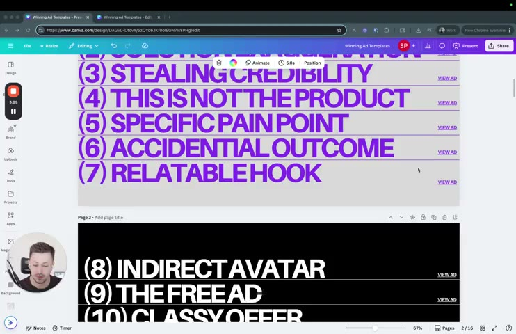
*The index slide listing templates by number and a "view ad" link for each (items 3–10 visible here). [03:30]*

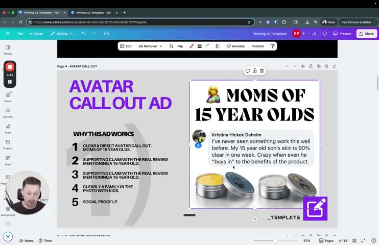
*Template 1: "Moms of 15 year olds", real review, family photo, social-proof LP. [04:45]*

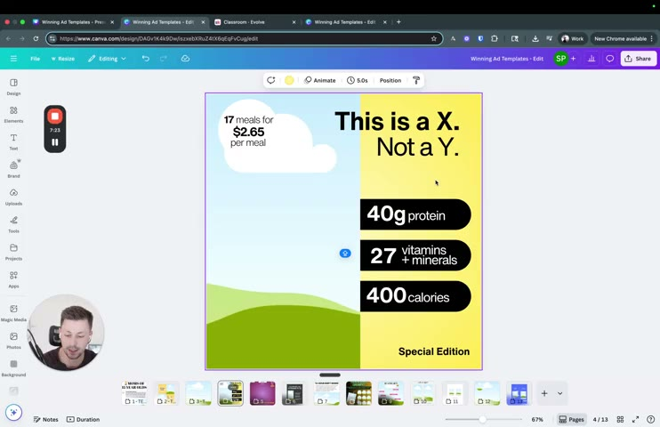
*The editable version in Canva with placeholder images and text boxes (the second file, 13 pages). [07:25]*

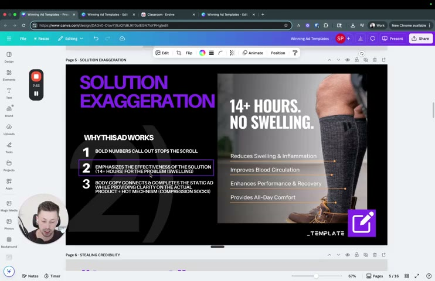
*Template 2: three reasons: bold numbers, effectiveness of the solution, body copy that completes the ad. [07:55]*

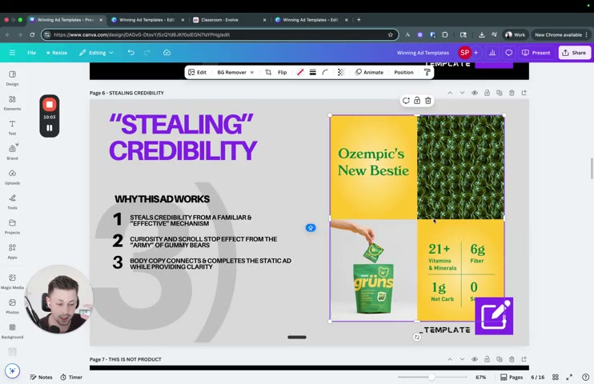
*Template 3. [10:05]*

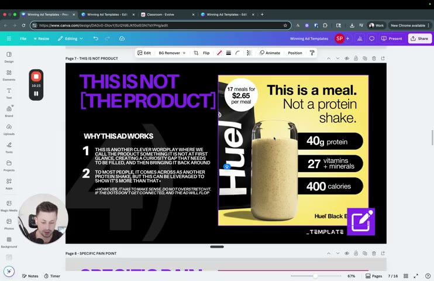
*Template 4, with the warning that the wordplay must connect. [10:25]*

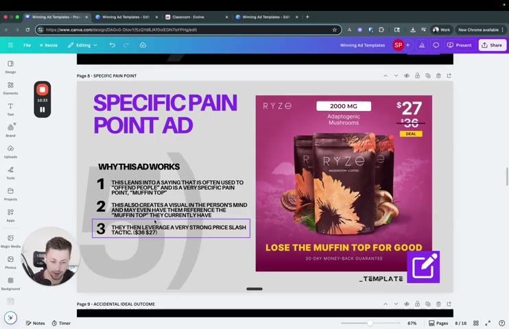
*Template 5. [10:35]*

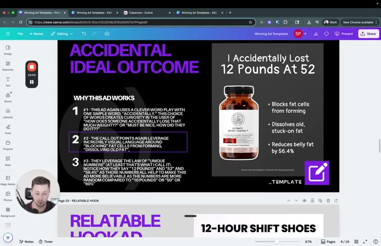
*Template 6: one word ("accidentally"), visual language, unique numbers. [10:55]*

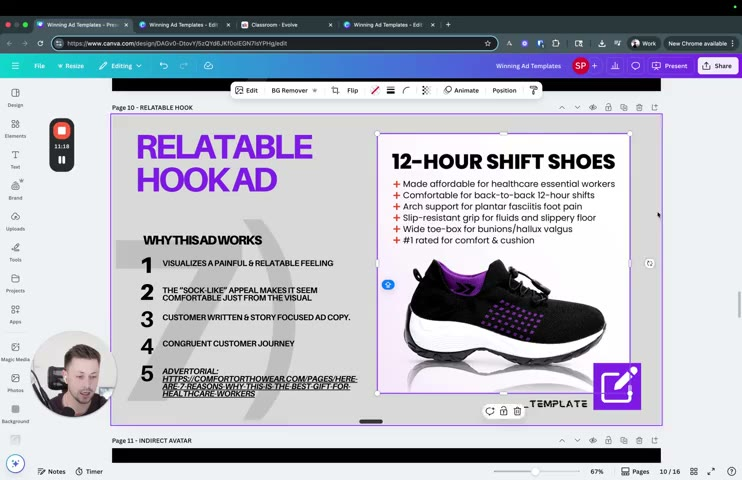
*Template 7. [11:20]*

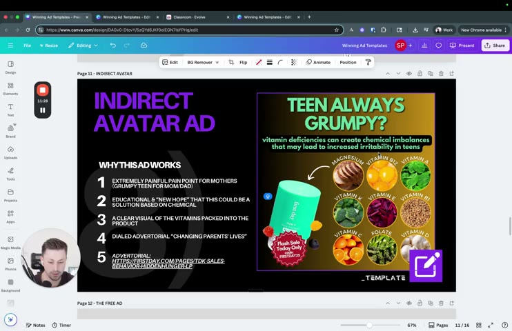
*Template 8: the avatar is the parent, the ad is about the teen. [11:30]*

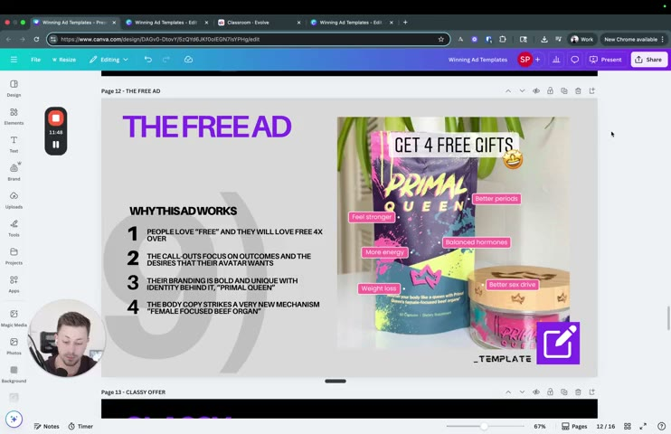
*Template 9. [11:50]*

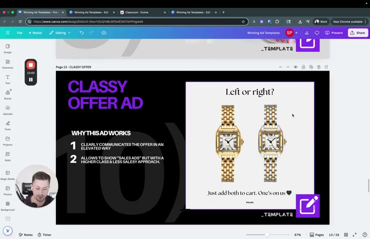
*Template 10. [12:05]*

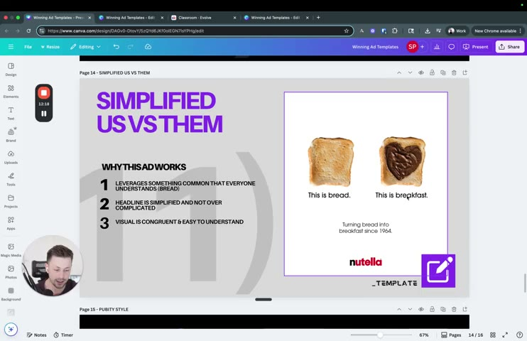
*Template 11. [12:20]*

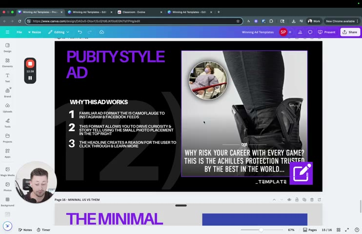
*Template 12: news-style format with a small corner photo. [12:30]*

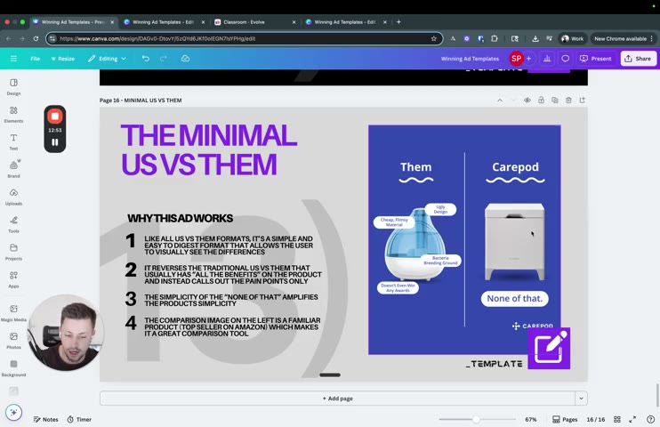
*Template 13. [12:55]*

## How to apply
- [ ] Choose a template by the job the ad must do (avatar, offer, exaggerated outcome, comparison), not by look.
- [ ] Before using it, restate in one line why the original works; if you cannot, pick another.
- [ ] Source a real review or comment for any template that shows one.
- [ ] Re-skin fonts, colours and claims to the brand; keep numbers only if substantiated.
- [ ] Add a landing page or advertorial where the template expects one (avatar callout, indirect avatar, relatable hook).
- [ ] When asking an LLM to rewrite, include the ad, its "why it works" notes and brand context; then check the headline yourself.

## Related
- Previous: [5. 100+ Hook Templates](005-100-hook-templates-from-ads-doc.md) · Next: [7. Evolve Master Prompt Doc](007-evolve-master-prompt-doc.md)
- [4. 100+ Winning Ads Document](004-100-winning-ads-document.md) · Evolve Copywriting: [static ad workflow](../../copywriting/frameworks/static-ad-workflow.md), [comparisons](../../copywriting/concepts/comparisons.md), [authority in ads](../../copywriting/concepts/authority-in-ads.md), [Banger Static Ads Prompt](../../copywriting/lessons/65-banger-static-ads-prompt.md)
- [Offer and bundle psychology](../../../../frameworks/offer-and-bundle-psychology.md)

## Sources and limitations
- Transcript: [6. 13 Winning Static Ad Templates….txt](<../../../../../raw/evolve/start-here/_transcripts/👣 Evolve (Start Here)/6. 📌 13 Winning Static Ad Templates 👣 Evolve (Start Here) Evolve.txt>) · Page text: [6. ….html.md](<../../../../../raw/evolve/start-here/_extracted/👣 Evolve (Start Here)/6. 📌 13 Winning Static Ad Templates_👣 Evolve (Start Here)_Evolve.html.md>) (two Canva links only).
- Machine transcription (Whisper large-v3-turbo); full recording covered (last segment 14:04 of 14:05). The speaker is not named (`unverified`); same presenter as lesson 1.
- Whisper wrote "Chatsby" for ChatGPT, "ad spy" for an unverified tool, "puberty style" for "Pubity style", "care pod" for Carepod, "She legit" (a jar in his demo; unclear), and "army of gummy bears" is the instructor's phrase for the on-screen product.
- The "why this ad works" bullets were read from 744–1280-px frames of the Canva file; the index slide at [03:30] shows only some of the 13 titles. Slide 4 lists "supporting claim with the real review" twice, which the instructor flags as a typo.
- Not included in the course files: the Canva templates themselves, the landing pages/advertorial links in the slides, performance data for any ad, and the "body copy" field the instructor says he will add. Ad claims on slides (weight loss, vitamins) are the ads' own and were not checked.
- Reviewer names printed on the review screenshots are not reproduced.
