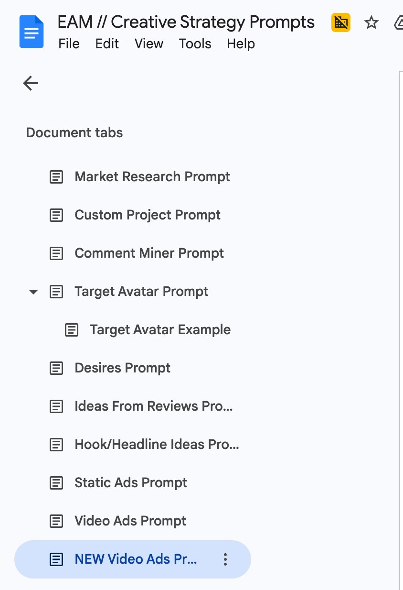

# 7. Evolve Master Prompt Doc
> A document-only lesson: one Google Doc that indexes every Evolve AI prompt (project setup, desires, new information, new mechanisms, angles, static ads, video ads, call analysis), each linked to the video that teaches it, plus the full "Project Goal Prompt" for setting up a brand-specific AI project.

## 🤖 Agent use
- **Use when:** setting up an AI "project" (Claude/ChatGPT) for a DTC brand; looking for the right Evolve prompt for desires, mechanisms, new information, angles, scripts or ad-review analysis; deciding which Start Here lesson holds a given prompt.
- **Inputs → outputs:** brand name + website + knowledge-base files (customer surveys, personas, research, competitor data, the "Breakthrough Advertising" reference) → a project instruction block that makes the assistant grounded in those files and ready for the five marketing jobs below.
- **Rules:**
  - **DON'T** use the prompt doc as a shortcut: "PLEASE NOTE... This does NOT mean just skip to these modules." [page text]
  - **DO** put the project goal prompt in first, fill in `BRAND` and `YOURWEBSITE`, and attach the research files as the knowledge base: "This project should use the attached files as its primary knowledge base." [doc, Project Goal Prompt]
  - **DO** require grounding: "Always ground your responses in the content within the knowledge base" and cite the principle used, "especially when drawing on 'Breakthrough Advertising.'" [doc, Project Goal Prompt]
  - **DO** watch the linked video for each prompt before running it: every prompt in the index is paired with its teaching video. [doc]
  - **DON'T** assume the other prompts are in this lesson: only the Project Goal Prompt is reproduced in the doc text; the rest are separate Google Docs (see the index below for where each is covered in this wiki). [doc]
  - **DO** treat call-recording prompts as restricted: the doc flags Alex Cooper's prompts "for EVOLVE ACCESS ONLY (in case this doc gets leaked)". [doc]
- **See also:** [63. How To Find Desires - Part 3](063-how-to-find-desires-part-3.md) · [66. How To Find & Apply New Mechanisms - Part 2](066-how-to-find-apply-new-mechanisms-part-2.md) · [68. How To Find & Apply New Information - Part 3](068-how-to-find-apply-new-information-part-3.md) · [79. How To Come Up With Ad Angles](079-how-to-come-up-with-ad-angles.md) · [130. How To Rewrite Losing Ads Into Winners](130-how-to-rewrite-losing-ads-into-winners.md) · [Evolve Copywriting: Evolve Writing Prompts](../../copywriting/lessons/37-evolve-writing-prompts.md) · [Evolve Copywriting: Banger Static Ads Prompt](../../copywriting/lessons/65-banger-static-ads-prompt.md) · [Prompts library](../../../../libraries/prompts.md)

## Key ideas

### What the page says (page text)
- Heading: "2026 Organized Evolve AI Prompts", with a link to a Google Doc (id `1wco7k1qt53skRFaPv8buruQhu9t_tCVgm_u-ReGJJN8`). [page text]
- "A lot of existing Evolve members have asked for an organized place for all AI prompts. You can find them all in that doc above." [page text] In [lesson 1](001-start-here-overview-of-evolve.md) the Master Prompt Doc is one of the three "pinned" items next to the winning-ads doc and the static templates [04:00–04:58].
- Lesson 1 adds that members who paid can make and keep a copy: "if you want to make a copy of this and keep it, you know, you've paid for it. So you've got it. You can keep that no matter what." [1. Overview, 04:00–04:58]

### The doc's structure (doc text; headings in the order shown)
Each section pairs a teaching video (a Skool classroom link) with the prompt document. The prompts themselves (except the first) are in separate Google Docs.

| Doc section | Teaching video (Skool `md=` id) | Prompt document named in the doc | Where this wiki covers it |
|---|---|---|---|
| Project Goal Prompt | `f49ffa01a9214d169e61d85042fbc229` | Written in full in the doc (below) | this page |
| Desires Prompt | `8decdfed5f15476a89aa8db727ff153a` | "Evolve - Desire AI Prompts" | [63. How To Find Desires - Part 3](063-how-to-find-desires-part-3.md) |
| New Info Prompt | `7d9c9eab12d44136956da3db820460d7` | "New Information Prompt Document" | [68. How To Find & Apply New Information - Part 3](068-how-to-find-apply-new-information-part-3.md) |
| New Mechanism Prompt | `b3b1c0ae3db14c368453214db7989630` | "New Mechanism Prompt Document" | [66. How To Find & Apply New Mechanisms - Part 2](066-how-to-find-apply-new-mechanisms-part-2.md) |
| Angles Prompt | `789f1a823fb344cd853be54bbefc1627` | "Evolve Enhanced - Angle Identifier" | [79. How To Come Up With Ad Angles](079-how-to-come-up-with-ad-angles.md) |
| Static Ads Prompt | video `4be11f3d66ef46efb8ef9280726caaae` (other classroom id `9917539c`); prompt page `505f26bc3fca41c98fa8b0ba3b58cd1c` | "$100k Static Ads - Full EVOLVE Prompts" | Not exported in the Start Here files; compare [Evolve Copywriting 65](../../copywriting/lessons/65-banger-static-ads-prompt.md) |
| Video Ads Prompt | "Older Video" `7630ea8648994b0e87adc46ea81c0fe2` (classroom id `9917539c`) | "Evolve - Video Script Prompt" | Not exported here; see [Evolve Copywriting video-ad script workflow](../../copywriting/frameworks/video-ad-script-workflow.md) |
| Ads Call Analysis Prompt | "Video (From Chef Karlo)" `a142814a717d4d28b0e8441666c5c916` | "Ad Learnings Call Analysis Prompt" | [130. How To Rewrite Losing Ads Into Winners](130-how-to-rewrite-losing-ads-into-winners.md) (the linked doc was exported under lesson 130) |
| Alex Cooper's Prompts | a call recording (classroom `67ce5630`, `md=36c02fddbc81496c92b6ce1e8a0221e7`) | Not in this doc; the doc says Alex's Notion and other call materials sit below that recording in Skool | Evolve-access only; not included in the course files |
| Evolve AI - Prompts | n/a | "The remaining AI Prompts & other AI tools we use are found in the Evolve AI program, courtesy of Karlo" | Not included (separate program) |

- The Alex Cooper section notes: "If you are new, call recordings will unlock in 30 days (not 42 days)." (Lesson 1 says 30 days; the program tile in its video shows "43 days".)
- The final image in the doc is a screenshot of a Google Doc titled "EAM // Creative Strategy Prompts" with a tab list: **Market Research Prompt, Custom Project Prompt, Comment Miner Prompt, Target Avatar Prompt (with a Target Avatar Example sub-tab), Desires Prompt, Ideas From Reviews Prompt, Hook/Headline Ideas Prompt, Static Ads Prompt, Video Ads Prompt, NEW Video Ads Pr[ompt]**. It shows what the Evolve AI program's prompt document contains; the tabs themselves are not in the course files. [doc image]

## Steps / framework
1. Create a custom project for the brand in your AI tool and paste the Project Goal Prompt below, replacing `BRAND` and `YOURWEBSITE`.
2. Attach the knowledge-base files the prompt expects: customer surveys, buyer personas, behavioural data, competitor and industry research, and the "Breakthrough Advertising" reference. (The prompt names the book; the files are yours.)
3. For each marketing job, run the specific Evolve prompt that matches (desires, new information, new mechanisms, angles, static ads, video ads, call analysis) after watching its video.
4. After launch, feed ad metrics (ad spend, ROAS, hook rate, hold rate, CTR) into the project to close the feedback loop; the prompt asks for "actionable takeaways from winning and losing ads".

## Examples
- None given as filled prompts in this doc. The project prompt is a template; the example brand is a placeholder ("BRAND").

## Structured units
### Rules of thumb
- **DO** make the assistant cite the knowledge-base file and principle for every recommendation. [doc]
- **IF** a result is not "data-driven and relevant to brand's target audience" **THEN** reject it: the prompt requires every insight, script and suggestion to be so. [doc]
- **DON'T** give the project external claims without files to ground them. (derived)

## Prompts / templates (verbatim)

### Project Goal Prompt
Reproduced exactly as extracted from the docx. Line breaks were lost in the conversion; `**BRAND**` and `**YOURWEBSITE**` are the placeholders to replace (the asterisks are formatting from the conversion):

```text
Hello, I would like to create a custom project tailored to assist our marketing agency in creating more effective, data-driven ads for our client, an E commerce Brand. Brand name: **BRAND** Brand website: **YOURWEBSITE** The purpose of this custom project is to support the following key marketing functions for this brand: Customer Understanding & Market Trends: Analyze customer surveys, buyer personas, and behavioral data to uncover customer preferences, pain points, and purchasing motivations.Identify market trends and audience segments relevant to this brand’s products. Market Research & Competitive Analysis: Gather and analyze data on competitors and broader industry trends. Identify opportunities for differentiation in brand’s positioning and advertising strategies. Creative Ideation & Strategy: Generate new creative concepts and strategies for ad campaigns based on insights from market data, customer feedback, and competitive analysis. Provide feedback on existing ideas, suggesting improvements grounded in customer insights and market trends. Scriptwriting & Copy Development: Assist with crafting persuasive, targeted scripts for ads and other marketing materials. Review and critique copy-writing to ensure it resonates with the target audience, incorporating customer pain points and desires. Ad Review & Performance Feedback Loop: Assist in analyzing post-launch ad performance by reviewing metrics such as ad spend, ROAS, hook rate, hold rate, CTR, etc. Provide insights on why certain ads performed well or underperformed, identifying key learnings from each campaign. Close the feedback loop by suggesting actionable takeaways from winning and losing ads, incorporating these learnings into future creative strategies. Knowledge Base: This project should use the attached files as its primary knowledge base and refer to the information within when providing insights or recommendations. Whenever this project provides an answer, it should be informed by the content within the knowledge base. It should autonomously apply the insights from the attached files to ensure all responses are grounded in data and relevant context. Key Responsibilities: Interpret customer feedback and survey data to identify trends and actionable insights. Suggest ad strategies, creative angles, and copy that align with market research and customer insights. Ensure all insights, scripts, and suggestions are data-driven and relevant to brand’s target audience, drawing on the knowledge base provided. Analyze ad performance post-launch, using key metrics to provide insights into ad success or failure. Instructions: Always ground your responses in the content within the knowledge base. Highlight any recommendations based on specific insights or principles from the provided data or resources, especially when drawing on "Breakthrough Advertising." Prioritize relevance to brand’s audience, and use data to back up your suggestions."
```

### Document index (verbatim section names from the doc)
```text
Project Goal Prompt
Desires Prompt
New Info Prompt
New Mechanism Prompt
Angles Prompt
Static Ads Prompt
Video Ads Prompt
Ads Call Analysis Prompt
Alex Cooper's Prompts (EVOLVE ACCESS ONLY)
Evolve AI - Prompts
```

## Screenshots

*The only image in the doc: the tab list of the larger Creative Strategy Prompts doc held in the Evolve AI program. The Master Prompt Doc points there for the prompts it does not reproduce. [doc image]*

## How to apply
- [ ] Create the project; paste the Project Goal Prompt with the real brand name and URL.
- [ ] Upload research files before asking for output; refuse to answer without them.
- [ ] Pick the next prompt from the index table and read its lesson page first.
- [ ] Log every AI output with the file it was grounded in; reject ungrounded suggestions.
- [ ] Do not republish restricted (call-recording) prompts.

## Related
- Previous: [6. 13 Winning Static Ad Templates](006-13-winning-static-ad-templates.md) · Next: [8. Overview Of Psychology](008-overview-of-psychology.md)
- [1. Start Here/ Overview Of Evolve](001-start-here-overview-of-evolve.md) · [Evolve Copywriting: Evolve Writing Prompts](../../copywriting/lessons/37-evolve-writing-prompts.md) · [Prompts library](../../../../libraries/prompts.md)

## Sources and limitations
- Page text: [7. Evolve Master Prompt Doc….html.md](<../../../../../raw/evolve/start-here/_extracted/👣 Evolve (Start Here)/7. 📌 Evolve Master Prompt Doc_👣 Evolve (Start Here)_Evolve.html.md>) · Attachment: [7. Evolve Master Prompt Doc.docx.md](<../../../../../raw/evolve/start-here/_extracted/👣 Evolve (Start Here)/7. 📌 Evolve Master Prompt Doc.docx.md>) · Linked Google Doc export: [07-document-1wco7k1qt5.docx.md](../../../../../raw/evolve/start-here/_extracted/_linked/google/07-document-1wco7k1qt5.docx.md) (same prompt text as the attachment; the attachment also has the section headings).
- This lesson has no video: no transcript and no timestamps.
- Not included in the course files: the Static Ads, Video Ads and Evolve AI prompt documents, Alex Cooper's prompts, and the Skool videos linked from the doc. The prompt documents for desires, new information, new mechanisms, angles and call analysis were exported under other lesson numbers (63, 68, 66, 79 and 130); those lesson pages summarize them.
- The doc text is an automated conversion; the Project Goal Prompt's original line breaks and formatting are lost. The doc names "Karlo" and "Alex Cooper" without further identification.
