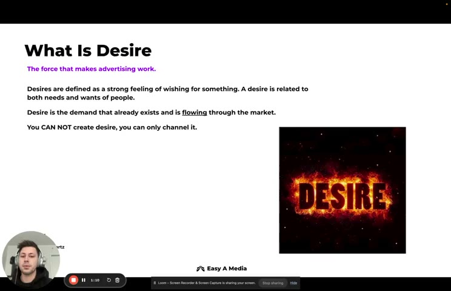
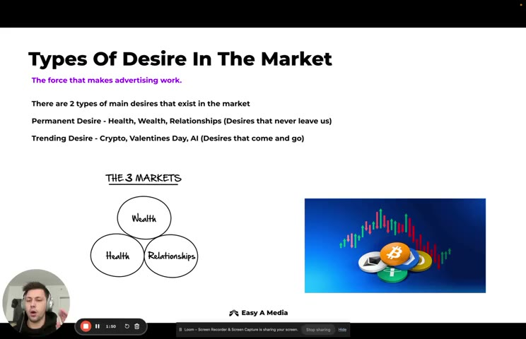
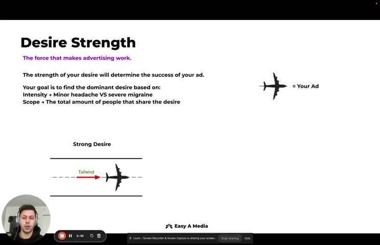
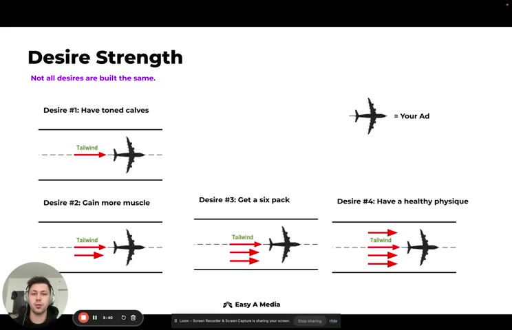
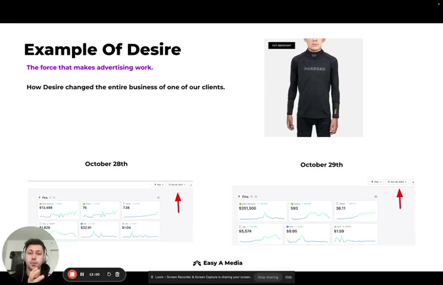
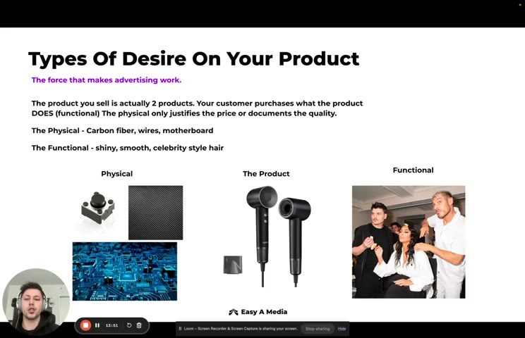
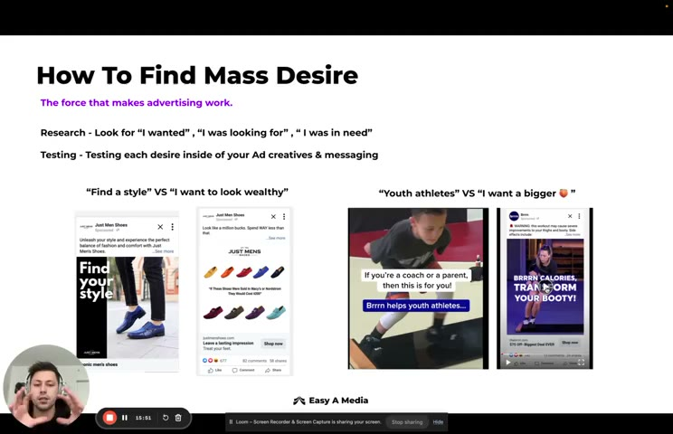

# 9. Market Desires
> Desire is the existing market demand that makes advertising work: you cannot create it, only channel it, and the strength of the desire your ad taps (intensity times how many people share it) decides how far the ad can scale.

## 🤖 Agent use
- **Use when:** choosing the core desire an ad or product angle will tap; diagnosing why an ad "did nothing" despite good execution; ranking candidate angles by size and strength; mapping a product's physical features to the functional outcome buyers want.
- **Inputs → outputs:** product, market research (reviews, comments, searches), candidate desires → a ranked list of desires with intensity and scope, the functional outcome behind each product feature, and test cells for the top desires.
- **Rules:**
  - **DO** "channel" existing desire; never "create" it. "You cannot create desire, okay? It is something that just exists in the market." [00:00–00:54]
  - **DO** classify each desire as permanent (health, wealth, relationships) or trending (crypto, Valentine's Day, AI); build long-term results on permanent desires and use trending ones for short-term gain. [00:54–03:32]
  - **DO** rate desire strength on intensity ("minor headache versus severe migraine") and scope ("total amount of people that actually share this desire"). The page text adds a third dimension, staying power. [03:32–04:28; page text]
  - **DO** sell the functional product, not the physical one: the buyer purchases what the product does for them; the physical parts "justify and document" quality. [12:19–14:06]
  - **DO** find desire in language: look for "I wanted", "I was looking for", "I was in need" in research, then test each desire in the ad creative and message. [14:06–15:44]
  - **DON'T** pick a niche desire when a bigger adjacent desire exists unless you are starting small on purpose: "Obviously, going after a desire that's a lot bigger is going to take a lot more skill … sometimes it makes sense to start smaller." [09:10]
  - **IF** an ad gets no traction **THEN** suspect the desire before the execution: the "Find your style" ad "did absolutely nothing" while "I want to look wealthy" spent over $20,000 (instructor claim). [14:53–15:44]
- **See also:** [8. Overview Of Psychology](008-overview-of-psychology.md) · [10. Market Awareness](010-market-awareness.md) · [14. Rule Of 1 - 1 Desire, Avatar, Message](014-rule-of-1-1-desire-avatar-message.md) · [63. How To Find Desires - Part 3](063-how-to-find-desires-part-3.md) · [61. Understanding & Applying Desire - Part 1](061-understanding-applying-desire-part-1.md) · [Evolve Copywriting: avatars and angles](../../copywriting/concepts/avatars-and-angles.md)

## Key ideas

### What desire is [00:00–00:54]
- Desire is "the force that makes advertising work" (slide subtitle). It is "strong feelings of wants or needs or wishes": "what people actually want", "demand that already exists and is flowing through the market." "You cannot make massive millions amounts of people want a certain thing. That desire just has to be there." [00:00–00:54; frame 01:10]
- Relationship to angles: "we have sometimes referred to desire as the angle behind your ad. … Angle is more of like an umbrella." The slide TL;DR: "Desire is the angle behind your ad and is the final outcome of what people get from buying your product." [00:54; slide 9]
- Framing: "this is essentially my interpretation of it and how we take it and apply it to marketing." Slide credit: "Credit to: Eugene Schwartz, Nick Theriot". The deck is branded "Easy A Media". [00:00; slides 1–2]

### Two types of desire in the market [00:54–03:32]
- **Permanent desire**: health, wealth, relationships: "desires that never leave us". "Every other little desire kind of trickles down from there, but they typically all point back up." [01:49]
- Example: the iPhone taps all three: health tracking; wealth (network and earn from your phone); relationships (connecting with people). "That's an example of why Apple … is a trillion dollar company". (instructor claim) [01:49–02:36]
- **Trending desire**: crypto, Valentine's Day, AI: "desires that come and go". Crypto in the 2021 bull market: "if you were selling Bitcoin t-shirts, you were probably doing pretty good." Valentine's Day: florists see a spike before the date. [02:36–03:32]
- Use: "the permanent desires are the ones that are gonna give us the long-term results. But trending desires are a great way to really drive short-term gain." [03:32]

### Desire strength: intensity and scope [03:32–09:10]
- "The amount of desire that your business can channel will determine how scalable your business is. At least that's what we've seen." The strength of the desire "will determine ultimately the success of your ad … your landing pages and everything else around it." (instructor claim) [03:32]
- "There's actually three" determinants but "when you're first learning this stuff … just focus on two": **intensity** (minor headache vs severe migraine) and **scope** (how many people share it). [04:28]
- The page text's version has three dimensions for evaluating a desire: **Urgency** (how desperately they want relief), **Staying power** (does it renew continuously), **Scope** (how many people). "Pick the desire with the highest combination of all three." [page text, "Step 2"/"Step 3"]
- **Wind analogy** (airplane = your ad): a desire is a tailwind that "jet packs" your ad; weak or no desire is a headwind; with enough headwinds "your plane or your ad won't go anywhere … that's an ad that doesn't succeed". Crosswinds also appear on the slide. [05:27–06:55; frames 08:40]
- **Desire ladder** (home-workout space), more tailwind at each step: [06:55–09:10]
  1. Have toned calves: "super niche"; an ad on it will only find the few who want it.
  2. Gain more muscle: bigger market.
  3. Get a six pack: bigger still; "they just want to look good".
  4. Have a healthy physique: "probably the strongest desire".
- Go-bigger caution: "everybody's going to be trying to go after a lot of these bigger desires", so it takes more skill; starting smaller can make sense. [09:10]

### Case: when the desire changed overnight [09:10–12:19]
- Client: a skate cut-resistant clothing brand (Whisper wrote "state cut resistant gear"). Oct 28: $10–15K/day revenue on about $2,000/day ad spend, "doing very, very good". Oct 29: one day, spend from $1,800 to $5,500 "at a 36X MER", "over $200,000 in sales". "Nothing changed other than what was going on in the market." [09:10–10:08]
- Trigger: a hockey player's death from a skate cut scared a lot of people; the whole market realised "myself or my child could get severely injured"; searches and talk spiked; "our ads are being served and Google searches are happening and our client's brand is popping up". [10:08–11:43]
- He checked the store "because I thought something was wrong. And the only thing that had changed was the desire." Lesson: scope and intensity both jumped. [11:43–12:19]
- On-screen dashboard (small text; date pills read Oct 28 and Oct 29): **Oct 28**: order revenue $13,498; 76 orders; ROAS 7.38; ads $1,828; two CPA tiles read $32.91 and $1.04. **Oct 29**: order revenue $201,300; 593 orders; ROAS 36.11; ads $5,574; the same two CPA tiles read $9.95 and $1.59. The numbers agree with the narration. [frame 12:00; slide 6]

### The product is two products [12:19–14:06]
- "When somebody buys your product, they're basically buying two": the **physical** (carbon fibre, wires, buttons, motherboard) and the **functional** (what it does). Hairdryer example: buyers want "shiny, smooth, celebrity style hair" (a photo of a celebrity being styled is on the slide). [12:19–13:10; frames 13:50]
- The physical "justifies and documents the quality of your product and … provides evidence" for the outcome; "majority of your customers are going to be purchasing the functional side." Car: seats and speakers matter, but the functional desire is getting from A to B or getting status. [13:10–14:06]
- Common mistake: advertising "the tech" instead of the outcome. [13:10]

### How to find mass desire [14:06–15:44]
- "The number one thing that you need to do is research … look for those 'I wanted'. 'I was looking for this and I found this', or 'I was in need of X'. Whatever those statements are, typically a desire will follow." [14:06–14:53]
- "The most important thing is to test the desires in your ad creatives and your messaging." [14:53]
- Slide 8: "Research: Look for 'I wanted', 'I was looking for', 'I was in need'. Testing: Testing each desire inside of your Ad creatives & messaging."

### Book recommendation [15:44–17:25]
- "Breakthrough Advertising" (Eugene Schwartz): "zero affiliation", "this book helped me 3X my business", "$150 … to potentially 3x your business". "All the other upcoming psychology videos … are actually coming from this book." (instructor claim) [15:44–16:39]

### Added in the lesson page text (Schwartz-style summary; from the page, not spoken)
- "Mass Desire = 'The public spread of a private want'." Rule: "You cannot CREATE desires. You can only CHANNEL existing desires onto your product."
- **Permanent forces**: mass instincts (health, attractiveness, security) and technological problems (car repairs, slow internet). **Forces of change**: style trends, mass education, cultural shifts. These create new/emerging desires.
- **Three desire categories**: Physical (health, strength, attractiveness, freedom from pain, sensory satisfaction); Material (money, possessions, status symbols, security, convenience); Emotional/Social (love, acceptance, recognition, success, power, adventure).
- **Process in action**: forces create desire (social-media culture → "Instagram-worthy") → categorize it (physical + emotional) → channel it onto your product (foundation: "Get that perfect selfie glow with our new foundation").
- **Schwartz's key insights**: never fight desires (the Edsel "fought" the mass desire for compact cars); ride the wave; timing is everything; specificity wins ("find the specific way they want to be attractive right now").
- **Your job**: be a desire detective; pick one powerful desire; channel, don't create; stay alert; "Master this, and you can predict what people will want to buy before your competitors even know there's a market for it."

## Steps / framework

### Choosing the dominant desire (video + page text, merged; the merge is derived)
1. **Spot** the desire: complaint patterns, successful competitors, cultural trends, where people spend money; and in your own research the phrases "I wanted", "I was looking for", "I was in need". [14:06; page text]
2. **Classify**: permanent (health, wealth, relationships) vs trending; physical / material / emotional-social category. [00:54; page text]
3. **Score** each: intensity (migraine vs headache) and scope (how many); page adds staying power. [03:32; page text]
4. **Pick** the strongest combination, but check that your product can deliver it credibly and that you have the skill to compete (bigger desires are more contested). [09:10; page text]
5. **Map** product features (physical) to the functional outcome that carries the desire. [12:19]
6. **Test** each desire in creative and messaging; let spend tell you which desire is scalable. [14:53–15:44]

### Desire strength ladder (example from slides)
| Rung | Desire | Relative pull | Source |
|---|---|---|---|
| 1 | Have toned calves | Tailwind (single arrow); niche | [06:55; frame 08:40] |
| 2 | Gain more muscle | Stronger (two arrows) | [07:42] |
| 3 | Get a six pack | Stronger (three arrows) | [08:31] |
| 4 | Have a healthy physique | Strongest (four arrows) | [08:31] |

## Examples

### Two desire tests (client ads)
| Test | Weaker desire | Stronger desire | Result as told | Source |
|---|---|---|---|---|
| Men's dress shoes | "Find your style" (ad: "Unleash your style and experience the perfect balance of fashion and comfort"; headline "Find your style") | "I want to look wealthy" (ad: "Look like a million bucks. Spend WAY less than that."; "If These Shoes Were Sold In Macy's or Nordstrom They Would Cost $200"; 677 reactions, 82 comments, 58 shares on screen) | "Find your style" "did absolutely nothing"; the wealth ad "has spent over $20,000". (instructor claim) | [14:53–15:44; frame 15:50] |
| Youth fitness (slide board) | "Youth athletes" (ad: "If you're a coach or a parent, then this is for you! … helps youth athletes…") | "I want a bigger booty" (ad: "BRRRN CALORIES, TRANSFORM YOUR BOOTY!"; "WARNING: this workout may cause severe improvements to your thighs and booty."; 140 reactions, 13 comments, 24 shares on screen) | The booty ad "has actually gone on to spend over $20,000 and is still continuing to spend", launched about two months before. (instructor claim) | [14:53–15:44; frame 15:50] |

- The hairdryer: physical (button switch, carbon-fibre texture, circuit board) vs functional (celebrity-style hair). [12:19–13:10]
- The cut-resistant gear case above. [09:10–12:19]

## Structured units

### Angles (source-backed rows only)
| Angle | Core desire / pain | Heuristic(s) | Best format | Example line | Source |
|---|---|---|---|---|---|
| "I want to look wealthy" | Status / look expensive for less (material, emotional-social) | — | Static (shoe ad) | "Look like a million bucks. Spend WAY less than that." | [14:53–15:44] |
| "I want a bigger booty" | Attractiveness (physical) | — | Video/static | "WARNING: this workout may cause severe improvements to your thighs and booty." | [14:53–15:44] |
| Protect me/my child from skate cuts | Safety (health; a trending desire spiking after a news event) | — | — | (no ad shown) | [10:08–11:43] |

### Rewrites (before → after)
| Before | After | What changed (verb / visual / promise / self / intensity) | Source |
|---|---|---|---|
| "Find your style" | "Look like a million bucks. Spend WAY less than that." | Generic expression → status/wealth desire with a price promise | [14:53–15:44] |
| "Youth athletes … coach or a parent" | "Transform your booty" with a workout-side-effects hook | Narrow audience call-out → a widely shared, intense appearance desire | [14:53–15:44] |

### Rules of thumb
- **DO** write down the permanent desire behind every trending one; trends fade but the permanent root stays. [00:54–03:32] (derived)
- **IF** a market event spikes concern (a news story, a holiday) **THEN** expect a desire spike; be ready with matching creative. [10:08–11:43]
- **DON'T** advertise motherboards: advertise the outcome. [12:19–14:06]

## Prompts / templates (verbatim)
No prompts in the video or the slides. Prompts for desires are indexed in [7. Evolve Master Prompt Doc](007-evolve-master-prompt-doc.md) and covered in [63. How To Find Desires - Part 3](063-how-to-find-desires-part-3.md).

Research phrases (slide 8, verbatim):
```text
"I wanted"
"I was looking for"
"I was in need"
```

## Screenshots

*"You CAN NOT create desire, you can only channel it." [01:10]*


*Permanent desire (health, wealth, relationships) vs trending desire (crypto, Valentine's Day, AI). [01:50]*


*"Intensity → Minor headache vs severe migraine; Scope → the total amount of people that share the desire", with the tailwind plane. [05:30]*


*Toned calves → gain more muscle → six pack → healthy physique: more arrows = more tailwind. [08:40]*


*Same store, one day apart: revenue $13,498 → $201,300; ROAS 7.38 → 36.11. [12:00]*


*Physical components (a switch, carbon-fibre texture, circuit board) vs the functional result (celebrity-style hair). [13:50]*


*"Find a style" vs "I want to look wealthy"; "Youth athletes" vs "I want a bigger [booty]". The right-hand ad of each pair is the winner. [15:50]*

## How to apply
- [ ] List 10+ desires from reviews, comments and searches using the "I wanted / I was looking for / I was in need" phrases.
- [ ] Tag each as permanent or trending and as physical, material or emotional/social.
- [ ] Score intensity, scope (and staying power) 1–5 and rank them.
- [ ] For each product feature, write the functional outcome and lead with that.
- [ ] Launch at least two desires as separate test cells; compare spend and cost per result, not taste.
- [ ] Watch the news and calendar for trending-desire spikes (holidays, events).

## Related
- Previous: [8. Overview Of Psychology](008-overview-of-psychology.md) · Next: [10. Market Awareness](010-market-awareness.md)
- [12. Market Sophistication](012-market-sophistication.md) · [14. Rule Of 1](014-rule-of-1-1-desire-avatar-message.md) · [62. The Desire Calendar](062-the-desire-calendar-part-2.md) · [Evolve Copywriting: avatars and angles](../../copywriting/concepts/avatars-and-angles.md) · [Triggering events](../../../../concepts/triggering-events.md)

## Sources and limitations
- Transcript: [9. Market Desires….txt](<../../../../../raw/evolve/start-here/_transcripts/👣 Evolve (Start Here)/9. Market Desires 👣 Evolve (Start Here) Evolve.txt>) · Page text: [9. ….html.md](<../../../../../raw/evolve/start-here/_extracted/👣 Evolve (Start Here)/9. Market Desires_👣 Evolve (Start Here)_Evolve.html.md>) · Slides: [9. Market Desires.pptx.md](<../../../../../raw/evolve/start-here/_extracted/👣 Evolve (Start Here)/9. Market Desires.pptx.md>) (also the Google Slides export [09-presentation…](../../../../../raw/evolve/start-here/_extracted/_linked/google/09-presentation-1Mv-wr2ePn.pptx.md), same content).
- Machine transcription (Whisper large-v3-turbo); full recording covered (last segment 17:25 of 17:25). The speaker is not named (`unverified`); same presenter as lesson 1. Whisper heard "state cut resistant gear" (the later narration and the slide say skate cut-resistant gear), "trinkles" for "trickles", and "the Hermoses of the world", an unresolved phrase about people who want toned calves (not used).
- The video lists "three" strength determinants but names two; the page text names urgency, staying power and scope. The page text also lists "mass instincts: health, attractiveness, security" whereas the video says health, wealth and relationships. Treat the video as the instructor's teaching and the page text as a Schwartz-based summary; they do not conflict in effect but use different labels.
- All dollar figures (desire cases, $20,000+ ad spends, "trillion dollar") are instructor claims or on-screen client numbers; none is independently verified. Slide dashboard dates are read from small text.
- A hockey player's death is mentioned as the trigger in the cut-resistant gear case; it is stated as told, not sourced.
