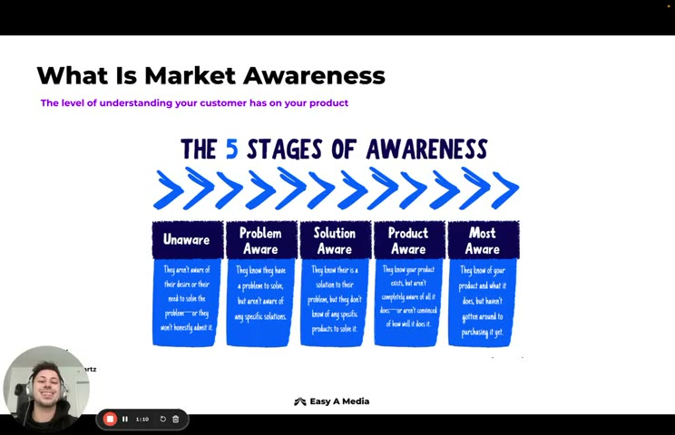
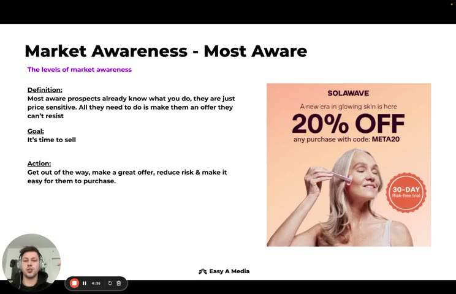
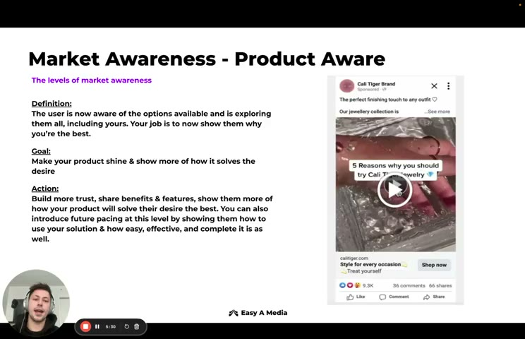
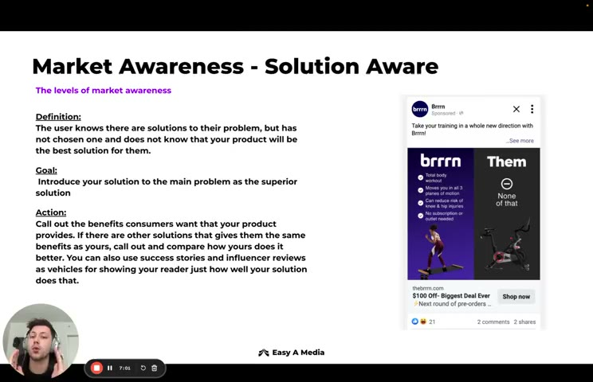
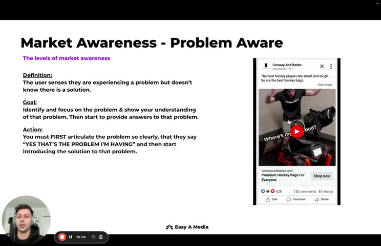
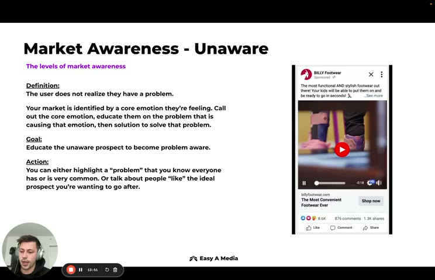

# 10. Market Awareness
> Market awareness is how much your customer already understands about the problem, solutions and your product; the five Schwartz levels each have a goal and an action, and an ad should enter the conversation at one level and carry the viewer forward to the offer.

## 🤖 Agent use
- **Use when:** labelling a competitor ad by awareness level; deciding where an ad should start (unaware, problem, solution, product, most aware); choosing what an us-vs-them ad compares against; checking a new ad idea before you build it.
- **Inputs → outputs:** an ad idea or existing ad + the audience's knowledge of the problem/solution/product → the awareness level it targets, the goal and action for that level, and the stages it must move the viewer through.
- **Rules:**
  - **DO** decide the level first: "Every single time I create a new ad or I have a new idea, I go and leverage the principles … for market awareness" to judge if it will scale. [00:00–00:36]
  - **DO** at **most aware**: "get out of the way, make a great offer, reduce risk & make it easy for them to purchase." [03:41–04:34]
  - **DO** at **product aware**: build trust, share benefits and features, show how yours solves the desire best, and use future pacing. [05:32–06:23]
  - **DO** at **solution aware**: introduce your solution to the main problem as the superior solution; compare against other solutions, not against the same product type. [06:23–08:48]
  - **DO** at **problem aware**: articulate the problem so clearly "they say 'YES THAT'S THE PROBLEM I'M HAVING'" and then introduce the solution; test how long you stay in the problem. [09:35–11:49]
  - **DO** at **unaware**: call out the core emotion, educate on the problem causing it, then the solution, product and offer; "the goal is to educate the unaware prospect to become problem aware." [13:28–14:22]
  - **DON'T** make unaware your first move: it "is the hardest level of market awareness to market at. And for most brands, you actually don't really need to tap into unaware … until you're at some serious scale." (instructor claim) [13:28]
  - **DON'T** stay in the problem too long: "staying in the problem too long can actually make the ad be like, I don't want to relive my problem." [09:35–10:14]
  - **IF** you start an ad at a level **THEN** carry the viewer through every later level to most aware (offer). [16:54–17:52]
  - **IF** you run us-vs-them **THEN** change what you compare against to change the level: same product type = product aware; a different type of solution = solution aware. [07:16–08:48]
- **See also:** [11. Understanding Unaware + Awareness Levels](011-understanding-unaware-awareness-levels.md) · [9. Market Desires](009-market-desires.md) · [12. Market Sophistication](012-market-sophistication.md) · [4. 100+ Winning Ads Document](004-100-winning-ads-document.md) · [Evolve Copywriting: market awareness](../../copywriting/concepts/market-awareness.md) · [Evolve Copywriting: being aware of market awareness](../../copywriting/lessons/21-being-aware-of-market-awareness.md) · [Evolve Copywriting: unaware ads](../../copywriting/concepts/unaware-ads.md)

## Key ideas

### Why it matters [00:00–01:10]
- "Market awareness is one of my favorite … psychology-based lessons." It "made marketing make a lot more sense", explains why ads do or don't work, and "give me a better direction for every single new ad that I create." [00:00]
- "The absolute secret … the cheat code to being able to scale a lot further by understanding the levels of market awareness that exist." (instructor claim) [00:36]
- Definition (slide): "The level of understanding your customer has on your product" (in the speech: "on your product, or just on the product in general"). Slide credit: "Eugene Schwartz, Nick Theriot". [00:36–01:10; slide 2]

### The five stages, via one running example (knee pain on stairs) [01:10–03:41]
| Stage | Meaning (speech) | Running example |
|---|---|---|
| **Unaware** | Not aware of the desire; if something is wrong it is "very, very mild", "whatever" | Walking up stairs is "kind of annoying" and you don't know why |
| **Problem aware** | Know they have a problem; don't know specific solutions | "Man, my knee really hurts when I walk up the stairs" |
| **Solution aware** | Know there are solutions; don't know specific products | Surgery, braces |
| **Product aware** | Know your product exists but aren't convinced it will solve their problem | Comparing a bunch of knee braces |
| **Most aware** | Know your product and what it does but haven't purchased | Waiting for Black Friday or for money after paying taxes |

Slide caption for the five-stage graphic: "They aren't aware of their desire or their need to solve the problem — or they won't honestly admit it" (Unaware); "They know they have a problem to solve, but aren't aware of any specific solutions" (Problem); "They know their is a solution to their problem, but they don't know of any specific products to solve it" (Solution); "They know your product exists, but aren't completely aware of all it does — or aren't convinced of how well it does it" (Product); "They know of your product and what it does, but haven't gotten around to purchasing it yet" (Most). The graphic is credited "growthmarketer". [frame 01:10; slide 2]

### Per-level playbook (slide: definition / goal / action; video examples)
Taught "in the inverse", from most aware (warmest) to unaware (coldest). [03:41]

**Most aware** [03:41–05:32]
- Definition: prospects "already know what you do, they are just price sensitive. All they need to do is make them an offer they can't resist." Goal: "It's time to sell." Action: "Get out of the way, make a great offer, reduce risk & make it easy for them to purchase." [slide 3]
- Example: **Solawave**, "a multi, multi eight figure brand" (instructor claim): "A new era in glowing skin is here. 20% OFF any purchase with code: META20" with a "30-day risk-free trial" badge. [04:34; frame 04:35]
- Targeting remark: "Facebook can analyze your creatives and it's gonna know who to show this ad to … Facebook knows who's ready to buy and who's not for the most part." Every business has funnels; "we just don't understand it because it happens at such scale". (instructor claim) [04:34–05:32] A lot of "low-hanging fruit" for brands sits here. [03:41]

**Product aware** [05:32–06:23]
- Definition: aware of the available options and exploring all, including yours. Goal: "make your product shine and show more of how it solves the desire." Action: build trust, share benefits and features, show how your product best solves the desire; "future pacing": show how easy, effective and complete using it is. [slide 4]
- Example: **Cali Tiger** jewelry, "5 Reasons why you should try Cali Tiger jewelry" (9.3K reactions, 36 comments, 66 shares on screen): many people are product aware of jewelry, so give "five reasons why they should shop with us instead". [06:23; frame 05:30]

**Solution aware** [06:23–08:48]
- Definition: knows there are solutions, hasn't chosen one, doesn't know yours is best. Goal: "introduce your solution to the main problem as the superior solution." Action: call out the benefits consumers want that your product provides; where other solutions give the same benefits, "call out and compare how yours does it better"; use success stories and influencer reviews. [slide 5]
- Example: **Brrrn** slide board vs a Peloton bike ("Them: None of that"; "Total body workout; Moves you in 3 planes of motion; Can reduce risk of knee & hip injuries; No subscription or outlet needed"). The instructor first showed the wrong image: "the humidifier … was actually more of a product-aware ad, because we were comparing a humidifier to another humidifier." Solution aware = "slide board versus Peloton. They're not the same product." (He swapped the slide mid-recording.) [06:23–08:48; frame 07:00]
- Rule from this: "you can actually climb a level of market awareness by changing what you're comparing to." [07:16]

**Problem aware** [09:35–13:28]
- Definition: senses a problem, doesn't know a solution exists. Goal: "Identify and focus on the problem & show your understanding of that problem. Then start to provide answers." Action: "You must FIRST articulate the problem so clearly, that they say 'YES THAT'S THE PROBLEM I'M HAVING' and then start introducing the solution." [slide 6]
- "Problem aware is probably the most common level that you see a lot of people talking about." Problem-aware ads "do so well … because you're showing the understanding of the user." [09:35–10:14]
- Specificity example: an ad that names sore hands from typing, "especially that left pinky" makes the viewer say "this person just gets me". "The better and the more in-depth that you understand that problem", the better. [10:14–11:49]
- Caveat: don't dwell: "you're definitely going to want to test how long you stay in the problem", and "focus on a lot of the benefits as well." [09:35–10:14]
- Example: **Conway and Banks** hockey bags, "Where's my shin pad?" video (628 reactions, 126 comments, 83 shares): about 30 seconds of recognisable hockey problems (forgotten shin pad, elbow pad, neck guard; snow-soaked foot; a bag that reeks), then the solution bag (pockets for gear, dries so it doesn't stink, a foot mat). "We are then taking the user through all the solutions and showing them our understanding of their problems." [11:49–13:28; frames 10:25, 13:11]

**Unaware** [13:28–16:54]
- Definition: "The user does not realize they have a problem." "Your market is identified by a core emotion they're feeling. Call out the core emotion, educate them on the problem that is causing that emotion, then solution to solve that problem." Goal: "Educate the unaware prospect to become problem aware." Action: either highlight a problem "you know everyone has or is very common", or "talk about people 'like' the ideal prospect you're wanting to go after." [slide 7]
- Hardest level; most brands need it only at serious scale. (instructor claim) [13:28]
- Example: **Billy Footwear** (on-screen label BILLY, "Inclusion for all"): the audience is people with cerebral palsy who wear AFOs. They know they have cerebral palsy but are not problem aware that putting on shoes is a hassle. The ad names that unseen problem ("putting your feet in the shoes is … so tiring and it's exhausting"), introduces the solution (shoes that are easy to put on), shows the product, and ends with the brand line. On screen: "The most functional AND stylish footwear out there! Your kids will be able to put them on and be ready to go in seconds!"; 8.6K reactions, 876 comments, 1.3K shares. The instructor says it had "over 800 comments, it's still running", and people commented "I didn't even realize these existed." (instructor claim) [14:22–16:54; frames 13:50, 14:40, 16:00]

### Where to enter and how to carry the conversation [16:54–17:52]
- "Wherever you enter the conversation … if I enter in solution aware, I have to carry it all the way forward … to product aware, and then … ideally … most aware." [16:54]
- The unaware ad: unaware → problem → solution → product → most aware. The hockey bag ad: started at problem aware and ended with an offer. (The audio about the middle of that ad is unclear; the earlier part of the lesson says the solution and product do appear.) [16:54–17:52]
- Slide 8 ("How Marketing Awareness Works Together"): "Where to enter the conversation & how to carry it forward" with three numbered steps (graphic only). [slide 8]

### Close [17:52–18:16]
- "Market awareness is the target market you are going after within a specific desire." Exercise: "start reviewing some of your ads and trying to figure out what market awareness level they are." Book: Breakthrough Advertising ("No affiliation", "helped me triple my business", "$150"). [17:52; slide 9]

## Steps / framework

### Awareness-level cheat sheet (slides 3–7, verbatim fields)
| Level | Definition | Goal | Action |
|---|---|---|---|
| Most aware | Already know what you do; price sensitive; need an offer they can't resist | It's time to sell | Get out of the way, make a great offer, reduce risk & make it easy to purchase |
| Product aware | Aware of the options and exploring them all, including yours | Make your product shine & show more of how it solves the desire | Build more trust, share benefits & features, show how your product solves their desire best; future pace (how easy, effective, complete) |
| Solution aware | Knows there are solutions, hasn't chosen one, doesn't know yours is best | Introduce your solution to the main problem as the superior solution | Call out benefits your product provides; compare against other solutions that give the same benefits; use success stories and influencer reviews |
| Problem aware | Senses a problem, doesn't know there is a solution | Identify and focus on the problem & show your understanding, then start giving answers | FIRST articulate the problem so clearly they say "YES THAT'S THE PROBLEM I'M HAVING", then introduce the solution |
| Unaware | Doesn't realize they have a problem; identified by a core emotion | Educate the unaware prospect to become problem aware | Highlight a common problem or talk about people "like" the ideal prospect; call out the emotion, educate on the cause, then the solution |

### Procedure: label and plan an ad (derived)
1. Write the audience's knowledge in one line (do they know the problem? the solution types? your product?).
2. Pick the entry level; look up its goal and action.
3. Draft the sequence from entry level to the offer; each later level needs at least one line or scene.
4. For us-vs-them, set the comparison target to match the entry level.
5. Test the length of time spent in the problem (problem-aware ads).

## Examples
See the per-level examples above. Summary:

| Brand (niche) | Level | Hook / opening | Source |
|---|---|---|---|
| Solawave (skincare device) | Most aware | "A new era in glowing skin is here" + 20% OFF code + risk-free trial | [04:34] |
| Cali Tiger (jewelry) | Product aware | "5 Reasons why you should try Cali Tiger jewelry" | [06:23] |
| Brrrn (slide board) | Solution aware | Slide board "Us" vs a Peloton-type bike "Them: None of that" | [07:16–08:48] |
| Conway and Banks (hockey bags) | Problem aware | "Where's my shin pad?" | [11:49–13:28] |
| Billy Footwear (adaptive shoes) | Unaware | People with cerebral palsy; shoe-donning difficulty not recognised as a problem | [14:22–16:54] |

## Structured units

### Ad teardowns
| Brand / product (niche) | Format | Hook / opening | What works | What fails | Fix suggested | Principle | Source |
|---|---|---|---|---|---|---|---|
| Solawave (skincare) | Static, offer | "A new era in glowing skin is here" | Offer, code, risk reversal; matches most-aware buyers | — | — | Offer-first for most aware | [04:34] |
| Cali Tiger (jewelry) | Video | "5 Reasons why you should try…" | Reasons to choose us among known options | — | — | Trust and benefits at product aware | [06:23] |
| Brrrn (slide board) | Static comparison | Slide board vs a Peloton | Different-category comparison lifts to solution aware | The humidifier-vs-humidifier example was product aware, not solution aware | Compare against a different solution | Comparison changes awareness level | [07:16–08:48] |
| Conway and Banks (hockey bags) | Video (~30s of problem scenes, then solution) | "Where's my shin pad?" | Shows many specific, relatable problems; then the solution and an offer | Risk of dwelling in the problem | Test length of problem section; add benefits | Show understanding of the problem | [11:49–13:28] |
| Billy Footwear (adaptive shoes) | Video | Cerebral palsy audience; "putting your feet in the shoes is … exhausting" | Introduces an unseen problem to a defined group; comments show surprise | Hardest level; only at scale | — | Unaware: emotion → problem → solution → product | [14:22–16:54] |

### Rules of thumb
- **DO** write the awareness level next to every ad in your tracker. [17:52]
- **IF** a market has many competitors with similar promises **THEN** compare against other solution types, not the same product type. (derived from [07:16–08:48])
- **DON'T** treat all your buyers as problem aware; at scale you reach all five stages. (derived)

## Prompts / templates (verbatim)
None in the lesson. A prompt-driven drill for awareness levels is in [11. Understanding Unaware + Awareness Levels](011-understanding-unaware-awareness-levels.md).

## Screenshots

*The five stages (Unaware → Problem Aware → Solution Aware → Product Aware → Most Aware), each with a one-line description. [01:10]*

*Definition, goal ("It's time to sell") and action for most aware, with the Solawave offer ad. [04:35]*

*Product aware: show why you are the best option; future pacing. [05:30]*

*Solution aware: "Them / None of that" compares a slide board against a different solution. [07:00]*

*Problem aware: articulate the problem until the viewer says "yes, that's the problem I'm having". [10:25]*

*Unaware: call out the core emotion, educate on the problem, then solution. [13:50]*

## How to apply
- [ ] Take your 10 live ads and label each with an awareness level; count how many sit at each.
- [ ] Rewrite one problem-aware ad so its first 3 seconds name the problem as specifically as possible (specific body part, moment, object).
- [ ] Draft one us-vs-them at solution-aware level (different solution type) and one at product-aware level (same product type).
- [ ] For any ad, confirm it moves the viewer to the offer (every later level has at least one beat).
- [ ] Do not attempt unaware ads until the problem- and solution-aware ads are scaling (instructor guidance; derived).

## Related
- Previous: [9. Market Desires](009-market-desires.md) · Next: [11. Understanding Unaware + Awareness Levels](011-understanding-unaware-awareness-levels.md)
- [12. Market Sophistication](012-market-sophistication.md) · [4. 100+ Winning Ads Document](004-100-winning-ads-document.md) (ads labelled by awareness stage) · [Evolve Copywriting: market awareness](../../copywriting/concepts/market-awareness.md) · [Evolve Copywriting 35: how to write unaware ads hooks](../../copywriting/lessons/35-how-to-write-unaware-ads-hooks.md) · [Evolve Copywriting: comparisons](../../copywriting/concepts/comparisons.md)

## Sources and limitations
- Transcript: [10. Market Awareness….txt](<../../../../../raw/evolve/start-here/_transcripts/👣 Evolve (Start Here)/10. Market Awareness 👣 Evolve (Start Here) Evolve.txt>) · Page text: [10. ….html.md](<../../../../../raw/evolve/start-here/_extracted/👣 Evolve (Start Here)/10. Market Awareness_👣 Evolve (Start Here)_Evolve.html.md>) (only a slide link) · Slides: [10. Market Awareness.pptx.md](<../../../../../raw/evolve/start-here/_extracted/👣 Evolve (Start Here)/10. Market Awareness.pptx.md>) (Google Slides export [10-presentation…](../../../../../raw/evolve/start-here/_extracted/_linked/google/10-presentation-1wfONE3dXO.pptx.md) has the same text).
- Machine transcription (Whisper large-v3-turbo); the full recording is covered (last segment 18:16 of 18:16). The speaker is not named (`unverified`); same presenter as lesson 1. Whisper heard "Solowave" for Solawave and "Billy Shoes" for the on-screen BILLY Footwear; "Peloton fight" at 07:16 is read as "Peloton bike" from the slide. Brand spellings follow the on-screen ads.
- The instructor says the Winning Ads doc contains these ads; he does not play them in this video ("I'm not going to play it for the sake of this video"). Engagement counts are read from on-screen ad frames and are not verified.
- Performance claims ("multi eight figure", "over 800 comments", "still running") are the instructor's. The statement that the hockey ad started at problem aware and did not introduce the solution conflicts with his earlier walkthrough of the same ad; the audio is unclear there.
- The lesson page text is only a slide link; slides 1, 8 and 9 contain little text. Slide 8's three numbered steps appear only as an image.
