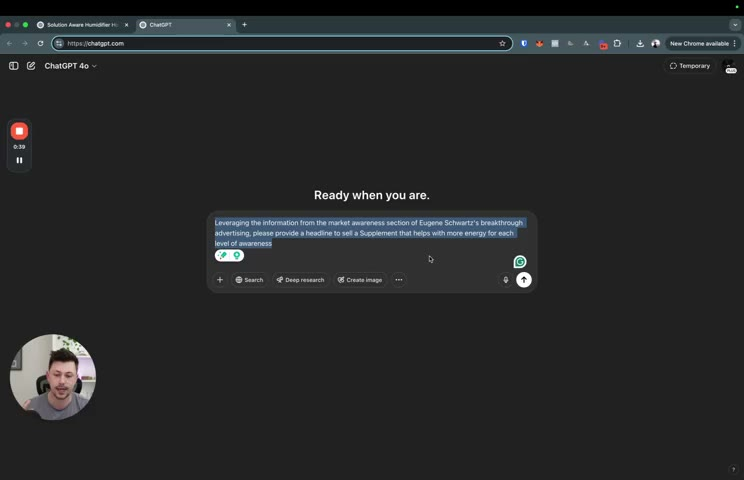
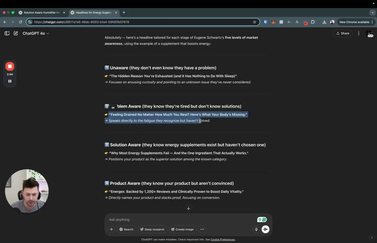
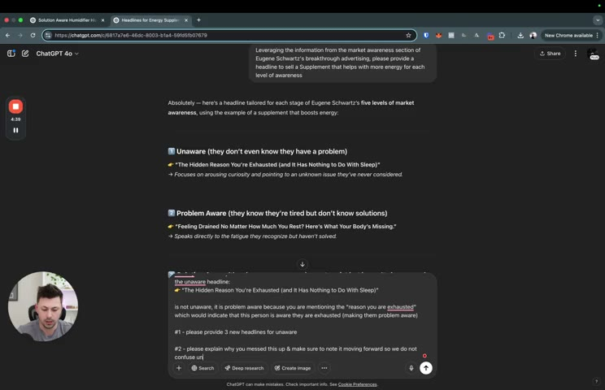
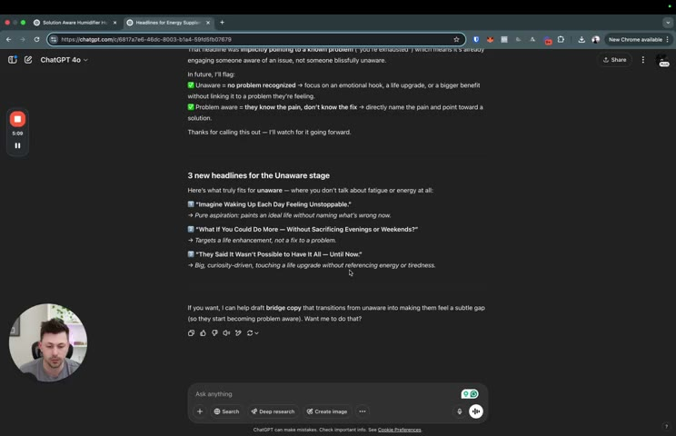
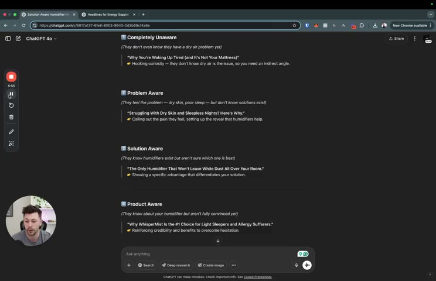

# 11. Understanding Unaware + Awareness Levels
> A prompt-driven drill that shows how to generate one headline per awareness level for your product, and why AI keeps mislabelling "problem aware" headlines as "unaware", which is the mistake that stops most people writing true unaware ads (the level the instructor says unlocks unlimited scale).

## 🤖 Agent use
- **Use when:** writing or labelling headlines/hooks by Schwartz awareness level; checking that a draft "unaware" ad is really unaware; correcting an LLM that confuses unaware and problem aware.
- **Inputs → outputs:** product + the angle you are going after → one headline per awareness level (unaware, problem, solution, product, most aware), then a corrected set of 3-5 true unaware headlines.
- **Rules:**
  - **DO** run the awareness-level prompt below with your product and angle swapped in, then audit every output line yourself. "You also can't blindly trust AI." [00:00–00:37]
  - **DON'T** call a headline unaware if it names the problem. If it mentions being exhausted, the reader already knows they are tired, so it is problem aware. [01:08–01:57; 03:28–04:29]
  - **DO** write unaware ads with no problem attached: curiosity, aspiration or "interesting information" that anyone could watch. [05:54–06:27]
  - **DO** educate or entertain first, then walk the viewer through the stages of the funnel. "That is how you create true unaware ads." [06:27–07:16]
  - **IF** the model returns a problem-aware line labelled unaware **THEN** paste the "Prompt For Mistake" (below), ask for 3-5 new headlines and make it explain the error and remember it. [03:28–04:29]
  - **DON'T** assume a problem-naming ad reaches everyone. Someone who is tired most days may see the ad on a day they are not tired and say "I'm not tired". [06:27]
  - **DO** use Claude, not GPT, when you move on to writing scripts: "Claude when you actually go to write out the scripts [is] going to be a little bit better." (instructor opinion) [05:17]
- **See also:** [10. Market Awareness](010-market-awareness.md) · [12. Market Sophistication](012-market-sophistication.md) · [Market awareness (Evolve Copywriting)](../../copywriting/concepts/market-awareness.md) · [Unaware ads (Evolve Copywriting)](../../copywriting/concepts/unaware-ads.md) · [How to write unaware ads and hooks](../../copywriting/lessons/35-how-to-write-unaware-ads-hooks.md)

## Key ideas

### Why this video exists [00:00–00:37]
- The market-awareness slideshow ([lesson 10](010-market-awareness.md)) "covers most of it", but "a lot of you are still getting confused", so the instructor breaks it down with AI.
- He warns to watch to the end: copying the prompt blindly "might be making a big mistake because the AI can actually mess this up". The point is that you must know the material yourself.

### Run the five-level prompt on your own product [00:37–01:57]
- Open ChatGPT (the screen shows ChatGPT 4o) and paste the prompt from the lesson page (below). The product can be anything: a supplement for more energy (his demo), a humidifier, a skincare cream or a mask. [00:37–01:08]
- Replace "more energy" with whatever angle you are pursuing. [01:08]
- The model returns a headline per level. Demo output on screen: unaware "The Hidden Reason You're Exhausted (and It Has Nothing to Do With Sleep)", problem aware "Feeling Drained No Matter How Much You Rest? Here's What Your Body's Missing.", solution aware "Why Most Energy Supplements Fail, and the One Ingredient That Actually Works.", product aware "Energex: Backed by 1,200+ Reviews and Clinically Proven to Boost Daily Vitality." [01:08–01:57]. (Whisper heard "quickly proven"; the screen says "Clinically Proven".)
- The first output is already wrong: "The hidden reason you're exhausted" is labelled unaware, but "this is problem aware" because it talks about the problem, being exhausted. He says "this is the second time the AI has messed this up". [01:08–01:57]

### Where the levels blur [01:57–03:28]
- Depending on how you read Eugene Schwartz's *Breakthrough Advertising*, solution aware and product aware (or product aware and most aware) "can kind of get blended". The AI's most-aware line is "familiar fans, they just need a nudge", which he reads as the offer. [01:57–02:48]
- His own use of "solution aware" is broader than "knows energy supplements exist". He asks what the *ways to get energy* are: sleep more, take a supplement, work out daily, eat better. Solution aware, in his usage, is often placed on the **mechanism / angle**: "a lot of times people will put it on the mechanism." [02:48–03:28]

### Fixing the AI's mistake [03:28–05:17]
1. Copy the wrongly-labelled "unaware" headline.
2. Paste the "Prompt For Mistake" (below) with the headline and the problem it names filled in.
3. Ask for 3-5 new unaware headlines **and** an explanation of the error with an instruction to remember it, "so we do not confuse unaware and problem aware again".
- The model replies "good catch", explains it jumped to curiosity framing "without fully stepping back into the unaware stage", and returns three new headlines (screen text): "Imagine Waking Up Each Day Feeling Unstoppable.", "What If You Could Do More, Without Sacrificing Evenings or Weekends?", "They Said It Wasn't Possible to Have It All, Until Now." [04:29–05:17]
- Instructor verdict: "a little like meh... these are OK". What makes them unaware is that "we're not calling out a specific problem. We're just kind of like selling this thing." He would want them a bit better. [04:29–05:54]

### The humidifier example: true unaware vs mislabelled [05:17–06:27]
- The same exercise on a humidifier also failed: "Why You're Waking Up Tired" was labelled completely unaware, but "that's clearly not aware... that's problem aware". (The AI output on screen shows exactly this headline: "Why You're Waking Up Tired (and It's Not Your Mattress)".) [05:17–05:54]
- True unaware headlines for the humidifier, from the examples lower in the document: "Inside the secret lives of your bedroom walls", "What happens in your bedroom at night", "You'll never guess what's floating in your air right now". "There's no problem associated. These are just interesting." [05:54]

### Why unaware matters [06:27–07:50]
- An unaware ad is one "anybody can watch" because it does not rely on the viewer having the problem today. You educate, entertain or inform, and "walk them through the funnel and walk them through the stages". [05:54–06:27]
- "If you can create true unaware ads, you will be able to scale infinitely." They are the "hard level or expert mode", and writing them lets you market "in any level of sophistication and... to the mass audience". [06:27–07:16]
- "The unaware market is the biggest piece of the pie" because most people are not thinking about the problem or in market for products. [07:16]
- He points to the winning-ads document as evidence ("you've seen it in the 50 plus winning ads document"; see [4. 100+ Winning Ads Document](004-100-winning-ads-document.md); Whisper/speaker says "50 plus", the lesson is titled "100+"). [06:27]

## Steps / framework
1. Fill the prompt with your product and angle. Run it.
2. For each of the five outputs ask: *does this headline name or imply a problem the reader already feels?* If yes, it is at least problem aware.
3. If the "unaware" line fails that test, run the "Prompt For Mistake" and request 3-5 replacements.
4. Keep replacements that sell a life upgrade, a curiosity gap or "interesting" information without referencing the pain.
5. Only then move to scripts (he recommends Claude for script writing).

| Level | Test used in this lesson | Demo headline (screen / spoken) |
|---|---|---|
| Unaware | No problem recognised; aspiration, curiosity or interesting information only | "Imagine Waking Up Each Day Feeling Unstoppable." / "Inside the secret lives of your bedroom walls" |
| Problem aware | Names the pain the reader recognises | "Feeling Drained No Matter How Much You Rest?..." |
| Solution aware | Knows solutions exist, has not chosen one (instructor often anchors this on the mechanism/angle) | "Why Most Energy Supplements Fail..." |
| Product aware | Knows your product, not convinced; proof and reviews | "Energex: Backed by 1,200+ Reviews..." |
| Most aware | Familiar fans who need a nudge: the offer | (no headline spoken; AI output cut off on screen) |

## Examples
- **Energy supplement (demo).** Wrong "unaware" line: "The Hidden Reason You're Exhausted (and It Has Nothing to Do With Sleep)" (problem aware). Corrected: "Imagine Waking Up Each Day Feeling Unstoppable." [01:08–05:17]
- **Humidifier (demo).** Wrong "completely unaware" line: "Why You're Waking Up Tired (and It's Not Your Mattress)". Instructor's true unaware lines: "You'll never guess what's floating in your air right now". [05:17–05:54]
- The AI's invented product names on screen ("Energex", "WhisperMist") are placeholders from the model, not real products.

## Structured units

### Rewrites
| Before | After | What changed | Source |
|---|---|---|---|
| "The Hidden Reason You're Exhausted (and It Has Nothing to Do With Sleep)" | "Imagine Waking Up Each Day Feeling Unstoppable." | Removed the named problem (exhaustion); replaced pain with an aspirational state | [04:29–05:17] |
| "The Hidden Reason You're Exhausted..." | "What If You Could Do More, Without Sacrificing Evenings or Weekends?" | Pain removed; curiosity/benefit framed as a life upgrade | [04:29–05:17] |
| "Why You're Waking Up Tired (and It's Not Your Mattress)" (humidifier) | "You'll never guess what's floating in your air right now" | Removed the symptom; replaced with a curiosity gap that anyone can relate to | [05:17–05:54] |

### Hooks
| Hook (verbatim or near) | Heuristic(s) | Emotion / zone | Self targeted | Why it works | Source |
|---|---|---|---|---|---|
| "Imagine waking up each day feeling unstoppable." | — | Aspiration (derived) | Ideal self (derived) | No problem named, so it fits viewers not currently feeling it | [04:29] |
| "They said it wasn't possible to have it all, until now." | Curiosity / open loop (derived) | Curiosity (derived) | — | Big claim, no pain referenced; instructor rates the set "meh/OK" | [04:29] |
| "Inside the secret lives of your bedroom walls" | Curiosity (derived) | Curiosity | — | "Super curiosity driven", no problem associated | [05:54] |
| "What happens in your bedroom at night" | Curiosity (derived) | Curiosity | — | Interesting to anyone, not tied to a problem | [05:54] |
| "You'll never guess what's floating in your air right now" | Curiosity gap (derived) | Curiosity | — | Hints at the humidifier's job without naming a problem | [05:54] |

## Prompts / templates (verbatim)
Awareness-level headline prompt (from the Skool lesson page; bold words are placeholders):
```text
Leveraging the information from the market awareness section of Eugene Schwartz's breakthrough advertising, please provide a headline to sell a **YOUR PRODUCT + YOUR ANGLE** for each level of awareness.
```

Prompt For Mistake (verbatim, from the lesson page):
```text
It looks like you made a mistake: the unaware headline:
**INSERT UNAWARE HEADLINE**
That is not unaware, it is problem aware because you are mentioning the **X** problem which would indicate that this person is aware of the problem

#1 - please provide 3-5 new headlines for the unaware stage

#2 - please explain why you messed this up & make sure to note it moving forward so we do not confuse unaware and problem aware again
```

## Screenshots

*The prompt as run: "...a headline to sell a Supplement that helps with more energy for each level of awareness". [00:40]*


*First output: headline per level. The "unaware" headline already names exhaustion, which is why it fails. [02:05]*


*The "Prompt For Mistake" being pasted: "...is not unaware, it is problem aware because you are mentioning the 'reason you are exhausted'". [04:40]*


*After correction: the model states "Unaware = no problem recognized" vs "Problem aware = they know the pain, don't know the fix" and gives three new headlines. [05:10]*


*Second failure: the humidifier "Completely Unaware" headline ("Why You're Waking Up Tired...") is still problem aware. [05:55]*

## How to apply
- [ ] Run the five-level prompt for each product + angle pair; save outputs with the level label.
- [ ] Mark any "unaware" headline that names a symptom, pain or desired fix as problem aware.
- [ ] Re-run with the "Prompt For Mistake" until the unaware set mentions no problem.
- [ ] Rank the true unaware lines by curiosity or aspiration; write the bridge into problem/solution later (see [Unaware ads](../../copywriting/concepts/unaware-ads.md)).
- [ ] Never ship an AI awareness label without checking it against the test above.

## Related
- Previous: [10. Market Awareness](010-market-awareness.md) · Next: [12. Market Sophistication](012-market-sophistication.md)
- [Beliefs (Evolve Copywriting)](../../copywriting/concepts/beliefs.md) · [13. Action Item: Practicing The Core 3](013-action-item-practicing-the-core-3.md)

## Sources and limitations
- Transcript: [11. Understanding Unaware + Awareness Levels….txt](<../../../../../raw/evolve/start-here/_transcripts/👣 Evolve (Start Here)/11. Understanding Unaware + Awareness Levels 👣 Evolve (Start Here) Evolve.txt>) · Page text (prompts): [11. ….html.md](<../../../../../raw/evolve/start-here/_extracted/👣 Evolve (Start Here)/11. Understanding Unaware + Awareness Levels_👣 Evolve (Start Here)_Evolve.html.md>)
- Machine transcription (Whisper large-v3-turbo). The full video is covered (last segment 7:49 of 7:50). The instructor is not named in the audio or on screen: `unverified`.
- Headlines are quoted from the instructor's reading plus on-screen AI output; where both exist, the screen text was used. "Energex" and "WhisperMist" are AI-invented placeholder names.
- The most-aware headline is not shown or spoken; the AI output is cut off on screen.
- The "true unaware" humidifier headlines come from a second document the instructor scrolls to; only his spoken versions are available.
