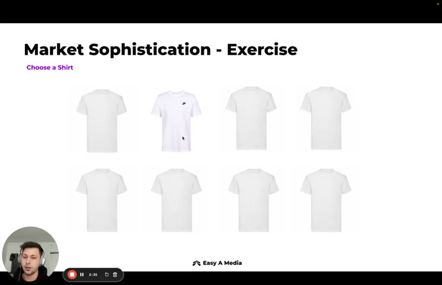
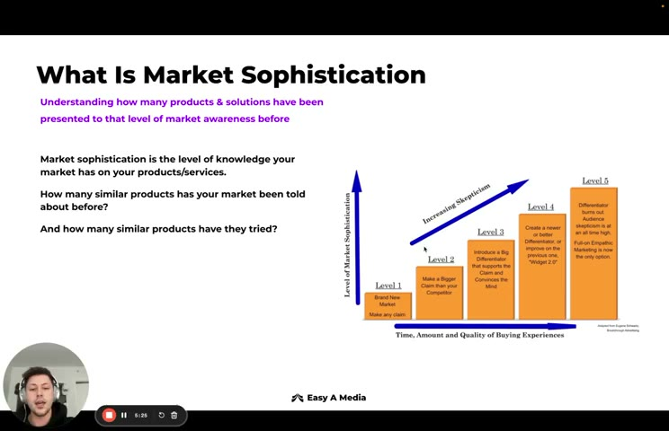
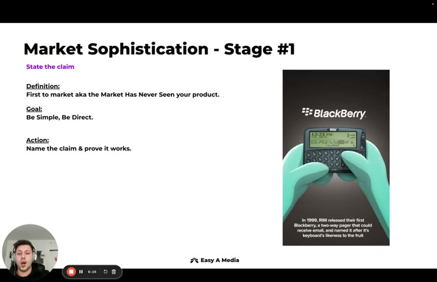
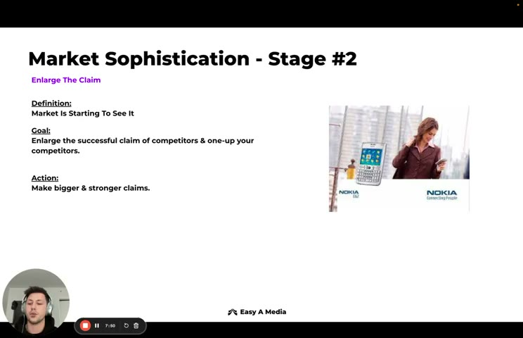
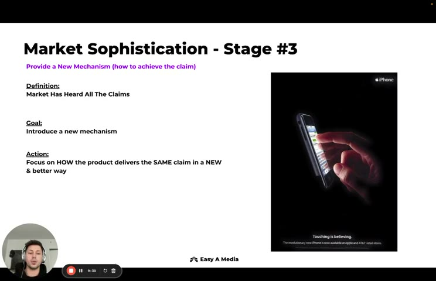
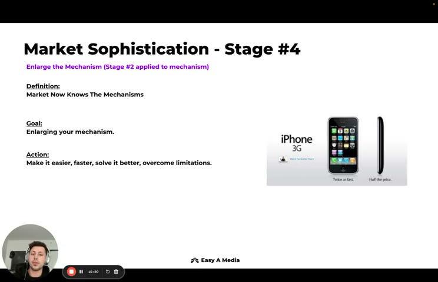
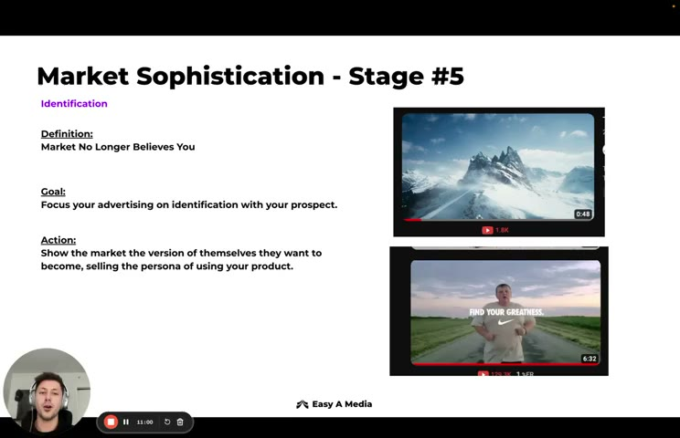
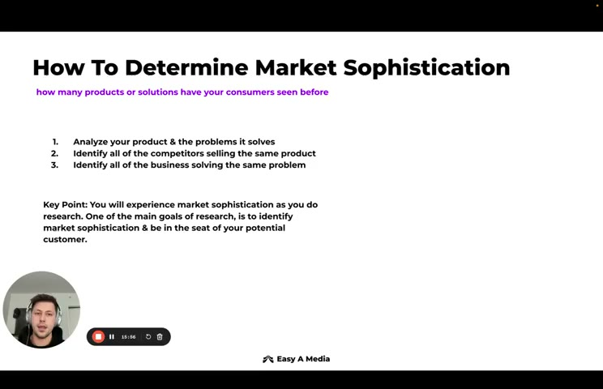
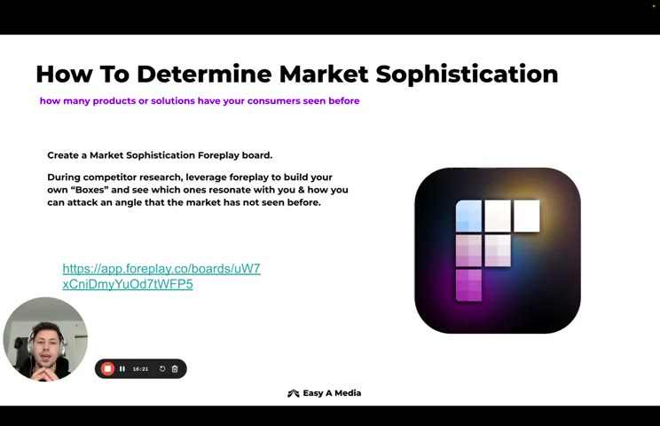

# 12. Market Sophistication
> Market sophistication is how many similar claims, products and solutions your market has already seen and tried; this lesson gives the five stages (state the claim, enlarge the claim, new mechanism, enlarge the mechanism, identification) and tells you which creative move each stage demands, so your ad is the "black shirt" instead of one more white shirt.

## 🤖 Agent use
- **Use when:** deciding what an ad must claim before writing it; labelling a competitor ad's stage; explaining why a "great" hook flopped; planning competitor research so it measures sophistication.
- **Inputs → outputs:** product mechanisms + problems solved + all competitor and substitute-solution claims (ideally a board of their ads) → a sophistication stage (1-5) for the market and a creative move (claim, bigger claim, new mechanism, bigger mechanism, identification).
- **Rules:**
  - **DO** define sophistication as "how many similar products has the market been told about before? How many claims have they been told? And how many of them have actually tried those products". [04:13–04:45]
  - **IF** the market is brand new **THEN** state the claim simply and directly and prove it works. [05:16–06:48]
  - **IF** competitors already make the claim **THEN** enlarge it: bigger, stronger claims that one-up them (stage 2). [08:31]
  - **IF** the market has heard every claim **THEN** introduce a new mechanism: the same old claim delivered a new way (stage 3). [08:31–09:25]
  - **IF** the mechanism is no longer new **THEN** enlarge the mechanism: easier, faster, solves it better, overcomes its limitations (stage 4). [10:10]
  - **IF** "the market doesn't believe you anymore" **THEN** sell identification: show the version of themselves the buyer wants to become (stage 5). [10:56]
  - **DON'T** launch an ad claim without checking who else makes it. Seven competitors all claimed "fast hair drying without heat damage", so the ad failed. [17:57–18:47]
  - **DO** keep re-checking: "this is something that's constantly ongoing". Mature markets cycle back to stage 3 or 1. [13:23; 18:47]
  - **DO** build a Foreplay board of competitor and substitute-solution ads and look for the one that stands out. [15:55–17:20]
- **See also:** [11. Understanding Unaware + Awareness Levels](011-understanding-unaware-awareness-levels.md) · [15. Market Identification](015-market-identification.md) · [65. Understanding Market Sophistication - Part 1](065-understanding-market-sophistication-part-1.md) · [Unique mechanism (Evolve Copywriting)](../../copywriting/concepts/unique-mechanism.md) · [Positioning (Evolve Copywriting)](../../copywriting/concepts/positioning.md)

Lesson page text: only a link to the slide deck (a Google Slides copy, exported identically to the PPTX attachment).

## Key ideas

### Expectation setting [00:00–00:48]
- "If you go through this video and you're like, I don't get it, that is completely normal." It took the instructor "months and months" and he is still learning how to explain it. It is "probably one of the hardest things to understand, but is one of the most important". Re-watch it. [00:00–00:48]

### The shirt exercise [00:48–04:13]
- Slides 2-5 show a grid of eight white T-shirts (credit on the slide: Eugene Schwartz, Nick Theriot). You pick one each round. [00:48]
- Round 1: all identical, so any choice is random: "they all look the same". [00:48–01:42]
- Round 2: one shirt has a small Nike swoosh. "Your eyes directly went to that." [01:42–02:29]
- Rounds 3-4: after further differentiation he says "my eyes automatically went towards the black shirt". [02:29–03:26] (The slide images for these rounds are in the deck; only the spoken description is cited here.)
- Lesson (slide 6): "These shirts represent what your potential customers see in the market. When all of the shirts look the same, there is no clear or obvious choice... But when a well branded OR a new mechanism/product is introduced, it automatically grabs attention and becomes the more attractive choice." [03:26–04:13]

### Definition and the skepticism graph [04:13–05:16]
- Slide 7: "Understanding how many products & solutions have been presented to that level of market awareness before." Market sophistication is "the level of knowledge your market has on your products/services". [04:13]
- Agency example: many buyers have tried agencies and had a bad experience, so an agency owner claiming "my agency is different" while using the same claims struggles. "The level of sophistication will increase as more time and the amount and experiences actually occur." [04:45–05:16]
- The slide graph (adapted from Schwartz, five orange steps, an arrow labelled "Increasing Skepticism", x-axis "Time, Amount and Quality of Buying Experiences"): Level 1 "Brand New Market / Make any claim"; Level 2 "Make a Bigger Claim than your Competitor"; Level 3 "Introduce a Big Differentiator that supports the Claim and Convinces the Mind"; Level 4 "Create a newer or better Differentiator, or improve on the previous one, 'Widget 2.0'"; Level 5 "Differentiator burns out. Audience skepticism is at an all time high. Full-on Empathic Marketing is now the only option." [05:16; slide at 05:25]
- Typically "the longer that the market is around... the more skepticism essentially increases and the more saturated... the market becomes". [05:16]

### The five stages, with the phone analogy [05:16–13:23]
| Stage | Definition (slide) | Goal | Action | Example used | Source |
|---|---|---|---|---|---|
| 1. State the claim | First to market: the market has never seen your product | Be simple, be direct | Name the claim and prove it works | BlackBerry's two-way pager that sends and receives email (slide: "In 1999, RIM released their first Blackberry"). Imagine a billboard: "This pager can send and receive email." | [05:16–07:42] |
| 2. Enlarge the claim | Market is starting to see it | Enlarge the successful claim of competitors and one-up them | Make bigger and stronger claims | Nokia "Connecting People" instead of "send and receive emails"; his Shilajit client sits roughly here ("we weren't first... second to the market") | [07:42–08:31] |
| 3. New mechanism | Market has heard all the claims | Introduce a new mechanism | Focus on HOW the product delivers the SAME claim in a NEW and better way | iPhone touchscreen ("Touching is believing"): same old claim, new mechanism | [08:31–09:25] |
| 4. Enlarge the mechanism | Market now knows the mechanisms | Enlarge your mechanism (stage 2 applied to the mechanism) | Make it easier, faster, solve it better, overcome limitations | iPhone 3G, "twice as fast, half the price" | [09:25–10:56] |
| 5. Identification | Market no longer believes you | Focus advertising on identification with your prospect | Show the version of themselves they want to become; sell the persona of using your product | Nike "Find your greatness" and a Rolex commercial (barely shows the watch; he says it features the first Everest climbers) | [10:56–13:23] |

- Stages 3-5 "is where majority of the marketing is done". Stage 1 is "very, very rare". [07:42–08:31]
- Stage 4 is "very, very similar to stage two, but rather than enlarging the claim... you're enlarging the mechanism". [09:25–10:10]
- Stage 5: "they've heard it all"; he notes he has a separate presentation on it ([15. Market Identification](015-market-identification.md)). [10:56]
- The Rolex video is played on screen with music; his reading: "It paints this reality... that's what Rolex represents... you automatically just associate this feeling and this identification with who you want to be with this product." [11:46–13:23]
- **The cycle:** after stage 4 you can go to stage 5 (identification), go back to stage 3 (another new mechanism), or go to stage 1 with "a brand new... product". "The sophistication stage will repeat itself." [13:23]

### Homework: watch BlackBerry [06:08]
- "An action item after you watch this video": watch the 2023 BlackBerry film/documentary for a case study. [06:08–06:48]

### How to determine market sophistication [13:23–17:20]
1. **Analyse your product and the problems it solves**: list your mechanisms and the problems each solves. Example (hairdryer client): quiet motor, a light ring that shows the heat setting, ion technology for frizz; solves frizz, slow drying, screeching noise. [13:23–14:16]
2. **Identify all competitors selling a similar product.** [14:16–15:04]
3. **Identify all other solutions solving the same problem**: for weight loss that is gym, personal trainer, liposuction ("liposurgery" in the transcript), "different vehicles". [15:04]
- You experience sophistication first-hand during the research modules; "one of the main goals is to identify market sophistication and be in the seat of your potential customer." [15:04–15:55]
- **Foreplay board** (slide 14): create a "Market Sophistication Foreplay board" of competitors and different solutions. You see "what your potential customers are seeing", so you can spot which brands separate themselves and which blend in; then "insert the black t-shirt into the market". [15:55–17:20]

### Case: same claim as seven competitors [17:57–18:47]
- The hairdryer client's big claim was "fast hair drying without heat damage". Research found about seven competitor brands making the same claim. Ads with that claim "just failed" and "we didn't understand why" until the sophistication research. "That's because that's what every other person is saying." (instructor account, no figures) [17:57–18:47]

### Resource [17:20]
- *Breakthrough Advertising* (Schwartz): "this book helped triple my business. So $150 to triple your business is really not that big of an investment" (instructor claim; slide says "There is no affiliation with this."). TL;DR: "Market Sophistication is the market's overall experience & exposure to other solutions & products before you." [17:20; slide 15]

## Steps / framework
1. List your product's unique mechanisms and the problems it solves.
2. Collect competitor ads for the same product *and* for other ways to solve the same problem; save them to one board.
3. Tally the claims and mechanisms they use. Ask: which stage are these ads at?
4. Pick the move that matches the stage (table above). Make sure your claim is not a repeat of what the board already shows.
5. Pick the angle that is visually distinct (the "black shirt").
6. Re-run when competitors change; cycle to stage 3 (new mechanism) or stage 5 (identification) as the market matures.

## Examples
- **Shilajit client:** first-to-market status belonged to someone else; the team is "enlarging the claim" as the second brand in. [07:42]
- **Hairdryer client:** features: quiet, heat-indicator light ring, ion technology. Claim "fast hair drying without heat damage" shared by roughly seven competitors, so the fix is a different mechanism, not a louder claim (derived). [13:23–18:47] Its later belief-building script is in [16. Market Belief](016-market-belief.md).
- **Phones as a stage ladder:** BlackBerry (state the claim), Nokia (enlarge the claim), iPhone touchscreen (new mechanism), iPhone 3G (enlarge the mechanism), Nike/Rolex (identification). [05:16–13:23]

## Structured units

### Angles / moves by stage (derived application of the instructor's table)
| Angle | Core desire / pain | Heuristic(s) | Best format | Example line | Source |
|---|---|---|---|---|---|
| Plain claim (stage 1) | Wants the new capability | — | Simple direct ad with proof | "This pager can send and receive email." | [06:48] |
| Bigger claim (stage 2) | Wants more than the first claim | — | Benefit-forward claim | "Connecting people" | [08:31] |
| New mechanism (stage 3) | Same outcome, a new route | — | Mechanism demo | "Touching is believing." | [09:25] |
| Bigger mechanism (stage 4) | Same mechanism, better | — | Comparison / spec | "Twice as fast. Half the price." | [10:10] |
| Identification (stage 5) | Who I want to be | — | Brand film / lifestyle | "Find your greatness." | [10:56] |

### Rules of thumb
- **DO** write the claim a first-mover would write only when nobody else has said it. [06:48]
- **DON'T** repeat a claim seven competitors already make. [17:57]
- **IF** you reach stage 4 **THEN** choose between stage 5, a return to stage 3, or a new product at stage 1. [13:23]

## Screenshots

*Round 2 of the exercise: one differentiated shirt out of eight wins attention. [02:35]*

*The five-level graph with the "Increasing Skepticism" arrow; the slide quotes each level's job. [05:25]*

*Stage 1: first to market, be simple, be direct, name the claim and prove it works. [06:15]*

*Stage 2: enlarge the competitors' successful claim and one-up them. [07:50]*

*Stage 3: same claim delivered through a new, better mechanism. [09:30]*

*Stage 4: enlarge the mechanism: easier, faster, solves it better, overcomes limitations. [10:20]*

*Stage 5: the market no longer believes you; sell the persona of using the product. [11:00]*

*The three research steps plus the key point that sophistication is experienced during research. [15:55]*

*Foreplay board step: build your own "boxes" and look for an angle the market has not seen. [16:21]*

## How to apply
- [ ] List the product's mechanisms and the problems each solves (one line each).
- [ ] Build a board of competitor ads and ads for alternative solutions (gym vs trainer vs surgery style).
- [ ] Write down every claim and mechanism seen; count how many competitors repeat each.
- [ ] Label the market stage (1-5) and name the move from the table.
- [ ] Reject draft hooks that repeat a claim 3+ competitors already make (derived threshold; instructor's example had about seven).
- [ ] Choose a differentiated mechanism or identification angle; log the stage on the ad's tracking sheet ([13. Practicing The Core 3](013-action-item-practicing-the-core-3.md)).

## Related
- Previous: [11. Understanding Unaware + Awareness Levels](011-understanding-unaware-awareness-levels.md) · Next: [13. Action Item: Practicing The Core 3](013-action-item-practicing-the-core-3.md)
- [15. Market Identification](015-market-identification.md) · [16. Market Belief](016-market-belief.md) · [65. Understanding Market Sophistication - Part 1](065-understanding-market-sophistication-part-1.md) · [Market awareness (Evolve Copywriting)](../../copywriting/concepts/market-awareness.md)

## Sources and limitations
- Transcript: [12. Market Sophistication….txt](<../../../../../raw/evolve/start-here/_transcripts/👣 Evolve (Start Here)/12. Market Sophistication 👣 Evolve (Start Here) Evolve.txt>) · Page text: [12. ….html.md](<../../../../../raw/evolve/start-here/_extracted/👣 Evolve (Start Here)/12. Market Sophistication_👣 Evolve (Start Here)_Evolve.html.md>) · Slides: [12. Market Sophistication.pptx.md](<../../../../../raw/evolve/start-here/_extracted/👣 Evolve (Start Here)/12. Market Sophistication.pptx.md>) and the linked Google Slides export [12-presentation-1TYAdvfdDT.pptx.md](../../../../../raw/evolve/start-here/_extracted/_linked/google/12-presentation-1TYAdvfdDT.pptx.md) (same 15 slides).
- Machine transcription (Whisper large-v3-turbo). Full recording covered (last segment 19:07 of 19:07). Instructor is not named in audio or on screen (slide branding is "Easy A Media"): `unverified`.
- Whisper writes "liposurgery" and "enlarging the client" (likely "enlarging the claim"). The Rolex/Everest description is the instructor's, not verified. The Foreplay board link on slide 14 was not fetched.
- The "black shirt" in rounds 3-4 was not captured in a frame; the description is from the audio.
