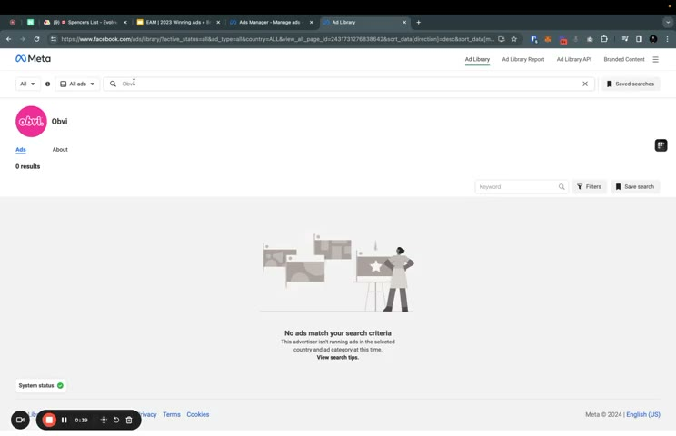
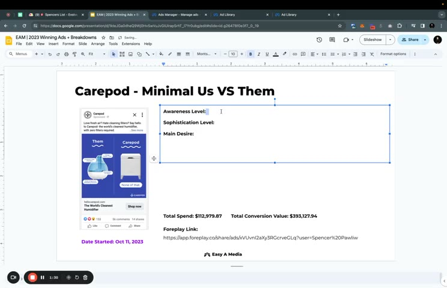
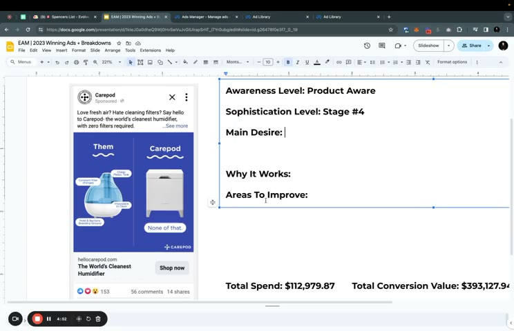

# 13. Action Item: Practicing The Core 3
> A practice drill: take real ads (your own or a favourite brand's from the Facebook Ad Library) and label each one's market awareness level, market sophistication stage and main desire in a short tracking sheet, so you learn which levers to double down on.

## 🤖 Agent use
- **Use when:** tearing down any ad (competitor or our own) into the three core psychology variables; planning the next test around an ad that already works.
- **Inputs → outputs:** an ad (link/preview) + its spend, conversion value and start date → a filled sheet: awareness level, sophistication stage, main desire (plus why it works / areas to improve), and the next variable to change.
- **Rules:**
  - **DO** judge the ad on awareness level and sophistication level; "you can just ignore the hook and the hold" for this exercise. [00:35–01:28]
  - **DO** expect to get it wrong at first: "It's going to be awkward. It's going to be weird... you might even mess this up a couple of times." [01:28]
  - **DO** record spend, total conversion value, a saved link on your Foreplay board, and the date started. [01:28]
  - **IF** the ad shows why *my* product beats the other products in a category the viewer already knows **THEN** label it product aware. [02:21]
  - **IF** the ad enlarges what the mechanism does against the old mechanism's flaws **THEN** label it sophistication stage 4; if it is a brand-new mechanism it may be stage 3. [03:10–04:04]
  - **DO** ask "why" repeatedly to get from the surface desire to the deeper one. [06:05]
  - **DO** use the result to choose what to test next: another awareness level or sophistication stage against the same desire. [06:39]
- **See also:** [10. Market Awareness](010-market-awareness.md) · [12. Market Sophistication](012-market-sophistication.md) · [9. Market Desires](009-market-desires.md) · [4. 100+ Winning Ads Document](004-100-winning-ads-document.md) · [Market awareness (Evolve Copywriting)](../../copywriting/concepts/market-awareness.md)

Lesson page text: only the Facebook Ad Library link (below). The tracking template file the instructor says he will "leave... below" is not included in the course files; its fields are read from the on-screen doc (see Prompts / templates).

## Key ideas

### The assignment [00:00–01:28]
- After desire, market awareness and market sophistication, apply "these three core principles" to ads. If you are not running ads, look up a favourite brand. [00:00]
- Two sources: the **Facebook Ad Library** (search a brand's name) or your own **ad account**. In the demo, the first brand search returned no results (the screen shows "Obvi", Whisper heard "my Avi"), so he switched to another brand (Whisper: "Snow Teeth Whitening"). [00:00–00:35]
- Copy the ad link into a better window so you can see the full ad, then "watch the ad or look at the ad and try to determine what the desire is, what the market sophistication level is, and what the market awareness level is." [00:35–01:28]
- For your own ads: open the ad account, find an ad "that is doing really well", preview and watch it over and over. "The whole goal... is you just want to get in the flow of trying to better understand the ads that you're making." [01:28]

### The tracking sheet [01:28]
- Fill out a sheet "like this": keep track of how much you spent, the total conversion value, save the ad to your Foreplay board, and include the date you started it. [01:28]
- The on-screen slide (Google Slides, "EAM | 2023 Winning Ads + Breakdowns") is titled "Carepod - Minimal Us VS Them" and holds: Awareness Level, Sophistication Level, Main Desire, Why It Works, Areas To Improve, Total Spend, Total Conversion Value, Foreplay Link, Date Started. [01:30–02:15 screen]

### Worked example: CarePod humidifier ad [01:28–06:39]
- **Awareness: Product Aware.** "A product aware ad is one that is essentially showing why my product is better than the other products... calling out the benefits and basically showcasing how we have a superior product." The ad targets "people who are aware of humidifiers". [02:21]
- **Timing note:** "This ad is absolutely crushing for us because we are in a time of year where people are in the market for humidifiers", a deliberate choice to run a product-aware ad then. [02:21–03:10]
- **Sophistication: Stage 4 (enlarge the mechanism).** The ad calls out problems with traditional humidifiers' mechanisms: "a cheap plastic tank and constant filter changes", hard to clean, "mold and bacteria breeding in there". It claims "the world's cleanest humidifier with zero filters required". "I'm not essentially enlarging the claim... I'm enlarging the mechanism by showing how our mechanism delivers everything better." [03:10–04:04]
- It "could also be a stage three... It is a new way to deliver fresh air", so "either stage three or stage four" and he calls it four. He admits you sometimes cannot tell: "It's one of those things that it takes time". [04:04–04:45]
- **Main desire: clean air** (overarching: health). On-ad lines: "the world's cleanest humidifier" and "if you love fresh air but hate cleaning filters... here's the care pod". [04:45–05:15] On screen the ad reads "Love fresh air? Hate cleaning filters? Say hello to Carepod, the world's cleanest humidifier, with zero filters required."
- **Where the desire came from:** research. Reviews repeatedly said the product is "a lifesaver" and "how easy the CarePod is to clean". [05:15]
- **Go one level deeper with "why":** easy to clean, so I know the air I breathe is clean, so I am healthier. "The desire for humidifiers specifically is to have cleaner air." [06:05–06:39]
- Screen metrics on the example slide: Total Spend $112,979.87, Total Conversion Value $393,127.94, Date Started Oct 11, 2023 (implied return about 3.5x, derived). The slide also lists a Foreplay link (not reproduced here). [screen 01:30–04:50]

### What to do with the labels [06:39–07:13]
- "Try to identify what market awareness level you are in, what sophistication level you are in, and what the main desire of your ads are." This shows "what desires you can double down on" and "if there's a different level of market sophistication... or market awareness that we can go after with these same desires". Do it "on a few of your ads". [06:39]

## Steps / framework
1. Pick 3+ ads: own winners (ad account) or a favourite brand's (Facebook Ad Library).
2. Open each ad full-size; ignore hook/hold for this drill.
3. Fill the sheet: awareness level; sophistication stage; main desire (ask "why" until it stops getting deeper); why it works; areas to improve; total spend; total conversion value; Foreplay link; date started.
4. For each labelled winner, list the other awareness levels and stages the same desire could be tested at.
5. Revisit as you learn the lessons; label mistakes are expected.

## Examples
- **CarePod "Them vs Carepod" static (humidifier):** product aware; stage 4; desire clean air (overarching health). Timing: seasonal demand for humidifiers. [01:28–06:39]

### Ad teardowns
| Brand / product (niche) | Format | Hook / opening | What works | What fails | Fix suggested | Principle | Source |
|---|---|---|---|---|---|---|---|
| CarePod humidifier (home/health) | Static "Them vs Carepod" comparison | "Love fresh air? Hate cleaning filters? Say hello to Carepod, the world's cleanest humidifier, with zero filters required." (screen) | Product-aware proof vs the category; enlarges the mechanism (no filters, easy clean); desire from reviews; run in humidifier season | Not stated (the "Areas To Improve" field is empty on screen) | — | Label awareness + sophistication + desire; time product-aware ads to in-market demand | [02:21–06:39] |

## Prompts / templates (verbatim)
Facebook Ad Library link given on the page:
```text
https://www.facebook.com/ads/library/?active_status=all&ad_type=all&country=ALL&sort_data[direction]=desc&sort_data[mode]=relevancy_monthly_grouped&media_type=all
```

Tracking sheet fields (as shown on the demo slide; the actual template file is "not included in the course files"):
```text
Awareness Level:
Sophistication Level:
Main Desire:

Why It Works:
Areas To Improve:

Total Spend:      Total Conversion Value:
Foreplay Link:
Date Started:
```

## Screenshots

*Step 1: search a brand in the Facebook Ad Library; this brand had no active ads, so pick another. [00:40]*


*The tracking template: the three core variables, why it works, areas to improve, total spend, total conversion value, Foreplay link and date started. [01:30]*


*Filled in: Awareness Level Product Aware, Sophistication Level Stage 4; Main Desire still to be written. [04:50]*

## How to apply
- [ ] Create the sheet with the fields above (one row/slide per ad).
- [ ] Label at least three ads (own or Ad Library) with awareness, sophistication and desire.
- [ ] Note spend, conversion value (or "not available" for competitors) and start date.
- [ ] Ask "why" three times on the desire.
- [ ] List one test per ad: same desire, different awareness level or sophistication stage.

## Related
- Previous: [12. Market Sophistication](012-market-sophistication.md) · Next: [14. Rule Of 1 - 1 Desire, Avatar, Message](014-rule-of-1-1-desire-avatar-message.md)
- [4. 100+ Winning Ads Document](004-100-winning-ads-document.md) (the doc format used for the template) · [11. Understanding Unaware + Awareness Levels](011-understanding-unaware-awareness-levels.md)

## Sources and limitations
- Transcript: [13. Action Item Practicing The Core 3….txt](<../../../../../raw/evolve/start-here/_transcripts/👣 Evolve (Start Here)/13. 💥 Action Item Practicing The Core 3 👣 Evolve (Start Here) Evolve.txt>) · Page text: [13. ….html.md](<../../../../../raw/evolve/start-here/_extracted/👣 Evolve (Start Here)/13. 💥 Action Item_ Practicing The Core 3_👣 Evolve (Start Here)_Evolve.html.md>)
- Machine transcription (Whisper large-v3-turbo). Full recording covered (last segment 7:13 of 7:13). Instructor is not named: `unverified`; he refers to "my team and I" and "our client's humidifier" (the doc branding is "EAM").
- The tracking template file promised in the audio is not in the course files; fields were read from video frames. Spend/conversion figures are read from the slide on screen.
- Whisper "my Avi" = on-screen "Obvi"; "Snow Teeth Whitening" is as heard.
