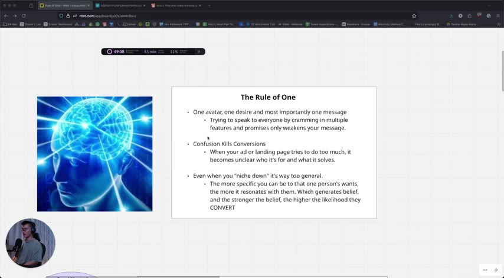
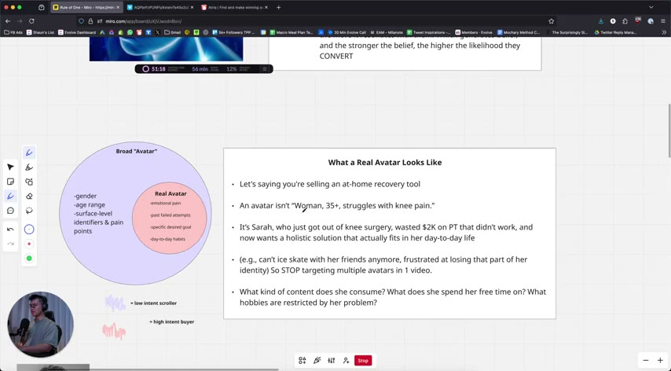
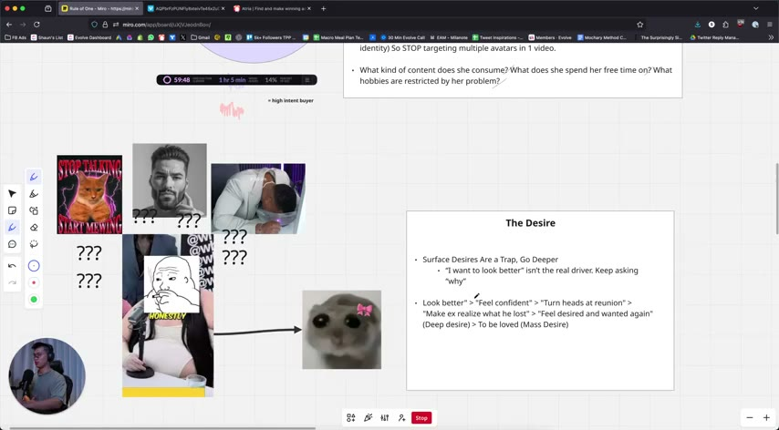
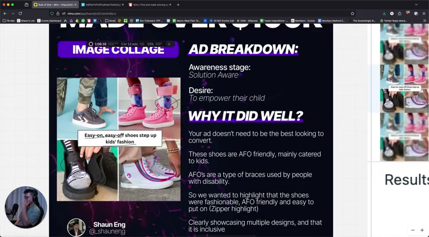
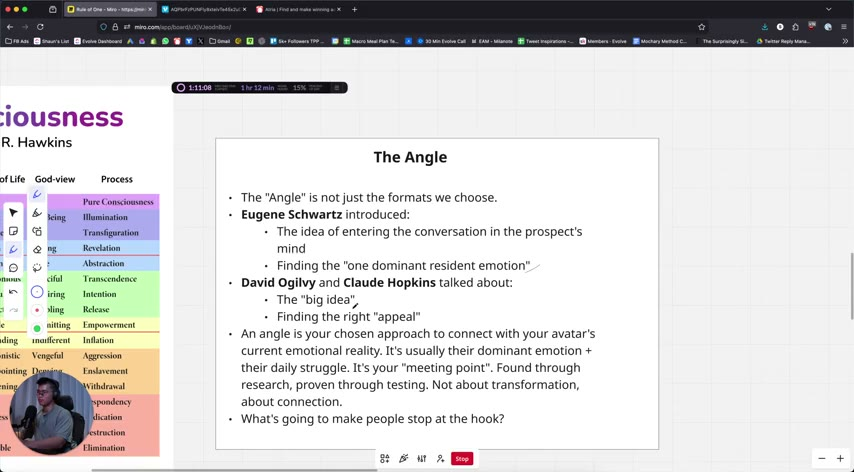
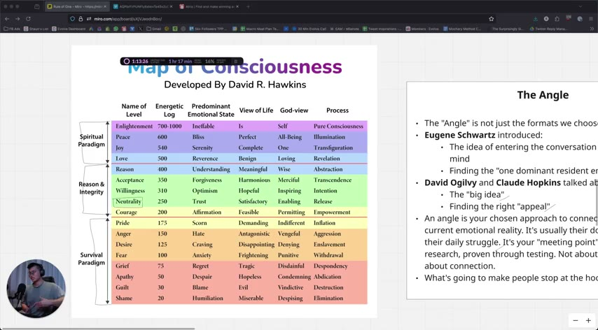
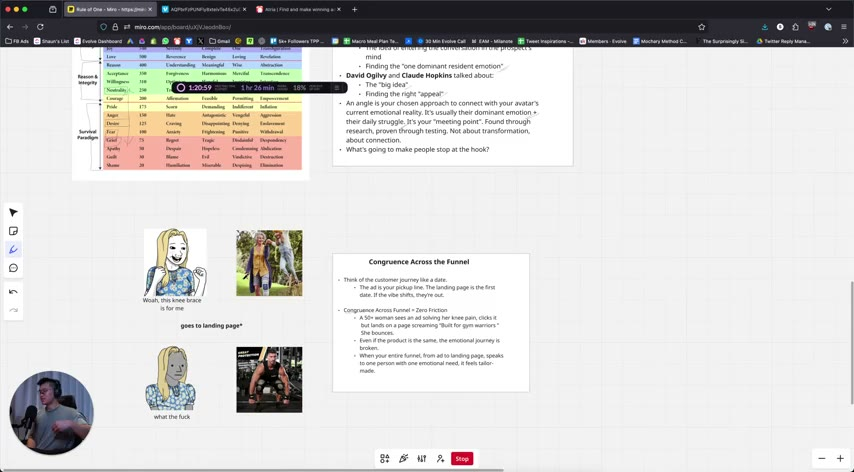
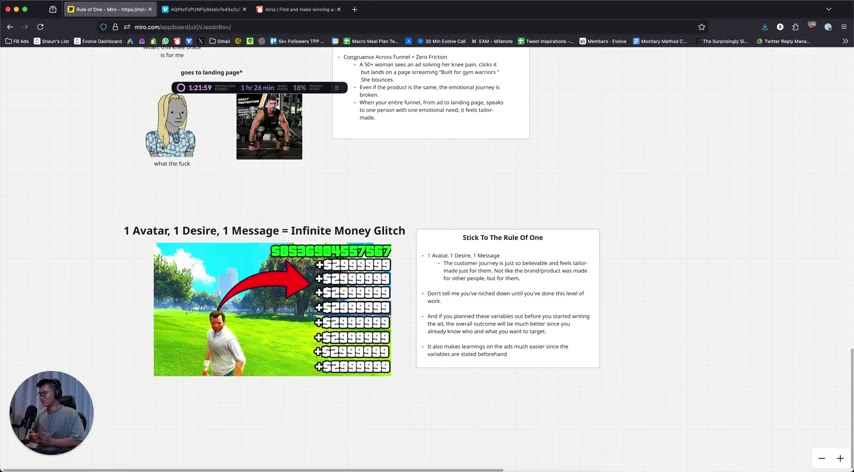

# 14. Rule Of 1: 1 Desire, Avatar, Message
> Every ad and landing page should appeal to exactly one avatar (defined by emotional pain, past failed attempts, goals and daily habits, not demographics), one deep desire (found by asking "why" repeatedly) and one message (an angle: the avatar's dominant emotion plus daily struggle), kept congruent from ad to landing page, because specificity creates belief and belief converts.

## 🤖 Agent use
- **Use when:** defining the avatar/desire/angle before writing any ad or page; auditing an ad that "targets everyone"; checking ad-to-landing-page congruence; deciding what to change after a test (avatar, desire or angle).
- **Inputs → outputs:** research on a customer (emotional pains, failed attempts, goals, habits, reviews/Reddit/TikTok comments) + product + landing page → one named avatar, one deep desire, one angle (hook calling out avatar, problem or solution), and a congruence check of ad vs landing page.
- **Rules:**
  - **DO** make every ad or page appeal to "one avatar, one desire, and one message". "If you try to target everyone, you try to get no one." [00:00–00:59]
  - **DON'T** call a demographic an avatar. "Woman 35 plus who struggles with knee pain... is not an avatar. This is a demographic." [02:01]
  - **DO** define the avatar by "emotional pains, past failed attempts, specific desired goals, and day-to-day habits". [02:01–03:07]
  - **DO** research content she consumes, free time and hobbies her problem restricts. [04:09]
  - **DON'T** go too specific (exact age, kids, degree). "We care about commonalities." [05:10–06:07]
  - **DO** keep asking "why" until you reach the deep desire, then show it in every part of the ad. [09:26–15:48]
  - **DO** make the hook call out the avatar, the problem, or the solution. [07:09; 22:31]
  - **DON'T** treat format (image, video, UGC) as an angle. [21:27]
  - **DO** define the angle as the avatar's dominant emotion plus daily struggle (or ideal outcome), i.e. the "meeting point". [22:31; Skool correction below]
  - **IF** an avatar and desire win **THEN** test different angles around them rather than new avatars. [29:03]
  - **IF** the avatar is working but the desire is not **THEN** test different desires; if the desire works but not the avatar, test avatars. [33:16]
  - **DO** match the landing page to the ad: same avatar, desire, emotion. "Congruence Across Funnel = Zero Friction." [30:09–32:17]
- **See also:** [9. Market Desires](009-market-desires.md) · [74. How To Build Core Avatars](074-how-to-build-core-avatars.md) · [61. Understanding & Applying Desire - Part 1](061-understanding-applying-desire-part-1.md) · [Avatars and angles (Evolve Copywriting)](../../copywriting/concepts/avatars-and-angles.md) · [Being aware of avatars](../../copywriting/lessons/17-being-aware-of-avatars.md) · [Being aware of angles](../../copywriting/lessons/18-being-aware-of-angles.md) · [Beliefs (Evolve Copywriting)](../../copywriting/concepts/beliefs.md)

Lesson page text: "This is one of the most important videos to watch... This is certified Chad scaling sauce." plus the **angle correction** quoted in full under Prompts / templates. The video is a screen recording of a Miro board with a webcam inset.

## Key ideas

### 1. The Rule of One [00:00–00:59]
- Slide "The Rule of One": "One avatar, one desire and most importantly one message. Trying to speak to everyone by cramming in multiple features and promises only weakens your message. Confusion kills conversions: when your ad or landing page tries to do too much, it becomes unclear who it's for and what it solves. Even when you 'niche down' it's way too general. The more specific you can be to that one person's wants, the more it resonates with them. Which generates belief, and the stronger the belief, the higher the likelihood they CONVERT." [00:00–00:59; slide at 00:30]
- Framing: "Most people skim through [the fundamentals], even the dudes in Evolve. But these concepts are the ones that are going to bring the most results." [00:00]
- The goal: "relate to a specific person so well" that "when you present your product to them, it feels bespoke. It feels tailor-made." [00:59–02:01]

### 2. What a real avatar looks like [02:01–07:10]
- Example product: an at-home recovery tool. Asked "who is the avatar of your best-performing ad?", most people say "woman, 35 plus, struggles with knee pain". That is a demographic. Broad targeting means lower intent: "tens or hundreds of millions of people with the same problem", "billions of different products". "You stand out by being more specific... higher intent, the buyers." [02:01–03:07]
- Slide "What a Real Avatar Looks Like": a big circle "Broad 'Avatar'" (gender, age range, surface-level identifiers and pain points) with a smaller "Real Avatar" circle inside (emotional pain, past failed attempts, specific desired goal, day-to-day habits); a legend marks "low intent scroller" and "high intent buyer". [02:10; frame]
- The real avatar, "Sarah": "just got out of knee surgery, wasted $2K on PT that didn't work, and now wants a holistic solution that actually fits in her day-to-day life." Research shows she liked to ice skate; "she can't ice skate with her friends anymore... A part of her identity was lost." Day-to-day habit: at the office pantry, colleagues ask how she is and "she has to pretend that she's not in pain". [03:07–04:09]
- **Do not mix avatars in one video:** a drastic switch would be John with golf knee pain; a subtle one is a woman who gardens instead of a post-surgery woman (different attempts, goals, habits, pains). [04:09–05:10]
- **Research prompts:** what content does she consume, what does she spend free time on, what hobbies are restricted by her problem. Research methods come later in the course. [04:09]
- **Bespoke effect:** show someone "all the specific scenarios that they've gone through, all the day-to-day habits... the emotional pain", and "this product is now bespoke". Belief rises, so conversion odds rise. [05:10]
- **Two extremes:** too broad (common) and too specific. "It's not going to be... exactly 42 years old, two kids... We care about commonalities." Use patterns from research: e.g. many Reddit threads of women waking at 3 am is a common pain you can target for that niche. [05:10–06:07]

### 3. Teardown: lip duo ad (bad avatar) [06:07–09:26]
- The instructor says he does not know the brand and is "not affiliated". The ad (shown in an Atria ad detail; "gosolovegan.com" on screen, Whisper heard "Solo Vegan") is a UGC-style video: "If you have chapped lips, you need to try this duo out..." with a guava lip treatment and butter balm. [06:07–07:09]
- His hook rule: "The hook is to do one of three things. Call out the avatar, problem, or solution." Here it calls out the problem (chapped lips), as thousands of products do. [07:09]
- Why it fails: (1) it does not show someone with chapped lips, "This woman doesn't even have chapped lips. Why should I believe her?"; (2) there are only two ways to stand out, "either through the product, or through the avatar", and it does neither: "amazing for your lips, nourishing, smells good" does not differentiate the product, and nothing mentions her previous lip balm attempts or why this is better; (3) "It's like saying, knee pain, pull on the braces, bro." [07:09–09:26]
- Verdict: "an example of a bad avatar". [09:26]

### 4. The desire ladder [09:26–15:48]
- Desire = what your customer wants; the trap is surface desires. "I want to look better is not a desire." Keep asking why. Three mass desires: "health, wealth, relationships". [09:26–10:28]
- Slide "The Desire": "Surface Desires Are a Trap, Go Deeper... 'I want to look better' isn't the real desire. Keep asking 'why'." Chain: **Look better > Feel confident > Turn heads at reunion > Make ex realize what he lost > Feel desired and wanted again (Deep desire) > To be loved (Mass Desire).** [10:28–11:35; slide at 10:40]
- The "turn heads at reunion" and "revenge body" steps came from a TikTok comment in research. [10:28]
- **Shapewear example:** "no shapewear brand just sells... a person looking good". The deep desire for an avatar like women 50+ with a distant husband is to "feel desired and wanted again": show the husband noticing something is different, or a divorced woman at a club turning heads. [11:35–12:39] (instructor illustration, not tested)
- **True Classic (men's tees):** "Nine-figure brand... Don't quote me." (instructor claim). The ad says "When you wear THIS, you're definitely getting a second date." Deep desire: be more attractive to the opposite sex; it shows women throughout, not only in the hook. [12:39–15:48]
  - Quoted ad copy (spoken in the clip): "There are three kinds of guys out there..." the ones who buy Hanes/Fruit of the Loom, the ones who "blow their money on ultra-pricy brands like Gucci and Versace", "and the ones who know real quality"; "True Classic t-shirts have the hottest fit, enhancing the arms, chest, and shoulders, while keeping it loose by the belly"; "Get them at nearly half price and use that extra cash on your next date." [12:39–13:41]
  - Avatar: men "30 plus", not Gen Z or the very wealthy; the "three kinds of guys" line lets the viewer self-select: "you're not a cheapo and you're not a super well-off dude... middle income". The ad is consistent in avatar and desire from hook to offer. [14:41–15:48]
  - Atria detail on screen: True Classic, started Mar 30, 2025, 113 days running, 00:57, Men's Clothing.

### 5. Live test: two ads for the same shoe [15:48–21:27]
- Same product, two ads. **Ad one (video "flip, zip, go"):** about $500 spent / $1.4k revenue; screen shows $578.61 spent, ROAS 2.42, purchase conversion value $1,400.96, 23 purchases. **Ad two (image collage):** instructor says "$39k in spend, $300,000 in revenue... a bit inflated because this is mainly view-through" ("Vue True and Click True" in Whisper); the screen shows three image ads totalling $29,370.58 spent, ROAS 10.41, $305,669.39 conversion value, 4,186 purchases (so the "$39k" in the audio disagrees with the screen). He says it "has made over $100,000". [15:48–17:03]
- **Why ad one lost:** the video shows a daughter, a son and a dad; no text; "flip, zip, go" is unclear. Who is targeted: dad for himself, for his kids, for the family? "It's too broad... The ad is to appeal to one specific person." [17:03–19:22]
- **Why ad two won:** a Canva image collage made "in a few minutes". Only kids, text "Easy-on, easy-off shoes step up kids' fashion". The shoe is an AFO-friendly shoe (AFOs are braces for children with disabilities); "only a parent who has a child like that knows what this is for", and that is good because the appeal is specific. [19:22–20:23]
- **Desire:** parents want to empower their child (kids can put the shoe on themselves; the shoe looks good). "It's a stronger emotion" than "get ready easily". [20:23–21:27]
- The slide breakdown for this ad: Awareness stage: Solution Aware. Desire: To empower their child. Why it did well: "Your ad doesn't need to be the best looking to convert. These shoes are AFO friendly, mainly catered to kids. AFO's are a type of braces used by people with disability. So we wanted to highlight that the shoes were fashionable, AFO friendly and easy to put on (Zipper highlight). Clearly showcasing multiple designs, and that it is inclusive." [slide at 19:10; frame]

### 6. What an angle is (and is not) [21:27–30:09]
- "An angle is not just the format we choose": image, video, UGC are not angles. [21:27]
- Slide "The Angle": Eugene Schwartz introduced "the idea of entering the conversation in the prospect's mind" and "finding the 'one dominant resident emotion'"; David Ogilvy and Claude Hopkins talked about "the 'big idea'" and "finding the right 'appeal'". "An angle is your chosen approach to connect with your avatar's current emotional reality. It's usually their dominant emotion + their daily struggle. It's your 'meeting point'. Found through research, proven through testing. Not about transformation, about connection. What's going to make people stop at the hook?" [21:27–22:31; slide at 22:00]
- The hook "needs to do three things": call out the avatar, the problem or the solution, because these pinpoint the daily struggle and dominant emotion. [22:31]
- **Hawkins Map of Consciousness** ("fancy chart", credited to David R. Hawkins): people "don't buy at low emotional states... when they're down". At guilt, shame or grief they won't purchase; once given a reason (a solution), they move toward neutral/hope/belief, and then purchase. The ad's job: say "we know exactly how you feel", show the scenarios they have been through, then present the product as the new belief. [22:31–24:44; slide at 24:00]
- **Example A (his own, media buyers):** "Are you running Facebook ads at 10k per day? Or are you spending more than 100k per day?" (calls out the avatar) then "Did you know that you could be losing money on the table?" Dominant emotion: fear of losing money. [24:44–25:47]
- **Example B (knee pain, Sarah):** hook "Spent thousands on knee pain surgeries when nothing worked out." Emotion: grief. Follow-up: why the surgery failed (it didn't fix the root cause), then the new mechanism "that the doctors didn't tell them about", which generates belief, moves them to neutral, then purchase. [25:47–26:49]
- **Example C (the shoe collage):** daily struggles: kids cannot put on shoes themselves and the shoes they can wear look ugly; emotion: parents want their kids accepted and looking good; call out the solution: "easy on, easy off shoes... and fashionable". [26:49–28:00]
- The point: "relate to someone as well as possible... meet them at the point where they're currently at". Attracting the right traffic matters: a clickbait stop at the hook "won't convert". [28:00]
- **Same avatar + desire, different angles:** keep the winning avatar and desire, test other angles, e.g. a video of a kid getting ready, easy on/off and fashionable. "A lot of our winning ads are made this way." [29:03–30:09]

### 7. Congruence from ad to landing page [30:09–32:17]
- Analogy: the ad is the pickup line, the landing page is the first date. A knee-brace ad for a 50+ woman that lands on a page "built for gym bros" breaks the emotional journey; she "cannot see herself" and bounces. Slide: "Think of the customer journey like a date. The ad is your pickup line. The landing page is the first date. If the vibe shifts, they're out. Congruence Across Funnel = Zero Friction." [30:09–32:17; slide at 31:30]
- "Even if the product is the same, emotional journey is broken." [31:12]

### 8. Putting it together [32:17–34:03]
- Slide "Stick To The Rule Of One": "1 Avatar, 1 Desire, 1 Message = Infinite Money Glitch." The journey is so believable it feels "tailor-made just for them". "Don't tell me you've niched down until you've done this level of work." Plan the variables before writing the ad so the message is congruent; it also "makes learnings on the ads much easier since the variables are stated beforehand." [32:17–33:16]
- Testing logic: if the avatar works but the desire does not, test other desires; if the desire works, test messages/angles. [33:16]
- He says this concept "has made the most winners in Evolve" and people with "100k day, million dollar days, million dollar months, all know this very, very well" (instructor claim); he also says "hit an 800k day, not by chance" (instructor claim). [33:16]
- A tracking sheet and review section are "covered in the later sections". [32:17]

## Steps / framework
1. **Avatar:** write one person: emotional pain, past failed attempts, specific desired goals, day-to-day habits; add hobbies/identity lost. Use commonalities across research, not one-off details.
2. **Desire:** write the surface want, then ask "why" until you reach a feeling (desired, loved, accepted, empowered). The mass desires: health, wealth, relationships.
3. **Message/angle:** dominant emotion + [daily struggle OR ideal outcome]; make the hook call out avatar, problem or solution.
4. **Write the ad** so the opening, middle and close all show the same avatar and desire (True Classic: women appear throughout).
5. **Match the landing page** (people, scenarios, language) to the ad.
6. **Test:** keep avatar + desire, vary angle; if no win, vary desire, then avatar.

## Examples
- **At-home recovery tool (knee pain)**: demographic "woman 35+" versus avatar "Sarah" [02:01–04:09].
- **Lip duo ad:** teardown above [06:07–09:26].
- **Shapewear:** from "look better" to "feel desired and wanted again" [10:28–12:39].
- **True Classic:** "second date" [12:39–15:48].
- **Easy-on/easy-off kids' shoe:** video "flip, zip, go" ($578.61 spend) versus image collage ($29,370.58 spend across three ads) [15:48–21:27].

## Structured units

### Ad teardowns
| Brand / product (niche) | Format | Hook / opening | What works | What fails | Fix suggested | Principle | Source |
|---|---|---|---|---|---|---|---|
| Guava lip duo (lip care; brand unverified, "Solo Vegan" as heard / "gosolovegan.com" on screen) | UGC-style video with product demo | "If you have chapped lips, you need to try this duo out." | Shows outcome (looks good at the end); fine as a product demo | Model does not look like she has chapped lips; no avatar specifics; no difference vs other lip balms; no past attempts | Show a real chapped-lips person with specific past attempts; win through the product or the avatar | Hook must call out avatar/problem/solution; stand out by product or avatar | [06:07–09:26] |
| True Classic men's tees | Video (0:57) | "When you wear THIS, you're definitely getting a second date." | Deep desire (opposite-sex attention) shown in every part; avatar (men 30+, middle income) self-selects via "three kinds of guys" | — | — | Deep desire + consistent avatar | [12:39–15:48] |
| Kids' AFO-friendly shoe (brand not stated), video "flip, zip, go" | Video, three people on screen | No text; "flip, zip, go" | — | Unclear target (dad/kids/family); unclear desire; $578.61 spend, ROAS 2.42, 23 purchases | One avatar (parent of a child who needs the shoe), one desire | One avatar, one desire | [15:48–19:22] |
| Same kids' shoe, image collage (Canva) | Static image collage | "Easy-on, easy-off shoes step up kids' fashion" | Clear avatar (parents of kids with AFOs); desire empower their child; solution-aware; fashionable + easy on/off; made in minutes; three ads total $29,370.58 spend, ROAS 10.41 (screen) | — | — | Specificity beats production polish | [19:22–21:27; slide] |

### Rules of thumb
- **DO** show the same avatar and desire in every segment of the ad. [14:41]
- **DON'T** mix avatars (post-surgery woman vs golfer vs gardener). [04:09]
- **IF** reverse-engineering an ad **THEN** ask what the desire is, then why, then why. [17:03]
- **DO** accept a "worse-looking" ad if the appeal is more specific. [19:10]

## Prompts / templates (verbatim)
Skool page correction (verbatim):
```text
Correction:
Angle = Emotional Trigger + [Daily Struggle OR Ideal Outcome]

Problem/Daily Struggle: Current pain + what makes it hell
Aspirational/Ideal: Current emotion + dream state
Your "meeting point" - where their feelings and your message connect

If you were not selling a problem solving product for example, like fashion. You would then show what your avatar aspires to be or look like.

The point is still the same. Per Schwartz's teachings, our goal is to be able to relate to our customers and enter their current emotional state through relating to their current state of emotions. And you can show that via a daily struggle or ideal outcome.
```
(This replaces the spoken/slide definition "dominant emotion + daily struggle"; see Related contradictions.)

Desire ladder (slide "The Desire", verbatim chain):
```text
Look better > Feel confident > Turn heads at reunion > Make ex realize what he lost > Feel desired and wanted again (Deep desire) > To be loved (Mass Desire)
```

Real-avatar slide (verbatim points):
```text
Let's saying you're selling an at-home recovery tool
An avatar isn't "Woman, 35+, struggles with knee pain."
It's Sarah, who just got out of knee surgery, wasted $2K on PT that didn't work, and now wants a holistic solution that actually fits in her day-to-day life
(e.g., can't ice skate with her friends anymore, frustrated at losing that part of her identity) So STOP targeting multiple avatars in 1 video.
What kind of content does she consume? What does she spend her free time on? What hobbies are restricted by her problem?
```

Hawkins Map of Consciousness (slide "Map of Consciousness", David R. Hawkins; level - energetic log - predominant emotional state):
```text
Enlightenment 700-1000 Ineffable | Peace 600 Bliss | Joy 540 Serenity | Love 500 Reverence
Reason 400 Understanding | Acceptance 350 Forgiveness | Willingness 310 Optimism | Neutrality 250 Trust
Courage 200 Affirmation | Pride 175 Scorn | Anger 150 Hate | Desire 125 Craving
Fear 100 Anxiety | Grief 75 Regret | Apathy 50 Despair | Guilt 30 Blame | Shame 20 Humiliation
```

Board text "Congruence Across the Funnel" (verbatim):
```text
Think of the customer journey like a date.
- The ad is your pickup line. The landing page is the first date. If the vibe shifts, they're out.
Congruence Across Funnel = Zero Friction
- A 50+ woman sees an ad solving her knee pain, clicks but lands on a page screaming "Built for gym warriors". She bounces.
- Even if the product is the same, the emotional journey is broken.
- When your entire funnel, from ad to landing page, speaks to one person with one emotional need, it feels tailor-made.
```

Board text "Stick To The Rule Of One" (verbatim):
```text
1 Avatar, 1 Desire, 1 Message
- The customer journey is just so believable and feels tailor-made just for them. Not like the brand/product was made for other people, but for them.
- Don't tell me you've niched down until you've done this level of work.
- And if you planned these variables out before you started writing the ad, the overall outcome will be much better since you already know who and what you want to target.
- It also makes learnings on the ads much easier since the variables are stated beforehand
```

## Screenshots

*Slide "The Rule of One": one avatar, one desire, one message; confusion kills conversions. [00:30]*


*Broad "avatar" (gender, age, surface pains) versus real avatar (emotional pain, failed attempts, goal, habits). [02:10]*


*The bad-avatar ad in Atria: the presenter does not look like she has chapped lips. [08:30]*


*The desire ladder from "look better" to the mass desire "to be loved". [10:40]*


*True Classic ad: the headline text states the deep desire outright. [12:50]*


*Live test: the broad video ad (top) versus the specific image ads (bottom). Read figures from the screen, not the audio. [15:55]*


*Breakdown of the winning image collage: awareness Solution Aware; desire "to empower their child". [19:10]*


*Angle definition: Schwartz's "one dominant resident emotion"; Ogilvy and Hopkins' "big idea" and "appeal". [22:00]*


*The chart used to explain why people do not buy at low emotional states. [24:00]*


*Congruence: ad and landing page must show the same person and emotional need. [31:30]*


*Closing board: plan the variables before writing; it also makes learnings easier. [32:30]*

## How to apply
- [ ] Write the avatar as one person (pain, failed attempts, goals, habits); reject any "woman 35+" style label.
- [ ] Run a three-"why" ladder on the surface desire; record the deep desire in one sentence.
- [ ] Write the angle with the formula: emotional trigger + [daily struggle OR ideal outcome].
- [ ] Hook: call out avatar, problem or solution (pick one).
- [ ] Review the ad: are all people, props and scenes consistent with one avatar and one desire?
- [ ] Review the landing page for the same avatar, desire and emotion (headline, imagery, copy).
- [ ] Log variables per ad (avatar / desire / angle) so test learnings are attributable.

## Related
- Previous: [13. Action Item: Practicing The Core 3](013-action-item-practicing-the-core-3.md) · Next: [15. Market Identification](015-market-identification.md)
- [16. Market Belief](016-market-belief.md) · [76. How To Build Sub Avatars](076-how-to-build-sub-avatars.md) · [Unique mechanism (Evolve Copywriting)](../../copywriting/concepts/unique-mechanism.md)
- **Contradiction to track:** the spoken/slide angle definition ("dominant emotion + daily struggle... not about transformation, about connection") is corrected on the Skool page to "Emotional Trigger + [Daily Struggle OR Ideal Outcome]" with a fashion exception that shows what the avatar aspires to be. Prefer the page correction. The Copywriting course's avatar/angle definitions are in [avatars and angles](../../copywriting/concepts/avatars-and-angles.md).

## Sources and limitations
- Transcript: [14. Rule Of 1….txt](<../../../../../raw/evolve/start-here/_transcripts/👣 Evolve (Start Here)/14. Rule Of 1 - 1 Desire, Avatar, Message 👣 Evolve (Start Here) Evolve.txt>) · Page text: [14. ….html.md](<../../../../../raw/evolve/start-here/_extracted/👣 Evolve (Start Here)/14. Rule Of 1 - 1 Desire, Avatar, Message_👣 Evolve (Start Here)_Evolve.html.md>)
- Machine transcription (Whisper large-v3-turbo). Full recording covered (last segment 34:01 of 34:03). Rough speech: several words are mangled ("convergence" for "conversion", "adversarial desires" for "variables/desires", "nipping" for "tipping/showing", "I think you used to understand" for the Hawkins chart). Quotes keep the transcript wording where clear.
- Instructor: the audio never names him; "Shaun Eng" (`@_shauneng`) appears on the ad-breakdown slide and as the Vimeo uploader, "Shaun's Board" appears in Atria. Treated as "named on screen", not confirmed as the speaker.
- The shoe-ad spend: the spoken "$39k" for the winning ads conflicts with the Ads Manager table on screen ($29,370.58 across three ads, ROAS 10.41, $305,669.39 conversion value). The screen figures are used. Per-ad rows: $14,151.50 / ROAS 14.97 / $211,891.04 / 2,843 purchases; $7,671.90 / 8.30 / $63,688.29 / 982; $7,547.18 / 3.99 / $30,090.06 / 361.
- "Nine-figure brand" for True Classic, "800k day" and winner counts are instructor claims, unverified. The kids'-shoe brand is not named.
- "Shout out homie Hawkins" is the instructor crediting the Map of Consciousness (David R. Hawkins); the slide itself shows the name.
- Hooks, tracking sheet and review sections are said to be covered "later down the line" and are in other lessons.
