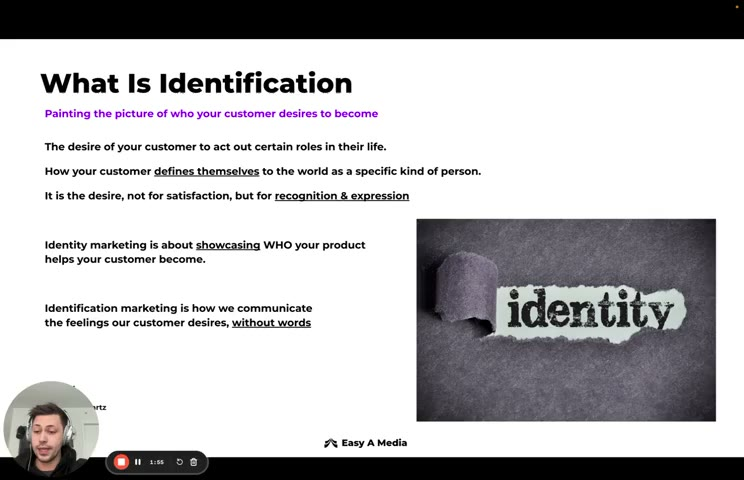
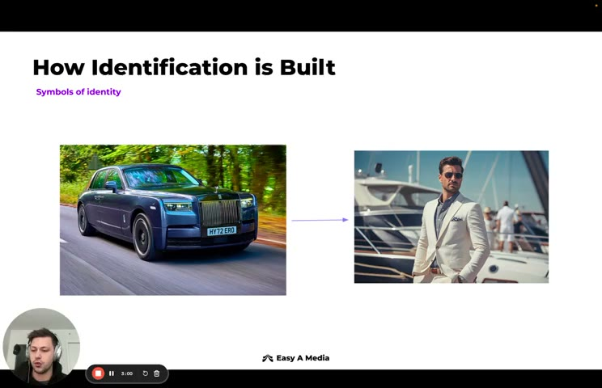
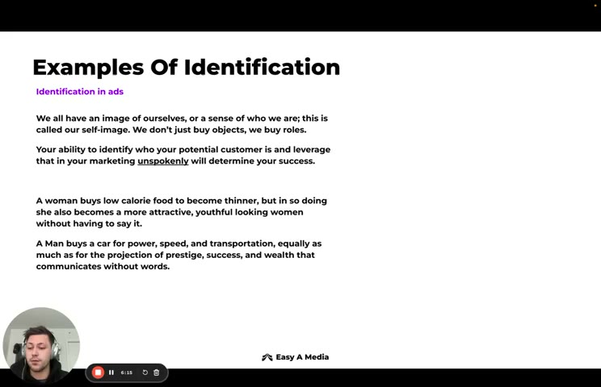
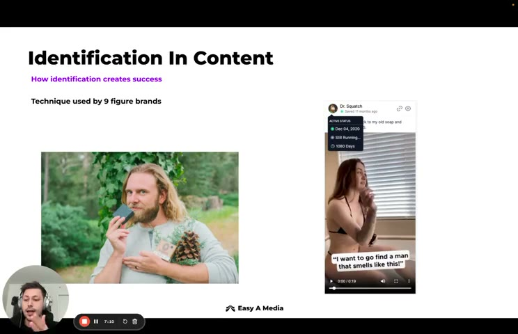
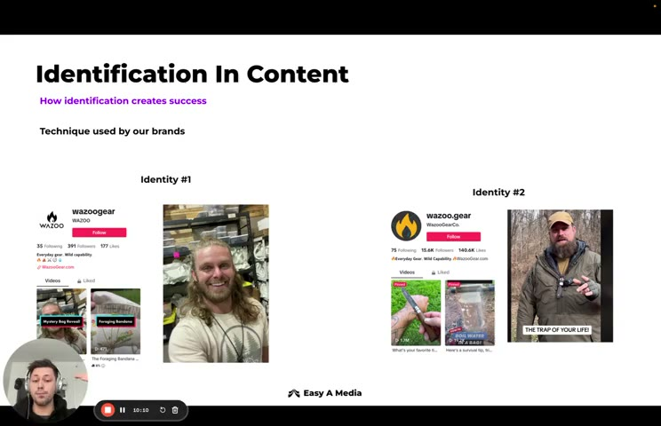
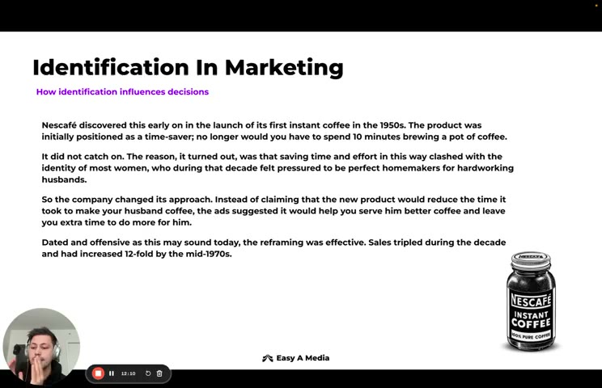
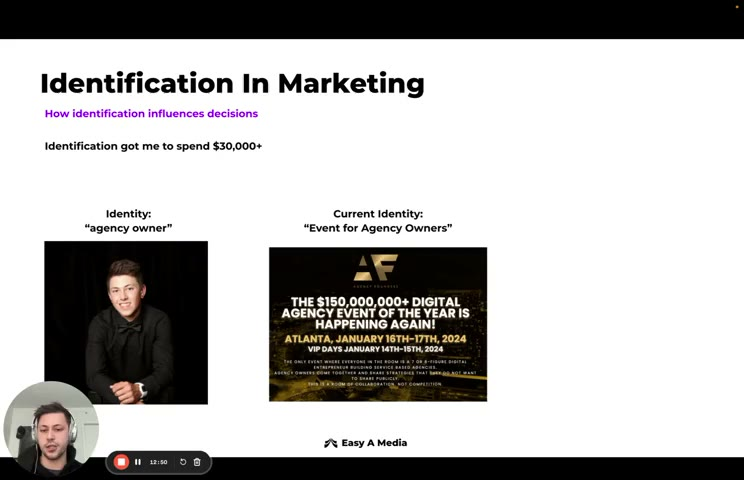
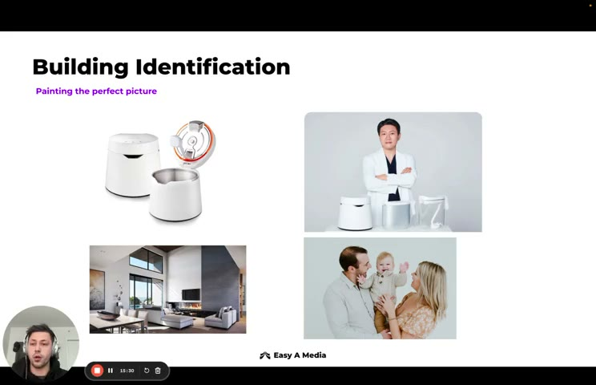
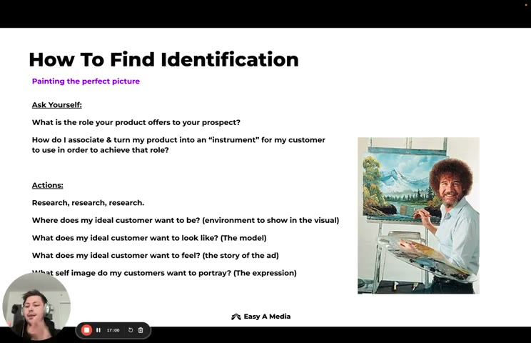

# 15. Market Identification
> Identification marketing sells who the buyer becomes (or is already) rather than satisfying a problem: you paint the picture of the role your customer wants to be seen in through environment, models, story and expression, usually without saying it in words, which drives visuals, creator casting and brand perception.

## 🤖 Agent use
- **Use when:** briefing visuals, models, locations and creators; writing ads for fashion/accessory/jewelry or any product without a clear "problem"; amplifying a desire-led ad with identity; choosing which creator to cast; diagnosing why an on-brand creator does or does not grow.
- **Inputs → outputs:** product, avatar research (language, environment, who they want to be) → the "role" the product offers now vs the role it should offer, plus answers to the four questions (environment, model, feeling/story, self-image) that drive the visual and casting brief.
- **Rules:**
  - **DO** treat identification as the way to "communicate the feelings our customer desires, without words". [01:37]
  - **DO** use it to amplify desire marketing even if the product is not fashion. [00:00–00:43]
  - **DO** remember "we don't just buy objects, we buy roles". [04:13]
  - **DO** work on what the customer wants to be seen as (current identity to dream identity), e.g. an ad can name the current identity ("agency owner") then show the elite version. [11:57–13:36]
  - **DO** choose creators who embody the identity. The creator with the right look, gear, setting and language grew from 300 to about 15,000 followers; the "another dude in a t-shirt in a storage room" did not. [08:14–10:07]
  - **DON'T** stretch the role: billionaire endorsements for mass-market deodorant, or a Rolls-Royce driver in a minivan ad, "too much of a stretch". [15:56–16:53]
  - **DON'T** position against the identity: Nescafé's time-saver pitch failed because it clashed with homemakers' self-image; the reframe tripled sales. [10:52–11:57]
  - **DO** ask the four research questions before filming (below). [16:53–17:53]
- **See also:** [12. Market Sophistication](012-market-sophistication.md) (stage 5 identification) · [14. Rule Of 1](014-rule-of-1-1-desire-avatar-message.md) · [16. Market Belief](016-market-belief.md) · [Identity stacking](../../../../concepts/identity-stacking.md) · [Three selves](../../../../concepts/three-selves.md) · [Avatars and angles (Evolve Copywriting)](../../copywriting/concepts/avatars-and-angles.md)

Lesson page text: only a link to the slide deck (a Google Slides copy exported identically to the PPTX attachment).

## Key ideas

### What identification is [00:00–02:20]
- It is "one of the most powerful forms of marketing" for his fashion, accessory and jewelry brands. If you have no problem-solution ad for, say, "a black and green t-shirt", identification is the lever. Non-fashion brands still need it: "use identification to amplify the desires... where you will start to really surpass all of your competition." [00:00–00:43]
- Slide 2: "The desire of your customer to act out certain roles in their life. How your customer defines themselves to the world as a specific kind of person. It is the desire, not for satisfaction, but for recognition & expression. Identity marketing is about showcasing WHO your product helps your customer become. Identification marketing is how we communicate the feelings our customer desires, without words." Tagline: "Painting the picture of who your customer desires to become." Credit: Eugene Schwartz, Nick Theriot. [00:43–01:37]
- Contrast: a migraine sufferer just wants the desire satisfied; identification is about "how people want to be recognized and how people want to express themselves". It can also be "embrace who your customer already is". [00:43–01:37]

### Symbols of identity: the Rolls-Royce and the minivan [01:37–04:13]
- A Rolls-Royce prompts a mental picture of who steps out: a man in a suit and sunglasses at the yacht club, Rolex or similar. A scraggly man with holes in his shoes stepping out would feel wrong. "That's how identification is built." [01:37–03:20]
- Rolls-Royce ads would show that person so viewers "feel a certain way while driving". A minivan ad would instead show a soccer mom with happy kids (the Chrysler's movie screens and the whole soccer team); showing the Rolls-Royce guy there "is not their market". [02:20–03:20]
- Self-image is the ego: "We all have this idea and this sense of who we are." [03:20–04:13]

### We buy roles [04:13–07:08]
- First date: McDonald's versus a nice steakhouse. People "play the role" even if they cannot afford it. "Your ability to identify with who your potential customer is and leverage that in your marketing unspokenly will ultimately determine your success." The key word is **unspokenly**. [04:13]
- Slide 5: "A woman buys low calorie food to become thinner, but in so doing she also becomes a more attractive, youthful looking woman without having to say it. A man buys a car for power, speed, and transportation, equally as much as for the projection of prestige, success, and wealth that communicates without words." (He notes the example is dated.) The sports car is driven 30-50 mph in the city: it is a symbol. [04:13–06:09]
- Identity is not only flashy: an $860 shirt that looks like a normal shirt serves the "low-key, very high quality, very premium" identity. [06:09–07:08]

### Identification in content [07:08–11:00]
- **Dr. Squatch** (Whisper "Dr. Swatch"): the on-screen man in nature with a pine cone and soap bar "embodies this idea of being a man"; the environment signals all-natural ingredients. "Go to YouTube, type in Dr. Squatch." [07:08]
- Identification can also symbolise "the type of people that you attract". Dr. Squatch ran an ad "for over three years" (screen: started Dec 04, 2020, "Still Running... 1080 Days") with a young woman saying "I want to go find a man that smells like this!" It builds a bridge: "here you are, here's the woman you could attract, one of the ways to get there is to smell good". He calls it "tactical" and "taboo advertising". He says the brand spends "millions of dollars a month" (instructor claim). [07:08–08:14]
- **Own client example (two creators, Wazoo Gear on screen):** Identity #1, "Dustin", a client managing TikTok, in a storage room in a t-shirt: "just wasn't really growing". Identity #2, "JJ", in the woods with gloves, hat, necklace chain, big jacket, text overlay "THE TRAP OF YOUR LIFE!": went "from 300 followers to 15,000 followers, hundreds of thousands of likes, videos with millions of views" (screen: 15.6K followers, 140.6K likes). "He's more of the person that we're trying to sell to... He understands the language that our customer is speaking... the environment... what our customers want to see." [08:14–10:07]
- Wrong-turn warning: identification can go the wrong way and you can correct course (next story). [10:07–10:52]

### Nescafé: reframing to match identity [10:52–11:57]
- Slide 8: Nescafé's first instant coffee in the 1950s was positioned as a time-saver (no more 10 minutes brewing). It "did not catch on" because it "clashed with the identity of most women, who... felt pressured to be perfect homemakers for hardworking husbands."
- The reframe: the ads "suggested it would help you serve him better coffee and leave you extra time to do more for him". "Dated and offensive as this may sound today, the reframing was effective. Sales tripled during the decade and had increased 12-fold by the mid-1970s." The company "changed the association of the product with the identity".
- Source: the instructor says the story is from the Harvard Business Review article he links at the end ("where the Nest Cafe story comes from", Whisper spelling). [17:53–18:49]

### Personal example: identification spent $30,000+ [11:57–14:22]
- Current identity: "agency owner". An Agency Founders event for agency owners ("the agency event of the year") called out that identity; he attended (names Eddie Maloof and Ashton Shanks as hosts; Whisper spelling). At the event the founder built the "dream identity": "an elite mastermind for the top 1% of agency owners". He ended up spending "around $30,000" to join the mastermind (slide: "Identification got me to spend $30,000+"). [11:57–13:36]
- Slide 9 maps this: Identity "agency owner" → Current Identity "Event for Agency Owners" → Dream Identity "Elite mastermind for top 1% agency owners". "He built this bridge of how you can get to your dream identity." [13:36]

### Painting the perfect picture: CarePod [14:22–16:53]
- Without identification it is "just a humidifier". With it: (1) associate it with a **doctor** (a doctor created it, so credibility); (2) a **luxurious, modern home** for people serious about health, with photoshoots in that environment; (3) a **loving, happy family with children** who want to keep them safe and healthy. [14:22–15:56]
- Result: the image of "endorsed by and created by a doctor for the modern family that wants to be healthy", so buyers can say "I'm a loving, caring parent that is healthy and successful". "In reality, this is just a humidifier that delivers cleaner air. And really the main selling point is that it's easy to clean." The identity is built through shoot design, imagery and the people brought in to film. [15:04–16:53]

### How to find identification [16:53–19:46]
- Ask: **What is the role your product offers to your prospect?** Then **how do I turn my product into an "instrument" for my customer to achieve that role?** [slide 11]
- **Don't stretch**: billionaires endorsing a mass deodorant, or a Rolls-Royce owner in a minivan ad; get the *current role* the product offers and the *wanted role* "at the same level". [15:56–16:53]
- Research ("research, research, research") and answer: where does my ideal customer want to be (environment); what does my ideal customer want to look like (the model); what does my ideal customer want to feel (the story of the ad, e.g. nostalgia, achievement, success, as in the Rolex commercials); what self-image do my customers want to portray (the expression). [16:53–17:53]
- Resources: the HBR article "Why your customers' social identities matter" (a free resource; link on slide 12) and *Breakthrough Advertising*. "Identification marketing is painting the picture of who your customer desires to be seen / known as." He suggests re-watching in a week or two. [17:53–19:46]

## Steps / framework
1. Write the role your product offers today and the role you want it to offer; keep them on the same level.
2. Run the four research questions (environment, model, feeling/story, self-image).
3. Convert answers into the brief: location and props, who appears and how they look, what the ad makes you feel, how the person expresses themselves.
4. Add credibility symbols that fit the role (doctor-created, family, home).
5. Cast creators who look and sound like the identity; check against the audience's language.
6. Test; if the identity clashes with customers' self-image (Nescafé), reframe the association.

| Question | Output field in the brief | Example from the lesson |
|---|---|---|
| Where does my ideal customer want to be? | Environment / location | Dr. Squatch in nature; CarePod luxurious modern home |
| What does my ideal customer want to look like? | Model / creator casting | Rolls-Royce man in suit; creator "JJ" in outdoors gear |
| What does my ideal customer want to feel? | Story of the ad | Nostalgia, achievement, success (Rolex ads) |
| What self-image do customers want to portray? | Expression / persona | "Loving, caring parent that is healthy and successful" |

## Examples
- **Rolls-Royce vs Chrysler minivan:** the person who steps out defines the market. [02:20–03:20]
- **Dr. Squatch:** nature environment (pine cone, soap) plus a 3-year bikini "man that smells like this" ad. [07:08–08:14]
- **Wazoo Gear creators:** two casting identities; the outdoors creator grows. [08:14–10:07]
- **Nescafé 1950s:** time-saver fails; "serve him better" works (tripled sales; 12x by mid-1970s per slide). [10:52–11:57]
- **Agency Founders event:** current identity to dream identity. [11:57–13:36]
- **CarePod:** doctor + modern home + family imagery on a product whose real benefit is easy cleaning. [14:22–16:53]

## Structured units

### Ad teardowns
| Brand / product (niche) | Format | Hook / opening | What works | What fails | Fix suggested | Principle | Source |
|---|---|---|---|---|---|---|---|
| Dr. Squatch (natural soap) | Video (UGC-style, 0:19 on screen) | "I want to go find a man that smells like this!" (text overlay, woman in bikini) | Shows who you attract; ran 1080+ days (screen) | — | — | Bridge from the current self to the outcome (attract the woman) | [07:08–08:14] |
| Dr. Squatch (natural soap) | Brand/ad image | Man in nature with pine cone and soap bar | Environment signals natural ingredients and masculine identity | — | — | Identity via environment | [07:08] |
| CarePod (humidifier) | Photo shoot + video | Doctor-created, modern home, family | Credibility (doctor), aspiration (home), emotion (children) | — | — | Paint the picture around a plain product | [14:22–16:53] |
| Nescafé instant coffee (1950s) | Print/ads (historical) | Time saver, then "serve him better coffee" | Reframe matched the self-image | The time-saver message clashed | Reframe the association | Don't clash with identity | [10:52–11:57] |

### Rewrites
| Before | After | What changed (verb / visual / promise / self / intensity) | Source |
|---|---|---|---|
| Nescafé: reduce the time it takes to make your husband coffee | Nescafé: serve him better coffee and leave you extra time to do more for him | Promise: from saving effort to being the better homemaker (self-image) | [10:52–11:57] |
| "Just a humidifier" (CarePod) | Doctor-created humidifier for the modern, healthy, loving family | Visual and credibility: added doctor, home, children | [14:22–16:53] |
| Creator in a storage room, plain t-shirt | Creator outdoors in gear, speaking the customer's language | Visual/self: the on-screen person matches the identity | [08:14–10:07] |

## Screenshots

*Definition slide: desire for recognition and expression; "without words". [01:55]*

*"How Identification is Built: Symbols of identity": the car implies the person. [03:00]*

*"We don't just buy objects, we buy roles." [06:15]*

*Identification in content: environment plus a 1,080-day-running ad. [07:10]*

*Same brand, two creator identities: the outdoors-gear creator grew from 300 to about 15K followers. [10:10]*

*Nescafé: from time-saver to "serve him better"; sales tripled, 12x by the mid-1970s (slide). [12:10]*

*Current identity ("agency owner") meets an event for agency owners; the dream identity is the elite mastermind. [12:50]*

*Painting the perfect picture: doctor, home, family. [15:30]*

*The role questions and the four actions (environment, model, story, expression). [17:00]*

## How to apply
- [ ] Write the product's current role and the desired role in one line each.
- [ ] Answer the four questions in a doc (environment, model, feeling, self-image).
- [ ] Add environment, wardrobe and casting notes to every creator/photo brief.
- [ ] Check that the identity is not a stretch for the actual buyer.
- [ ] If an identity message underperforms, test a reframe (Nescafé pattern).
- [ ] Pair with a desire (see [9. Market Desires](009-market-desires.md)) so the identity amplifies a real want.

## Related
- Previous: [14. Rule Of 1 - 1 Desire, Avatar, Message](014-rule-of-1-1-desire-avatar-message.md) · Next: [16. Market Belief](016-market-belief.md)
- [12. Market Sophistication](012-market-sophistication.md) (identification as stage 5) · [Identity stacking](../../../../concepts/identity-stacking.md) · [Authority in ads (Evolve Copywriting)](../../copywriting/concepts/authority-in-ads.md)
- Cross-lesson: lessons 15 and 16 name desire, identification and belief the "trio" that drives results ([16](016-market-belief.md) [00:00–00:55]); lesson 13 names desire, awareness and sophistication the "core 3". Both groupings are the instructor's.

## Sources and limitations
- Transcript: [15. Market Identification….txt](<../../../../../raw/evolve/start-here/_transcripts/👣 Evolve (Start Here)/15. Market Identification 👣 Evolve (Start Here) Evolve.txt>) · Page text: [15. ….html.md](<../../../../../raw/evolve/start-here/_extracted/👣 Evolve (Start Here)/15. Market Identification_👣 Evolve (Start Here)_Evolve.html.md>) · Slides: [15. Market Identification.pptx.md](<../../../../../raw/evolve/start-here/_extracted/👣 Evolve (Start Here)/15. Market Identification.pptx.md>) · linked export [15-presentation-1IHutH5Q4h.pptx.md](../../../../../raw/evolve/start-here/_extracted/_linked/google/15-presentation-1IHutH5Q4h.pptx.md)
- Machine transcription (Whisper large-v3-turbo). Full recording covered (19:47). Instructor not named (deck branding "Easy A Media"): `unverified`. Whisper names: "Dr. Swatch" = Dr. Squatch (screen); "Eddie Maloof" / "Ashton Shanks" are as heard, spelling unverified; "Agency Founders" per spoken name and slide "AF".
- The Nescafé case is attributed by the instructor to a Harvard Business Review article (not fetched). The "$30,000", "spends millions of dollars a month", and follower growth are instructor claims; follower and like counts on screen (15.6K / 140.6K) differ in scale from the spoken "hundreds of thousands of likes".
- Examples such as the low-calorie food and 1950s homemaker framing are dated; the instructor flags them as such.
