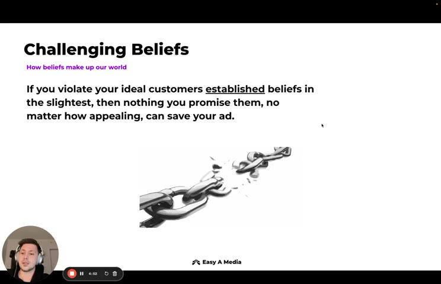
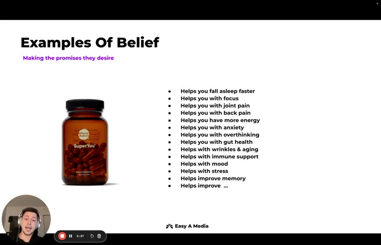
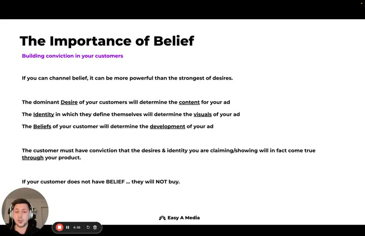
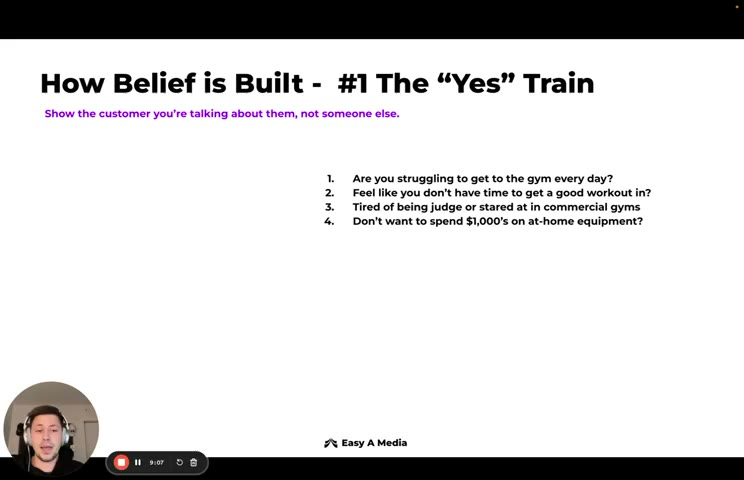
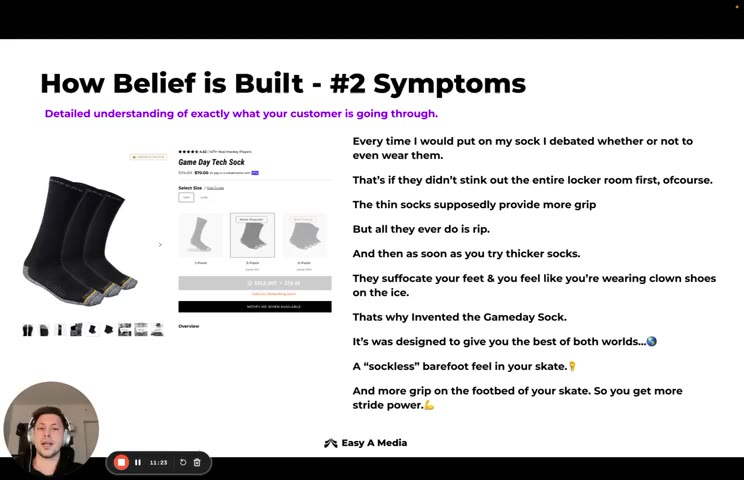
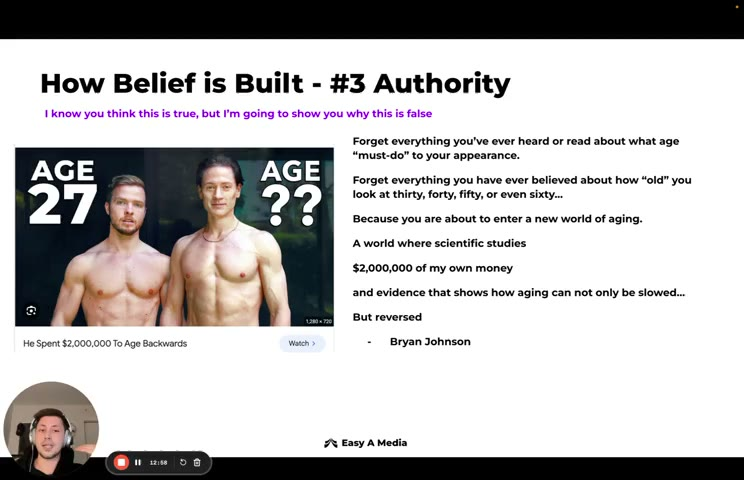
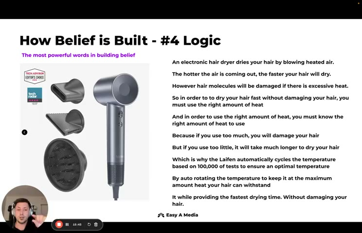

# 16. Market Belief
> Belief is the filter through which every ad passes ("the way your customers see reality"): you cannot challenge established beliefs head-on, you should not pile up promises, and you build belief with four techniques (the "yes" train, symptoms, authority, logic), which together with desire and identification decide whether anyone buys.

## 🤖 Agent use
- **Use when:** writing scripts or landing-page copy that must be believed; diagnosing why a good-looking ad does not convert; handling "too good to be true" claims; choosing between several proof devices.
- **Inputs → outputs:** research on the market's current beliefs, product beliefs, common objections and claims that sound too good to be true → copy built from one justifiable promise, plus a chosen belief-building device (yes train, symptoms, authority, logic) and a draft.
- **Rules:**
  - **DON'T** violate established beliefs: "If you violate your ideal customers established beliefs in the slightest, then nothing you promise them, no matter how appealing, can save your ad." [03:38–04:42]
  - **DON'T** stack promises. Strengthen "one justifiable promise" instead. [05:31]
  - **DO** let desire set the ad's content, identity set its visuals and belief set how the ad is built. [06:21–07:13]
  - **DO** use customers' logic, not yours, and show people with the same beliefs using the product. [01:49]
  - **DO** run the **yes train** to show you are speaking about them: a string of questions they answer "yes" to, before the product appears. [08:08–09:39]
  - **DO** detail the **symptoms** and problems so they think "this guy just gets it", proving you have been there. [09:39–12:06]
  - **DO** use **authority** when you must change a belief: acknowledge it bluntly and show strong evidence. [12:06–13:48]
  - **DO** use **logic**: each statement builds on the previous one so the conclusion cannot be disagreed with. [13:48–16:27]
  - **DO** research: current beliefs of the market, beliefs about your product, common objections, claims that sound too good to be true. [16:27]
- **See also:** [15. Market Identification](015-market-identification.md) · [14. Rule Of 1](014-rule-of-1-1-desire-avatar-message.md) · [49. Understanding Objections](049-understanding-objections.md) · [Beliefs (Evolve Copywriting)](../../copywriting/concepts/beliefs.md) · [Authority in ads (Evolve Copywriting)](../../copywriting/concepts/authority-in-ads.md) · [Why you need to understand beliefs](../../copywriting/lessons/15-why-you-need-to-understand-beliefs.md) · [Objection handling](../../copywriting/concepts/objection-handling.md)

Lesson page text: only a link to the slide deck (a Google Slides copy exported identically to the PPTX attachment).

## Key ideas

### What belief is and why it matters [00:00–02:47]
- Belief is the third piece "alongside desire and identification", "the trio that basically drives all of your results". It may be "one of the main reasons" customers do not purchase. [00:00–00:55]
- Slide 2: "Your customers mental picture of the world they live in. People believe in certain ways. These beliefs form a filter through which your product must pass or be rejected. Your ad MUST fit in with your customers version of 'facts'. You leverage your CUSTOMERS logic, not your own, to prove that your product works, to prove that people with their belief system rely on your product, and prove no other product satisfies his specific needs as well." [00:55–01:49]
- Show "there are people with similar beliefs who... are currently using our product" to get the dream outcome and embrace the identity. [01:49–02:47]

### Rule 1: you can't challenge established beliefs [02:47–04:42]
- Exaggerated example: tell someone they were not born on Earth but on the exoplanet "Kepler-452b" (spoken "Kepler-425b" then "452B"; Whisper) and were shipped here as a baby. Even if true, "you would just scroll right past it". [02:47–03:38]
- Slide 4 states the rule (above). He recalls someone (possibly Hormozi, he is unsure) saying "we question every belief except for the ones that we truly believe". [03:38–04:42]
- "Challenging beliefs is the number one mistake that we see a lot of people make. And a lot of times you don't even realize that you're doing it." [04:42]

### Rule 2: too many promises [04:42–06:21]
- Example: "Moon Juice" supplement (slide shows the "SuperYou" bottle) that "helps you fall asleep faster; focus; joint pain; back pain; more energy; anxiety; overthinking; gut health; wrinkles & aging; immune support; mood; stress; memory" and more. [04:42–05:31]
- "What doesn't this thing do, right?" Even if all true ("I can look like Michael B. Jordan after taking all of these supplements") it is "so hard to believe". Piling promises on promises instead of "building believability and strengthening one justifiable promise" is a common marketer mistake, especially in supplements. [05:31–06:21]

### Belief outranks desire [06:21–08:08]
- "If you can channel belief, it can be more powerful than the strongest of desires." He cites cults as masters of channelling belief. [06:21]
- How the three work together (slide 7): the dominant **desire** determines the **content** of your ad; the **identity** determines the **visuals**; the **beliefs** determine the **development** of the ad. "If your customer does not have BELIEF... they will NOT buy." [06:21–07:13]
- Anecdote (instructor, unsourced): a newspaper offered $100 to anyone who cut out the ad and mailed it in; nobody did because the claim was "too good to be true". [07:13–08:08]

### How belief is built: four techniques [08:08–16:27]
| # | Technique | Slide statement | How it works | Source |
|---|---|---|---|---|
| 1 | The "Yes" train | Show the customer you're talking about them, not someone else | A run of questions the right person answers "yes" to; those who answer "no" self-exclude (good). Once in the "yes" group, your recommendations "carry more weight". | [08:08–09:39] |
| 2 | Symptoms | Detailed understanding of exactly what your customer is going through | Detail the symptoms/problems that are their reasons for needing the product; "prove that you have been there yourself"; shared problems | [09:39–12:06] |
| 3 | Authority | "I know you think this is true, but I'm going to show you why this is false" | "Come out bluntly & acknowledge the current beliefs", show strong authority for the new belief; "not looking for agreement, you are loosening previous beliefs to create new ones - that serve your customer better" | [12:06–13:48] |
| 4 | Logic | The most powerful words in building belief | Prove the product works through bulletproof logical thinking, one statement leading into the next; "he has been shown PROOF that it works" | [13:48–16:27] |

#### 1. The "Yes" train [08:08–09:39]
- Gym example for the "BRRRN board" (slide spelling; spoken "burn board"): "Are you struggling to get to the gym every day?" / "Feel like you don't have time to get a good workout in?" / "Tired of being judged or stared at in commercial gyms?" / "Don't want to spend $1,000s on at-home equipment?" / "So you just give up on your fitness goals entirely?" / "Then you've experienced what millions of others have" / "Which is why the BRRRN board allows you to take your fitness goals in a whole new direction." [08:08–09:39]
- A professional athlete who goes to the gym daily answers "no", "which is great because I don't want to sell to that person". [08:08]
- After the questions "then I could obviously go on to say, here's why the burn board is so great", answering each objection (at-home, no thousands, 30-minute workout). [09:39]

#### 2. Symptoms [09:39–12:06]
- Hockey-sock script (see templates) calls out the pain points: socks that stink out the locker room, thin socks that rip, thick socks that "suffocate your feet and you feel like you're wearing clown shoes on the ice". Instructor calls it "very, very sloppy copy that I've written here, but you get the idea". [09:39–11:12]
- Contrast: "doesn't rip" versus "sacred material to avoid rips and antimicrobial so it doesn't stink" (Whisper "sacred"; unclear). "Telling a story that you're in their position" is more powerful. [11:12–12:06]

#### 3. Authority [12:06–13:48]
- Example (slide, Bryan Johnson, "He Spent $2,000,000 To Age Backwards"): "Forget everything you've ever heard or read about what age 'must-do' to your appearance. Forget everything you have ever believed about how 'old' you look at thirty, forty, fifty, or even sixty... Because you are about to enter a new world of aging. A world where scientific studies, $2,000,000 of my own money and evidence that shows how aging can not only be slowed... But reversed." [12:06–13:03]
- The instructor says Johnson has "so much evidence and... such an authority"; compare someone "eating Doritos, drinking Diet Coke" claiming aging doesn't exist. For the Kepler example, "photos of you in a pod" or a vlog would be the evidence. [13:03–13:48]
- "Make sure you acknowledge the current belief... Don't just talk about how you can start reversing aging." [13:48]

#### 4. Logic [13:48–16:27]
- Slide text (hairdryer client, Laifen): see templates. "Each statement is being built on one another, and everything is in agreement." The reader cannot disagree with "an electronic hair dryer dries your hair by blowing heated air" or "the hotter the air, the faster your hair will dry". "This is a bulletproof argument." [14:37–15:30]
- He uses the same pattern on sales calls: "let's play this out", "you invest X, by month..., this is what will happen". "At the end of the day, that is logic." [15:30–16:27]
- "Prove your product works through logical thinking." [15:30]

### How to create belief: research [16:27–17:44]
- "Research, research, research." Ask: current beliefs of the market; current beliefs around your product; most common objections; claims that sound too good to be true. These "areas that you need to build more belief". [16:27]
- Resource: *Breakthrough Advertising* ("this book helped triple my business", instructor claim; Whisper "purchasing through advertising"). Slide: "Belief is the final component to ensuring your customer has enough conviction to purchase your product." "There's a lot more to come around belief." [17:15]

## Steps / framework
1. Research and list: market beliefs, product beliefs, objections, claims that sound too good to be true.
2. Check the draft claim against those beliefs; if it contradicts an established belief, rework (do not attack head-on).
3. Cut to one justifiable promise.
4. Choose the device: yes-train opener (call the person out), symptoms (prove you have been there), authority (change a belief with strong evidence), logic (chain statements to the product).
5. Feed desire to the content, identity to the visuals, belief to the build of the ad.
6. Prefer proof that comes from the customer's own logic and from people like them.

## Examples
- **Kepler-452b "born elsewhere":** extreme example of a belief you cannot challenge. [02:47–04:42]
- **Moon Juice SuperYou:** too many promises. [04:42–06:21]
- **$100 newspaper offer:** a claim so outrageous nobody acted. [07:13–08:08]
- **BRRRN board yes train**, **Game Day Tech Sock symptoms**, **Bryan Johnson authority**, **Laifen hairdryer logic**: full texts below. [08:08–16:27]
- **Hairdryer failures in lesson 12:** the same hairdryer client's "fast hair drying without heat damage" claim was shared by about seven competitors; the logic script above builds the believable mechanism ([12. Market Sophistication](012-market-sophistication.md)).

## Structured units

### Rewrites
| Before | After | What changed (verb / visual / promise / self / intensity) | Source |
|---|---|---|---|
| "Doesn't rip" (generic claim) | Story of thin socks that rip and thick socks that suffocate, then the Game Day sock | Promise made concrete through symptoms; instructor in the customer's position | [11:12–12:06] |
| "Aging doesn't exist" (unsupported) | "Forget everything you've ever believed about how old you look... $2,000,000 of my own money" (Bryan Johnson) | Authority and evidence; belief acknowledged and loosened | [12:06–13:48] |
| A long claim list (slide: 13 "Helps you..." lines plus "…") | One justifiable promise | Fewer promises; more belief (derived from the instructor's advice) | [05:31–06:21] |

### Templates
| Template | Use for | Example fill | Source |
|---|---|---|---|
| Series of 4-5 yes-questions about the avatar's struggles, then "Then you've experienced what millions of others have", then "Which is why [product] allows you to [new direction]" | Opening copy that makes the reader self-select | BRRRN board script above | [08:08–09:39] |
| "[Daily frustration]. That's if [worse thing]. [Thin option] supposedly [promise], but all they ever do is [failure]. And as soon as you try [alternative], [new failure]. That's why [we] invented [product]." | Symptom story from the creator's POV | Game Day sock | [09:39–11:12] |
| "I know you think X is true, but I'm going to show you why it is false. Forget everything you've [heard/believed]... Because you are about to enter [new world]. [Evidence + authority]." | Replacing a false belief | Bryan Johnson aging | [12:06–13:03] |
| Statement chain: [fact everyone accepts] → [fact] → [however problem] → [so you need X] → [to know X you must Y] → [too much/too little] → [which is why product does Y] | Logic proof of a mechanism | Laifen hairdryer | [14:37–15:30] |

## Prompts / templates (verbatim)
Yes-train script (slide 8):
```text
Are you struggling to get to the gym every day?
Feel like you don't have time to get a good workout in?
Tired of being judge or stared at in commercial gyms
Don't want to spend $1,000's on at-home equipment?
So you just give up on your fitness goals entirely?
Then you've experienced what millions of others have
Which is why the BRRRN board allows you to take your fitness goals in a whole new direction.
```

Symptoms script (slide 10; the instructor says it is sloppy and some words are as on the slide):
```text
Every time I would put on my sock I debated whether or not to even wear them.
That's if they didn't stink out the entire locker room first, ofcourse.
The thin socks supposedly provide more grip
But all they ever do is rip.
And then as soon as you try thicker socks.
They suffocate your feet & you feel like you're wearing clown shoes on the ice.
Thats why Invented the Gameday Sock.
It's was designed to give you the best of both worlds...
A "sockless" barefoot feel in your skate.
And more grip on the footbed of your skate. So you get more stride power.
```

Authority script (slide 12):
```text
Forget everything you've ever heard or read about what age "must-do" to your appearance.
Forget everything you have ever believed about how "old" you look at thirty, forty, fifty, or even sixty...
Because you are about to enter a new world of aging.
A world where scientific studies
$2,000,000 of my own money
and evidence that shows how aging can not only be slowed...
But reversed
- Bryan Johnson
```

Logic script (slide 14, hairdryer):
```text
An electronic hair dryer dries your hair by blowing heated air.
The hotter the air is coming out, the faster your hair will dry.
However hair molecules will be damaged if there is excessive heat.
So in order to dry your hair fast without damaging your hair, you must use the right amount of heat
And in order to use the right amount of heat, you must know the right amount of heat to use
Because if you use too much, you will damage your hair
But if you use too little, it will take much longer to dry your hair
Which is why the Laifen automatically cycles the temperature based on 100,000 of tests to ensure an optimal temperature
By auto rotating the temperature to keep it at the maximum amount heat your hair can withstand
It while providing the fastest drying time. Without damaging your hair.
```

Research questions (slide 16):
```text
Research, research, research.
What are the current beliefs of the market?
What are the current beliefs around your product?
What are the most common objections?
What are the claims that sound too good to be true?
```

## Screenshots

*The rule: violating an established belief means nothing else you promise can save the ad. [04:50]*


*Too many promises: believability collapses. [05:37]*


*How desire, identity and belief divide the work of an ad. [06:30]*


*The yes train: questions that make the right person say yes. [09:05]*


*Symptoms: describe the sock problems in detail before introducing the product. [11:20]*


*Authority: acknowledge the old belief, then bring evidence ($2,000,000, studies). [12:55]*


*Logic: each sentence builds on the last until the product is the only conclusion. [15:40]*

## How to apply
- [ ] List the market's beliefs, product beliefs, objections and "too good to be true" claims from research.
- [ ] Reduce each ad to one justifiable promise.
- [ ] Open with a yes train of 4-5 questions that only your avatar answers yes to.
- [ ] Add 3-5 specific symptoms in the customer's words.
- [ ] If you must change a belief, write: acknowledge, evidence, new belief.
- [ ] Write the mechanism as a logic chain; remove any step the customer can dispute.
- [ ] Check: does anything in the ad contradict something the customer already believes?

## Related
- Previous: [15. Market Identification](015-market-identification.md) · Next: [17. Overview & Self Onboarding](017-overview-self-onboarding.md)
- [12. Market Sophistication](012-market-sophistication.md) · [Unique mechanism (Evolve Copywriting)](../../copywriting/concepts/unique-mechanism.md) · [Beliefs (Evolve Copywriting)](../../copywriting/concepts/beliefs.md) · [Why you need to understand authority](../../copywriting/lessons/16-why-you-need-to-understand-authority.md)

## Sources and limitations
- Transcript: [16. Market Belief….txt](<../../../../../raw/evolve/start-here/_transcripts/👣 Evolve (Start Here)/16. Market Belief 👣 Evolve (Start Here) Evolve.txt>) · Page text: [16. ….html.md](<../../../../../raw/evolve/start-here/_extracted/👣 Evolve (Start Here)/16. Market Belief_👣 Evolve (Start Here)_Evolve.html.md>) · Slides: [16. Market Belief.pptx.md](<../../../../../raw/evolve/start-here/_extracted/👣 Evolve (Start Here)/16. Market Belief.pptx.md>) · linked export [16-presentation-1zTbgkLYcZ.pptx.md](../../../../../raw/evolve/start-here/_extracted/_linked/google/16-presentation-1zTbgkLYcZ.pptx.md)
- Machine transcription (Whisper large-v3-turbo). Full recording covered (last segment 17:43 of 17:44). Instructor not named (deck branding "Easy A Media"): `unverified`.
- Whisper spellings: "Kepler-425b / 452B" (real exoplanet is Kepler-452b), "burn board" (slide: "BRRRN board"), "Lifan" (slide: "Laifen"), "sacred material" (unclear), "Purchasing through advertising" (the book is *Breakthrough Advertising*). The slide says "100,000 of tests"; the audio says "hundreds of thousands of tests". The final slide says "Dive Deeper into desire" (slide typo; the topic is belief).
- Claims by the instructor (not verified): Bryan Johnson's results and spend, the book tripling his business, the newspaper $100 anecdote, the "Hormozi" attribution.
- The instructor says "the EZA yes train" in speech; "EZA" is likely Whisper noise or a house brand name (unclear).
