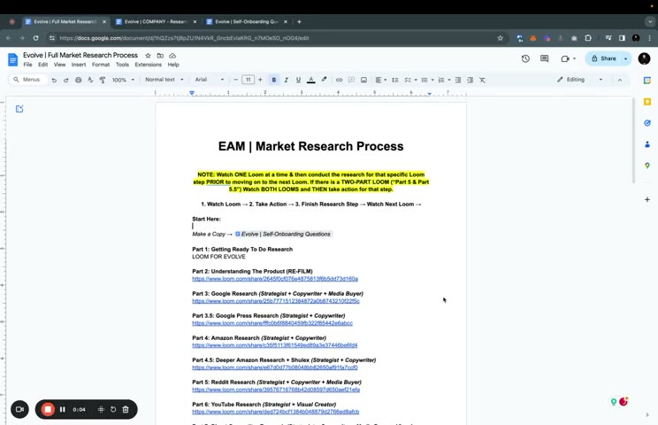
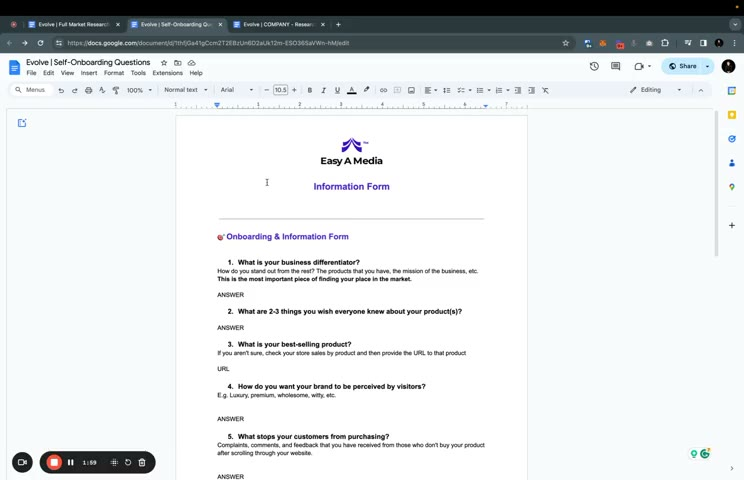

# 17. Overview & Self Onboarding
> Opens the research module: do the research one module at a time, and first "onboard yourself" with a questionnaire so you can compare your beliefs about the business before and after you study the market.

## 🤖 Agent use
- **Use when:** starting any new brand or product research run, before touching competitors, reviews or ad libraries.
- **Inputs → outputs:** the brand's own knowledge (founder answers, store, best sellers) → a filled self-onboarding form (see [18. Action Item: Self Onboarding](018-action-item-self-onboarding.md)) that becomes the "before" baseline.
- **Rules:**
  - **DO** run research as a loop: watch/read one module → take action → finish that research step → move to the next. The page text says: "1. Watch Module → 2. Take Action → 3. Finish Research Step → Watch Next Module." [page text]
  - **DON'T** read or run all 20+ research modules in one pass. The page warns that doing so means "your brain will be OVERWHELMED with information and you will not do any research." [page text]
  - **IF** a module has two parts (Part 1 and Part 2) **THEN** consume both before acting on that step. [page text]
  - **DO** fill the self-onboarding form first, then compare it with what the market research says at the end. [02:00–03:20]
  - **DON'T** treat "I did some research" as done. The instructor says you have not done research "until you go through what I'm about to show you in this process." (instructor claim) [01:20]
- **See also:** [18. Action Item: Self Onboarding](018-action-item-self-onboarding.md) · [19. Getting Ready To Do Research - Part 1](019-getting-ready-to-do-research-part-1.md) · [Customer research stack](../../../../frameworks/customer-research-stack.md) · [Competitor landscape audit](../../../../playbooks/competitor-landscape-audit.md)

## Key ideas

### Why the research process exists [00:00–01:50]
- The instructor's agency bottleneck was "trying to understand why things were actually working" and "how to come up with new ideas." [00:00]
- His team's creative strategy had been shallow: "essentially Twitter and whatever influencers were posting, whatever hooks were trending that month, and Foreplay" (Foreplay is the ad-library app of that time; later lessons replace it with Atria, see [19](019-getting-ready-to-do-research-part-1.md)). [00:00–00:54]
- He says this research process "transformed the way that we have done business" and let them "predictably grow" brands (instructor claim). [00:54]
- Credit: Nick Theriot "very much so" helped him understand research; the process mixes what he learned from Nick, what the agency built, and what he learned from others. [01:20–01:50]

### "Onboard yourself" before researching [01:50–03:20]
- Normally the agency collects an onboarding form from the client. Here you answer it for your own business "as if you were filling out an onboarding form to work with an agency." [02:45]
- Purpose: record how you currently see the business, then "compare that to where we're going to be at after you actually understand the market." [01:50]
- Steps he names: open the document, make a copy, fill in the questions. The first two he reads out: "What is your business differentiator? How do you stand up from the rest?" ("one of the most important things for you to call out") and "What are two to three things you wish everyone knew about your product?" Others he mentions: best-selling products, "How do you want your brand to be perceived?" [01:50–02:45]
- He says "about 11 questions"; the exported doc has 10 numbered questions (full list in [18](018-action-item-self-onboarding.md)). [02:45]

## Steps / framework
The research modules that follow, as listed on the "EAM | Market Research Process" doc shown on screen at [00:04] (the role tags are the instructor's):

| Part | Module | Roles tagged on screen |
|---|---|---|
| Start Here | Make a copy of the "Evolve \| Self-Onboarding Questions" doc | — |
| 1 | Getting Ready To Do Research | — |
| 2 | Understanding The Product (RE-FILM) | — |
| 3 | Google Research | Strategist + Copywriter + Media Buyer |
| 3.5 | Google Press Research | Strategist + Copywriter |
| 4 | Amazon Research | Strategist + Copywriter |
| 4.5 | Deeper Amazon Research + Shulex | Strategist + Copywriter |
| 5 | Reddit Research | Strategist + Copywriter + Media Buyer |
| 6 | YouTube Research | Strategist + Visual Creator |

The list continues below the visible part of the screenshot; the rest is not shown in this video.

## Examples
- None. The lesson is process framing. The worked example (a hair dryer brand) starts in [22](022-understanding-your-product-part-1.md).

## Prompts / templates (verbatim)
From the lesson page text (the page says you do not need the Google doc; the videos are the modules):
```text
REMINDER: IF you just watch these next 20+ modules in a row without taking action... Your brain will be OVERWHELMED with information and you will not do any research.

SO... You need to watch ONE module at a time & THEN conduct the research for that specific module before moving on to the next one.

If there is a TWO-PART Module ("Part 1 & Part 2") Watch BOTH Modules and THEN take action for that step.

1. Watch Module → 2. Take Action → 3. Finish Research Step → Watch Next Module
```

## Screenshots

*The "EAM | Market Research Process" doc: the ordered research parts (Google, Press, Amazon, Reddit, YouTube...) and the one-module-at-a-time rule in the yellow note. [00:05]*


*The "Easy A Media" Information Form that the student copies and fills out: question 1 is the business differentiator. [02:00]*

## How to apply
- [ ] Copy the self-onboarding form and answer every question before opening any competitor or review source.
- [ ] Store the filled form where the research doc can link to it (see [19](019-getting-ready-to-do-research-part-1.md)).
- [ ] Run one research module at a time and finish its output before starting the next.
- [ ] At the end of research, re-read the self-onboarding answers and log what changed.

## Related
- Previous: [16. Market Belief](016-market-belief.md) · Next: [18. Action Item: Self Onboarding](018-action-item-self-onboarding.md)
- Sister course on research-to-angles: [Avatars and angles](../../copywriting/concepts/avatars-and-angles.md)

## Sources and limitations
- Transcript: [17 transcript](<../../../../../raw/evolve/start-here/_transcripts/👣 Evolve (Start Here)/17. Overview & Self Onboarding 👣 Evolve (Start Here) Evolve.txt>) · Page text: [17 page](<../../../../../raw/evolve/start-here/_extracted/👣 Evolve (Start Here)/17. Overview & Self Onboarding_👣 Evolve (Start Here)_Evolve.html.md>) · Form: [self-onboarding doc](../../../../../raw/evolve/start-here/_extracted/_linked/google/18-document-184VerkTvv.docx.md)
- Machine transcription (Whisper). Full recording covered (last segment 3:40 of 3:41). Whisper writes "loom" for the screen-recording videos and "4Play"/"Foreplay" inconsistently elsewhere; here it is "Foreplay".
- The instructor's surname is not stated in this video. Frame timestamps in the screenshots are of the on-screen recorder, not the lesson timeline.
