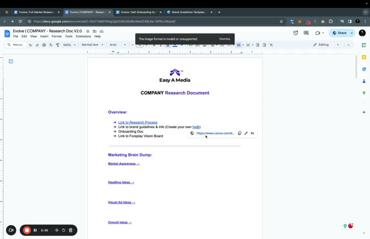
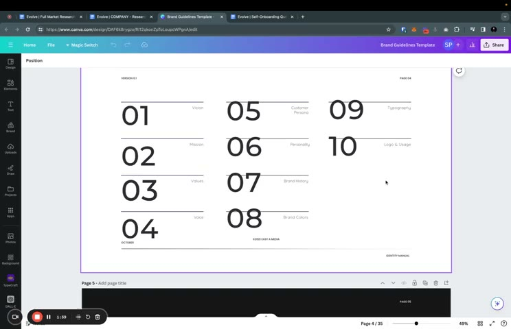
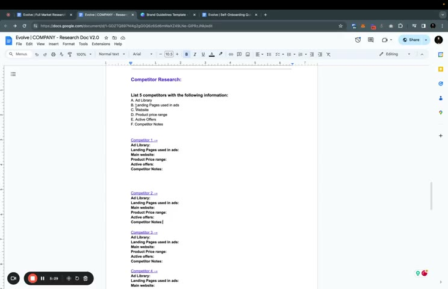

# 19. Getting Ready To Do Research - Part 1
> Set up the single document where all research lives (quick links, brand guidelines, onboarding doc, ad-library tool, brain dump), and do not let missing brand guidelines block you.

## 🤖 Agent use
- **Use when:** creating the research workspace for a brand before any source research (Google, Amazon, Reddit, YouTube, competitors).
- **Inputs → outputs:** brand name, website, onboarding doc ([18](018-action-item-self-onboarding.md)), brand guidelines if they exist, ad-library tool access → a copied research doc with its header links filled and an empty "brain dump" area for ideas.
- **Rules:**
  - **DO** copy the research doc, rename it for the brand, and link the research-process doc, brand guidelines, onboarding doc and the ad-library board at the top so you can come back after "a couple of days". [00:00–00:52, 03:27]
  - **DO** use the "brain dump" area for any headline, visual ad, or overall idea that appears during research instead of trying to remember it. [04:11]
  - **DON'T** spend days building brand guidelines before research. "If you do not have brand guidelines, I do not want you to spend the next three days building on a brand guidelines document." [01:51]
  - **IF** brand guidelines exist **THEN** link them in the research doc. [02:35]
  - **DON'T** rush through the doc sections now. "This is just an overview video." [05:31]
  - **IF** the lesson text says Foreplay **THEN** read it as Atria: the page notes "We are NO LONGER using Foreplay"; the team merged over to Atria. [page text]
- **See also:** [20. Getting Ready To Do Research - Part 2](020-getting-ready-to-do-research-part-2.md) · [21. Action Item: Copy Research Document](021-action-item-copy-research-document.md) · [41. Creative Research - Part 1 (Atria)](041-creative-research-part-1-atria.md) · [Customer research stack](../../../../frameworks/customer-research-stack.md)

## Key ideas

### One document holds all research [00:00–00:52]
- Make a copy of the research doc, update the company name in the title and header (or delete the placeholder), and add quick links so you can "go back and check certain things." The research process doc stays linked from it. [00:00]
- Next link: brand guidelines and info. [00:00–00:52]

### Brand guidelines: useful, not a blocker [00:52–03:27]
- He gives access to a Canva template of "our entire brand guidelines document that we used to charge a lot of money for." [00:52]
- What a guidelines document forces you to answer (his list): vision, mission, brand values, brand voice, "what do I want them to think" when they hear the brand name, customer persona, personality type, brand history, colors/typography, logo and usage. [00:52–01:51] The Canva template's table of contents shows ten sections (see screenshot).
- Priority call: "We have worked with brands doing over $200,000 a month without a brand guidelines document" (instructor claim). Guidelines "are not going to make or break your ads." Treat them as a weekend project or something to hand a team member. [01:51–02:35]
- His rant: if you have no reason or "why" beyond making money, that could be "one of the main reasons why people aren't buying your stuff because they can see you right through it." (instructor opinion) [02:35]
- Later he repeats that he has seen "million dollar brands without brand guidelines," but they matter "as you begin to scale and become a real brand." (instructor claim) [05:31]

### Onboarding doc and ad-library tool [03:27–04:11]
- Paste the filled onboarding doc link into the research doc. [03:27]
- The video links a "Foreplay vision board." He recommends at least the free trial: "Foreplay.co... I believe it's 49 bucks a month," and a seven-day free trial (he is unsure). "It's not make or break. You don't have to use this software." [03:27–04:11]
- Update (page text, later than the video): "We are NO LONGER using Foreplay - We have merged over to a better platform over on Atria." Atria is covered in the "Creative Research" step ([41](041-creative-research-part-1-atria.md)).

### The research doc's sections (overview only) [04:11–05:31]
- **Brain dump:** "any kind of headline ideas, visual ad ideas, overall ideas that you get while doing research rather than trying to store them, just jot them down." You will come back to them "to start creating your ads." [04:11]
- **Company/product block:** who is the company; are the products physical; functional functions; features; benefits; potential competitive advantages; common use cases; reviews; bad direct competitor reviews; indirect competitor reviews; buzz/niche words; wants and needs; what customers do not want; who the potential customer is now; day-to-day struggles. [04:11–05:00]
- **Competitor research** section and **creative audit** ("basically help you actually audit your ad account"), covered in later lessons. [05:00–05:31]
- "This is not like a do or die. You don't have to follow this exactly. Just know that these are areas that we look at." [04:11]

## Steps / framework
1. Copy the research doc; rename for the brand.
2. Add header quick links: research process, brand guidelines (if any), onboarding doc, ad-library board.
3. Leave the brain-dump area empty until research starts.
4. Do not fill the rest yet; each source gets its own module.

## Prompts / templates (verbatim)
Brand-guidelines template sections (from the Canva contents page shown at 02:00):
```text
01 Vision
02 Mission
03 Values
04 Voice
05 Customer Persona
06 Personality
07 Brand History
08 Brand Colors
09 Typography
10 Logo & Usage
```
(The small on-screen text was read from a 744x480 frame; section names 05-08 are the least legible.)

## Screenshots

*The company research doc v2.0: Overview links (research process, brand guidelines, onboarding doc, Foreplay vision board) and the "Marketing Brain Dump" headings. [00:55]*


*The Canva brand-guidelines template's ten-section contents page. [02:00]*


*Competitor Research block: for each competitor list ad library, landing pages used in ads, website, product price range, active offers, competitor notes. [05:30]*

## How to apply
- [ ] Copy the research doc, rename it, fill header links.
- [ ] Link brand guidelines if they exist; if not, note "none yet" and continue.
- [ ] Set up an ad-library board in the current tool (Atria, see [41](041-creative-research-part-1-atria.md)); do not rely on the Foreplay mention.
- [ ] Add every idea that surfaces during research to the brain dump with its source.

## Related
- Previous: [18. Action Item: Self Onboarding](018-action-item-self-onboarding.md) · Next: [20. Getting Ready To Do Research - Part 2](020-getting-ready-to-do-research-part-2.md)
- [Competitor landscape audit](../../../../playbooks/competitor-landscape-audit.md)

## Sources and limitations
- Transcript: [19 transcript](<../../../../../raw/evolve/start-here/_transcripts/👣 Evolve (Start Here)/19. Getting Ready To Do Research - Part 1 👣 Evolve (Start Here) Evolve.txt>) · Page text: [19 page](<../../../../../raw/evolve/start-here/_extracted/👣 Evolve (Start Here)/19. Getting Ready To Do Research - Part 1_👣 Evolve (Start Here)_Evolve.html.md>)
- Machine transcription. Whisper wrote "4Play" for Foreplay and "EAM" appears on screen as the agency name (Easy A Media). Full recording covered (369.83 s).
- The Foreplay price and trial length are the instructor's recollection ("I believe").
- The research doc itself is covered in [21](021-action-item-copy-research-document.md); the Canva template is linked from there but its contents were not fetched beyond the contents page above.
