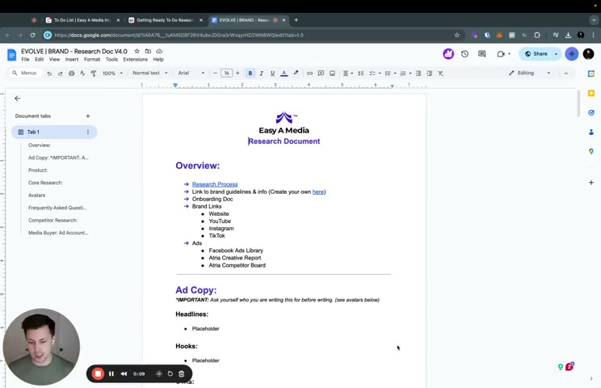
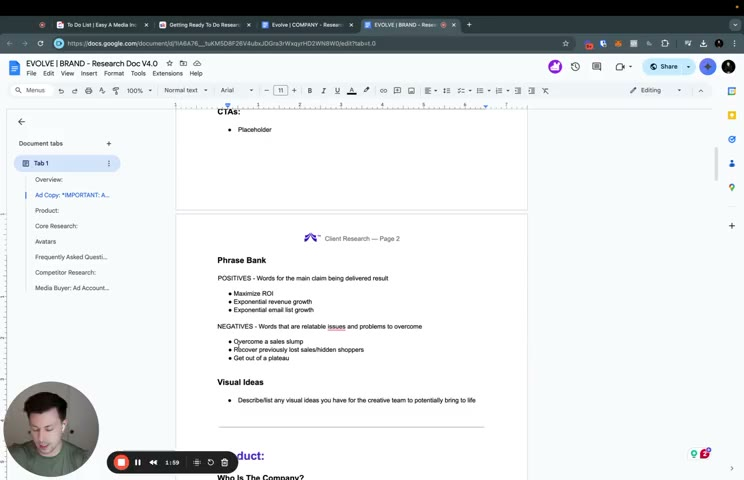
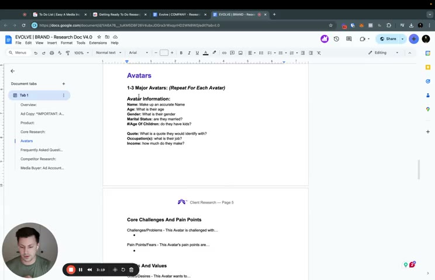
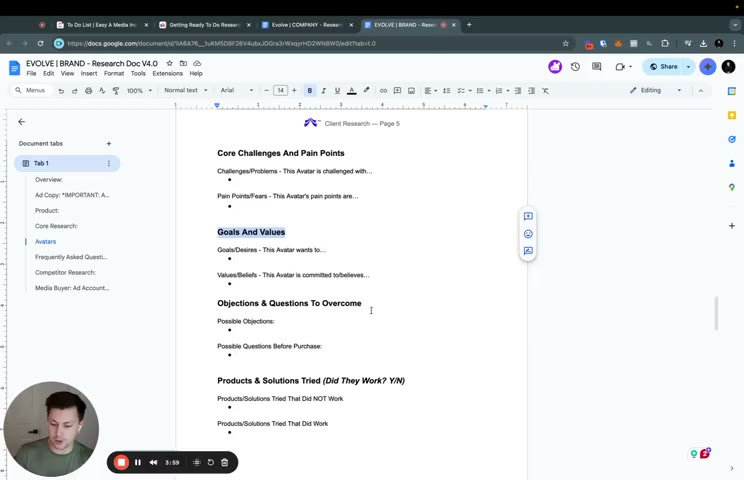

# 20. Getting Ready To Do Research - Part 2
> Walkthrough of the revised (v4) research doc: brand links, ad copy bank with a "phrase bank", visual ideas, product block, core problems and solutions, avatar block, FAQ, competitor and ad-account audit.

## 🤖 Agent use
- **Use when:** structuring the output of any research run, or deciding where a finding goes (copy ideas, visual ideas, objections, FAQs, avatars).
- **Inputs → outputs:** raw findings from research sources → entries filed under the right research-doc headings, with phrase-bank words, visual ideas and FAQ items kept separate from facts.
- **Rules:**
  - **DO** quick-link the website, YouTube, Instagram, TikTok, Facebook Ads Library and the Atria creative report/competitor board at the top of the doc. [00:36–01:26]
  - **DO** keep a **phrase bank** with two lists: positives (words for the main claim/result) and negatives (relatable problems to overcome). [01:26–02:00]
  - **DO** write visual ideas as soon as they occur, even odd ones. His examples for a hair dryer: "someone with like a bunch of foam in their hair" or "someone who like has their hair on fire." [01:59–02:40]
  - **DO** make problems-and-solutions explicit: "here's a problem. Here's all of the solutions and try to list as many of them as you can." [02:40–03:30]
  - **IF** research shows customers repeatedly asking the same questions **THEN** log them in the FAQ section, update the store's FAQ/product page if missing, and treat them as possible ad ideas. [04:07–05:04]
  - **DON'T** build avatars with this template alone: the page says the newer "How To Create Avatars" training makes this style outdated ("how we are building avatars in 2026"). [page text] (See [74. How To Build Core Avatars](074-how-to-build-core-avatars.md).)
- **See also:** [21. Action Item: Copy Research Document](021-action-item-copy-research-document.md) · [74. How To Build Core Avatars](074-how-to-build-core-avatars.md) · [Labels and customer language](../../copywriting/concepts/labels-and-customer-language.md) · [Avatars and angles](../../copywriting/concepts/avatars-and-angles.md)

## Key ideas

### Why a revised doc [00:00–00:36]
- "It's Spencer from the future again": the team rebuilt its research doc when it merged its project management from Monday to ClickUp. The new doc is "very similar to the existing one." The old one is still in the lessons because he likes its questions and layout. [00:00]
- The page text labels the new one "UPDATED Research Doc Overview (make a copy in next step below)" ([21](021-action-item-copy-research-document.md)).

### Brand links and ad tools [00:36–01:26]
- The doc works like a "brand Bible": quick links to website, YouTube channel, Instagram, TikTok, Facebook Ads Library and the Atria creative report. [00:36]
- "We're no longer using Foreplay and we have moved over to Atria"; a link explains why in the Creative Research step ([41](041-creative-research-part-1-atria.md)). [00:36–01:26]

### Ad copy bank and phrase bank [01:26–02:40]
- New area for headlines, hooks, hook ideas and CTAs. [01:26]
- **Phrase bank** = "positive frames" (words for the main claim being delivered) and negatives ("words that are relatable issues and problems to overcome"). The doc's placeholder examples are agency-marketing phrases (see verbatim list below). [01:26–01:59]
- **Visual ideas** area. He notes UGC/creator-brief content is coming later. [01:59–02:40]

### Product block, core research, avatars [02:40–04:07]
- Product block: who is the company, what are the products, what they do, use cases, features, benefits, desires, reviews. "Similar to like that self-onboarding, but just organizing it here." [02:40]
- Core research: "core problems here, other problems here", then good comparative reviews, bad comparative reviews, buzzwords. [02:40–03:30]
- Avatar section is "the biggest thing that we've added": name, age, gender, marital status, age of children (only if it matters for the product), quote, occupation and income (ballpark, if it makes sense). [03:30]
- "A lot of the value" is in the next fields: core challenges and pain points, goals and values, objections and questions, and products/solutions tried that did not work. [03:30–04:07]

### FAQ, competitor research, ad-account audit [04:07–05:04]
- FAQ section: if you notice people asking questions, "make sure you take this after your research process and also update this on your store." [04:07]
- Competitor research and the media-buying ad-account audit are "basically the same" as before, "slightly more organized." [04:07–05:04]

## Steps / framework
Sections of the v4 research doc in order, per the video and the doc outline panel on screen: Overview, Ad Copy, Product, Core Research, Avatars, Frequently Asked Questions, Competitor Research, Media Buyer: Ad Account Audit. Full verbatim text is in [21](021-action-item-copy-research-document.md).

## Examples
| Item | Content (as shown) | Source |
|---|---|---|
| Visual idea | Someone with a bunch of foam in their hair | [02:00–02:40] |
| Visual idea | Someone whose hair is on fire | [02:00–02:40] |
| Phrase bank, positive | Maximize ROI; Exponential revenue growth; Exponential email list growth | doc, Phrase Bank |
| Phrase bank, negative | Overcome a sales slump; Recover previously lost sales/hidden shoppers; Get out of a plateau | doc, Phrase Bank |

## Structured units
### Templates
| Template | Use for | Example fill | Source |
|---|---|---|---|
| Phrase bank: POSITIVES and NEGATIVES | Collecting claim words and problem words for copy | "Maximize ROI" / "Get out of a plateau" | doc, Phrase Bank |
| Avatar header: Name / Age / Gender / Marital Status / #/Age of Children / Quote / Occupation(s) / Income | Basic persona header (older template) | "Everyday girl" persona in [26](026-google-research-part-2.md) | [03:30], screenshot |

## Prompts / templates (verbatim)
Old avatar block shown on screen at 03:19 (research doc V4.0):
```text
Avatars
1-3 Major Avatars: (Repeat For Each Avatar)
Avatar Information:
Name: Make up an accurate Name
Age: What is their age
Gender: What is their gender
Marital Status: are they married?
#/Age Of Children: do they have kids?
Quote: What is a quote they would identify with?
Occupation(s): what is their job?
Income: how much do they make?
```
Remaining avatar fields at 03:59: Core Challenges And Pain Points (Challenges/Problems, Pain Points/Fears); Goals And Values (Goals/Desires, Values/Beliefs); Objections & Questions To Overcome (Possible Objections, Possible Questions Before Purchase); Products & Solutions Tried (Did They Work? Y/N).

## Screenshots

*Research Doc V4.0: Overview with Brand Links (website, YouTube, Instagram, TikTok) and Ads (Facebook Ads Library, Atria Creative Report, Atria Competitor Board), plus the outline of document tabs. [00:10]*


*Phrase Bank (positives and negatives) and Visual Ideas sections. [02:00]*


*The avatar block: name, age, gender, marital status, children, quote, occupation, income. The page text calls this style outdated. [03:20]*


*Avatar sub-blocks where "a lot of the value" is: goals and values, objections and questions, products and solutions tried that did or did not work. [04:00]*

## How to apply
- [ ] Use the v4 headings as the output schema for research runs.
- [ ] Fill the phrase bank during every source (positives and negatives).
- [ ] Log visual ideas immediately, including weird ones.
- [ ] For avatars, use the newer avatar training ([74](074-how-to-build-core-avatars.md)) rather than this template alone.
- [ ] Move repeated customer questions into the FAQ section and to the site's FAQ.

## Related
- Previous: [19. Getting Ready To Do Research - Part 1](019-getting-ready-to-do-research-part-1.md) · Next: [21. Action Item: Copy Research Document](021-action-item-copy-research-document.md)

## Sources and limitations
- Transcript: [20 transcript](<../../../../../raw/evolve/start-here/_transcripts/👣 Evolve (Start Here)/20. Getting Ready To Do Research - Part 2 👣 Evolve (Start Here) Evolve.txt>) · Page text: [20 page](<../../../../../raw/evolve/start-here/_extracted/👣 Evolve (Start Here)/20. Getting Ready To Do Research - Part 2_👣 Evolve (Start Here)_Evolve.html.md>) · Doc: [research doc export](../../../../../raw/evolve/start-here/_extracted/_linked/google/21-document-11LjJxW9nB.docx.md)
- Machine transcription. Last segment ends 311.76 s of 312.11 s (full coverage). The transcript says "Monday" for the PM tool; "ClickUp" is as spoken.
- "Life in" in the transcript is the hair dryer brand Laifen (confirmed by on-screen site/doc names in later lessons).
