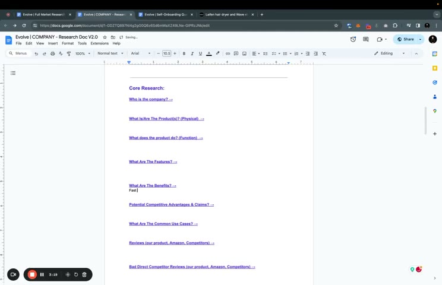
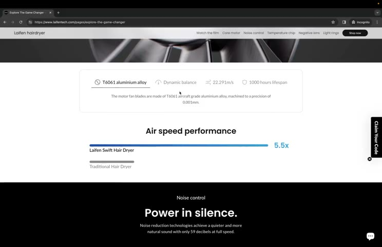

# 22. Understanding Your Product - Part 1
> First research step: understand your own product by reading your self-onboarding answers, then cold-reading your own website as a first-time visitor and logging features, benefits and claims.

## 🤖 Agent use
- **Use when:** starting product research for a brand or a client, before competitors or reviews; auditing whether a site communicates what the brand knows.
- **Inputs → outputs:** self-onboarding answers ([18](018-action-item-self-onboarding.md)) + the live website/landing page → filled research-doc fields: who is the company, what the product is and does, features, benefits, potential competitive advantages and claims, use cases.
- **Rules:**
  - **DO** start with the product. "Understanding your product is the first and most important thing." [00:00]
  - **DO** diagnose failure with three causes: (1) you do not understand where the product fits in the market, (2) you do not understand what the market wants, (3) you are failing to execute. [00:00]
  - **DO** compare your onboarding answers with what the website actually says; anything you know but the site does not say "you need to communicate that right away." [01:25]
  - **DO** cold-read the site in an incognito window "as a person that doesn't know" the brand, and write down what you learn as you go. [02:18–03:16]
  - **DO** separate features from benefits: "visible heat" is a feature, and "I don't really know how that's a benefit for me yet." [03:16]
  - **IF** a claim is third-party or credential-like (e.g. "celebrity hairstylist approved") **THEN** log it under potential competitive advantages and claims. [03:16]
  - **DON'T** fill the doc from memory alone: "this is all coming from your understanding of it first," then you go deeper into the market. [00:53]
- **See also:** [23. Understanding The Product - Part 2](023-understanding-the-product-part-2.md) · [24. Action Item: Understanding Product](024-action-item-understanding-product.md) · [57. Understanding Your Product - Part 1](057-understanding-your-product-part-1.md) · [Positioning exercise](../../copywriting/frameworks/positioning-exercise.md)

## Key ideas

### Why product understanding comes first [00:00–00:53]
- "Our ability to position your product in the market the right way is going to ultimately determine our success." [00:00]
- Failing ads have three causes (see rules). "You could understand what the market wants perfectly, but if you don't understand how your product fits in the market, you are not going to have success." [00:00]
- Action: reopen the self-onboarding questionnaire and note the business differentiator. [00:00–00:53]

### Fill the "company and product" part of the research doc [00:53–01:25]
- Fields to fill "as much as you can": who is the company, what are the products, features, benefits, what the product does, potential competitive advantages, common use cases. [00:53–01:25]

### Website cold-read exercise [01:25–04:13]
- Problem he names: you understand the product so well you have it "stored up in here" and in a Google Doc, "but you're not telling anybody about it." [01:25]
- Method: open the website in an incognito window, "turn my brain off completely," and see if you can work out what the product does. [02:18]
- His live narration on the Laifen site (the example brand; transcript says "Life in"): "it's a hairdryer. Fast drying, visible heat, celebrity hairstylist approved." He clicks "learn more," finds a film, and spends time watching it. [02:18–03:16]
- Notes he takes while reading: benefits seen right away = fast drying; feature = visible heat; potential competitive advantage/claim = celebrity hairstylist approved. [03:16]
- On the next page he logs features: "Super powerful 110,000 RPM motor," "1,000 hours lifespan," "airspeed performance, 5.5 times faster," "power and silence." [03:16–04:13]
- Goal of the whole pass: understand "the company... and then all of the products, use cases, features, physical, functional, benefits, advantages, claims." [03:16–04:13]
- A second video ([23](023-understanding-the-product-part-2.md)) shows the result for this brand. [04:13]

## Steps / framework
1. Re-read the self-onboarding answers; note differentiator, claims.
2. Open the site incognito; read it as a stranger; stop and write the first impression of what it is.
3. For each thing seen, log it as: physical product / function / feature / benefit / competitive advantage or claim / use case.
4. Mark features whose benefit is unclear (to explain later in ads).
5. List what you know that the site does not say; fix the site or mark it as an ad opportunity (derived).

## Examples
| Item seen on site | Logged as | Instructor's comment | Source |
|---|---|---|---|
| Fast drying | Benefit | seen "right away" | [03:16] |
| Visible heat | Feature | "I don't really know how that's a benefit for me yet" | [03:16] |
| Celebrity hairstylist approved | Potential competitive advantage / claim | credential-style proof | [03:16] |
| Super powerful 110,000 RPM motor | Feature | watch the video to learn why it matters | [03:16] |
| 1,000 hours lifespan | Feature | — | [03:16] |
| Airspeed performance 5.5x | Feature / comparative claim | "Wow" | [03:16] |
| Power and silence | Feature / benefit | — | [03:16] |

## Screenshots

*The older research doc's Core Research headings (who is the company, product physical, function, features, benefits, competitive advantages, use cases, reviews) that the cold-read fills. [03:20]*

*The Laifen product page being cold-read: motor material, lifespan, air speed performance 5.5x vs a traditional hair dryer, and a "Power in silence" noise section (the page text shows 59 decibels). [03:55]*

## How to apply
- [ ] Copy self-onboarding answers into the product block.
- [ ] Cold-read the site and log features, benefits, claims with the source URL.
- [ ] Highlight features without an obvious benefit and write the missing benefit.
- [ ] List claims the site makes that need proof before an ad uses them (never invent proof).
- [ ] Move on only after the product block is as complete as you can make it.

## Related
- Previous: [21. Action Item: Copy Research Document](021-action-item-copy-research-document.md) · Next: [23. Understanding The Product - Part 2](023-understanding-the-product-part-2.md)
- [Beliefs](../../copywriting/concepts/beliefs.md) · [Unique mechanism](../../copywriting/concepts/unique-mechanism.md)

## Sources and limitations
- Transcript: [22 transcript](<../../../../../raw/evolve/start-here/_transcripts/👣 Evolve (Start Here)/22. Understanding Your Product - Part 1 👣 Evolve (Start Here) Evolve.txt>) · Page text: [22 page](<../../../../../raw/evolve/start-here/_extracted/👣 Evolve (Start Here)/22. Understanding Your Product - Part 1_👣 Evolve (Start Here)_Evolve.html.md>)
- Machine transcription. Whisper heard "Life in" for the brand Laifen (on-screen: laifentech.com, "Laifen Swift Hair Dryer") and "iCognito" is the instructor's playful pronunciation of incognito. The page text contains only the watch-then-act reminder.
- The product numbers (110,000 RPM, 1,000 hours, 5.5x) are the brand's marketing claims as read aloud, not verified.
