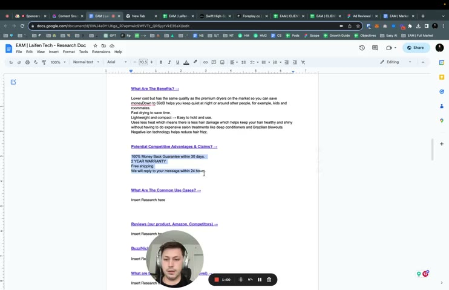
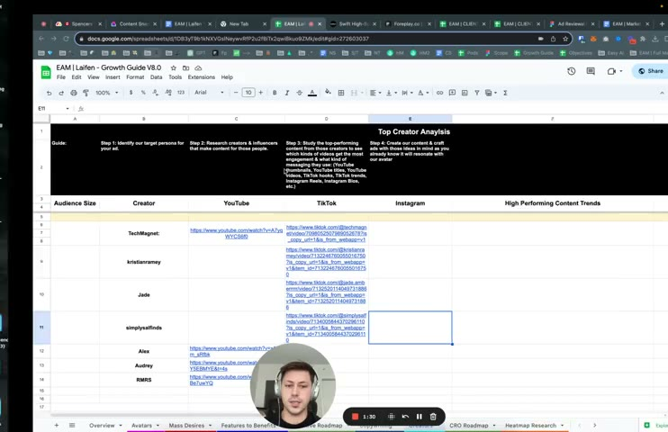

# 23. Understanding The Product - Part 2
> The result of the product pass for the example brand (a Laifen hair dryer): what a first-draft "product understanding" looks like, including features, claims, and two objections to handle.

## 🤖 Agent use
- **Use when:** you need a reference for how detailed a first product pass should be, or you are filling the Product block of the research doc.
- **Inputs → outputs:** client-provided info (here via an onboarding form) + the website → a short company summary, product definition, feature list, competitive advantages and claims, and pre-identified objections.
- **Rules:**
  - **DO** write a one-line company positioning from the client info, not only a product description. His version: a tech company that "doesn't like seeing brands like Dyson make a ton of money off of something that is not related to the core product" and wants customers to "only pay for the tech." [00:00]
  - **DO** list competitive advantages and claims separately from features. [00:57]
  - **DO** write down objections as soon as you see them. Here: "it's a Dyson copycat" / "Dyson knockoff," and "it's expensive compared to other hairdryers." [00:57]
  - **DON'T** assume the first draft is final. "These questions are most likely going to change now that we're going through this worksheet." [00:00]
  - **IF** the lesson mentions "content snare" **THEN** use your self-onboarding answers instead (page note). [page text]
- **See also:** [22. Understanding Your Product - Part 1](022-understanding-your-product-part-1.md) · [24. Action Item: Understanding Product](024-action-item-understanding-product.md) · [Objection handling](../../copywriting/concepts/objection-handling.md) · [57. Understanding Your Product - Part 1](057-understanding-your-product-part-1.md)

## Key ideas

### What the first pass produced [00:00–00:57]
- He used the client's intake answers (shown in a questionnaire tool) to fill "the majority of the targeting here." [00:00]
- Only one headline idea so far: "One billion ions, one great hair day" (he says "I only have one headline idea, so I suck right now"). [00:00]
- Company: tech company; product in focus: "a light and swift hairdryer." What the product does (so far): "dries hair." [00:00]
- Features listed: fair price, quiet, lightweight, compact, 110,000 RPM motor, "building a negative ion generator." [00:00–00:57]
- He has "an understanding of what those features do" and "some potential competitive advantages in claims." [00:57]

### Objections and next steps [00:57–01:47]
- Objections to handle: Dyson "copycat"/"knockoff"; expensive compared to other hair dryers. [00:57]
- He also opens the "Growth Guide" sheet, which already lists "about nine" or ten creators from the client's own content scenario, to do "a lot more of our own research." [00:57]
- Next: website, reviews and further research. [01:30]

## Examples
Filled fields visible on screen at 01:00 (research doc "Laifen Tech"):

| Field | Content on screen |
|---|---|
| What are the benefits? | Lower cost but has the same quality as the premium dryers on the market so you can save money; down to 59dB helps you keep quiet at night or around other people (e.g. kids, roommates); fast drying to save time; lightweight and compact, easy to hold and use; uses less heat, so less heat damage, which keeps hair healthy and shiny without expensive salon treatments (deep conditioners, Brazilian blowouts); negative ion technology helps reduce hair frizz |
| Potential competitive advantages and claims | 100% Money Back Guarantee within 30 days; 2 YEAR WARRANTY; Free shipping; "We will reply to your message within 24 hours" |

(Transcribed from the screenshot; these are the client's offered terms as shown, not independently verified.)

## Screenshots

*Benefits written as customer outcomes (save money, quiet, save time, less heat damage) and a list of guarantees under "Potential Competitive Advantages & Claims." [01:00]*

*"Growth Guide V8.0" tab "Top Creator Analysis": Step 1 identify the target persona; Step 2 research creators who make content for those people; Step 3 study their top-performing content (YouTube thumbnails/titles/videos, TikTok hooks and trends, Instagram Reels and bios); Step 4 create content and ads with those ideas in mind. Columns: Audience Size, Creator, YouTube, TikTok, Instagram, High Performing Content Trends. [01:30]*

## How to apply
- [ ] Write company position, product definition, feature list, claims and objections in the research doc.
- [ ] Rewrite features as benefits in outcome words (see the Benefits row above for the style).
- [ ] Keep a "benefit unclear" list for features you cannot yet link to an outcome.
- [ ] If competitors are far larger brands, log the trust/skepticism objection ([25](025-google-research-part-1.md)).
- [ ] Reuse the client-provided creator list for the Growth Guide ([mini-breakthrough memo and Growth Guide](../../copywriting/frameworks/mini-breakthrough-memo-and-growth-guide.md)).

## Related
- Previous: [22. Understanding Your Product - Part 1](022-understanding-your-product-part-1.md) · Next: [24. Action Item: Understanding Product](024-action-item-understanding-product.md)

## Sources and limitations
- Transcript: [23 transcript](<../../../../../raw/evolve/start-here/_transcripts/👣 Evolve (Start Here)/23. Understanding The Product - Part 2 👣 Evolve (Start Here) Evolve.txt>) · Page text: [23 page](<../../../../../raw/evolve/start-here/_extracted/👣 Evolve (Start Here)/23. Understanding The Product - Part 2_👣 Evolve (Start Here)_Evolve.html.md>)
- Machine transcription; last segment 106.99 s of 107.41 s. "Content scenario" in the transcript is likely the client intake form shown in "Content Snare" (the page text names "content snare"). "Life in/live" for the brand = Laifen. "Believe in, you know, just delivering the best" is garbled; read as: the company believes in delivering the best product and charging only for the tech.
- The first-draft screenshot content was transcribed from a 742x480 frame; the "59dB" figure is the brand's own claim.
- The screenshot of the intake tool includes a client name and was not kept.
