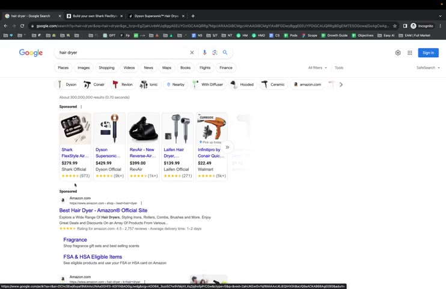
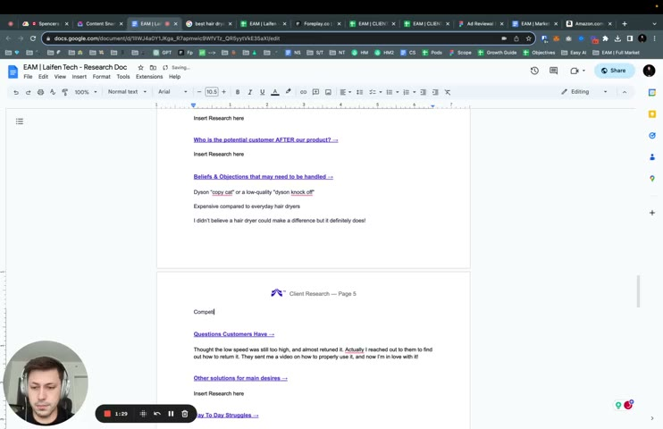

# 25. Google Research - Part 1
> Google the category from the target market's point of view (VPN + incognito), see which big trusted brands you are competing against, and log the trust objection and ad ideas that follow.

## 🤖 Agent use
- **Use when:** first market-facing research pass on a category; judging how a new or small brand looks next to established competitors; deriving objections from what the SERP shows.
- **Inputs → outputs:** category queries ("best hairdryer", "hairdryer", "a fast hairdryer") in the target country → notes on dominant brands and retailers, objections to handle, buzz words, and new ad ideas in the research doc.
- **Rules:**
  - **DO** search from the target market: use a VPN to the country you sell in (he is in Canada, the market is the US) and use an incognito window "to get a better understanding of what's showing up for people in this area." [00:00]
  - **DO** note the size and trust of the brands that fill the results (Shark, Dyson Supersonic, Revair, Rite Aid, Kohl's, Hudson's Bay, Walmart, JC Penney named). [00:37–01:36]
  - **DO** convert that into an objection under "Beliefs & Objections that may need to be handled": "competing against big brands and trusted sources online for shopping." [00:37–01:36]
  - **DON'T** assume a comparison with a premium leader will land: "comparing ourselves to a really high level competitor can lead to a lot of skepticism," e.g. "how does this do everything that the Dyson does for $300 less?" even if it is true. [02:25]
  - **IF** you find a customer review that voices the trust doubt **THEN** turn it into an ad idea. His example: "Faith in online shopping restored." [01:36]
  - **DO** read what competing pages say and log the repeated claims. His list: "No heat damage, powerful, fast drying, curl, volumized, smooth and dry." [03:10]
- **See also:** [26. Google Research - Part 2](026-google-research-part-2.md) · [27. Action Item: Google Research](027-action-item-google-research.md) · [Beliefs](../../copywriting/concepts/beliefs.md) · [Competitor landscape audit](../../../../playbooks/competitor-landscape-audit.md)

## Key ideas

### Search like a customer in the market [00:00–00:37]
- Searches: "best hairdryer," "hairdryer," "a fast hairdryer," and similar. [00:00]
- VPN to the US because the market is the US; incognito to avoid personalised results. [00:00]

### You are competing against trusted giants [00:37–02:25]
- Results are full of brands "that just have so much credibility": Shark, Dyson Supersonic, Revair ("I don't even know what that is"), Rite Aid, Kohl's, Hudson's Bay, Walmart, JC Penney. [00:37–01:36]
- "All these really, really high trustworthy brands that people are confident shopping on is definitely something that you want to note down." [00:37]
- Result in the doc: objection "competing against big brands and trusted sources online for shopping." [00:37–01:36]
- Skepticism to expect: people are less sure about buying from the example brand than from names they know. One review said: "I'm pretty skeptical of buying stuff, which a lot of people are." That led to the ad idea "faith in online shopping restored." [01:36–02:25]

### Comparison risk [02:25–03:10]
- The brand's positioning is "Dyson for a quarter of the price" (his paraphrase of the brand's message). The "biggest thing that we're going to need to handle is making sure that people can actually understand the value." [02:25]
- Caution: comparing to a high-level competitor can add skepticism; plan for it. [02:25]

### Read the claims [03:10–03:39]
- "I'm trying to read a little bit more about it, see what they're talking about... Really understanding what are the key things that they're talking about... and adding that to the research doc." [03:10]

## Examples
| Finding | What he wrote / proposed | Source |
|---|---|---|
| SERP full of big retailers and brands | Objection: competing against big brands and trusted sources online | [00:37–01:36] |
| Review voicing online-shopping skepticism | Ad idea: "Faith in online shopping restored" | [01:36] |
| Brand priced far below Dyson | Value must be understood; avoid naked comparisons that invite "how?" | [02:25] |
| Competitor page claims | No heat damage; powerful; fast drying; curl; volumized; smooth and dry | [03:10] |

## Structured units
### Hooks
| Hook | Heuristic(s) | Emotion / zone | Self targeted | Why it works | Source |
|---|---|---|---|---|---|
| "Faith in online shopping restored" | — | Relief (derived) | — | Built from a customer review that voiced distrust of online shopping; speaks to the skeptic | [01:36] |

## Screenshots

*Sponsored Google Shopping row for "hair dryer": Shark, Dyson Supersonic, RevAir, the example brand and retailers such as Walmart. This is the "big trusted brands" landscape he describes. [00:50]*

*"Beliefs & Objections that may need to be handled": Dyson "copy cat" / low-quality "dyson knock off"; expensive compared to everyday hair dryers; and a customer line "I didn't believe a hair dryer could make a difference but it definitely does!" [01:30]*

## How to apply
- [ ] Turn on a VPN to the target market and open an incognito window.
- [ ] Search the main category terms and 2-3 variations; screenshot the top results.
- [ ] List the 5-10 most prominent brands/retailers and the price points shown.
- [ ] Log "big brand / trust" and any price-comparison objection in the doc.
- [ ] Add one ad idea per objection or customer quote that surfaces.
- [ ] Copy the repeated claims from competing pages into the buzz-words list (see [26](026-google-research-part-2.md) for tallying).

## Related
- Previous: [24. Action Item: Understanding Product](024-action-item-understanding-product.md) · Next: [26. Google Research - Part 2](026-google-research-part-2.md)
- [Comparisons](../../copywriting/concepts/comparisons.md) · [Authority in ads](../../copywriting/concepts/authority-in-ads.md)

## Sources and limitations
- Transcript: [25 transcript](<../../../../../raw/evolve/start-here/_transcripts/👣 Evolve (Start Here)/25. Google Research - Part 1 👣 Evolve (Start Here) Evolve.txt>) · Page text: [25 page](<../../../../../raw/evolve/start-here/_extracted/👣 Evolve (Start Here)/25. Google Research - Part 1_👣 Evolve (Start Here)_Evolve.html.md>) (reminder only)
- Machine transcription; full coverage (219.28 s of 219.29 s). "iCognito" = incognito; "Life in"/"live" = Laifen. "Spying sources" in the transcript is garbled (likely "buying sources"). The price gap ($300) and "quarter of the price" are the instructor's framing of the brand's positioning, not verified.
- Google results change by date and country; the screenshot is a point in time.
