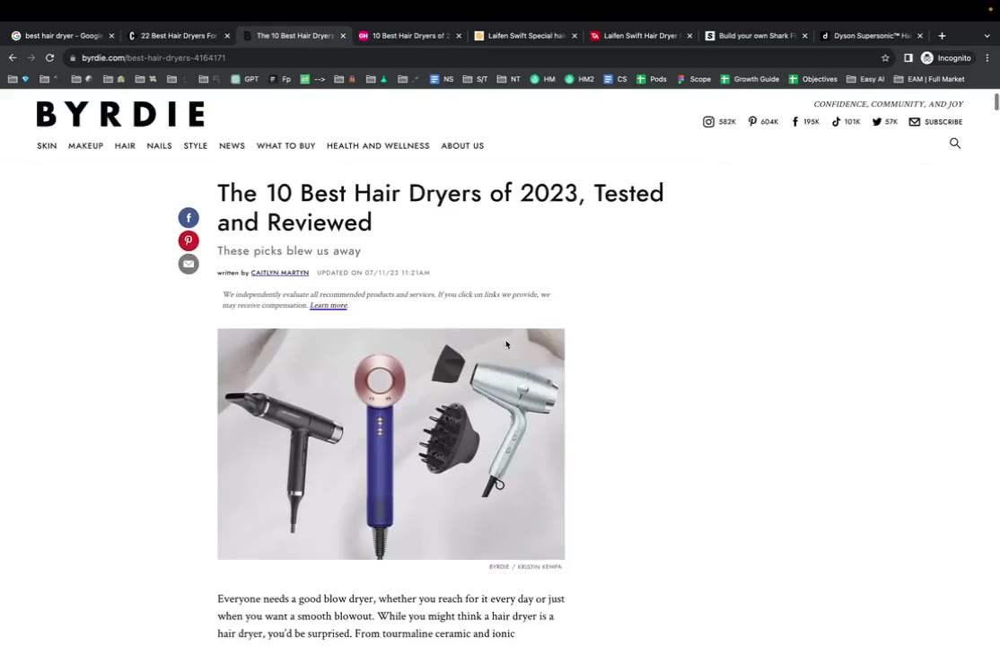
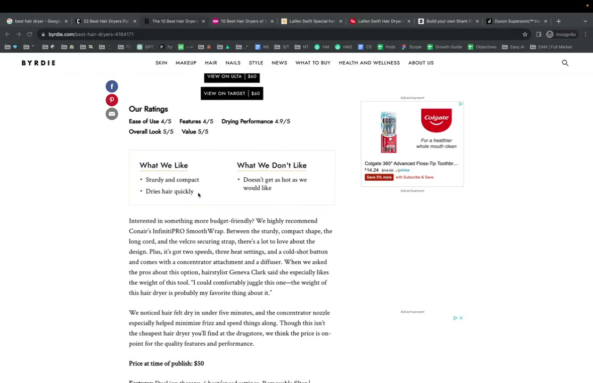
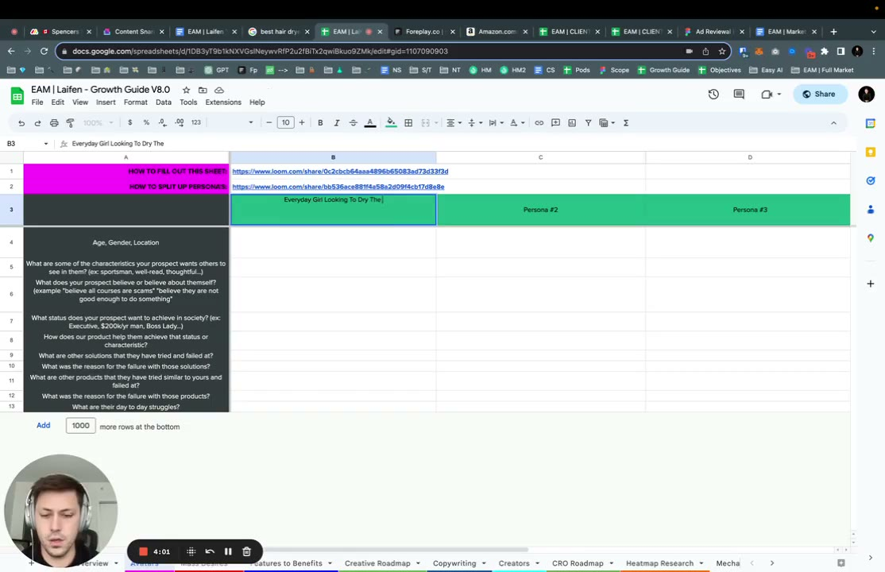

# 26. Google Research - Part 2
> Search for your own brand and for "best [product]" lists, read what the top articles say, tally repeated phrases, and use the article's "best budget / best splurge / best X" categories to discover market segments and personas.

## 🤖 Agent use
- **Use when:** mining review and listicle articles for features, buzz words, price tiers and persona seeds.
- **Inputs → outputs:** SERPs for own brand and "best [category]" → tallied features and buzz words, price-tier segments, and 2-3 draft personas in the research doc.
- **Rules:**
  - **DO** google your own brand and product first: "What comes up? What are people seeing?" Note which articles and reviews appear. [00:00]
  - **DO** then search "best [category]" and open the top results: "figure out what are people seeing? What are people clicking on?" [00:00–00:42]
  - **DO** tally repeated phrases by adding "1" each time you see one, in the features/benefits and buzzword sections ("this is obviously a Nick thing to do"). [01:25–02:12]
  - **DO** use the count to see "which words are being overdone" in competitor messaging. [02:12]
  - **DO** treat the article's category headings (best budget, best splurge, best airflow, best for heat damage, best design, best compact) as separate market segments and as persona or use-case seeds. [02:12–03:00]
  - **IF** a segment matches a use case (professional stylists, everyday daily drying, luxury experience) **THEN** draft a persona in the avatar section, placing deeper ones lower. [03:00–03:59]
  - **DON'T** assume your product belongs on those lists: "the odds of that happening are probably not great." [02:12]
- **See also:** [25. Google Research - Part 1](025-google-research-part-1.md) · [28. Amazon Research - Part 1](028-amazon-research-part-1.md) · [Labels and customer language](../../copywriting/concepts/labels-and-customer-language.md) · [Avatars and angles](../../copywriting/concepts/avatars-and-angles.md)

## Key ideas

### Look yourself up, then the category [00:00–00:42]
- Queries: the brand + "hairdryer" (to see what articles from TechHive and TechAdvisor say), then "best hairdryer." [00:00]
- Goal of the "Google experiment": see what people see and what they click, e.g. a "22 best hairdryers" result ranked first. [00:00–00:42]

### Take notes from the best-of article [00:42–02:12]
- Example article: "The 10 Best Hair Dryers of 2023, Tested and Reviewed" (Byrdie, shown on screen; Whisper wrote "birdie"). "Best overall is the Dyson." [00:42]
- Notes he takes: dries hair quickly; sleek and sturdy; magnetic attachments; air filter located on the handle. [00:42]
- Tally method: add a "1" next to each phrase each time it appears (e.g. "dry hair quickly," "sleek and sturdy," "no heat damage") "to have a better understanding of which words are being overdone" and place them in the buzzword section. [01:25–02:12]

### Segments hidden in the headings [02:12–03:00]
- "Best budget": dries hair quickly, "doesn't get as high as we would like"; about $50. [02:12]
- "Best splurge": about $450; "why is this so expensive?" [02:12]
- Also: best airflow, best for heat damage, best design, best compact. "There's all these different markets now that are starting to open up for us." [02:12–03:00]

### Personas from use cases [03:00–04:11]
- Use cases and personas read from the article: professional hairstylists (a deeper persona, "put that more towards the end"); "our everyday girl looking to dry their hair" (persona 1); "the girls who want the luxury experience" (persona 2). [03:00–03:59]
- "We can start to identify personas also by doing this group of research." [03:59]

## Steps / framework
1. Google the brand/product; record what appears.
2. Google "best [category]"; open the top 3-5 articles.
3. For each: record the "best overall" pick and the category labels, the pros and cons, and any price.
4. Tally repeated features and buzz words (+1 per sighting) in the doc.
5. Map each article category to a market segment (budget / mid / luxury / use-case) and a draft persona.

## Examples
| Article label | What it means for research | Source |
|---|---|---|
| Best overall (Dyson) | Category leader; benchmark claims | [00:42] |
| Best budget (~$50) | Price-driven buyer; weaker heat | [02:12] |
| Best splurge (~$450) | Luxury seeker; ask why it costs this much | [02:12] |
| Best for heat damage / best airflow / best compact | Use-case segments and claim ideas | [02:12–03:00] |
| Professional stylists | Persona, deeper niche | [03:00] |
| Everyday girl looking to dry her hair | Persona 1 (draft) | [03:59] |
| Luxury-experience buyer | Persona 2 (draft) | [03:59] |

## Prompts / templates (verbatim)
Persona questions on the "Avatars" tab of the Growth Guide (Laifen copy, V8.0), shown at 04:01; the first persona cell reads "Everyday Girl Looking To Dry The…":
```text
Age, Gender, Location
What are some of the characteristics your prospect wants others to see in them? (ex: sportsman, well-read, thoughtful...)
What does your prospect believe or believe about themself? (example "believe all courses are scams" "believe they are not good enough to do something")
What status does your prospect want to achieve in society? (ex: Executive, $200k/yr man, Boss Lady...)
How does our product help them achieve that status or characteristic?
What are other solutions that they have tried and failed at?
What was the reason for the failure with those solutions?
What are other products that they have tried similar to yours and failed at?
What was the reason for the failure with those products?
What are their day to day struggles?
```
Row 1-2 of that tab point to two Loom videos ("How to fill out this sheet", "How to split up personas"), not included in the course files.

## Screenshots

*The best-of article he reads for notes, "The 10 Best Hair Dryers of 2023, Tested and Reviewed." [00:50]*


*Article ratings (Ease of Use, Features, Drying Performance, Overall Look, Value) and "What We Like / What We Don't Like" bullets such as "Sturdy and compact," "Dries hair quickly," "Doesn't get as hot as we would like": the raw material for tallies. [02:30]*


*Growth Guide "Avatars" tab: persona columns across the top ("Everyday Girl Looking To Dry The…", Persona #2, Persona #3) and the persona questions down the left. [04:00]*

## How to apply
- [ ] Search brand and "best [category]"; open the top articles and save the URLs in the doc.
- [ ] Tally every repeated feature or word; mark overdone ones.
- [ ] Write one line per article category: segment, price, who it is for.
- [ ] Draft 2-3 personas from the segments and fill the Growth Guide Avatars tab (see [mini-breakthrough memo and Growth Guide](../../copywriting/frameworks/mini-breakthrough-memo-and-growth-guide.md)).
- [ ] Do not claim the brand was reviewed or ranked unless it was.

## Related
- Previous: [25. Google Research - Part 1](025-google-research-part-1.md) · Next: [27. Action Item: Google Research](027-action-item-google-research.md)

## Sources and limitations
- Transcript: [26 transcript](<../../../../../raw/evolve/start-here/_transcripts/👣 Evolve (Start Here)/26. Google Research - Part 2 👣 Evolve (Start Here) Evolve.txt>) · Page text: [26 page](<../../../../../raw/evolve/start-here/_extracted/👣 Evolve (Start Here)/26. Google Research - Part 2_👣 Evolve (Start Here)_Evolve.html.md>) (reminder only)
- Machine transcription; full coverage. "Two guests, our research document" is garbled (likely "to our research document"). "A Nick thing" refers to the tallying method credited to Nick Theriot in [17](017-overview-self-onboarding.md) (inferred; the transcript does not give a surname here).
- The article prices (~$50, $450) are as read aloud and on screen at the time (2023); prices are dated.
