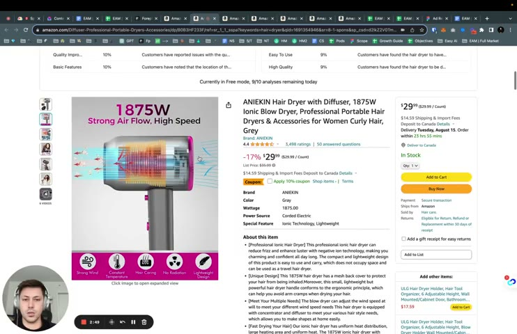
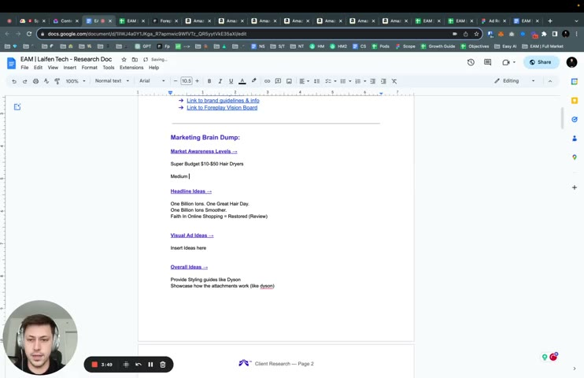
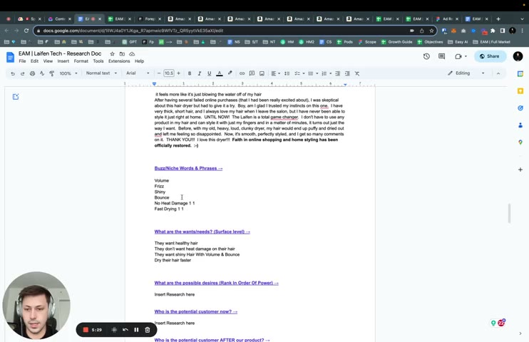

# 28. Amazon Research - Part 1
> Use Amazon search results and the Shulex review-analysis extension to see how each price tier of the market buys, what pros, cons and motivations it reports, and where your product sits.

## 🤖 Agent use
- **Use when:** researching a physical-product category before writing ads: price tiers, claims customers are used to, pros/cons by tier, usage scenarios, purchase motivations.
- **Inputs → outputs:** Amazon search + product listings (budget, similar, premium) and Shulex summaries → tier-by-tier notes, tallied buzz words, "things people are used to" (e.g. a cold-shot button), purchase motivations, and messaging risks in the research doc.
- **Rules:**
  - **DO** look at all sizes of the market: budget products, products similar to yours in price, and more expensive ones. [02:34–03:23]
  - **DO** write the price tiers down (his draft: super budget about $10-$50; "medium", about $75-$200, "that's us"). [03:23]
  - **DO** use Shulex's review summaries to get top pros, top cons, usage scenarios, customer expectations and purchase motivations, "but it is still important that we scroll through it again" yourself. [04:22–05:10]
  - **DO** check things buyers are used to that your product may lack (his example: the cold-shot button; "I don't think we have a cold shot button... I have to double check our product"). [01:47]
  - **DON'T** assume "great value" works everywhere: for budget shoppers who pay $13-$30 it "might roll right past the heads of a lot of different people" because your product is expensive to them. [04:22]
  - **DO** audit your own Amazon listing: "Are we saying the same thing that everyone else is saying?" [05:10]
  - **IF** most buyers choose on price **THEN** your job is to educate why the cheap alternative is worse (his assumption: old hairdryers "are really damaging their hair," flagged as an assumption). [00:00]
- **See also:** [29. Amazon Research - Part 2](029-amazon-research-part-2.md) · [30. Action Item: Amazon Research](030-action-item-amazon-research.md) · [26. Google Research - Part 2](026-google-research-part-2.md) · [Market awareness](../../copywriting/concepts/market-awareness.md)

## Key ideas

### See what the shopper sees [00:00–00:58]
- Search "best hairdryer(s)" on Amazon. A shopper who sees an ad and starts looking meets "a lot of these lower budget items," e.g. "a $13 hairdryer that they can get basically tomorrow." [00:00]
- Implication: the brand charges much more than what the general public pays. For a "a little bit more premium" product, "a lot of our job... is explaining and educating." [00:00]

### Extract claims from listings [00:58–01:47]
- Install the Shulex Chrome extension (page note in [29](029-amazon-research-part-2.md); Whisper heard "Shulips/Shulix"). The instructor says he will leave logins as a comment (not included in the course files). [00:58]
- Example $29.99 listing: he logs imagery and claims: "strong wind, constant temperature, hair curling, ultra fast drying, no heat damage" (and adds a second "no heat damage" tally). [00:58]
- Another listing: "infrared heat technology... will maintain its natural moisture and softness, heat and speed settings, cold shot." [00:58–01:47]
- "Things that people are used to": the cold-shot button. [01:47]

### Shulex summaries, by tier [01:47–03:23]
- $21 product: top pros are drying time, lightweight, drying power, price. [01:47]
- "Number two online" listing with 68,000 ratings: top pro #1 is lightweight; "easy to use, lightweight." [01:47–02:34]
- A closer-priced competitor: top cons "slow drying." [02:34]
- Tiers as he names them: budget ($10-$50; "$13", "$20-$30"), similar ($75-$200; he names T3, Tymo, "Cozy Companions" as competitors the client provided), premium ($300 Shark = "10X the price almost"; one is "20X the price"). [02:34–03:23]
- Log the problems each tier faces; he files notes under "market awareness" in the older doc (it is "just general market awareness, like being aware of who we're selling to"). [03:23]

### Purchase motivation and messaging warning [04:22–05:10]
- Many budget buyers are motivated by price: "What's the worst that happens? It's 15 bucks." "Price here, affordable... great value." [04:22]
- "Make sure you pay attention to the different markets... different problems, the different pros, the different cons, their usage scenarios, at home, traveling, daily use." [04:22]

### Last checks [05:10–06:02]
- Scroll the listing yourself; new buzz words appear ("lightweight," "shiny" "is being used again," "salon ionic infrared styler"). [05:10]
- Look at your own Amazon listing and ask whether to change messaging. [05:10]
- Use Shulex per listing to summarise "the issues... the pros... their profile." [05:10–06:02]

## Steps / framework
1. Search the category on Amazon; open 2-3 listings per tier (budget / similar / premium).
2. For each: run the Shulex analysis (review, Q&A, listing); note pros, cons, usage scenarios, motivations.
3. Tally buzz words (+1 per sighting) and record claims buyers are used to.
4. Write the tier map (price band, who buys, main pro, main con, motivation).
5. Compare your own listing with the claims everyone makes.

## Examples
| Tier (price) | Example from video | Pros noted | Cons noted | Source |
|---|---|---|---|---|
| Super budget ($10-$50) | $13 dryer; $21 dryer; $29.99 listing | drying time, lightweight, drying power, price | slow drying (a closer-priced competitor) | [00:00–02:34] |
| Medium ($75-$200) | "that's us"; T3, Tymo, Cozy Companions listed | lightweight (number two listing, 68,000 ratings) | slow drying (top con) | [02:34–03:23] |
| Premium ($300+) | Shark at $300 | — | — | [02:34] |

## Prompts / templates (verbatim)
Buzz word list after Amazon, as typed in the doc at 05:29 (the "1"s are the tally marks):
```text
Volume
Frizz
Shiny
Bounce
No Heat Damage 1 1
Fast Drying 1 1
```
Surface-level wants logged:
```text
They want healthy hair
They don't want heat damage on their hair
They want shiny Hair With Volume & Bounce
Dry their hair faster
```
Market awareness and ideas in the brain dump at 03:49:
```text
Market Awareness Levels:  Super Budget $10-$50 Hair Dryers / Medium
Headline Ideas:  One Billion Ions. One Great Hair Day. / One Billion Ions Smoother. / Faith In Online Shopping = Restored (Review)
Overall Ideas:  Provide Styling guides like Dyson / Showcase how the attachments work (like dyson)
```

## Screenshots

*Shulex panel on an Amazon listing: topic percentages and sample reasons from reviews. The free mode shows a daily analyses limit. [02:50]*


*Doc after the Amazon pass: "Super Budget $10-$50 Hair Dryers" and "Medium" market levels, headline ideas, and overall ideas (styling guides, attachment demos). [03:50]*


*Buzz/niche words with +1 tally marks, and the surface-level wants list. [05:30]*

## How to apply
- [ ] Capture 3 listings per tier with price, rating count and top claims.
- [ ] Run a review/Q&A summary tool on each and paste the pro/con/motivation tables.
- [ ] Update tallies for buzz words and "things buyers expect".
- [ ] Check your own listing for the same claims and for missing expected features.
- [ ] Write one "what the cheap tier gets wrong that we can educate on" idea, labelled as an assumption until supported.

## Related
- Previous: [27. Action Item: Google Research](027-action-item-google-research.md) · Next: [29. Amazon Research - Part 2](029-amazon-research-part-2.md)
- [Customer research stack](../../../../frameworks/customer-research-stack.md)

## Sources and limitations
- Transcript: [28 transcript](<../../../../../raw/evolve/start-here/_transcripts/👣 Evolve (Start Here)/28. Amazon Research - Part 1 👣 Evolve (Start Here) Evolve.txt>) · Page text: [28 page](<../../../../../raw/evolve/start-here/_extracted/👣 Evolve (Start Here)/28. Amazon Research - Part 1_👣 Evolve (Start Here)_Evolve.html.md>) (reminder only)
- Machine transcription. Whisper heard "Shulips"/"Shulix"; the page text in lesson 29 spells it Shulex. "Cozy Companions or whatever it is" is a brand read off the screen; it appears on the Amazon listing as "Cosy Companions". "Life in/live" = Laifen.
- Shulex logins mentioned in the video are not in the files. The tier prices are the instructor's draft ranges, not data.
