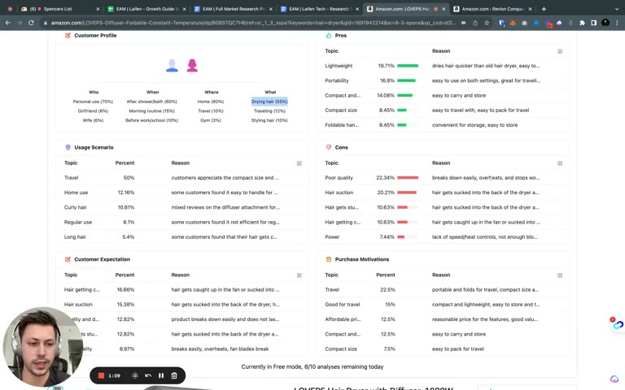
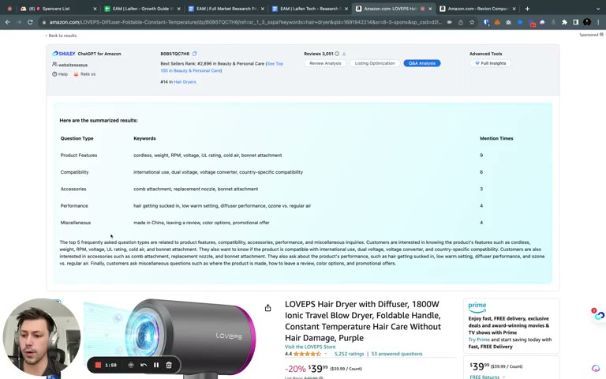
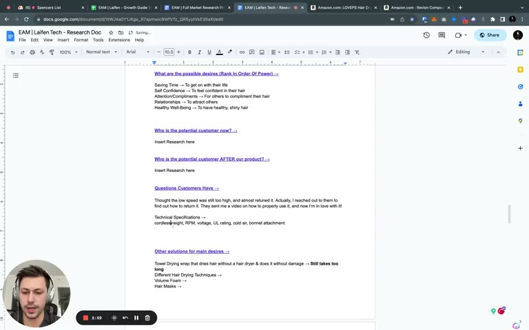

# 29. Amazon Research - Part 2
> Deeper use of Shulex on a ranked Amazon listing: use-case scenarios, bad competitor reviews, and a Q&A analysis showing what technical questions shoppers ask, plus how those findings fill the research doc.

## 🤖 Agent use
- **Use when:** extracting use cases, filming environments, bad competitor review themes, and customer questions from Amazon reviews and Q&A.
- **Inputs → outputs:** a listing's review analysis and Q&A analysis (ideally the #1 product in the category plus a ranked mid-tier one) → use-case percentages, failure modes, question themes, and doc entries (use cases, bad competitor reviews, questions customers have, possible desires).
- **Rules:**
  - **DO** run the same Shulex report on the category's number one product too, "because you're just looking for the most amount of data possible." [00:00]
  - **DO** read "use case scenarios" for who, when and where, and let them pick the filming environment: "if... a majority of people are using it to get out of the shower... that's probably an environment that we want to film in." [00:00–00:55]
  - **DO** log failure modes from bad reviews of cheap or competing products as "bad comparative reviews": hair caught in the fan, breaks down easily, overheats and stops working, smells like burning, too hot and burns the scalp. [00:55–01:45]
  - **DO** read the Q&A analysis to learn what questions shoppers ask; put the answers on product pages and in ads, and pass them to CRO. [01:45–03:42]
  - **IF** most questions are about specs **THEN** the market is sophisticated: "people understand the outcome and they're just looking for the mechanism and the features that are actually going to lead to the outcome that they want." [01:45–02:43]
  - **DON'T** dismiss spec questions: "a lot of people might be like, oh, well, you don't need to know that." [02:43]
- **See also:** [28. Amazon Research - Part 1](028-amazon-research-part-1.md) · [30. Action Item: Amazon Research](030-action-item-amazon-research.md) · [Objection handling](../../copywriting/concepts/objection-handling.md) · [Unique mechanism](../../copywriting/concepts/unique-mechanism.md)

## Key ideas

### Use cases decide where and when to film [00:00–00:55]
- Shulex on a listing ranked "number 14 in hairdryers" gives usage shares; he reads out "80% of people are using it at home" and "coming out of the shower" as environments to film in. [00:00]
- Page note: Shulex Chrome extension link ("ChatGPT for Amazon..."); a community member's Discord post (screenshot on the page) says that if you cancel the subscription "they offer 50% off for 6 months" (unverified community claim; not the course's advice). [page text]

### Bad competitor reviews [00:55–01:45]
- Themes from cheap-dryer reviews: hair "gets caught up in the fan or suckings in the back," "breaks down easily," "overheats and stops working," "stops working within a month or broke easily," "cheaply made, not durable," "smells like something's burning," "gets too hot and burns the scalp." [00:55–01:45]
- Add to "bad comparative reviews": "Device overheats and smells like something is burning." [00:55–01:45]
- "This is exactly what we're using this tool for to get access to research very, very fast." [01:45]

### Questions customers have [01:45–03:42]
- Question themes in the Q&A analysis: features (mentioned about nine times), compatibility (technical specs: dual voltage, heat, temperature, Hz range). [01:45]
- His listed spec questions: "is it cordless? How much does it actually weigh? What are the RPMs? What's the voltage? UL rating, cold air, does it have a cold air shot?" [02:43]
- Use: put them "on our product pages... but also in our ads"; also CRO. [02:43]
- Together, the QA and review analysis "gets a really good idea very quickly of what the market is looking for, what struggles they have, and how we can stand out." [02:43]

## Examples
Shulex numbers on the listing shown (a competing travel dryer; Amazon rank #14 in hair dryers):

| Panel | Values on screen (01:09) |
|---|---|
| Customer profile: who | Personal use 70%, Girlfriend 8%, Wife 6% |
| Customer profile: when | After shower/bath 60%, Morning routine 15%, Before work/school 10% |
| Customer profile: where | Home 80%, Travel 10%, Gym 3% |
| Customer profile: what | Drying hair 55%, Traveling 12%, Styling hair 10% |
| Cons (share of mentions) | Poor quality 22.34%, Hair suction 20.21%, Hair gets stuck 10.63%, Hair getting caught 10.63%, Power 7.44% |
| Purchase motivations | Travel 22.5%, Good for travel 15%, Affordable price 12.5%, Compact and... 12.5%, Compact size 7.5% |

Q&A analysis (screen at 02:00): Product Features 9 mentions (cordless, weight, RPM, voltage, UL rating, cold air, bonnet attachment); Compatibility 6 (international use, dual voltage, voltage converter, country-specific compatibility); Accessories 3; Performance 4 (hair getting sucked in, low warm setting, diffuser performance, ozone vs regular air); Miscellaneous 4.

Doc entries after this pass (screen at 03:00):
```text
What are the possible desires (Rank In Order Of Power)
Saving Time → To get on with their life
Self Confidence → To feel confident in their hair
Attention/Compliments → For others to compliment their hair
Relationships → To attract others
Healthy Well-Being → To have healthy, shiny hair

Questions Customers Have
Technical Specifications → cordless, weight, RPM, voltage, UL rating, cold air, bonnet attachment

Other solutions for main desires
Towel Drying wrap that dries hair without a hair dryer & does it without damage → Still takes too long
Different Hair Drying Techniques →
Volume Foam →
Hair Masks →
```
(Transcribed from the screenshot. Also visible: use cases list "For drying hair / For styling their hair / At home every day use / After showers / In the morning routine / Before work & school / Traveling / For Professional hair stylists.")

## Screenshots

*Shulex report: customer profile (who/when/where/what), usage scenarios, customer expectations, purchase motivations, pros and cons with percentages. [01:10]*


*Q&A analysis: question type, keywords, mention counts (product features, compatibility, accessories, performance, miscellaneous). The pattern shows a feature-literate buyer. [02:00]*


*Doc fields filled from the Amazon pass: ranked possible desires, customer questions (technical specifications) and other solutions for the main desire. [03:00]*

## How to apply
- [ ] Run review analysis on the #1 listing and one mid-tier listing; screenshot the usage panels.
- [ ] Log filming environments from the top "where/when" percentages.
- [ ] Add each failure mode to "Bad Competitor Product Reviews" with the listing it came from.
- [ ] Put the Q&A themes into the doc's questions section; mirror answers on the product page and in at least one ad.
- [ ] Map each recurring want to a deeper desire ("Saving Time → to get on with their life") to feed the desire work in [48](048-understanding-other-desires.md).

## Related
- Previous: [28. Amazon Research - Part 1](028-amazon-research-part-1.md) · Next: [30. Action Item: Amazon Research](030-action-item-amazon-research.md)

## Sources and limitations
- Transcript: [29 transcript](<../../../../../raw/evolve/start-here/_transcripts/👣 Evolve (Start Here)/29. Amazon Research - Part 2 👣 Evolve (Start Here) Evolve.txt>) · Page text: [29 page](<../../../../../raw/evolve/start-here/_extracted/👣 Evolve (Start Here)/29. Amazon Research - Part 2_👣 Evolve (Start Here)_Evolve.html.md>) · Image: [Discord tip screenshot](../../../../../raw/evolve/start-here/linked/skool-images/29/29-img01.png) (not copied to the wiki because it shows a user name)
- Machine transcription. "Shulix/Shulips" = Shulex. "Hair gets caught up in the fan or suckings in the back" is garbled but clearly means hair gets sucked in. The percentages are read from a 768x480 frame; treat last-digit values as approximate.
- The Shulex numbers belong to one specific competitor listing, not the category.
