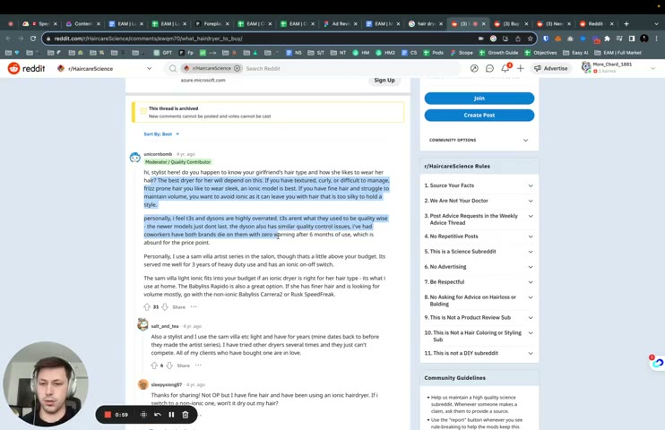
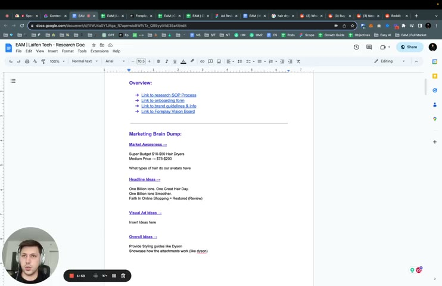

# 31. Reddit Research
> Read Reddit threads about the category to find customer questions, segments (hair type, budget), expert opinions, and the beliefs you must overcome, such as "expensive dryers are no different from cheap ones."

## 🤖 Agent use
- **Use when:** looking for unfiltered buyer and expert language, price-value beliefs, segmentation ideas, and education angles for unaware or low-information buyers.
- **Inputs → outputs:** Reddit threads found via Google ("hair dryer reddit") and Reddit search → questions customers ask, beliefs and objections, segment ideas, ad angle seeds, in the research doc.
- **Rules:**
  - **DO** search "[category] reddit" and open threads such as "Is Dyson hairdryer really worth it?", "hairdryer recommendations", "Buy a $100 hairdryer or a $20 hairdryer. Looking for longevity", "Need suggestions for mid-range blow dryers." [00:00]
  - **DO** turn thread titles into the doc's "problems we have to solve" and "questions customers have": "what is the best hairdryer?", "is it really worth spending more?" [00:00]
  - **DO** check the thread's age: "this is from four years ago... make sure you keep an eye on how long these things are." [00:58]
  - **DO** harvest expert replies (the "stylist here" comment) and what they ask the poster, such as hair type and how the person wears their hair. [00:58–01:47]
  - **DO** segment messaging when everyone claims "best for everyone": "this is for girls with thick hair. Do you have thick, heavy hair? [brand] is going to help you dry that faster." [01:47]
  - **IF** upvoted comments say expensive and cheap products are the same **THEN** log it as a belief to overcome and plan an education angle ("here's the science behind it. Here's something that you don't know"). [02:33–03:27]
  - **DON'T** treat his pass as the full job: he reads "at a surface level"; "when we sit down to really go through this" the doc gets filled. [04:20]
- **See also:** [32. Action Item: Reddit Research](032-action-item-reddit-research.md) · [25. Google Research - Part 1](025-google-research-part-1.md) · [Beliefs](../../copywriting/concepts/beliefs.md) · [Objection handling](../../copywriting/concepts/objection-handling.md) · [Unaware ads](../../copywriting/concepts/unaware-ads.md)

## Key ideas

### Reddit as a "deeper understanding" source [00:00–00:58]
- "Reddit is just really, really good for trying to get a deeper understanding of what people are saying." [00:00]
- Reading threads reveals the questions: best hair dryer? is it worth spending more? what budget? Replies come from "people that are a lot more familiar with our niche." [00:00–00:58]

### Expert asks about hair type [00:58–02:33]
- A stylist's reply asks the poster: "Do you happen to know your girlfriend's hair type and how she likes to wear her hair?" He had not thought of it: "How do our customers wear their hair, and what type of hair do they have?" [00:58]
- That prompts the question for avatars: what hair types do ours have? He links it to general market awareness ("being aware of who we're selling to"), not the formal awareness levels. [00:58–01:47]
- Segmentation example: most replies call it the best hair dryer "for anyone and anybody with a pulse"; he proposes narrowing: thick, heavy hair; tight budgets. River analogy: "the desire of having a good hair dryer flows," but some stretches of the river flow less strongly, and you can still pull desire from them. [01:47–02:33]
- The expert's guidance includes: textured, curly or frizz-prone hair needs an ionic dryer; fine hair needs care with ionic; the best dryer depends on hair type. [02:33] (paraphrase of what he reads aloud)

### Price-value belief [02:33–04:20]
- A stylist: "personally, I feel T3s and Dysons are highly overrated." [02:33]
- Upvoted comment: "I have a $200 hair dryer. I don't find any different in the cheap ones." He notes this is "probably a belief that we're going to have to handle." Belief: "there really is no difference between luxury hair dryers and cheap ones." [02:33–03:27]
- Counter-comment from the same thread: "A bad hair dryer will fry your hair... if she's using it daily, it's worth spending the money to get one that keeps her hair healthy." He sees it as a good counter and a way to educate "that unaware market." [03:27]
- A Dyson owner: "best... investment I've ever made" (he reads "food"; the screen says "beauty investment"). Another: had it six to seven years. Instructor reasoning (assumption): cheap dryers burn out, so someone could spend upwards of $100 over three or four dryers when one durable one lasts. [03:27–04:20]

## Steps / framework
1. Google "[category] reddit"; list 5-10 relevant threads with dates.
2. Per thread: questions asked, which answers got upvotes, expert vs layperson, any price-value claims.
3. Log: questions customers have; problems to solve; beliefs and objections; segment ideas; buzz words.
4. Convert each belief to an angle: confirm, reframe or educate.

## Examples
| Reddit finding | Belief / question | How he would use it | Source |
|---|---|---|---|
| Stylist asks the poster about hair type | Best dryer depends on hair type | Ask "what hair types do our avatars have?"; segment messaging | [00:58–01:47] |
| "Is this for anyone with a pulse?" style recommendations | Generic "best for everyone" | Narrow to thick-hair segment | [01:47] |
| $200 dryer "no different" than cheap ones (upvoted) | Luxury = cheap | Belief to overcome | [02:33–03:27] |
| Daily use makes quality worth it | A bad dryer fries hair | Use as the counter-argument and educational angle | [03:27] |
| Owner keeps a dryer 6-7 years | Premium = long-term investment | Cost-over-time argument (assumption) | [04:20] |

### Hooks
| Hook | Heuristic(s) | Emotion / zone | Self targeted | Why it works | Source |
|---|---|---|---|---|---|
| "Do you have thick, heavy hair? [Brand] is going to help you dry that faster." | — | — | — | Segment-specific call-out instead of "for everyone" | [01:47] |

## Screenshots

*A stylist's reply (highlighted) asking about hair type and calling T3 and Dyson "highly overrated"; the thread banner says it is archived. [01:00]*

*The doc's Marketing Brain Dump now has "Super Budget $10-$50 Hair Dryers," "Medium Price → $75-$200" and a new question "What types of hair do our avatars have." [02:00]*

*r/Frugal comments: "I have a $200 hair dryer. I don't find it any different than cheap ones," against a reply arguing a bad dryer fries hair so daily users should pay for healthy hair. [03:00]*

## How to apply
- [ ] Find 5-10 relevant threads; note dates and subreddits.
- [ ] Copy exact question titles into the questions section.
- [ ] Record every belief that cheap = expensive (or similar) with its upvote level.
- [ ] Add segment variables experts ask about (here, hair type).
- [ ] Draft one education angle per belief and one segment-specific hook; keep quotes as language, not as proof.

## Related
- Previous: [30. Action Item: Amazon Research](030-action-item-amazon-research.md) · Next: [32. Action Item: Reddit Research](032-action-item-reddit-research.md)
- [Customer research stack](../../../../frameworks/customer-research-stack.md) · [Customer research to angles](../../../../playbooks/customer-research-to-angles.md)

## Sources and limitations
- Transcript: [31 transcript](<../../../../../raw/evolve/start-here/_transcripts/👣 Evolve (Start Here)/31. Reddit Research 👣 Evolve (Start Here) Evolve.txt>) · Page text: [31 page](<../../../../../raw/evolve/start-here/_extracted/👣 Evolve (Start Here)/31. Reddit Research_👣 Evolve (Start Here)_Evolve.html.md>) (reminder only)
- Machine transcription. Whisper: "food investment" (screen: "beauty investment"); "life in/live" = Laifen; the instructor swears; quotes are cleaned.
- Reddit quotes are public posts read in the video; user handles are not recorded here. Thread dates matter: one is four years old.
