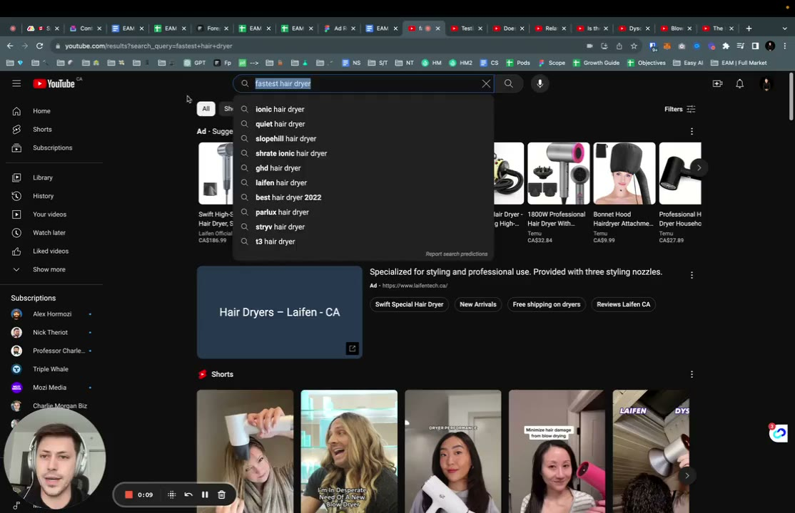
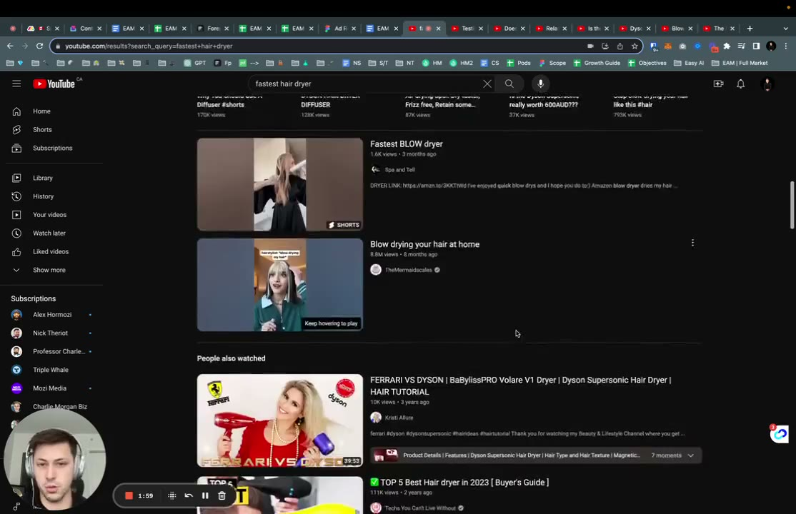
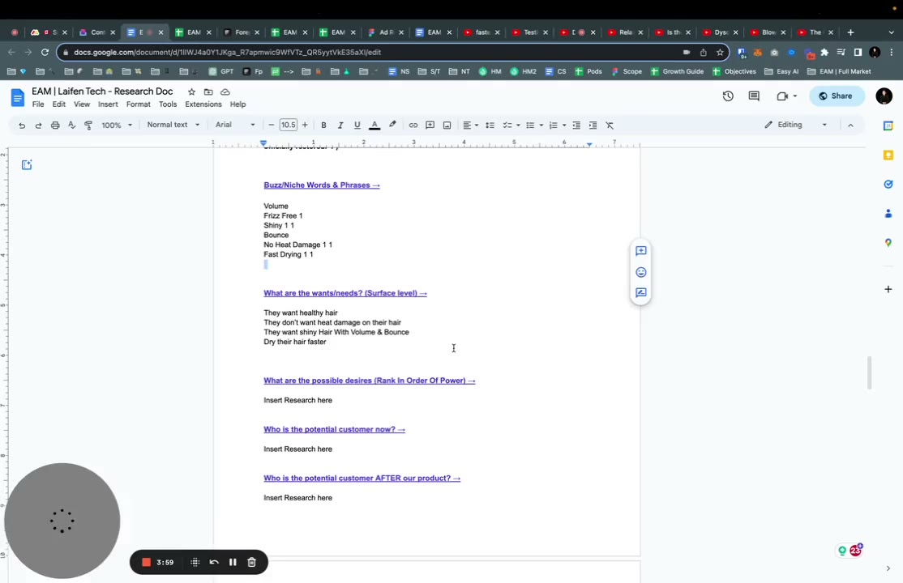

# 33. YouTube Research
> Mine YouTube for what the market watches: adjacent content formats (ASMR), headline patterns, reviewer vocabulary, comment-section opinions, and the desire chain from product to deeper desire.

## 🤖 Agent use
- **Use when:** looking for ad ideas, headline formats, creative formats, buzz words and desires from video content around a category; preparing visual ideas for a creator brief.
- **Inputs → outputs:** YouTube searches (category, "best X", "fastest X", brand names, autosuggest) + video titles, descriptions, comments → visual ad ideas, headline templates, buzz words, fears and desires, competitor-comparison notes.
- **Rules:**
  - **DO** search variations ("best hairdryer," "fastest hairdryer") and also look beyond product videos: "it doesn't have to be specifically for just hairdryers." [00:00]
  - **DO** treat high-view adjacent formats as ad-idea sources. He found hair-dryer ASMR ("Sleep like a baby in 10 minutes") with 26 million views and wrote the visual idea: "an ASMR ad with the iPhone, just blowing and just calm, relaxing... have that shine." [00:00–00:57]
  - **DO** read titles for clicks: "Best budget hairdryer," "Blow dry your hair quicker, faster, and better with these hacks" (he flags this as one to "take and turn into our own"), "Testing top professional hairdryer versus Dyson," "Ferrari versus Dyson," "Top five best hairdryers," "Head-to-head Dyson Supersonic versus GHD." [00:57–01:53]
  - **DO** actually watch the videos ("spending these eight minutes to really understand") and read descriptions and comments for language and arguments. [01:53–02:52]
  - **DO** tally new buzz words (frizz free, shiny/hair shine) in the doc. [01:53–02:52]
  - **DO** note fears surfaced by educational shorts ("Does blow-drying destroy your hair?") as a way into the unaware market. [03:35]
  - **DO** connect the chain "product → feature → benefit → surface-level want → deeper desire," using YouTuber phrases like "do you want to feel your best version of yourself." [04:56]
  - **DON'T** skip comments: "you're always reading the comments." [00:57]
- **See also:** [34. Action Item: YouTube Research](034-action-item-youtube-research.md) · [53. Ad ONLY Instagram Research](053-ad-only-instagram-research.md) · [Unaware ads](../../copywriting/concepts/unaware-ads.md) · [Hooks](../../copywriting/concepts/hooks.md) · [Labels and customer language](../../copywriting/concepts/labels-and-customer-language.md)

## Key ideas

### Search broadly and notice formats [00:00–00:57]
- Several tabs of "best hairdryer," "fastest hairdryer" etc. Beyond direct reviews he notices ASMR hair-dryer content: "Hair dryer sounds. Sleep like a baby in 10 minutes." One has "26 million views... This is something that is incredible for us to understand. There's an ad that we might be able to run that is just the hair dryer just blowing and it's very calming. This resonated with 26 million people." [00:00–00:57]
- Always read the comments. [00:57]

### Headlines to model [00:57–01:53]
- Look at titles to "see what's getting good clicks." Examples are listed in the rules above. He notes some results are ASMR-dominated, so "we might need to go and find some better titles." [00:57–01:53]

### Watch, read descriptions and comments [01:53–03:35]
- Description line read aloud: "A perfect sleek at-home blowout is almost impossible to achieve without a great hairdryer, but in a world with seemingly endless blow hairdryer options, how do you know which one will leave your hair shiny and frizz free?" New buzz words: "frizz free," "shiny," "hair shine." [01:53–02:52]
- Comments teach arguments: "I do think you should have tested the blow dryers without knowing the price. That way you could judge them from their work." "Nozzles make a massive difference to how hair dryers work and finish... the Dyson should have been used with the nozzle to get a bit of cool." [02:52]
- Brands compared in the video he watches: Revlon compact, Remington damage protection, Philips ceramic, Drybar, Dyson Supersonic. [02:52]

### Shorts and fears [03:35–04:09]
- Short "Does blow-drying destroy your hair?" has traction and "is kind of tacking into that unaware market"; it is a possible fear. [03:35]

### Desires and the full chain [04:09–05:48]
- Customer wants noted: healthier hair; no heat damage; shinier hair with volume and bounce. [04:09]
- Comparison videos include one about the example brand; comments like "I've never tried the [brand], but I tried the Dyson." Also a one-month review with tons of views and comments. [04:09]
- Desire phrases from YouTubers: "are you looking for beautiful hair? Do you want to feel your best version of yourself?" He ties the desire to feel beautiful and confident back to the surface want of healthier hair, then to the benefit, then the feature (negative-ion technology; he says "native ion"), then the product: "from product to feature to benefit to surface level want to the deeper desire and we can connect all the way down." [04:09–05:48]

## Steps / framework
1. Search 5-10 phrases; open adjacent formats, not only reviews.
2. Per video: title pattern, views, description wording, comment arguments.
3. Update doc: visual ideas, headline templates, buzz-word tallies, fears, desires.
4. Write the chain: product → feature → benefit → surface want → deeper desire.

## Examples
| Finding | Idea logged | Source |
|---|---|---|
| ASMR hair-dryer video, 26M views | Visual ad idea: ASMR ad "with the iPhone," calm blowing, shine | [00:00–00:57] |
| "Blow dry your hair quicker, faster, and better with these hacks" | Headline to adapt | [00:57–01:53] |
| "Does blow-drying destroy your hair?" (short) | Fear; unaware-market entry | [03:35] |
| Comments on tests and nozzles | Arguments buyers use; objection fuel | [02:52] |
| "Do you want to feel your best version of yourself?" | Deeper desire: feel beautiful and confident | [04:56] |

### Hooks
| Hook | Heuristic(s) | Emotion / zone | Self targeted | Why it works | Source |
|---|---|---|---|---|---|
| "Blow dry your hair quicker, faster, and better with these hacks" | — | — | — | Speed + improvement promise; he says it is a headline to turn into "our own" | [01:53] |
| "Does blow-drying destroy your hair?" | — | Fear (derived) | — | Question taps a latent fear; unaware-market entry point | [03:35] |
| "Ferrari versus Dyson" / "Testing top professional hairdryer versus Dyson" | — | — | — | Head-to-head comparison framing | [01:53] |

## Screenshots

*YouTube search with autosuggest ("ionic hair dryer," "quiet hair dryer," "shrate ionic hair dryer," "laifen hair dryer," "best hair dryer 2022"...) and a Laifen brand ad above the results. Autosuggest shows how people phrase searches. [00:10]*

*Results for "fastest hair dryer": Shorts, "Blow drying your hair at home" with 8.8M views, "Ferrari vs Dyson" comparison, "TOP 5 best hair dryer in 2023." These are the headline patterns he lists. [02:00]*

*Doc buzz words with tallies (Volume, Frizz Free 1, Shiny 1 1, Bounce, No Heat Damage 1 1, Fast Drying 1 1) and the wants list. [04:00]*

## How to apply
- [ ] Search category terms plus modifiers; also check autosuggest and Shorts.
- [ ] Log adjacent formats with high views as visual ideas; label as untested.
- [ ] Copy winning title patterns into a headline-template list; adapt, do not copy verbatim.
- [ ] Read 20+ comments on 2-3 videos; add objections and buzz words.
- [ ] Write the product→feature→benefit→want→desire chain for the main benefit.

## Related
- Previous: [32. Action Item: Reddit Research](032-action-item-reddit-research.md) · Next: [34. Action Item: YouTube Research](034-action-item-youtube-research.md)
- [Customer research to angles](../../../../playbooks/customer-research-to-angles.md) · [Show don't tell](../../copywriting/concepts/show-dont-tell.md)

## Sources and limitations
- Transcript: [33 transcript](<../../../../../raw/evolve/start-here/_transcripts/👣 Evolve (Start Here)/33. YouTube Research 👣 Evolve (Start Here) Evolve.txt>) · Page text: [33 page](<../../../../../raw/evolve/start-here/_extracted/👣 Evolve (Start Here)/33. YouTube Research_👣 Evolve (Start Here)_Evolve.html.md>) (reminder only)
- Machine transcription. Whisper: "Brad Rondo" (a YouTuber, spelling uncertain), "native ion" (likely negative ion), "life in" = Laifen. The 26M-view figure is as spoken; the exact video was not identifiable on the sampled frames. View counts and rankings are dated to the recording.