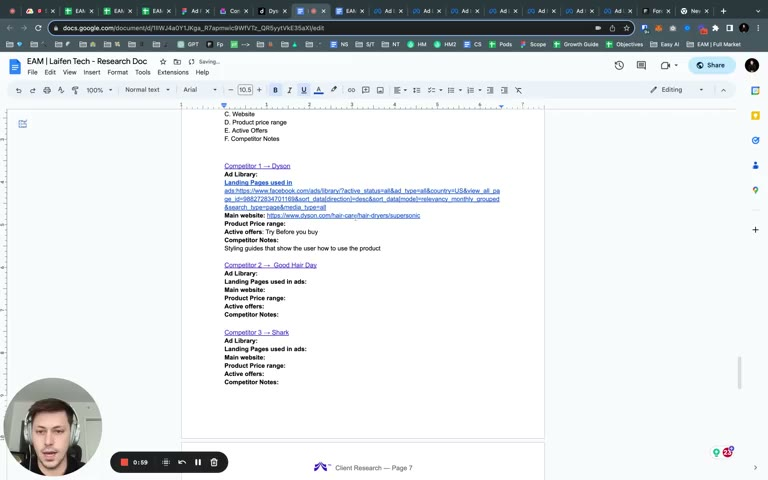
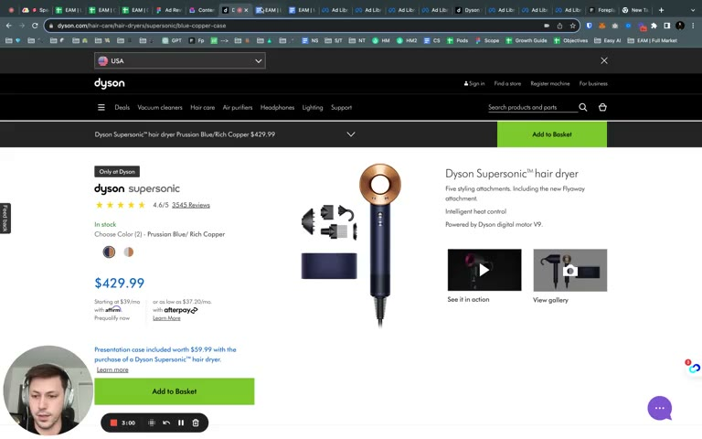
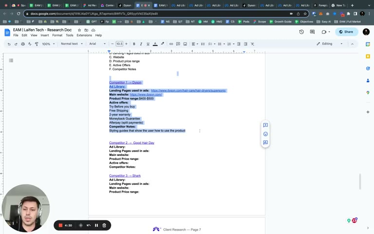

# 35. Competitor Research - Part 1
> How to fill the Competitor Research block: for each competitor link the ad library, the landing page the ads send to, the main site, price range, active offers, and objective notes on claims and presentation.

## 🤖 Agent use
- **Use when:** building a competitor profile table for a brand; auditing offers, claims, guarantees and landing-page presentation of direct competitors.
- **Inputs → outputs:** client-provided competitor list (plus extras you find) + Facebook Ad Library + competitor sites → one block per competitor with six fields filled and competitor notes in objective terms.
- **Rules:**
  - **DO** record, per competitor: Ad Library link, Landing Pages used in ads, Main website, Product price range, Active offers, Competitor notes. [00:00–04:27]
  - **DO** find the landing page by clicking the competitor's ad in the ad library and linking the page it opens. [00:52]
  - **DO** link the ad library, not just the website: "we actually need the ad library." Keep links clean (hyperlink the text). [00:00–00:52]
  - **DO** pick the competing product, not their whole line: "Supersonic Professional, that's a professional one. We're not really going after professionals." [00:52]
  - **DO** capture offers exactly: try before you buy, Afterpay (split payments), case included (valued at $59.99), free shipping, two-year warranty, money-back guarantee. [01:49–02:48]
  - **DO** record claims with numbers: "zero heat damage, fast drying... increased smoothness by 75%, increased shine by 132%, and decreased frizz and flyaways by 61%." [02:48] (the competitor's own claims, not verified)
  - **DO** note what the page shows to justify a premium price: what is in the box, style guides, attachments, key controls, case, technology, specifications, reviews. [03:46]
  - **DON'T** write opinions only: "try to compete these competitor notes more like objective rather than your thoughts." "They look really premium" is fine, but also note "what they do really well and how they showcase and present themselves." [04:27]
  - **DON'T** let this step dissolve into detail: he keeps it short and focuses on "the actual offers and how to keep track of the competition." [02:48]
- **See also:** [36. Competitor Research - Part 2](036-competitor-research-part-2.md) · [37. Action Item: Competitor Research](037-action-item-competitor-research.md) · [Competitor landscape audit](../../../../playbooks/competitor-landscape-audit.md) · [Competitor ad teardown](../../../../playbooks/competitor-ad-teardown.md) · [38. Facebook Research - Part 1](038-facebook-research-part-1.md)

## Key ideas

### Link the right things [00:00–01:49]
- Competitors come from the client and from his own finds; link all to the research doc. [00:00]
- The ad library is a separate link from the landing page; the landing page is whatever the competitor's ad clicks through to (here a Dyson Supersonic product page); the main website is just the root domain. [00:52–01:49]
- Product price range example: "429 to 479," written as "$400-$500." [01:49]

### Offers [01:49–02:48]
- Active offers observed on the competitor's product page: try before you buy ("very, very, very impressive"), Afterpay, a case included worth $59.99, free shipping, a two-year warranty, a money-back guarantee. [01:49–02:48]

### Claims and presentation [02:48–04:27]
- Competitor page claims engineered to protect from "extreme heat damage with fast drying"; buzz words noted again (zero heat damage; fast drying). [02:48]
- Statistical claims with proof elements: smoothness +75%, shine +132%, frizz and flyaways -61%. [02:48]
- Page content: styling guides, attachments in action, key controls, what is in the box, specs, reviews. "This is a big, big competitor of ours and... they look very premium." For a product at this level "we need to show everything that is included." [03:46]

### How to write notes [04:27–04:53]
- Notes should be objective and include what they do well and how they present. Do this "for every other product and every other competitor." [04:27]

## Steps / framework
1. List competitors (client list + your own finds): 3-5 are asked in the updated doc ([21](021-action-item-copy-research-document.md)).
2. For each: Ad Library link; open an ad; copy the landing page URL; main website URL.
3. Price range from the current product(s); active offers from the page; claims and proof.
4. Notes: what they show, how they are structured, what they guarantee.
5. Update buzz-word tallies from their pages.

## Examples
Competitor 1 entry as written at 04:30 (screenshot):

| Field | Entry |
|---|---|
| Competitor | Dyson |
| Landing Pages used in ads | dyson.com Supersonic product page URL |
| Main website | dyson.com |
| Product price range | $400-$500 |
| Active offers | Try Before you buy; Free Shipping; 2-year warranty; Moneyback Guarantee; Afterpay (split payments) |
| Competitor notes | Styling guides that show the user how to use the product |

The doc lists Competitor 2 as "Good Hair Day," 3 as Shark, 4 as T3 (names visible in the template at 00:09; their fields are empty in this video).

### Ad teardowns
| Brand / product (niche) | Format | Hook / opening | What works | What fails | Fix suggested | Principle | Source |
|---|---|---|---|---|---|---|---|
| Dyson Supersonic product page (premium hair dryer) | Landing page (not an ad) | Heat-damage protection + fast drying | Shows box contents, attachments, controls, case; stat-backed claims; try-before-you-buy and warranty offers | — (not assessed) | Show everything included at this price level (applies to our product) | Premium price needs visible completeness and risk reversal (derived) | [01:49–04:27] |

## Screenshots

*Competitor Research block with Competitor 1 Dyson (ad-library link and main website added), 2 Good Hair Day, 3 Shark, 4 T3. [01:00]*

*Dyson product page "Styling attachments" section (flyaway attachment, styling concentrator, diffuser), part of the presentation he calls "very premium." [03:00]*

*The finished Competitor 1 entry: landing page, website, price range $400-$500, offers and notes. [04:30]*

## How to apply
- [ ] Create one block per competitor with the six fields.
- [ ] Open ads from the ad library and record the exact landing page.
- [ ] Copy prices and offers as shown (date them).
- [ ] List claims with numbers, marked as competitor claims.
- [ ] Write notes on structure and proof elements, not only "looks premium."
- [ ] Add repeated claims to buzz-word tallies.

## Related
- Previous: [34. Action Item: YouTube Research](034-action-item-youtube-research.md) · Next: [36. Competitor Research - Part 2](036-competitor-research-part-2.md)
- [Comparisons](../../copywriting/concepts/comparisons.md) · [Positioning](../../copywriting/concepts/positioning.md)

## Sources and limitations
- Transcript: [35 transcript](<../../../../../raw/evolve/start-here/_transcripts/👣 Evolve (Start Here)/35. Competitor Research - Part 1 👣 Evolve (Start Here) Evolve.txt>) · Page text: [35 page](<../../../../../raw/evolve/start-here/_extracted/👣 Evolve (Start Here)/35. Competitor Research - Part 1_👣 Evolve (Start Here)_Evolve.html.md>) (reminder only)
- Machine transcription. "Super sign" is garbled; "after pay" = Afterpay; "Hudson's"/"Dyson" as spoken. The title says Facebook ad library, but he shortens the ad-library analysis: the in-depth ad analysis is later ([38](038-facebook-research-part-1.md)).
- "Ad Library:" fields are mostly links in the screenshot, not readable here. Prices and offers are a snapshot from the recording.
