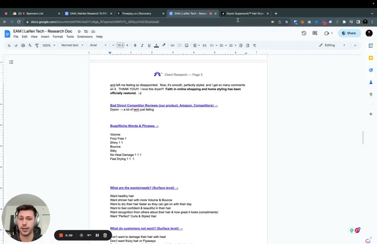

# 36. Competitor Research - Part 2
> Read one-star reviews of direct competitors to find what they fail at, build a risk-reversing message around it, and break the skepticism of people who already tried and failed with a similar product.

## 🤖 Agent use
- **Use when:** collecting "bad direct competitor reviews"; designing guarantee and customer-service messaging; writing for solution-aware or product-aware buyers who had a bad experience elsewhere.
- **Inputs → outputs:** one-star and low-star reviews of the main competitors (their site, Amazon, Shopify) → a list of failure modes, a guarantee/service angle, and beliefs to break.
- **Rules:**
  - **DO** read competitors' bad reviews to see "what our competitors are doing wrong so that we can take advantage of that." [01:42]
  - **DO** separate causes: product faults (tech failing, power button, cord), fulfilment/service faults (wrong item sent, waiting weeks), and expectation faults (scratches within 30 days, bulky cord). [00:56–01:42]
  - **IF** the main competitor complaint is "it broke" or "it did not work" **THEN** answer it in the message: "if anything goes wrong with your product... let us know, send you a brand new one," conditional on the client being able to do it. [00:00–00:56; 01:42]
  - **DON'T** announce competitor failures in ads, or "mention that tech can just be buggy": the point is the reassurance ("Hey, if anything happens, if any of it fails, let us know. We'll send you a brand new one. No questions asked"), not the admission. [00:00–00:56]
  - **DO** write for people who bought something similar and failed: they are "a lot harder to sell." [01:42–02:41]
  - **DO** treat the failure as a belief to break: "just because they worked with a... shitty agency or they had a shitty experience doesn't mean that Facebook ads don't work for them." [02:41]
  - **DON'T** promise a guarantee you cannot deliver: "obviously, hopefully the client can do that." [00:56]
- **See also:** [35. Competitor Research - Part 1](035-competitor-research-part-1.md) · [37. Action Item: Competitor Research](037-action-item-competitor-research.md) · [Objection handling](../../copywriting/concepts/objection-handling.md) · [Beliefs](../../copywriting/concepts/beliefs.md) · [Market awareness](../../copywriting/concepts/market-awareness.md)

## Key ideas

### Bad direct competitor reviews, tech edition [00:00–00:56]
- Look at "people that have tried our product or have kind of bought into the messaging that we're going to be using and failed with some of our direct competitors." [00:00]
- Tech category pattern: "product control issues. Like sometimes the tech is just going to be a dud and it's going to break." The doc line for Dyson: "a lot of tech just failing." [00:00]
- Use: a clear promise of replacement if anything fails. [00:00–00:56]

### What the one-star reviews say [00:56–01:42]
- One reviewer: bought "weeks ago," "the power button doesn't stay up properly and shuts off even if you barely shake the device." He notes it is probably one faulty unit, not every unit. [00:56]
- Another: sent the wrong item and still waiting for weeks: "an issue with customer service." [00:56]
- Another (read aloud): within 30 days "already scratched up in bright light"; "the dryer works fine, but the cord is clunky, which makes it difficult to store in a small space... Really expecting more." [01:42]

### Selling to the burned buyer [01:42–03:11]
- Message to "people that are more solution aware" and product aware: they "tried another one, they had an issue with it, but we still want to tell them to try ours." [01:42]
- Analogy: someone who tried Facebook ads with an agency and failed is skeptical of Facebook ads. The belief to break: "that Facebook ads don't work for them." Understand what customers are going through and what direct competitors fail at "so that we can take advantage of that." [02:41]

## Examples
| Competitor complaint | Category | Messaging response | Source |
|---|---|---|---|
| Tech failing / dud unit | Product reliability | "If any of it fails, let us know. We'll send you a brand new one, no questions asked" (if client can) | [00:00–00:56] |
| Power button shuts the device off | Product defect | Same replacement promise | [00:56] |
| Wrong item sent; waited weeks | Fulfilment / service | Fast service promise (derived) | [00:56] |
| Scratched in 30 days; cord clunky | Quality/design at a premium price | Design and finish proof (derived) | [01:42] |

### Rewrites
| Before | After | What changed | Source |
|---|---|---|---|
| (not to be said, per the instructor) "Tech can be buggy and sometimes fails" | "If anything happens, if any of it fails, let us know. We'll send you a brand new one, no questions asked." | Dropped the admission and kept the guarantee: risk reversal instead of naming the flaw (derived framing) | [00:00–00:56] |

## Prompts / templates (verbatim)
Doc fields at 01:00 after this pass (screenshot):
```text
Bad Direct Competitor Reviews (our product, Amazon, Competitors) →
Dyson → a lot of tech just failing

What are the wants/needs? (Surface level) →
Want healthy hair
Want shinier hair with more Volume & Bounce
Want to dry their hair faster so they can get on with their day
Want to feel confident & beautiful in their hair
Want recognition from others about their hair & how great it looks (compliments)
Want "Perfect" Curls & Styled Hair

What do customers not want? (Surface level) →
Don't want to damage their hair with heat
Don't want frizzy hair or Flyaways
```
(The "what customers not want" list may continue below the visible area.)

## Screenshots

*Research doc: "Bad Direct Competitor Reviews" filled with "Dyson → a lot of tech just failing," buzz words with tallies, and the surface-level wants and "not want" lists. [01:00]*

## How to apply
- [ ] Read 20+ one-star reviews per main competitor; classify each (product, service, expectation).
- [ ] Tally the top 3 failure modes per competitor.
- [ ] Write a guarantee/service message that answers the top failure mode, only if the client can honor it.
- [ ] Draft one ad for the burned buyer (tried similar, failed) aimed at their "it won't work for me" belief.
- [ ] Keep competitor reviews as research, not as claims in the ad (no quoting competitor reviews as proof).

## Related
- Previous: [35. Competitor Research - Part 1](035-competitor-research-part-1.md) · Next: [37. Action Item: Competitor Research](037-action-item-competitor-research.md)
- [Risk reduction hooks](../../../../concepts/risk-reduction-hooks.md) · [Competitor ad teardown](../../../../playbooks/competitor-ad-teardown.md)

## Sources and limitations
- Transcript: [36 transcript](<../../../../../raw/evolve/start-here/_transcripts/👣 Evolve (Start Here)/36. Competitor Research - Part 2 👣 Evolve (Start Here) Evolve.txt>) · Page text: [36 page](<../../../../../raw/evolve/start-here/_extracted/👣 Evolve (Start Here)/36. Competitor Research - Part 2_👣 Evolve (Start Here)_Evolve.html.md>) (reminder only)
- Machine transcription; full coverage. The sentence "if I could read this lesson, I'm sorry, I would" is garbled (he is skimming a review). "Direct pair of reviews" = direct competitor reviews; "bright light views" = "bright light" (the review says it scratched up in bright light).
- The video says "I'm probably going to sneak this back into the review process": it is an addendum to the review research, recorded after Part 1.
- The "don't announce competitor failures" rule is the instructor's implied stance ("you obviously don't really want to mention that"); the rewrite row is derived from his wording.
