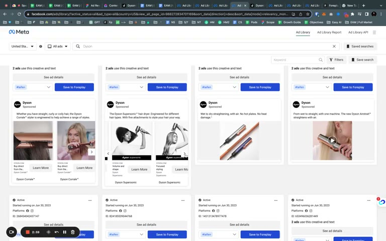
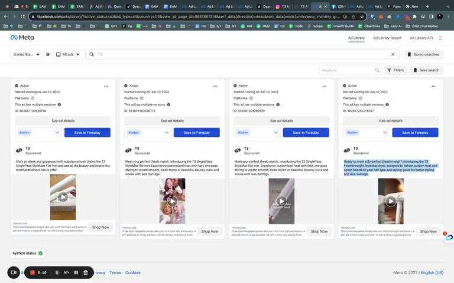
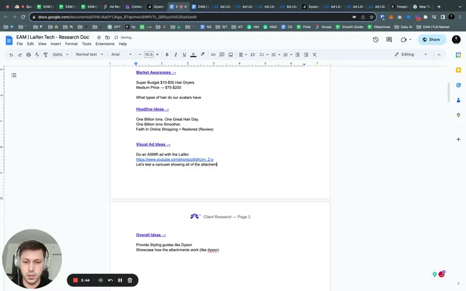

# 38. Facebook Research - Part 1
> Use the Meta Ad Library to see what the market is actually being shown (keyword search plus named competitors), save the ads that have run longest, and turn each one into ad ideas in the research doc.

## 🤖 Agent use
- **Use when:** researching a niche or a named competitor's live advertising on Meta before writing angles, hooks or briefs.
- **Inputs → outputs:** niche keyword(s) + the 5 competitors already listed in the research doc → saved ads on a client board, a list of competitor messages/objections, and entries under "Headline Ideas", "Visual Ad Ideas" and "Overall Ideas" in the research doc.
- **Rules:**
  - **DO** search the Ad Library by keyword (the demo uses "hair dryer"), not only by brand, to see "what people are seeing", including adjacent solutions. [00:00-00:54]
  - **DO** set the filters to English, one country (the instructor uses United States only), All advertisers, and Active ads, so you see what is live now. [01:47-02:23]
  - **DO** look at "how long this has been running" and treat the longest-running ads as the strongest signal. [00:00; 04:19]
  - **DO** save useful ads to the client's board with the Foreplay browser extension (set the board to the client first). [00:54-01:47]
  - **DO** write ad ideas directly into the research doc while you scroll (headline ideas, visual ad ideas, overall ideas). [03:23]
  - **DON'T** copy the biggest competitor's ad one-for-one: "that's probably not going to be as effective because I can almost guarantee this has been running since June 30th and they are going to be outspending us and outconverting us." [02:23-03:23]
  - **IF** a competitor cannot be found by name in the Ad Library **THEN** open their Instagram profile, follow it to their Facebook page, copy the exact page name and search that. [03:23-04:19]
  - **IF** a competitor's ad addresses an objection (fit for my hair type, heat damage) **THEN** note it as that brand's messaging and as an objection in the doc. [04:19-05:19]
- **See also:** [39. Facebook Research - Part 2](039-facebook-research-part-2.md) (ad comments) · [42. Creative Research - Part 2](042-creative-research-part-2.md) · [35. Competitor Research - Part 1](035-competitor-research-part-1.md) · [Competitor ad teardown playbook](../../../../playbooks/competitor-ad-teardown.md) · [Competitor landscape audit](../../../../playbooks/competitor-landscape-audit.md)

Lesson page text: only the course loop reminder, "1. Watch Module -> 2. Take Action -> 3. Finish Research Step -> Watch Next Module". The demo client is a hair dryer brand ("Laifen" on screen; Whisper wrote "Life in").

## Key ideas

### 1. Search the whole market by keyword, not just by brand [00:00-01:47]
- "Using the Facebook ad library, we can use this for everything." Start with a keyword search (example: "hairdryer"). [00:00]
- The point is to "get an idea of what people are seeing". Scrolling the results exposes hooks, testimonials, different product types and alternative solutions. [00:00]
- Example of an alternative solution found by keyword search: a towel-wrap brand whose ad says it "dries hair without a hairdryer and does it without damage". The instructor adds it to the research doc as another solution to look into. [00:00-00:54]
- Example hook he flagged in the results: "some girl putting a plastic bag over her head. Danger, right?" [00:00]

### 2. Filters and saving [00:54-02:23]
- Create a board per client in Foreplay ("create board"), then click the extension in the Ad Library and pick that client's board so each save lands in the right place. [00:54-01:47]
- Filters he uses (they reset during the recording): English only, United States only ("because that's all I care about right now"), All advertisers, Active ads. Goal: "see what people are actually seeing in the marketplace." [01:47-02:23]
- Foreplay is the swipe-file tool of this era. The course later replaces it with Atria, see [41. Creative Research - Part 1 (Atria)](041-creative-research-part-1-atria.md).


*Ad Library results for Dyson with filters applied: each card shows start date ("Started running on Jun 30, 2023"), creative and a "Save to Foreplay" button. This is the view used to judge longevity and save ads. [03:00]*

### 3. Read the market leader's ads, then plan how to differ [02:23-03:23]
- Dyson Supersonic ads: "showing the product in use", five attachments, "defying curls and waves", "no extreme heat", "engineered for different hair types". He calls it "a great, great job by Dyson by actually showing the product in use." [02:23-03:23]
- Decision: do not run the same message as Dyson; save it to the board "to keep an eye on". [02:23-03:23]
- Ideas generated on the spot, written to the doc: add visual ad ideas, e.g. "Let's test a carousel showing all of the attachments in action with the right personas in each visual." [03:23]

### 4. Competitor-by-competitor pass [03:23-05:56]
- Repeat for each competitor (GHD, T3 and others). For each, scroll to find "what ads have been running the longest. What's their messaging?" [04:19]
- Finding T3: searching "T3" alone fails. Open the client's Instagram from the T3 Micro page, copy the page name, search it, then find the Facebook page. [03:23-04:19]
- T3 messaging read aloud: "Ready to meet your perfect heat match? Introducing T3 Featherweight StyleMax dryer, designed to deliver custom heat and speed based on your hair type and styling goals for better styling and less damage." His read: they "understand people don't want heat damage", "want a featherweight, lightweight dryer", and the ad pre-empts the objection "I don't know if this is right for my hair type". [04:19-05:19]
- Look at the landing page too. T3's page says "Up the style, drop the damage", shows "the tech behind it" and a claim of "6% more natural moisture retained / 6% of people experience less damage" (Whisper numbers; verify against the page before reuse). [05:19-05:56]
- Run time as signal: a T3 ad "running since June 10th... almost two months now". [05:56]
- Closing: "this is where the competitive research, starting with Facebook ads library, leads you down a rabbit hole". A part 2 on market sophistication is promised. [05:56]


*T3 ads in the Ad Library, all "Started running on Jun 10, 2023"; the highlighted primary text is the "perfect (heat) match" copy discussed in the lesson. [05:10]*

## Steps / framework
1. Have the client's board created in Foreplay and the competitors listed in the research doc. [00:54]
2. Open the Meta Ad Library, set country, language English, status Active, All advertisers. [01:47]
3. Keyword search the niche. Scroll. Save ads whose hook, format or solution is new to you. [00:00-02:23]
4. Search each competitor by name (or via their Instagram to find the exact Facebook page name). [03:23-04:19]
5. For each competitor: sort mentally by longest running, read the primary text, note the angle and objection handled, open the landing page. [04:19-05:56]
6. Write ideas into the doc as you go: Headline Ideas, Visual Ad Ideas, Overall Ideas. [03:23]

## Examples

### Ad teardowns
| Brand / product (niche) | Format | Hook / opening | What works | What fails | Fix suggested | Principle | Source |
|---|---|---|---|---|---|---|---|
| Dyson Supersonic (hair dryers) | Static / carousel / video showing attachments in use | "engineered for different hair types with five attachments to style your hair" | Product shown in use, curls and waves, attachment close-ups | — (not for us to copy, as they outspend us) | Test a carousel showing all attachments with the right persona in each visual (our product) | Show the product in use; do not match the market leader's message head-on | [02:23-03:23] |
| T3 Featherweight StyleMax (hair dryers) | Video ad + landing page | "Ready to meet your perfect heat match?" | Handles "is this right for my hair type" and heat damage; landing page shows the tech and a damage-reduction claim | — | — | Pre-empt the fit/damage objection inside the ad | [04:19-05:56] |
| Unnamed towel-wrap brand (hair drying alternative) | Static/video | "Dries hair without a hairdryer and does it without damage" | Positions against hair dryers entirely | — | Logged as an "other solution" to research | Alternative solution visible only via keyword search | [00:00-00:54] |

### Hooks
| Hook | Heuristic(s) | Emotion / zone | Self targeted | Why it works | Source |
|---|---|---|---|---|---|
| A woman puts a plastic bag over her head (hair dryer category) | — | — | — | Instructor called it "pretty interesting"; no reason given | [00:00] |

## Prompts / templates (verbatim)
Research-doc sections visible on screen while ideas are logged (screen text, lesson 38 at 03:45):

```
Market Awareness →
Super Budget $10-$50 Hair Dryers
Medium Price → $75-$200
What types of hair do our avatars have

Headline Ideas →
One Billion Ions. One Great Hair Day.
One Billion Ions Smoother.
Faith In Online Shopping = Restored (Review)

Visual Ad Ideas →
Do an ASMR ad with the Laifen
Let's test a carousel showing all of the attachments in action with the right personas in each visual

Overall Ideas →
Provide Styling guides like Dyson
Showcase how the attachments work (like dyson)
```


*The client research doc being filled while scrolling the Ad Library: price tiers under Market Awareness, headline ideas (one drawn from a customer review), visual ideas and overall ideas copied from Dyson's approach. [03:45]*

## How to apply
- [ ] Create the client board in the swipe-file tool and confirm the extension saves to it.
- [ ] Run one keyword search and one search per competitor; filter English, one country, Active.
- [ ] For each competitor, record the longest-running ads, their messaging, the objection each addresses and the landing-page treatment.
- [ ] Save 5+ ads; write at least one headline idea and one visual idea per competitor into the doc.
- [ ] Log alternative solutions found (e.g. towel wrap) for [48. Understanding Other Desires](048-understanding-other-desires.md).
- [ ] When copying a leader's structure, re-express it for our product and differentiator (copy the mechanism, not the asset).

## Related
- Previous: [37. Action Item/ Competitor Research](037-action-item-competitor-research.md) · Next: [39. Facebook Research - Part 2](039-facebook-research-part-2.md)
- [Competitor ad teardown playbook](../../../../playbooks/competitor-ad-teardown.md) · [Market awareness (Copywriting)](../../copywriting/concepts/market-awareness.md) · [Objection handling (Copywriting)](../../copywriting/concepts/objection-handling.md)

## Sources and limitations
- Transcript: [38. Facebook Research - Part 1….txt](<../../../../../raw/evolve/start-here/_transcripts/👣 Evolve (Start Here)/38. Facebook Research - Part 1 👣 Evolve (Start Here) Evolve.txt>) · Page text: [38….html.md](<../../../../../raw/evolve/start-here/_extracted/👣 Evolve (Start Here)/38. Facebook Research - Part 1_👣 Evolve (Start Here)_Evolve.html.md>)
- Machine transcription (Whisper large-v3-turbo). Full recording covered (last segment 6:25 of 6:25). Whisper wrote "Life in" for the client Laifen (screen text), "Suterra Sleep" for a towel-wrap brand (name unconfirmed) and "6%" claims for T3 (unverified). Dates quoted (Jun 30, Jun 10) are 2023, from the screen.
- "Hairdryer" and the 2023 date mean ads and prices have moved on; use the method, not the specific ads.
