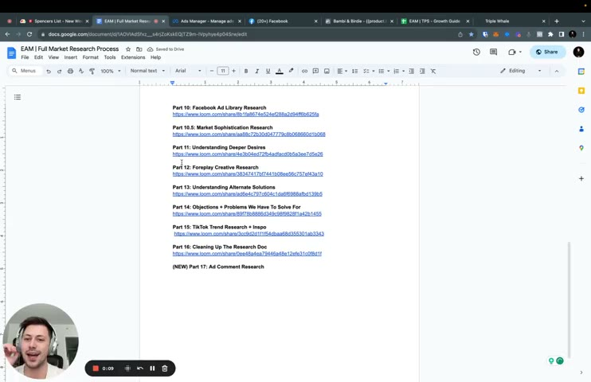
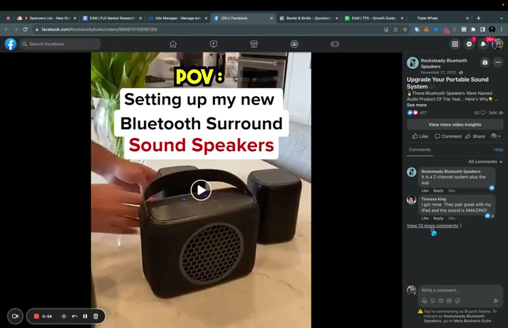
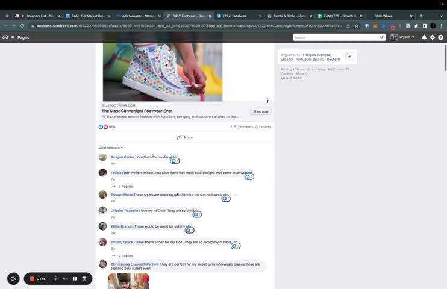

# 39. Facebook Research - Part 2
> Mine the comments under your best-spending or longest-running ads for questions, objections and new angles, because the market is handing you proven angles in its own words.

## 🤖 Agent use
- **Use when:** you have access to an ad account (ours or a client's) and need fresh angles, objections or customer language, especially when creative is stuck ("a bit of a creative rut").
- **Inputs → outputs:** ad account sorted to the highest-spend / most-results ads → the Facebook post with comments for those ads → a list of questions, objections, customer situations and angle ideas.
- **Rules:**
  - **DO** set the date range to Max, then open the ad with the most results or the most spend. [00:00-00:43]
  - **DO** open the ad preview, use the share menu and choose "Facebook post with comments", then read all comments. [00:00-00:43]
  - **DO** convert each comment pattern into an angle or ad idea: "the whole idea of going through this comment section is to find new angles based on what people are actually saying." [03:01]
  - **DO** read ads that have run a long time: they have the most engagement and the most comments. [02:12]
  - **DO** note comments that criticise the landing page (e.g. "why do we have to go through all this long landing page before we see the actual product?"). [01:33-02:12]
  - **DON'T** be put off by hostile comments: "Are some people going to be pissed off? Of course... It's Facebook." [03:01-03:49]
  - **IF** a comment names a use case or person (daughter, son, school, braces, dog) **THEN** test an ad built on that use case (e.g. back-to-school). [02:12-03:01]
- **See also:** [38. Facebook Research - Part 1](038-facebook-research-part-1.md) · [46. Ad Account Research](046-ad-account-research.md) · [Customer research to angles playbook](../../../../playbooks/customer-research-to-angles.md) · [Labels and customer language (Copywriting)](../../copywriting/concepts/labels-and-customer-language.md)

Lesson page text: only the course loop reminder. The instructor calls this "another piece of research" he is adding later ("maybe 10.25 or something like that"); in the process document it is the "(NEW) Part 17: Ad Comment Research". [00:00]

## Key ideas

### 1. Where the process doc places it [00:00-00:10]
The on-screen doc "EAM | Full Market Research Process" lists the research videos in order: Part 10 Facebook Ad Library Research; Part 10.5 Market Sophistication Research; Part 11 Understanding Deeper Desires; Part 12 Foreplay Creative Research; Part 13 Understanding Alternate Solutions; Part 14 Objections + Problems We Have To Solve For; Part 15 TikTok Trend Research + Inspo; Part 16 Cleaning Up The Research Doc; "(NEW) Part 17: Ad Comment Research". [00:10]

*The research process order used by the agency. Titles match several Start Here lessons (derived mapping: 38 = Part 10, 42 = Part 12, 48 = Part 13 alternate solutions, 49 = Part 14, 44 = Part 15, 51 = Part 16, 39 = the new Part 17); lesson order in the course differs slightly. [00:10]*

### 2. Get to the comments [00:00-00:43]
- Inside the ad account: set the account date range to Max. Look at whichever ad "has the most results or the most spend". [00:00]
- Click Preview, click the share button, choose "Facebook post with comments". The post opens with a comment section; click to show all comments. [00:00-00:43]

*A Facebook post opened from the ad preview. Comments (right) carry buying advice and questions: a recommendation of a competing speaker, questions about the base box, outdoor sound and carry cases. [00:55]*

### 3. Example 1: speaker brand (first account) [00:43-02:12]
- A commenter recommends a competing JBL model (20-hour battery) "so you won't need the base box speaker". The instructor: "even this is important to know", it shows what the buyer compares against. [00:43-01:33]
- Question comments read as research: "How are they outdoor sounding?", "Are they overheating?", "Does that have a carry case?" [01:33-02:12]
- Landing-page insight: "why do we have to go through all this long landing page before we see the actual product?" His conclusion: "that's where sometimes the landing page might not actually work that well." [01:33-02:12]

### 4. Example 2: kids' shoes brand (long-running DCT ad) [02:12-03:49]
- Comments: "Love them for my daughter", "perfect for my sweet girl who wears braces", "I got them for my son", "I just ordered two pairs", "Brooke needs these for school". [02:12-03:01]
- Angles pulled out: buying shoes for your children; kids with braces; **back to school** ("let's actually create a school ad"); a possible headline from a comment: "Have you seen these new shoes?" [02:12-03:49]
- Also noticed: demand for "more cute designs" (a product gap) and a photo reply from a customer. [02:12]

*Comments under a shoe ad where each reply names a person or situation (child, son, braces), which the instructor reads as angle seeds. [02:45]*

### 5. Why this works [03:01-03:49]
- "This is a great strategy in order to just have new, basically angles given to you that are basically proven because ... the market is actually saying and giving you that angle." [03:49-04:13]
- Use it when "we're in a bit of a creative rut": browse comments, look for new ideas. [03:01-03:49]

## Steps / framework
1. Ad account, date range Max.
2. Sort/choose the ad with highest spend or most results (or a long-running DCT).
3. Preview, share, "Facebook post with comments".
4. Show all comments. For each, tag: question, objection, use case/person, comparison, product gap, landing-page complaint.
5. Convert each tag into: an angle, a hook ("Have you seen these..."), an objection to handle, or a landing-page fix.
6. Write the result into the research doc.

## Examples

### Angles
| Angle | Core desire / pain | Heuristic(s) | Best format | Example line | Source |
|---|---|---|---|---|---|
| Back to school (kids' shoes) | Kid needs shoes for school | — | Seasonal static/UGC | "Brooke needs these for school" (comment) | [02:12-03:01] |
| Gifting for a child with braces / leg braces | Product that works for a special-needs situation | — | Testimonial / UGC | "perfect for my sweet girl who wears braces" (comment) | [02:12-03:01] |
| Curiosity: "Have you seen these?" | Novelty | (derived) curiosity | Hook line | "Have you seen these new shoes?" | [03:01-03:49] |

### Hooks
| Hook | Heuristic(s) | Emotion / zone | Self targeted | Why it works | Source |
|---|---|---|---|---|---|
| "Have you seen these new shoes?" | — | Curiosity (derived) | — | Taken from a commenter reacting to the product; instructor: "that could even be a headline right there" | [03:01] |

## How to apply
- [ ] For each account, open the top spend ad and the longest-running ad as "Facebook post with comments".
- [ ] Copy 20+ comments verbatim into the doc (customer language), tagged by type.
- [ ] Turn at least 3 use-case or person mentions into angles and 3 questions into objections or FAQ lines.
- [ ] Flag any landing-page complaints for the CRO list.
- [ ] Do not invent comments; quote only what is on the post.

## Related
- Previous: [38. Facebook Research - Part 1](038-facebook-research-part-1.md) · Next: [40. Action Item/ Facebook Research](040-action-item-facebook-research.md)
- [Beliefs (Copywriting)](../../copywriting/concepts/beliefs.md) · [Avatars and angles (Copywriting)](../../copywriting/concepts/avatars-and-angles.md)

## Sources and limitations
- Transcript: [39. Facebook Research - Part 2….txt](<../../../../../raw/evolve/start-here/_transcripts/👣 Evolve (Start Here)/39. Facebook Research - Part 2 👣 Evolve (Start Here) Evolve.txt>) · Page text: [39….html.md](<../../../../../raw/evolve/start-here/_extracted/👣 Evolve (Start Here)/39. Facebook Research - Part 2_👣 Evolve (Start Here)_Evolve.html.md>)
- Machine transcription (Whisper large-v3-turbo). Full recording covered (253.42 of 253.42 s). Whisper garbled parts ("copper watching this" for an unclear name; "DCT" is read as dynamic creative test, derived). The speaker brands are not named in the audio; the screen shows a Bluetooth speaker brand and a children's footwear brand, so they are described generically.
- Comments are shown for the instructor's demo accounts; none are reproduced beyond short quotes.
