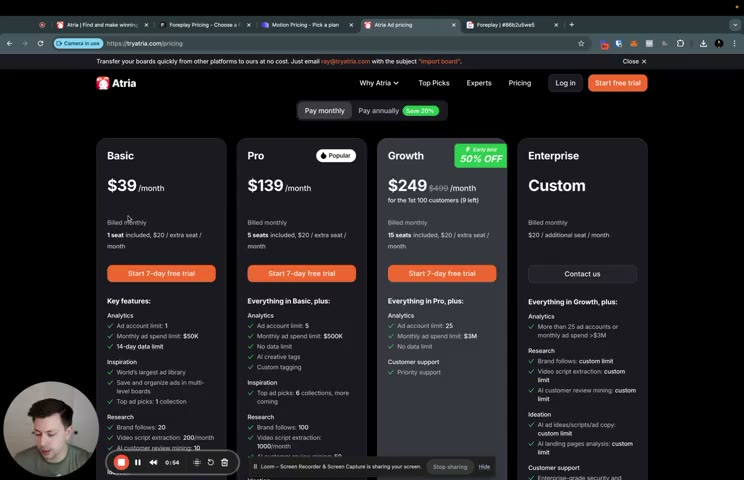
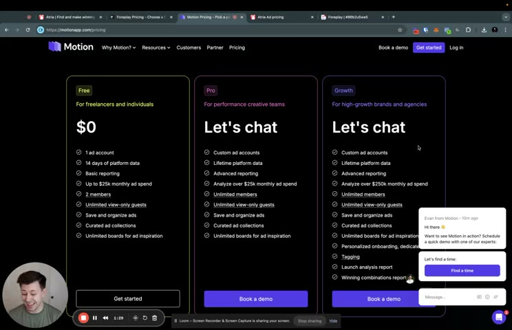
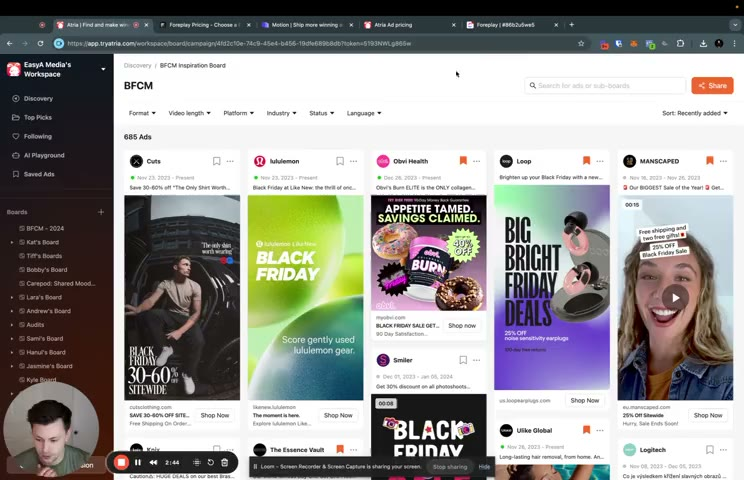
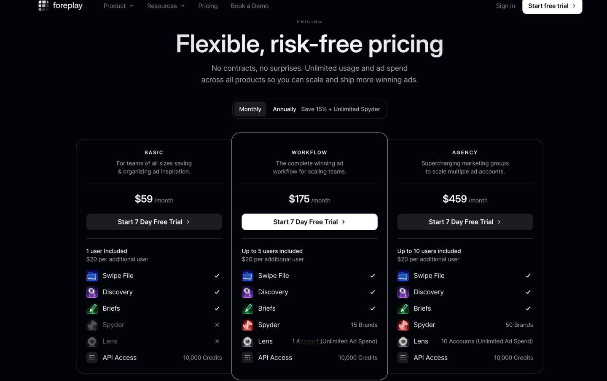
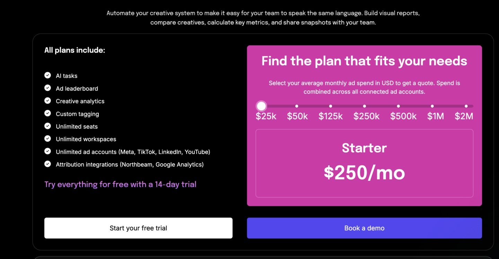

# 41. Creative Research - Part 1 (Atria)
> The agency replaced Foreplay with Atria as its swipe-file and creative-analytics tool: cheaper, covers what Motion does, and the next lesson's Foreplay walkthrough still applies method-wise.

## 🤖 Agent use
- **Use when:** choosing or setting up the tool that stores competitor ads and reports creative performance, or when lesson 42's Foreplay steps need an Atria equivalent.
- **Inputs → outputs:** monthly ad spend + number of ad accounts + need (swipe file only vs swipe file + analytics) → tool choice and an expected price band.
- **Rules:**
  - **DO** follow lesson 42's research method but run it in Atria: "in the video that is attached below, I still watch that video because everything in there fully applies." [00:00-00:51]
  - **DO** pick by spend band: swipe file only = Foreplay Basic; analytics + swipe file = Atria. Motion becomes "very, very expensive" above $25k/month ad spend. [00:51-01:28]
  - **DON'T** quote the prices said in the video as current; the page note says Atria is now $159/month and Foreplay Basic $59/month (page text). [page note]
  - **IF** you are migrating from Foreplay **THEN** ask Atria support to import your boards: the instructor says "just email Ray and he can get you moved over." [02:10-03:02]
  - **IF** it is Black Friday / Cyber Monday season **THEN** use Atria's BFCM inspiration board (685 ads) for seasonal angles. [02:10-03:02]
- **See also:** [42. Creative Research - Part 2](042-creative-research-part-2.md) · [43. Action Item/ Creative Research](043-action-item-creative-research.md) · [38. Facebook Research - Part 1](038-facebook-research-part-1.md) · [100. How To See Ads Performance + Our Columns](100-how-to-see-ads-performance-our-columns.md)

## Key ideas

### 1. Why Atria replaced Foreplay [00:00-01:28]
- The instructor films this as an "update" ("Spencer here from the future") placed before the Foreplay lesson. Two reasons: "we have found a cheaper tool" and "a tool that is honestly better and gives you just way more that you can look at." [00:00-00:51]
- Prices said in the video: Foreplay "$49 a month ... pretty standard"; Atria "$39 a month" and it also gives "functionality around actually getting analytics into your ad account". [00:00-00:51] (Both numbers are outdated; see price table.)
- Atria adds the function of Motion, "a creative reporting platform that gives you insights ... like creative cockpit" (his comparison: the Creative Cockpit in Triple Whale). [01:28-02:10]
- More Atria modules promised: "another module around Atria that shows you guys how to better understand and process learnings on ads". [00:51-01:28]

### 2. Cost argument vs Motion [00:51-02:10]
- Motion above $25k/month in spend "is very, very expensive". Agency scale quoted: "we manage almost $2 million a month right now in spend". Motion's growth plan would charge them "like two, $3,000 a month". Atria: "$250 a month. And that gives us up to $3 million in a monthly ad spend". (instructor claim) [00:51-01:28]
- Page note: "For even just $25k/mo it's $250 month (already cheaper)" for Motion, and "If you're spending $500k/month --> It's over $1,500/month" (page text; instructor figures, not verified). [page note]

### 3. What the screens show [00:00-02:45]
- Atria workspace: Discovery, Top Picks, Following, AI Playground, Saved Ads, plus boards per person/client (including a "BFCM - 2024" board). [00:05]
- Atria pricing page (video screenshot): Basic $39 (1 seat; 1 ad account; $50K monthly ad spend limit; 14-day data limit), Pro $139 (5 seats; 5 ad accounts; $500K monthly spend limit), Growth $249 (was $499; "50% off for the first 100 customers"; 15 seats; 25 ad accounts; $3M limit), Enterprise (custom). Billing: $20 per extra seat on paid plans. [00:55]
- Motion pricing page: Free tier ($0: 1 ad account, up to $25k monthly ad spend, 2 members), Pro and Growth are "Let's chat". [01:30]
- BFCM inspiration board: "685 ads for inspiration from Black Friday", partly from the instructor's YouTube video. [02:10-02:45]

*Atria plan comparison at recording time: spend limits and ad-account limits per tier. The tier that covers about $3M of monthly spend is Growth (billed $249). [00:55]*

*Motion's pricing: only the free tier shows a price; higher tiers require a sales conversation. [01:30]*

*The "BFCM Inspiration Board" in Atria with 685 Black Friday ads; use for seasonal hooks and offers. [02:45]*

## Steps / framework (derived)
1. Decide: swipe file only, or swipe file plus creative analytics.
2. If spend is below about $50K/month and you only need a swipe file: the cheapest plan of Atria or Foreplay Basic; above $25k/month Motion is the expensive option (instructor).
3. Sign up through the course link on the lesson page. (The page offers an Atria sign-up link; the lesson 42 and 43 pages show an affiliate version, so it is a referral link.)
4. Create a board per client; run [42. Creative Research - Part 2](042-creative-research-part-2.md) steps there.

## Structured units

### Tool price comparison (as stated, with dates of the source)
| Tool | Tier | Price in video (recording time) | Price on page note / Skool screenshot | Source |
|---|---|---|---|---|
| Foreplay | basic (swipe file) | "$49 a month" | Basic $59/mo; Workflow $175/mo (5 users, Spyder 15 brands, Lens 1 account); Agency $459/mo | [00:00-00:51]; page note; Skool image 1 |
| Atria | entry | "$39 a month" (Basic $39 on screen) | "It is $159/month now" (page note) | [00:51]; page note |
| Atria | agency scale | "$250 a month" for up to $3M spend (Growth, $249 on screen) | — | [01:28]; frame 00:55 |
| Motion | starter | — | $250/month at $25k monthly spend (slider shows Starter $250/mo); "over $1,500/month" at $500k (page note) | page note; Skool image 2 |

Skool page note (verbatim): "NOTE* Since making this video, Atria has increased its prices pretty significantly. With that said, we still use it and still believe in its value. It is $159/month now. That said if you want to use a cheaper option in foreplay just for the swipfile, it's $59."

*Image embedded in the Skool page: Foreplay monthly plans (Basic $59 with 1 user; Workflow $175; Agency $459). The page note uses the $59 figure for "just the swipe file". Not in the video.*

*Image embedded in the Skool page: Motion's spend-based calculator; at the $25k stop it quotes Starter $250/mo, with 14-day trial and attribution integrations listed. Not in the video.*

## How to apply
- [ ] Decide the tool by monthly spend and need; check current pricing, as the numbers in the video are outdated.
- [ ] Use the sign-up link from the lesson page if the team is following the course setup.
- [ ] Create a board per client; import old Foreplay boards through support if migrating.
- [ ] Save seasonal examples (BFCM) before a sale period.

## Related
- Previous: [40. Action Item/ Facebook Research](040-action-item-facebook-research.md) · Next: [42. Creative Research - Part 2](042-creative-research-part-2.md)
- [Creative testing system](../../../../frameworks/creative-testing-system.md)

## Sources and limitations
- Transcript: [41. Creative Research - Part 1 (Atria)….txt](<../../../../../raw/evolve/start-here/_transcripts/👣 Evolve (Start Here)/41. Creative Research - Part 1 (Atria) 👣 Evolve (Start Here) Evolve.txt>) · Page text: [41….html.md](<../../../../../raw/evolve/start-here/_extracted/👣 Evolve (Start Here)/41. Creative Research - Part 1 (Atria)_👣 Evolve (Start Here)_Evolve.html.md>) · Images: [41-img01.png](../../../../../raw/evolve/start-here/linked/skool-images/41/41-img01.png), [41-img02.png](../../../../../raw/evolve/start-here/linked/skool-images/41/41-img02.png)
- Machine transcription. Full recording covered (181.8 s). The instructor says "Atria. Or sorry, rather than me going through Atria, I'm going through Foreplay" (a slip: the next video uses Foreplay).
- Pricing conflicts: the video says Atria $39 and Foreplay $49; the page note says Atria $159 and Foreplay $59; the on-screen Atria page shows Pro $139. Treat all as dated. The "up to $3 million" is the Growth tier limit on screen. The page links an Atria sign-up shortlink; it is a referral link.
