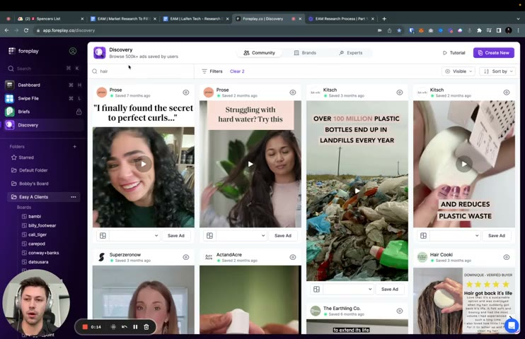
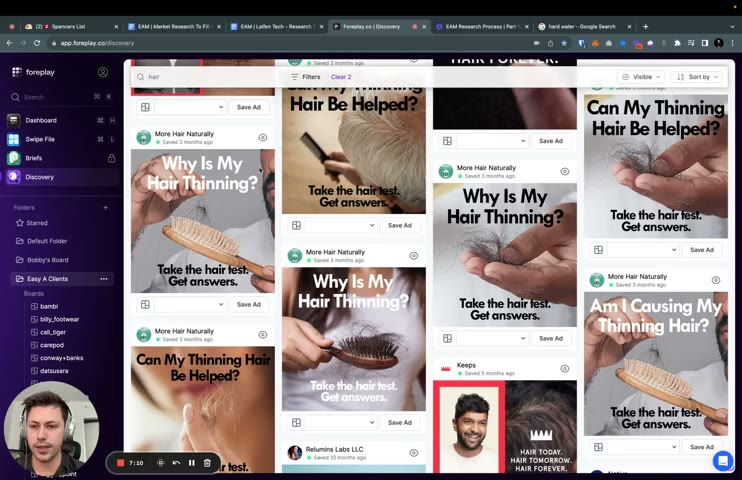
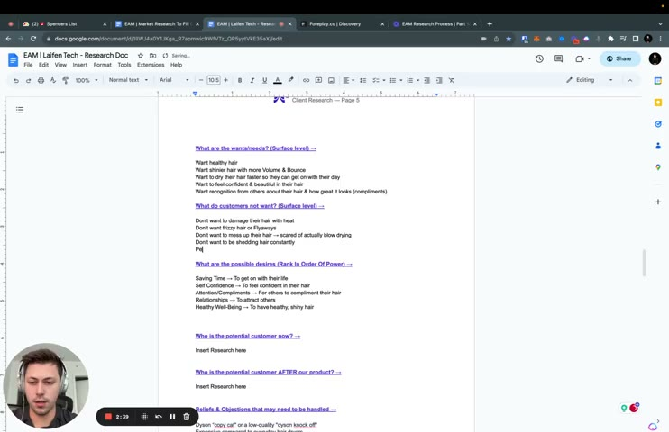
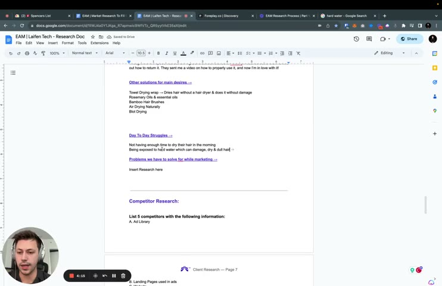

# 42. Creative Research - Part 2
> Search the swipe-file tool's ad library for your niche, filter to English and still-running ads, sort by longest running, and mine those ads for hooks, desires, fears, formats and ad ideas ("imitation research").

## 🤖 Agent use
- **Use when:** collecting proven creative inspiration and market signals for a niche; building a vision board for a creative strategy session; looking for hook patterns and desires that survive a long time in-market.
- **Inputs → outputs:** niche keywords (e.g. "hair", "hair dryer", "healthy hair", "hairstyle") → saved ads on a client board + headline-inspiration templates, desires, "don't want" fears, problems and format ideas in the research doc.
- **Rules:**
  - **DO** search inside Discovery with several niche terms; "you're really gonna want to play with the search bar". [00:00-00:54]
  - **DO** always apply two filters, **English** and **status = still running**, then sort by **longest running**; "that's gonna bring the best ads up to the top." [00:00-00:54]
  - **DO** treat run length as a performance proxy: 996-day, 992-day and 884-day ads in the demo are "a brand that is spending a shitload of money", "probably a good ad". [00:54-01:50] (instructor inference)
  - **DO** save the ads you like and log: headline inspo with the desire swapped in, the desire behind it, what customers do not want, and a visual/format idea. [01:50-02:21; 03:49]
  - **DO** do "imitation research": "a lot of the research that we've done previously was kind of around ideation, and maybe some iterations. But now we're doing some imitation. We're seeing what's working." [03:18]
  - **DON'T** only copy: "that is essentially directly copying competition. But what you can also do is just interpret it." Read the message and ask what desire is being served. [02:21-03:18]
  - **IF** a word recurs across long-running ads (the instructor spots "secret") **THEN** note it as a pattern and test it with your desire: "the secret to [desire goes here]". [05:36-06:08]
  - **IF** an ad shows a problem you had not listed (hard water) **THEN** research the problem and add it to "What do customers not want" and "Problems we have to solve". [03:49-04:43]
- **See also:** [41. Creative Research - Part 1 (Atria)](041-creative-research-part-1-atria.md) · [43. Action Item/ Creative Research](043-action-item-creative-research.md) · [38. Facebook Research - Part 1](038-facebook-research-part-1.md) · [Hooks (Copywriting)](../../copywriting/concepts/hooks.md) · [Competitor ad teardown playbook](../../../../playbooks/competitor-ad-teardown.md)

Page text: a reminder that the team "NO LONGER use[s] Foreplay, this video is for training purposes", they moved to Atria (as described in lesson 41), plus an Atria sign-up link and the course loop. Run the same search, filter and sort steps in Atria.

## Key ideas

### 1. Search, filter, sort [00:00-00:54]
- Tool: Foreplay, tab "Discovery" (community-saved ads). Niche here is "hair", with variants "hair dryers", "healthy hair", "hairstyle". [00:00]
- Filters: "number one is going to be English. ... status is still running"; then Sort by -> Longest running. [00:00-00:54]


*Foreplay Discovery with search "hair", two filters applied ("Clear 2") and a Sort by control. This is the starting view for the method (Atria has the same flow). [00:15]*

### 2. Reading the list [00:54-03:18]
- Long-running ads seen: "I finally found the secret to perfect curls" at 996 days; "Struggling with hard water? Try this" at 992 days; two ads at 884 days (one on color protection, one "Sharing my secret to combat hair thinning"; Whisper does not make clear which duration is which). [00:54-01:50]
- Action per ad: save it; write headline inspo with a placeholder: "I finally found [whatever the desire is]: the secret to perfect curls, the secret to drying my hair faster. Or you could just say, insert desire here." [01:50-02:21]
- Interpretation instead of copying: the message is perfect curls, so "perfect curls" is a desire to add; "what do customers want? They want perfect curls and styled hair." [02:21-03:18]
- The instructor labels the first-person, result-first openers a "reverse hook" / "reverse effect" and logs "Potentially Reverse effect on the hook" in the doc (screen text). The term is not defined in the audio; (derived) it appears to mean past-tense first-person hooks like "I finally found..." and "Why I switched from X to Y". [02:21; 08:07]
- Raw unboxing format spotted: "my Pros products came in the mail today... it's an unboxing"; logged as "More of a raw unboxing style video". [02:21-03:18]

### 3. Turn ads into desires, fears and problems [03:49-05:36]
- Hard water ad (992 days): he looks up hard water, finds it is "high dissolved minerals, largely calcium, magnesium", and adds "don't want hard water damage" under customers do-not-want; ad copy read: "Most hair care products don't account for hard water." [03:49-04:43]
- Eco angle ("Over 100 million plastic bottles end up in the landfills") with shampoo and conditioner bars. [03:49-04:43]
- Format insight: a 742-day video uses a split screen (product on one side, person using it on the other) with social proof on top: "not only are we leveraging social proof, ... we're having an interesting creative style of showing the product and what it is and then the actual person using it." [04:43-05:36]
- Word pattern: "the word secret is apparently doing pretty well. People want to know the secret sauce." [05:36-06:08]
- Visual fear: "This is literally my hair, thin, brittle. You can see right through my scalp." Logged as "don't want thin, see-through hair" ("a very visual one"). [05:36-06:08]
- Emotion fear: "Look, I was so embarrassed." "They don't want to feel embarrassed. Right. No one does." [06:08]

### 4. Vision board and more patterns [06:08-08:33]
- "You're also getting a really, really good vision board built for our creative strategy sessions." [06:08]
- Seen in the scroll: "Results guaranteed or your money back"; "Before and after. Very simple."; attractive people in most ads ("That's what they kind of want to be"); a 17-second power-gummies ad at 343 days; fear-based questions ("Can my thinning hair be helped? Why is my hair thinning? ... Take the hair test") from a company he thinks is "absolutely abusing this fear"; a 300-day ad for a client's sleep-wrap product. [06:08-07:07]
- More: "See the difference in just one watch"; "Why I switched from generic to personalized hair care"; he improvises "Why I switched from cheap hair dryers to a more expensive one." [07:07-08:07]
- Closing: use the filters English, still active, longest running. "That was just hair, right? So play around with the search filter." [08:07-08:33]


*A cluster of near-identical fear-question ads ("Why Is My Hair Thinning?", "Can My Thinning Hair Be Helped?", "Take the hair test. Get answers."): the same hook repeated across creatives suggests the angle is working. [07:10]*

### 5. Where it goes in the research doc [02:40; 04:15]
The "Client Research" doc sections he fills (screen text):


*Research doc: surface-level wants and do-not-wants plus "possible desires (Rank In Order Of Power)". The instructor types the foreplay findings under "What do customers not want?". [02:40]*


*Research doc: other solutions, day-to-day struggles (hard water entered here) and "Problems we have to solve while marketing", directly above the Competitor Research block. [04:15]*

## Steps / framework
1. Open Discovery (Foreplay) / Atria; search niche term(s). [00:00]
2. Filters: Language = English; Status = Still running. Sort = Longest running. [00:00-00:54]
3. Scroll the results (no count given in the lesson); save every ad with a notable hook, format or desire to the client board. [01:50]
4. For each saved ad, write in the doc: (a) headline inspiration with `[desire]` swapped; (b) the desire; (c) what customers do not want; (d) a visual or format idea. [01:50-04:43]
5. Look up unfamiliar problems (e.g. hard water) and add them to problems and day-to-day struggles. [03:49]
6. Look for recurring words ("secret"), formats (split screen, unboxing, before/after) and fears (thinning, embarrassment). [05:36-07:07]
7. Re-search with another term and repeat. [08:07-08:33]

## Examples

### Hooks
| Hook | Heuristic(s) | Emotion / zone | Self targeted | Why it works | Source |
|---|---|---|---|---|---|
| "I finally found the secret to perfect curls..." (996 days) | Curiosity / secret (derived) | Hope (derived) | — | Names the desired result; running 996 days implies it pays back | [00:54; 02:21] |
| "Struggling with hard water? Try this" (992 days) | Problem call-out (derived) | — | — | Names a specific, little-known problem; ad claims "Most hair care products don't account for hard water" | [00:54; 03:49] |
| "Sharing my secret to combat hair thinning" | Curiosity / secret (derived) | Fear of hair loss (derived) | — | Pairs "secret" with a visual fear (see-through scalp) | [05:36-06:08] |
| "Can my thinning hair be helped? Why is my hair thinning? Take the hair test" | Question + curiosity (derived) | Fear (derived) | — | Repeated across creatives; instructor: the company is "abusing this fear" | [07:07] |
| "Why I switched from generic to personalized hair care" | Reverse / switch story (derived) | — | — | Past-tense first-person switch narrative; instructor calls it "the reverse effect again" | [07:07-08:07] |
| "Why I switched from cheap hair dryers to a more expensive one" | Reverse / switch story (derived) | — | — | The instructor's own adaptation of the pattern for the client's product | [07:07-08:07] |
| "Results guaranteed or your money back" | Risk reversal (derived) | — | — | Noted while scrolling | [06:08] |

### Ad teardowns
| Brand / product (niche) | Format | Hook / opening | What works | What fails | Fix suggested | Principle | Source |
|---|---|---|---|---|---|---|---|
| Hair-care brand, 742-day ad | Split-screen video | Product on one side, person using it on the other; social proof on top | Shows the product and its use at once; social proof visible in-frame | — | Save for creative strategy sessions | Combine product demo and social proof in one frame | [04:43-05:36] |
| Hair-care brand, UGC unboxing | Raw unboxing video | "My [brand] products came in the mail today... I'm so excited to try them" | Raw unboxing style | — | Add as a format idea | Unboxing as a UGC format | [02:21-03:18] |
| Shampoo/conditioner bars (eco) | Video | "Over 100 million plastic bottles end up in landfills" | Eco-friendly angle | — | Log "eco-friendly" as an adjacent desire | Statistic-led opener | [03:49-04:43] |

### Rules of thumb
- **DO** write the desire as a placeholder so the pattern can be re-used: "I finally found the secret to [desire]". [01:50-02:21]
- **DO** note which people appear in ads: "most of these people are attractive people... that's what they kind of want to be." [06:08] (instructor observation)
- **DON'T** assume every long runner is good for your offer; he writes "probably" and "or they just have money to burn" about one brand. [00:54-01:50]

## Prompts / templates (verbatim)
Research-doc headings visible on screen (lesson 42 frames at 02:40 and 04:15):

```
What are the wants/needs? (Surface level) →
What do customers not want? (Surface level) →
What are the possible desires (Rank In Order Of Power) →
Who is the potential customer now? →
Who is the potential customer AFTER our product? →
Beliefs & Objections that may need to be handled →
Questions Customers Have →
Other solutions for main desires →
Day To Day Struggles →
Problems we have to solve while marketing →
Competitor Research:
List 5 competitors with the following information:
A. Ad Library  B. Landing Pages used in ads  C. Website  D. Product price range  E. Active Offers  F. Competitor Notes
```

Entries typed in the demo (screen text, hair-dryer client):
- Wants: healthy hair; shinier hair with more volume and bounce; dry hair faster to get on with the day; feel confident and beautiful; recognition and compliments.
- Do not want: damage from heat; frizzy hair or flyaways; mess up their hair (scared of blow drying); constant shedding.
- Desires ranked: Saving Time; Self Confidence; Attention/Compliments; Relationships ("to attract others"); Healthy Well-Being.

## How to apply
- [ ] Run Discovery for 3+ niche terms, filtered English and Still running, sorted by Longest running.
- [ ] Save 10+ ads per term; for each, add a doc line with desire, fear and format.
- [ ] Count repeated words, formats and fears; mark patterns that appear in 3+ ads.
- [ ] Add one new problem per session to "Problems we have to solve while marketing".
- [ ] Rewrite each saved hook with our desire; never reuse competitor wording or claims.

## Related
- Previous: [41. Creative Research - Part 1 (Atria)](041-creative-research-part-1-atria.md) · Next: [43. Action Item/ Creative Research](043-action-item-creative-research.md)
- [44. TikTok Research](044-tiktok-research.md) · [48. Understanding Other Desires](048-understanding-other-desires.md) · [Unique mechanism (Copywriting)](../../copywriting/concepts/unique-mechanism.md)

## Sources and limitations
- Transcript: [42. Creative Research - Part 2….txt](<../../../../../raw/evolve/start-here/_transcripts/👣 Evolve (Start Here)/42. Creative Research - Part 2 👣 Evolve (Start Here) Evolve.txt>) · Page text: [42….html.md](<../../../../../raw/evolve/start-here/_extracted/👣 Evolve (Start Here)/42. Creative Research - Part 2_👣 Evolve (Start Here)_Evolve.html.md>)
- Machine transcription. Full recording covered (512.68 s). Whisper heard "Pros"/"Pros products" for the brand Prose (screen label), "Foreplace" for Foreplay, and "Zutero's sleep" for an unclear brand name. Ad day counts are as read aloud from Foreplay in 2023 and are stale. The page says Foreplay is no longer used; Atria is the replacement.
