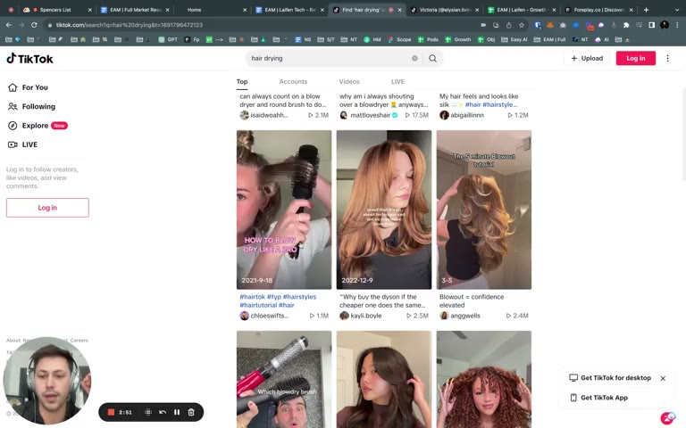
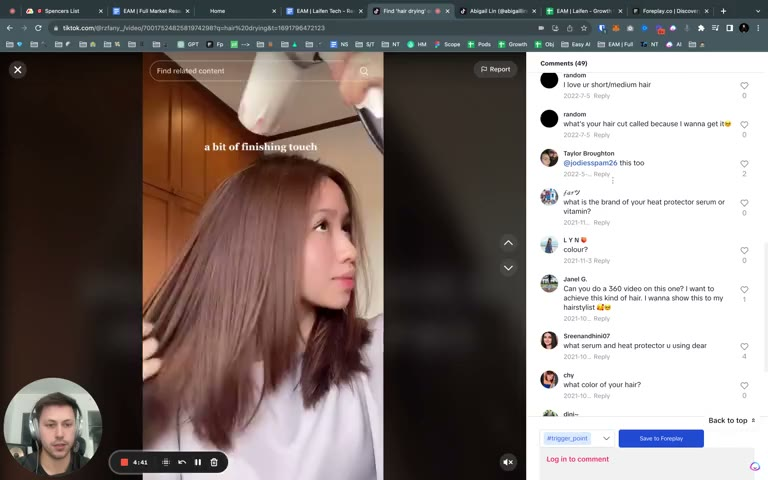
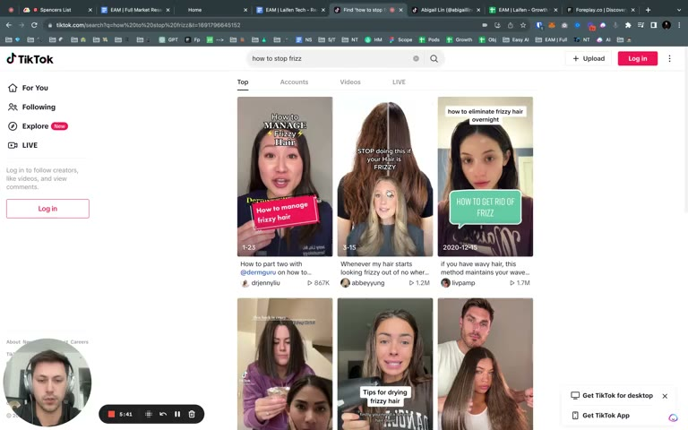
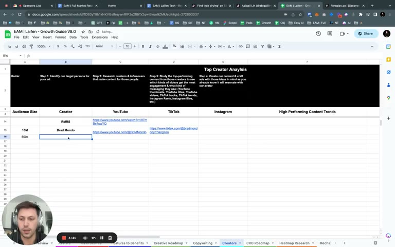

# 44. TikTok Research
> Search TikTok for each desire and "don't want" in your research doc, find the high-engagement videos and creators, read the comments, and log content formats, hooks and creators for later ads and creator outreach.

## 🤖 Agent use
- **Use when:** validating desires and finding native content formats and creator candidates for a niche; the final step of the research-doc build before cleaning the doc.
- **Inputs → outputs:** the desires, fears and general niche terms already in the research doc → a list of searched terms, high-view video formats and hooks, comment insights, and creator candidates (name, platform, audience size).
- **Rules:**
  - **DO** search TikTok with the desires, the wants and the "customers do not want" items from the research doc, plus general niche terms (e.g. "hair drying", "thin and damaged hair", "how to stop frizz"). [00:00; 04:33-05:31]
  - **DO** look for videos with high engagement and note the format: "18 and a half million views... hair care routine"; POV wash day; ASMR ("we know that ASMR typically does well"). [00:00-00:51]
  - **DO** check the creator's profile: are they a niche creator or a general lifestyle account? Note whether they fit the creator list. [00:00-00:51; 02:46-03:35]
  - **DO** read the comments on every promising video: "Comments are king." [03:35-04:33]
  - **DO** save the video to the swipe-file board (extension) or save the link and paste it into the board manually. [01:47-02:46; 06:30-07:15]
  - **DO** add creators to the creator list with audience size and look for them on YouTube and Instagram ("we're advertising on Instagram"); check their link-in-bio for links. [02:46-03:35]
  - **DON'T** add the creator to the "growth guide"; per the page note: "Rather than adding creators to the 'growth guide' that I show in the video ... just keep track of content creators in your research document." (page text)
  - **IF** tutorial or "how to" videos dominate the results **THEN** record tutorial-style content as a resonating format. [02:46-03:35]
  - **IF** a hook has no time frame **THEN** add one: "How to eliminate frizzy hair overnight. There's a great hook as well. How to eliminate, add a time to it." [05:31-06:30]
- **See also:** [42. Creative Research - Part 2](042-creative-research-part-2.md) · [45. Action Item/ TikTok Research](045-action-item-tiktok-research.md) · [85. The 3.0 Evolve Growth Guide](085-the-3-0-evolve-growth-guide.md) · [TikTok creator search insights (tool)](../../../../tools/tiktok-creator-search-insights.md) · [136. How To Get Viral UGC Inspo For Creators & Ads](136-how-to-get-viral-ugc-inspo-for-creators-ads.md)

Page text note (verbatim): "Rather than adding creators to the 'growth guide' that I show in the video (you will receive that document shortly) just keep track of content creators in your research document."

## Key ideas

### 1. Search by desire, then rank by engagement [00:00-00:51]
- "Scroll back down here to find the desires the customer wants and what they don't want. And what you're going to do is just search that up on TikTok." [00:00]
- Evaluate the video (format, hook), the comments and the creator. Example: a "hair wash day" POV, ASMR-style routine video with 18.5M views. The creator's account is general wellbeing and living, not hair care, so "probably not" a creator to store; a hair creator such as Brad Mondo "we definitely should." [00:00-00:51]

*TikTok search results for "hair drying": tutorial-style videos ("How to blow dry like a pro", blowout tutorials) with 1M-2.5M views each. The instructor concludes tutorial content "seems to resonate well." [02:50]*

### 2. Comments as research [00:51-01:47; 03:35-04:33]
- Example comments from the first video: people call out the creator's habit (raw oil on the scalp) and say "My hair wash day is literally every day". The instructor reads this as a possible reason for the video's reach. [00:51-01:47]
- On another creator's video: "Is hair drying won't damage your hair?", "I wish I had thin hair", "What's your cut hair?" [03:35-04:33]
- Seen in the comment panel: product questions (brand of heat protector, serum, hair colour) which are objection and purchase-intent signals (derived).

*A hair-tutorial video with its comments panel: "what is the brand of your heat protector serum or vitamin?" and "what serum and heat protector u using" are purchase-intent questions. The Save to Foreplay bar sits under the comments. [04:40]*

### 3. Save and organize [01:47-02:46; 06:30-07:15]
- Use the swipe-file board for the client. The save button is on the "For You" page only ("which seems a little odd"); otherwise copy the video link and add it manually (create new -> save new ads -> paste link -> choose client board). The extension may require being logged in to TikTok. [01:47-02:46; 06:30-07:15]

### 4. Content patterns noticed [02:46-06:30]
- Searches: "hair blowout tutorial", "How to blow dry like a pro five minute blowout tutorial", "blow dry roadmap". [02:46]
- "Try this hair drying hack... people say they're jealous of my hair". [02:46]
- 20M-view video: "How to do a blowout on short hair". "Blowout seems to be like one of the main things that people are talking about." [04:33]
- "I need your hair care routine now, healthiest hair ever" -> "Here's my hair care routine for the healthiest hair ever." Logged as an ad idea. [04:33]
- Frizz searches show many green-screen videos: "Stop doing this if your hair is frizzy" (1.2M views), "How to eliminate frizzy hair overnight". [05:31]
- High-quality example: half her hair styled, half not, a man talking about it, "one minute transformation", a comment "I just bought this. I promise to come back and tell y'all the honest to God truth". [05:31-06:30]

*"How to stop frizz" results: how-to titles, green-screen explainers and an overnight-fix hook. [05:40]*

### 5. Creator list [02:46-03:35]
- The "Creators" tab of the growth guide sheet: columns Audience Size, Creator, YouTube, TikTok, Instagram, High Performing Content Trends. Two sample rows: Brad Mondo (10M), a 500K creator (name read as "Abigail Lynn"). [03:35]
- Cross-platform check: search the creator on YouTube and Instagram; use their link-in-bio. In the demo one creator turns out to be "already an ambassador for the [brand]. So product research success. Finding our avatars to a T." [03:35-04:33]
- The sheet's guide row: "Step 1: Identify your target persona for your ad. Step 2: Research creators & influencers that make content for those people. Step 3: Study the top-performing content from those creators to see which kinds of videos get the most engagement & what kind of messaging they use (YouTube thumbnails, YouTube titles, YouTube videos, TikTok hooks, TikTok trends, Instagram Reels, Instagram Bios, etc.). Step 4: Create our content & craft ads with those ideas in mind so they know it will resonate with our avatar." (screen text, 03:40)

*The creator-research sheet ("Top Creator Analysis") with its four-step guide and two example rows. Per the page note, track creators in the research doc instead. [03:40]*

## Steps / framework
1. Take each want, do-not-want, desire and niche term from the research doc.
2. Search TikTok; sort the visible results by view count (or note "Top").
3. For each strong video: write format (POV, ASMR, tutorial, green screen, transformation), hook line, view count, and the creator.
4. Open the comments; copy questions, objections and "I just bought this" signals.
5. If a creator fits, add to the research-doc creator list (audience, platforms, content trends); check their other platforms.
6. Save the video to the board (For You page extension) or paste the link manually.
7. Turn patterns into ad ideas in the doc (tutorial-style ads; time-bound hooks).

## Examples

### Hooks
| Hook | Heuristic(s) | Emotion / zone | Self targeted | Why it works | Source |
|---|---|---|---|---|---|
| "How to eliminate frizzy hair overnight" (1.2M views, frizz search) | Specificity / time frame (derived) | — | — | "Add a time to it" makes it concrete | [05:31] |
| "Try this hair drying hack" | Curiosity (derived) | — | — | Seen alongside "people say they're jealous of my hair" | [02:46] |
| "I want to teach you how to blow dry your hair" / "How to blow dry like a pro five minute blowout tutorial" | Tutorial promise (derived) | — | — | Tutorial content "seems to resonate well" | [02:46] |
| "Here's my hair care routine for the healthiest hair ever" | Result promise (derived) | — | — | Appears with demand comment "I need your hair care routine now" | [04:33] |

### Rules of thumb
- **DO** use ASMR and "wash day" POV as format candidates for hair content. [00:00-00:51] (instructor inference)
- **DO** check whether a popular video's creator actually works in your niche before listing them. [00:00-00:51]
- **IF** TikTok will not let you save to the swipe tool **THEN** save the link and paste it in. [01:47-02:46]

## How to apply
- [ ] Search at least 5 terms drawn from desires, fears and niche words; record top videos with view counts.
- [ ] Log format, hook, and 3+ representative comments per video.
- [ ] Add 3-5 niche creators to the research doc list (audience size, platforms, content trends).
- [ ] Turn recurring formats (tutorial, transformation, green-screen) into ad ideas; time-bound the hooks.
- [ ] Keep a link list of saved videos if the extension fails.

## Related
- Previous: [43. Action Item/ Creative Research](043-action-item-creative-research.md) · Next: [45. Action Item/ TikTok Research](045-action-item-tiktok-research.md)
- [Hooks (Copywriting)](../../copywriting/concepts/hooks.md) · [Avatars and angles (Copywriting)](../../copywriting/concepts/avatars-and-angles.md)

## Sources and limitations
- Transcript: [44. TikTok Research….txt](<../../../../../raw/evolve/start-here/_transcripts/👣 Evolve (Start Here)/44. TikTok Research 👣 Evolve (Start Here) Evolve.txt>) · Page text: [44….html.md](<../../../../../raw/evolve/start-here/_extracted/👣 Evolve (Start Here)/44. TikTok Research_👣 Evolve (Start Here)_Evolve.html.md>)
- Machine transcription. Full recording covered (434.71 s). Whisper wrote "Abigail Lynn" for a creator whose profile name is partly visible on screen ("Abigail Lin"-like); treat the spelling as uncertain. "Life in" in the audio is the client brand Laifen. "ProPlay" = Foreplay. "Brad Mondo" is a hair creator named on screen.
- The growth guide mentioned ("you will receive that document shortly") is the sheet covered in [85. The 3.0 Evolve Growth Guide](085-the-3-0-evolve-growth-guide.md); that lesson's page was not read for this write-up.
