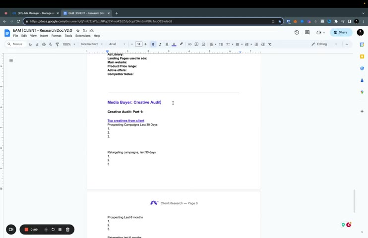
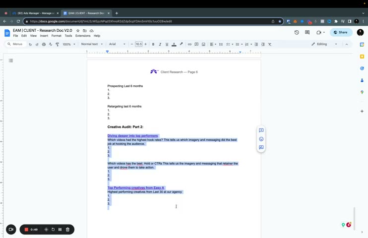
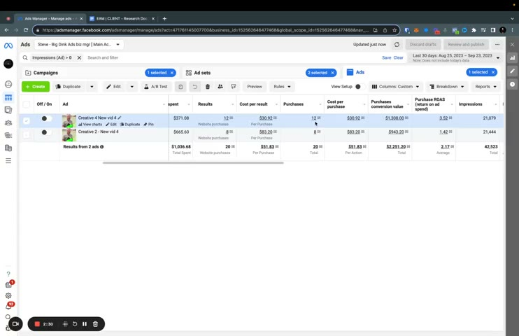
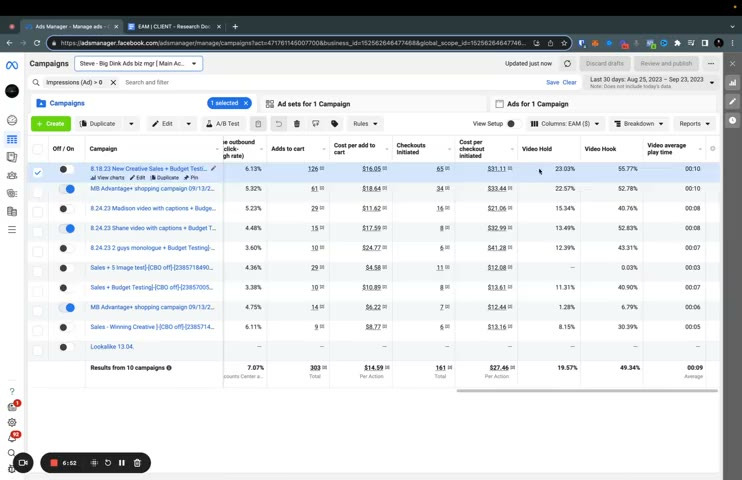

# 46. Ad Account Research
> The "media buyer creative audit": pull the top prospecting and retargeting ads from a new client's account (last 30 days and last 6 months), log their hook, hold and CTR leaders, and carry the winners into the new acquisition campaign.

## 🤖 Agent use
- **Use when:** onboarding an account that has spend history (a new client, an inherited account, our own brand) and you need to know which creatives already work before launching a new structure.
- **Inputs → outputs:** read access to Ads Manager + the research doc's "Media Buyer: Creative Audit" section → ad links and metrics for top prospecting/retargeting ads (30 days and 6 months), top hook-rate and hold/CTR ads, and a "winners to carry over" list.
- **Rules:**
  - **DO** audit top prospecting creatives and top retargeting creatives for the last 30 days, then the last 6 months. [00:00-00:55; 05:02]
  - **DO** rank by highest spend and lowest CPA (or best ROAS): "highest spend and lowest CPA... or best ROAS." [01:36]
  - **DO** filter by spend so the data has the most volume, then compare purchases. [01:36-02:18; 06:43]
  - **DO** check duplicates: the same creative often sits in several ads, "just always make sure you double check them". [02:18]
  - **DO** verify the campaign is prospecting before logging: "this is broad. This is wide open targeting. This is not retargeting." [03:08]
  - **DO** grab each ad's link: open the ad, click Edit, click Share, copy the share link, paste into the sheet. [02:18-03:08]
  - **DO** set custom columns for Video Hold, Video Hook, average play time and CTR, and save the column preset so it stays in the account. [06:00-06:43]
  - **DO** log the best hook-rate videos and the best Hold/CTR videos, then compare against the agency's own top performers in the last 30 days. [00:55; 06:43-07:29]
  - **DON'T** assume retargeting exists. If none is found write: "no clear retargeting ads over the last 30 days." [04:03-05:02]
  - **IF** no retargeting is visible **THEN** sort by frequency and list the ads with the highest frequency (e.g. 2.77) as probable retargeting. [04:03-05:02]
  - **DON'T** trust the previous agency's structure: the demo account has duplicated creatives and no post IDs reused. [01:36-02:18]
- **See also:** [100. How To See Ads Performance + Our Columns](100-how-to-see-ads-performance-our-columns.md) · [47. Action Item/ Ad Account Research](047-action-item-ad-account-research.md) · [39. Facebook Research - Part 2](039-facebook-research-part-2.md) · [Creative testing system](../../../../frameworks/creative-testing-system.md)

Page text: only the course loop reminder. The demo is a "practice audit" on an account the agency "just brought on". [00:00]

## Key ideas

### 1. The audit has four parts [00:00-00:55]
1. Top prospecting campaigns, last 30 days.
2. Top retargeting campaigns, last 30 days.
3. The same two for the last 6 months.
4. Dive into top performers: highest hook rates ("which imagery and messaging did the best job at hooking the audience"), best hold / CTR ("the imagery and messaging that retained the user and drove them to take action"), and "top performers from [the agency]" (Whisper "EZA", screen shows "Easy A"): "highest performing creatives from last 30 at our agency".
- Purpose: "make sure that we know in our accounts which ads are top performing. So that way we have an idea of some directions to go." [00:55]


*The research doc's audit block: top creatives from client, prospecting campaigns last 30 days (1-3), retargeting campaigns last 30 days (1-3). [00:10]*


*Part 2 of the audit with the two questions (highest hook rates; best hold or CTRs) and the agency top performers list. [00:50]*

### 2. Pulling the 30-day prospecting winners [01:36-04:03]
- Set Ads Manager to the account, Last 30 days, a delivery filter "impression zero" (screen: Impressions > 0), then sort by spend; check purchases. [01:36]
- In the demo two ads in one campaign are the same creative with no shared post ID; preview, confirm it is the same ad, then grab one link. [01:36-02:18]
- Link procedure: Edit the ad -> Share -> copy link -> paste into the doc's "Prospecting last 30 days" list. [02:18-03:08]
- Confirm prospecting: wide-open targeting; an Advantage Shopping campaign also counts as a top spender. Add 1-3 ads per campaign "rinse and repeat" for all top ads by spend and lowest CPA. [03:08-04:03]


*Ads-level view for one campaign over the last 30 days: two ads (the same creative) with spend, results, cost per purchase and purchase ROAS visible. [02:30]*

### 3. Retargeting and the frequency fallback [04:03-05:02]
- If there are no retargeting campaigns: "just note that there is no retargeting ads kind of set up." Write "no clear retargeting ads over the last 30 days". [04:03]
- Fallback: sort campaigns by frequency. In the demo one ad has "2.77 frequency... looks like more of a retargeting ad", but spends "a dollar a day". It did well, so he grabs its creative anyway. A "180 day page view" audience is also seen with no data. [04:03-05:02]

### 4. Six-month pass [05:02-06:00]
- Repeat the exact process with the date range at 6 months, "analyze it properly and pay attention to detail to ensure that you've got the clear winning ads." [05:02-06:00]

### 5. Hook, hold and CTR [06:00-07:29]
- Customize columns: Video Hold, Video Hook (both already created in the account), Average play time, CTRs. Name the column preset so it persists. [06:00]
- Hook-rate leader in the demo: "55% hook rate. This is great." (screen: Video Hook 55.77%, Video Hold 23.03%, avg play time 0:10 for that ad). [06:00-06:43]
- Filter by spend first ("this will just give us the most amount of data"), then look at which ads hook best and hold best. Duplicated creatives: copy just once. CTRs are "really, really good here" for the same ad. [06:43-07:29]


*The custom columns used for the audit: Video Hold, Video Hook and Video average play time next to cost per add to cart and checkouts initiated. [06:50]*

### 6. Why it matters for the next build [07:29-08:06]
- Winners from the audit must be "in there prior to ... launching our DCTs" so the new structure starts with proven ads and "we can work on pulling spend from the ones that weren't getting spent". [07:29]
- The new structure referenced: an "optimized acquisition campaign" with a "champions ad set" holding the previous winners, "for us to come in and focus on". For questions, ask the senior media buyer or senior strategist. [07:29-08:06]

## Steps / framework
1. Ads Manager -> account -> filter Impressions > 0 -> Last 30 days.
2. Sort ads by spend desc. Take the top ads by spend and lowest CPA / best ROAS. For each: confirm campaign type (broad prospecting), confirm unique creative, copy share link into doc (prospecting list).
3. Repeat for retargeting. If none, note it; use highest-frequency ads.
4. Repeat steps 1-3 for Last 6 months.
5. Add Video Hook, Video Hold, average play time, CTR columns; save the preset.
6. List the top hook-rate ads and top hold/CTR ads (spend-filtered); record metrics.
7. Add the agency top performers from the last 30 days.
8. Hand the list to the strategist and media buyer to seed the champions ad set.

## Prompts / templates (verbatim)
Research-doc audit block (screen text, compiled from frames at 00:10, 00:50 and 01:40; layout simplified):

```
Media Buyer: Creative Audit

Creative Audit: Part 1:
Top creatives from client base on HIGHEST SPEND & LOWEST CPA or BEST ROAS
Prospecting Campaigns Last 30 Days
1.
2.
3.

Retargeting campaigns, last 30 days
1.
2.
3.

Prospecting Last 6 months
1.
2.
3.

Retargeting last 6 months
1.
2.
3.

Creative Audit: Part 2:
Diving deeper into top performers
Which videos had the highest hook rates? This tells us which imagery and messaging did the best job at hooking the audience.
1.
2.
3.
Which videos has the best Hold or CTRs This tells us the imagery and messaging that retainer the user and drove them to take action.
1.
2.
3.
Top Performing creatives from Easy A
Highest performing creatives from Last 30 at our agency
1.
2.
3.
```
(The "retainer" typo and "Easy A" are as shown on screen; "Easy A" is the agency name.)

KPIs used: hook rate (Video Hook column), hold (Video Hold column), average play time, CTR, frequency, purchases, cost per purchase, ROAS. The lesson gives no thresholds beyond the single "55% hook rate" example and "2.77 frequency".

## Examples
- Duplicate creatives in one campaign: the audit logs the creative once, with the better ad link, rather than twice. [01:36-02:18; 06:43-07:29]
- A $1/day ad with frequency 2.77 and good results: logged as a probable retargeting winner despite the tiny budget. [05:02]
- Missing retargeting: write the note instead of leaving the list blank. [04:03]

## How to apply
- [ ] Complete the four lists (30-day and 6-month, prospecting and retargeting) with ad links, spend, purchases, CPA/ROAS.
- [ ] Flag duplicates; keep one link per unique creative.
- [ ] Set and save the Hook/Hold/Play-time/CTR column preset; list the top 3 by hook and top 3 by hold/CTR (filtered by spend).
- [ ] Write "no clear retargeting" when applicable and list the highest-frequency ads.
- [ ] Hand the winner list to the media buyer for the champions ad set before new tests launch.

## Related
- Previous: [45. Action Item/ TikTok Research](045-action-item-tiktok-research.md) · Next: [47. Action Item/ Ad Account Research](047-action-item-ad-account-research.md)
- [100. How To See Ads Performance + Our Columns](100-how-to-see-ads-performance-our-columns.md) · [Iteration vs variation](../../../../concepts/iteration-vs-variation.md)

## Sources and limitations
- Transcript: [46. Ad Account Research….txt](<../../../../../raw/evolve/start-here/_transcripts/👣 Evolve (Start Here)/46. Ad Account Research 👣 Evolve (Start Here) Evolve.txt>) · Page text: [46….html.md](<../../../../../raw/evolve/start-here/_extracted/👣 Evolve (Start Here)/46. Ad Account Research_👣 Evolve (Start Here)_Evolve.html.md>)
- Machine transcription. Full recording covered (485.72 s). Whisper wrote "EZA" for the agency name (screen: "Easy A"), "optimized acquisition campaign" and "DCTs" as spoken ("DCT" is read here as dynamic creative test; unconfirmed). Audit is on an account that was "an absolute disaster", so the quirks (duplicates, no post IDs) are not typical.
- The ad account name and ID on screen are not reproduced.
