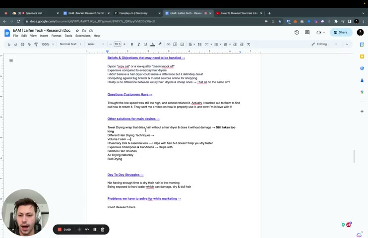
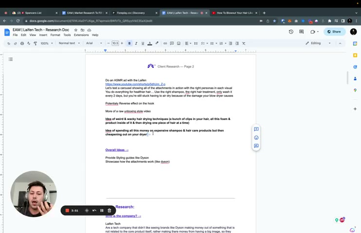

# 48. Understanding Other Desires
> Research the other solutions customers already try for the main desire (towel wraps, foams, oils, expensive shampoo), note what each one fails to deliver, and turn those flaws into ad ideas that either work with them or call them out.

## 🤖 Agent use
- **Use when:** filling the research doc's "Other solutions for main desires" and "Day To Day Struggles" sections, or generating ad ideas that contrast our product with what buyers already do.
- **Inputs → outputs:** the main desire + YouTube/Foreplay/Reddit research already done → a list of alternative solutions with what each helps and where it falls short, plus ad ideas built on the flaws.
- **Rules:**
  - **DO** record, for every alternative solution, why it still falls short for the customer: e.g. towel wrap "dries hair without a dryer... it still takes too long." [00:00-00:57]
  - **DO** write day-to-day struggles alongside (the 9 a.m. deadline, waking at 5 a.m. to wash hair). [00:00-00:57]
  - **DO** look up unknown solutions in YouTube/Foreplay: "hair mask" was found and researched via a YouTube search and a Foreplay search. [04:19-05:11]
  - **DO** bold the ideas you like in the doc so they can be found later. [01:50]
  - **DO** build ads on people "doing weird shit" with the existing solutions, then show them still failing. [00:57-03:21]
  - **DON'T** use the blunt "stop using cheap hair dryers"; instead "educate the person and resonate with them": you spend money on expensive shampoo, yet use a $20 dryer. [03:21-04:19]
  - **IF** a solution is popular **THEN** either work with it (position as the complement) or call out how flawed it is. [03:21-04:19]
- **See also:** [49. Understanding Objections](049-understanding-objections.md) · [50. Action Item/ Objections & Other Desires](050-action-item-objections-other-desires.md) · [33. YouTube Research](033-youtube-research.md) · [Switching behavior](../../../../concepts/switching-behavior.md) · [Unique mechanism (Copywriting)](../../copywriting/concepts/unique-mechanism.md)

Lesson page text: only the course loop reminder. The title says "desires"; the content is about alternative solutions for the main desire (the process doc calls this part "Understanding Alternate Solutions", see [39](039-facebook-research-part-2.md) at 00:10).

## Key ideas

### 1. Sources for alternative solutions [00:00-00:57]
- "Foreplay is going to help with a lot of that... and a lot of your YouTube research is going to help with that too." Note them down throughout the research. [00:00]
- Example from the Ad Library work: the towel wrap that dries hair without a dryer. Flaw: "it still takes two hours. You have to have a shower. You have to wait... You got to wake up at 5 a.m. if you want to wash your hair. Or you got to wash it the night before." [00:00]
- A YouTube search ("hair drying techniques") surfaces a hair expert's blow-dry tutorial using clips, a brush and "volume foam". [00:00-00:57]


*The research doc sections used in this lesson: the "Other solutions for main desires" list with flaws (e.g. towel wrap: "Still takes too long"; rosemary oils: "helps with hair but doesn't help you dry faster") and the "Day To Day Struggles" list. [00:10]*

### 2. Turn the flaws into ads [00:57-03:21]
- Ad idea 1 (weird techniques): someone dries their hair upside down, or pulses the dryer every two seconds; or "a girl that's got like eight clips in her hair and she's doing one thread at a time". "That's just something that's an ideation. I didn't really get that from anything other than just the research, and understanding the day-to-day struggle." [00:57-01:50]
- Expanded: "some girl with a bunch of foam in her hair... clips all over the place... holding that one strand of hair, trying so hard just to blow dry... trying everything to dry your hair faster or trying everything to avoid heat damage." People are doing this "and still having problems". [01:50-02:23]
- List kept in the doc: volume foam; rosemary oils and essential oils; expensive shampoos and conditioners; bamboo hair brushes; air drying naturally; blot drying. [02:23]
- Ad idea 2 (money mismatch): "You spend all this money on expensive shampoos and conditioners, right? But then you use a $20 blow dryer... that doesn't make any sense." Instead of "stop using cheap hair dryers", "educate the person and resonate with them." [02:23-04:19]

### 3. Researching a solution further [04:19-05:11]
- "What are expensive shampoos and conditioners?" -> YouTube search "best shampoo and conditioners for shiny, silky hair" and budget product videos; a "hair mask" appears as another solution; Foreplay is searched for hair masks. Results: "special guide to hair mask", DIY hair mask, top six hair masks "for damage and breakage". [04:19-05:11]
- Ad idea 3: "someone with just crazy stuff in their hair. It's like, stop doing this and just get a real hairdryer." [05:11]
- Summary of purpose: "What are people trying? ... What are some of the weird and wacky things? What are some of the most common things? And start to use that and leverage that in our marketing messages." [05:11-05:33]


*The ideas block after this lesson: "Idea of weird & wacky hair drying techniques" and "Idea of spending all this money on expensive shampoo & hair care products but then cheapening out on your dryer" (bolded), with the earlier ASMR and carousel ideas and a raw-unboxing note. [03:50]*

## Steps / framework
1. List each alternative the customer tries for the main desire (sources: Ad Library, Foreplay, YouTube, Reddit, Amazon).
2. For each: what it helps with; why it still fails the main desire.
3. List the day-to-day struggles that make the failure painful (time pressure, cost, confusion).
4. Generate ad ideas: (a) exaggerate the failing routine, (b) contrast the money spent with the weak link, (c) show the "real" solution as the fix.
5. Bold the best ideas; carry them to the concept plan.

## Examples

### Angles
| Angle | Core desire / pain | Heuristic(s) | Best format | Example line | Source |
|---|---|---|---|---|---|
| "All the effort, still failing" (weird & wacky techniques) | Dry hair fast without heat damage | (derived) contrast / pattern interrupt | UGC skit | Girl with eight clips and foam drying one strand at a time | [00:57-02:23] |
| "Expensive shampoo, cheap dryer" | Shiny, healthy hair | (derived) inconsistency | Direct-response video / static | "You spend all this money on expensive shampoo ... and yet you have a $20 hair dryer" | [02:23-04:19] |
| "Stop doing this, get a real hairdryer" | Replace the hacks | (derived) call-out | Skit | Someone with crazy stuff in their hair | [05:11] |

### Other solutions logged (research doc, screen text)
| Alternative | What it helps with | Why it falls short | Source |
|---|---|---|---|
| Towel drying wrap | Dries hair without a dryer and without damage | "Still takes too long" | doc at 00:10 |
| Volume foam | (blank on screen) | People use it and still struggle | [01:50-02:23] |
| Rosemary oils and essential oils | Helps with hair | "doesn't help you dry faster" | doc at 00:10 |
| Expensive shampoos and conditioners | Helps with (blank) | Does not fix drying speed or damage | doc at 00:10; [02:23-03:21] |
| Bamboo hair brushes; air drying naturally; blot drying | — | not discussed in audio | doc at 00:10 |
| Hair masks | Damage and breakage (guides) | Not assessed | [04:19-05:11] |

### Day-to-day struggles (research doc)
- "Not having enough time to dry their hair in the morning"
- "Being exposed to hard water which can damage, dry & dull hair"

## Prompts / templates (verbatim)
Doc headings used (screen text):

```
Other solutions for main desires →
Day To Day Struggles →
Problems we have to solve while marketing →
```

## How to apply
- [ ] List 5+ alternative solutions with "helps with / falls short because".
- [ ] Write 3+ day-to-day struggles in the customer's words.
- [ ] Draft 3 ads: one exaggerating the failed routine, one money-mismatch contrast, one call-out.
- [ ] For each solution decide: work with it or call it out.
- [ ] Cite the source (video, thread, ad) next to every logged solution.

## Related
- Previous: [47. Action Item/ Ad Account Research](047-action-item-ad-account-research.md) · Next: [49. Understanding Objections](049-understanding-objections.md)
- [38. Facebook Research - Part 1](038-facebook-research-part-1.md) (towel wrap found by keyword search) · [Avatars and angles (Copywriting)](../../copywriting/concepts/avatars-and-angles.md)

## Sources and limitations
- Transcript: [48. Understanding Other Desires….txt](<../../../../../raw/evolve/start-here/_transcripts/👣 Evolve (Start Here)/48. Understanding Other Desires 👣 Evolve (Start Here) Evolve.txt>) · Page text: [48….html.md](<../../../../../raw/evolve/start-here/_extracted/👣 Evolve (Start Here)/48. Understanding Other Desires_👣 Evolve (Start Here)_Evolve.html.md>)
- Machine transcription. Full recording covered (332.59 s). The instructor swears throughout; quotes here are trimmed to the working content. Whisper wrote "freezing it" where it likely means "frizzing it" (frizz). "Hair care expert now" is a YouTube creator caption read aloud. The ideas are the instructor's examples for a hair dryer client, not tested results.
