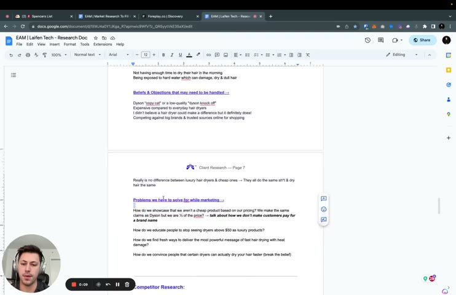
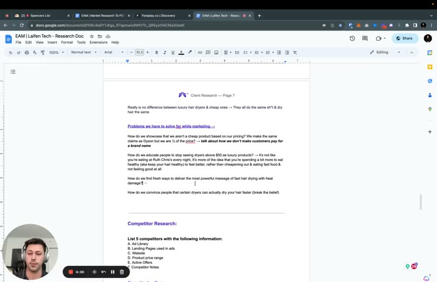

# 49. Understanding Objections
> Turn the beliefs and objections found in reviews, Reddit and YouTube into explicit "problems we have to solve while marketing", each with a candidate solution, analogy or proof idea.

## 🤖 Agent use
- **Use when:** converting raw objections (low-quality reviews, Reddit/YouTube comments, survey answers) into marketing tasks; writing the "Problems we have to solve while marketing" section; briefing writers on what an ad must overcome.
- **Inputs → outputs:** list of beliefs/objections in the research doc → a list of problems phrased as "How do we..." with a candidate answer, analogy or demo for each.
- **Rules:**
  - **DO** source objections from "low quality reviews", "Reddit threads", "YouTube videos" and (later) customer surveys. [00:00; 04:58]
  - **DO** rewrite every objection as a "How do we ..." problem. [00:00-00:52]
  - **DO** add the solution when you have one, mark it in the doc (bold italic in the demo), and do more research when you do not: "go into Google, go into YouTube, maybe just sit in a dark room and think about it." [00:52-01:44]
  - **DO** write an analogy or metaphor for the belief: it "helps you understand it a little bit better" and "maybe get closer to finding a solution". [01:44-03:28]
  - **DO** plan to show disproof for performance beliefs: timers, before/afters, comparisons. [04:07-04:58]
  - **DON'T** rely on a message everyone uses; "fast hair drying without heat damage... everybody says that. So that messaging is getting very fatigued." Find a fresh way to say the same desire. [03:28-04:07]
  - **IF** you are cheaper for the same claims **THEN** expect "too good to be true" skepticism and address it directly (e.g. "we don't make customers pay for a brand name"). [00:52-01:44]
- **See also:** [48. Understanding Other Desires](048-understanding-other-desires.md) · [50. Action Item/ Objections & Other Desires](050-action-item-objections-other-desires.md) · [Objection handling (Copywriting)](../../copywriting/concepts/objection-handling.md) · [How to prevent/handle objections in writing (Copywriting 28)](../../copywriting/lessons/28-how-to-prevent-handle-objections-in-writing.md) · [Beliefs (Copywriting)](../../copywriting/concepts/beliefs.md) · [Risk-reduction hooks](../../../../concepts/risk-reduction-hooks.md)

Lesson page text: only the course loop reminder. This is Part 14 "Objections + Problems We Have To Solve For" of the process doc ([39 at 00:10](039-facebook-research-part-2.md)).

## Key ideas

### 1. Objections come from low-quality voices [00:00-00:52]
- "The beliefs and objections should have been ... gone through by reading some of the low quality reviews or ... Reddit threads ... or YouTube videos." [00:00]
- Demo objections (hair dryer brand priced at about a third of Dyson): "we're a Dyson copycat or ... a Dyson knockoff"; "expensive compared to all the other hair dryers"; "there really is no difference between luxury hair dryers and cheap ones. They all do the same shit." [00:00-00:52]
- Doc entries: "Dyson 'copy cat' or a low-quality 'dyson knock off'"; "Expensive compared to everyday hair dryers"; "I didn't believe a hair dryer could make a difference but it definitely does!"; "Competing against big brands & trusted sources online for shopping"; "Really is no difference between luxury hair dryers & cheap ones -> They all do the same sh*t & dry hair the same". (screen text, 00:10)


*Beliefs and objections captured from reviews and threads, directly above "Problems we have to solve while marketing". [00:10]*

### 2. Problem 1: prove we are not cheap [00:52-01:44]
- Problem: "How do we showcase that we aren't a cheap product based on our pricing? We make the same claims as Dyson but we are 1/3 of the price." Cause: "That builds skepticism... too good to be true." [00:52]
- Analogy: the newspaper ad that offered to send back a thousand dollars for one dollar; nobody sent the dollar because it was too good to be true. (He cannot remember the details.) [00:52-01:44]
- Candidate solution logged: "talk about how we don't make customers pay for a brand name." Instructor: "We don't charge as much as the other guys because we don't make customers pay for a brand name. That simple." [01:44]

### 3. Problem 2: stop seeing anything over $50 as luxury [01:44-03:28]
- Problem: "How do we educate people to stop seeing anything above $50 as a luxury product?" [01:44]
- Logic: a $130-$140 dryer lasts "two, three, four, five years"; "it's not a luxury product... it's like saying my Honda Civic's a luxury car." [01:44-02:37]
- Doc analogy: "it's not like you're eating at Ruth Chris's every night. It's more of the idea that you're spending a bit more to eat healthy (aka keep your hair healthy) to feel better, rather than cheapening out & eating fast food & not feeling good at all." [02:37-03:28; doc at 04:00]
- Pattern reference: the "you wouldn't do this, would you?" insurance ads that show something silly and then link it to the real choice. [03:28]

### 4. Problem 3: a fresh way to say the core promise [03:28-04:07]
- Problem: "How do we find fresh ways to deliver the most powerful message of fast hair drying with heat damage?" (the doc line says "with heat damage"; the audio says "without"). The message is "simple, to the point. But everybody says that." Task: brainstorm new ways to say the same desire. [03:28-04:07]

### 5. Problem 4: break the belief that dryers cannot dry faster [04:07-04:58]
- Problem: "How do we convince people that certain dryers can actually dry hair faster (break the belief)." Two sides of the belief: "stay away from hair dryers, just natural air dry" and "all hair dryers are the same". [04:07]
- Proof formats brainstormed: a timer, regular vs non-regular dryer side by side, before-and-afters, comparisons. "Do we do before and afters? Do we do comparisons? ... How do we make that come to life?" [04:07-04:58]
- Link to survey: customer surveys for clients will also yield objections; the feedback survey will be updated with a question for it. [04:58]


*The four problems after the lesson: problem 1 answered with "talk about how we don't make customers pay for a brand name" (bold italic), problem 2 with the Ruth's Chris vs fast-food analogy, problems 3-4 still open. [04:00]*

## Steps / framework
1. Collect objections/beliefs with sources (review, thread, video).
2. For each, write: "How do we [show / educate / find a fresh way / convince] ...?"
3. Add the best-known answer after an arrow; bold-italic the solution.
4. If none: research (Google, YouTube), then write an analogy or metaphor.
5. For belief-breaking tasks, list proof devices (timer, before/after, comparison).
6. Check each ad concept against the list before approval.

## Examples

### Rewrites (objection -> problem)
| Before | After | What changed (verb / visual / promise / self / intensity) | Source |
|---|---|---|---|
| "Expensive compared to everyday hair dryers" / "We're a Dyson knock-off" | "How do we showcase that we aren't a cheap product based on our pricing?" | Objection becomes an actionable problem for the writer | [00:52] |
| "Quality is price-linked: over $50 is luxury" | "How do we educate people to stop seeing anything above $50 as a luxury product?" | Reframes the belief as an education task, answered with an analogy | [01:44] |
| "All dryers dry the same" | "How do we convince people that certain dryers can actually dry hair faster (break the belief)" | Belief-breaking task with proof formats | [04:07] |

### Analogies produced
| Belief | Analogy | Source |
|---|---|---|
| Too good to be true (same claims, a third of the price) | Newspaper ad "send me a dollar, I'll send you a thousand": no one sent the dollar | [00:52-01:44] |
| Over $50 is a luxury | A long-lasting purchase like a Honda Civic is not a luxury car; dryer vs fast food / Ruth Chris | [01:44-03:28] |

## Prompts / templates (verbatim)
Doc section (screen text, 00:10 and 04:00):

```
Beliefs & Objections that may need to be handled →
Problems we have to solve while marketing →

How do we showcase that we aren't a cheap product based on our pricing? We make the same claims as Dyson but we are 1/3 of the price? → talk about how we don't make customers pay for a brand name
How do we educate people to stop seeing dryers above $50 as luxury products? → it's not like you're eating at Ruth Chris's every night. It's more of the idea that you're spending a bit more to eat healthy (aka keep your hair healthy) to feel better, rather than cheapening out & eating fast food & not feeling good at all
How do we find fresh ways to deliver the most powerful message of fast hair drying with heat damage?
How do we convince people that certain dryers can actually dry your hair faster (break the belief)
```

## How to apply
- [ ] Collect 10+ objections with sources; dedupe.
- [ ] Rewrite each as a "How do we..." problem; assign a candidate solution or "research needed".
- [ ] Add one analogy per major belief; test whether it works in plain language.
- [ ] Pick a proof device for every performance belief (timer, comparison, before/after).
- [ ] Map each planned ad to the problem(s) it solves; flag fatigued messages for a new expression.

## Related
- Previous: [48. Understanding Other Desires](048-understanding-other-desires.md) · Next: [50. Action Item/ Objections & Other Desires](050-action-item-objections-other-desires.md)
- [Skeptic format](../../../../frameworks/skeptic-format.md) · [Analogies (Copywriting 33)](../../copywriting/lessons/33-how-to-use-metaphors-similes-analogies.md) · [61. Objections list (Copywriting)](../../copywriting/lessons/61-objections-list.md)

## Sources and limitations
- Transcript: [49. Understanding Objections….txt](<../../../../../raw/evolve/start-here/_transcripts/👣 Evolve (Start Here)/49. Understanding Objections 👣 Evolve (Start Here) Evolve.txt>) · Page text: [49….html.md](<../../../../../raw/evolve/start-here/_extracted/👣 Evolve (Start Here)/49. Understanding Objections_👣 Evolve (Start Here)_Evolve.html.md>)
- Machine transcription. Full recording covered (327.32 s). Whisper garbled "Ruth Chris" and the newspaper-ad story (instructor himself is unsure). The doc line "with heat damage" is a typo on screen versus "without" in the audio. Examples are for a hair dryer client; tested results are not given.
