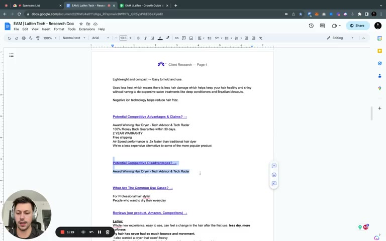

# 51. Cleaning Up The Research Doc
> Spend 10-15 minutes tidying and completing the research doc (customer now/after, competitor notes, price range, creative audit, plus any sections of your own) so the creative roadmap and avatar work can pull from one organized source.

## 🤖 Agent use
- **Use when:** the research phase is finished and the doc is about to feed the creative roadmap, avatar/persona and desire work.
- **Inputs → outputs:** the partly filled research doc → a complete, consistently structured doc with every section filled or explicitly marked empty.
- **Rules:**
  - **DO** clean the doc itself first: "not so much on moving things over." [00:00]
  - **DO** fill "who is the potential customer right now?" and "who is the potential customer after our product?" (more than one answer is fine). [00:00-00:51]
  - **DO** complete the competitor notes and the product price range. [00:00-00:51]
  - **DO** make sure the media buyer's creative audit is done ([46](046-ad-account-research.md)). [00:00-00:51]
  - **DO** add your own sections when something is missing: copy an existing heading and rename it. [00:51-01:47]
  - **DO** time-box it: "the next few, probably 10, 15 minutes." [00:00-00:51]
  - **IF** a section only lists strengths **THEN** add a mirrored section for weaknesses, e.g. "Potential Competitive Disadvantages" next to "Potential Competitive Advantages & Claims". [00:51-01:21]
- **See also:** [52. Action Item/ Clean Up The Research Doc](052-action-item-clean-up-the-research-doc.md) · [56. Organizing Insights Overview (Must-Watch)](056-organizing-insights-overview-must-watch.md) · [21. Action Item/ Copy Research Document](021-action-item-copy-research-document.md) · [Customer research stack](../../../../frameworks/customer-research-stack.md)

Lesson page text: only the course loop reminder.

## Key ideas

### 1. Goal: organized information [00:00-01:47]
- "The whole goal is that we just have information somewhat organized. So that way, when we go to fill out the creative roadmap and the persona avatar section ... and desires and all that kind of stuff, we will be able to have it organized nice and neatly and be able to get to all of our information very quickly." [01:21-01:47]
- Do not move data between documents yet: "for right now, just going to most likely clean up the sheet itself." [00:00]
- The video then skips to the cleanup itself: "I will see you in the next part of the video." The screen-recorded cleaning is not in this video. [01:47]

### 2. Sections to complete [00:00-00:51]
- Potential customer now; potential customer after the product; competitor notes; product price range; media buyer creative audit. [00:00-00:51]

### 3. Make it your own [00:51-01:47]
- If a section you need is not in the template, copy a heading and add it. Example on screen: renamed a copied "Potential Competitive Advantages & Claims" section to "Potential Competitive Disadvantages" so you can "call out what our disadvantages are." [00:51-01:21]


*A completed doc page: product benefits (lightweight, less heat, negative ion technology), advantages & claims (award, 30-day money-back guarantee, 2-year warranty, free shipping, air speed claim, less expensive alternative), the new "Potential Competitive Disadvantages" heading, "What Are The Common Use Cases?" and "Reviews". [01:30]*

## Steps / framework
1. Read the doc top to bottom; list empty sections.
2. Fill: potential customer now, potential customer after, competitor notes, price range, creative audit.
3. Add custom sections (e.g. disadvantages) by copying a heading.
4. Keep the format consistent so later steps (roadmap, avatars, desires) can reference it.

## Examples
Research-doc section headings visible in the finished page (screen text, 00:10-01:30):

```
Potential Competitive Advantages & Claims →
Potential Competitive Disadvantages →     (added in this lesson)
What Are The Common Use Cases? →
Reviews (our product, Amazon, Competitors) →
Bad Direct Competitor Reviews (our product, Amazon, Competitors) →
```

Filled advantages & claims shown (demo hair dryer client): "Award Winning Hair Dryer - Tech Advisor & Tech Radar; 100% Money Back Guarantee within 30 days; 2 YEAR WARRANTY; Free shipping; Air Speed performance is .5x faster than traditional hair dryer; We're a less expensive alternative to some of the more popular product."
Common use cases: "For Professional hair stylist"; "People who want to dry their everyday".

## How to apply
- [ ] List every section of the research doc that is empty or half-filled.
- [ ] Fill customer-now and customer-after (more than one each if the market has several).
- [ ] Add competitor notes and price range for all 5 competitors; confirm the creative audit is complete.
- [ ] Add a "Potential Competitive Disadvantages" section (and any other section you need).
- [ ] Mark unknowns as "not found" instead of leaving them blank, so an agent can tell missing from forgotten.

## Related
- Previous: [50. Action Item/ Objections & Other Desires](050-action-item-objections-other-desires.md) · Next: [52. Action Item/ Clean Up The Research Doc](052-action-item-clean-up-the-research-doc.md)
- [20. Getting Ready To Do Research - Part 2](020-getting-ready-to-do-research-part-2.md)

## Sources and limitations
- Transcript: [51. Cleaning Up The Research Doc….txt](<../../../../../raw/evolve/start-here/_transcripts/👣 Evolve (Start Here)/51. Cleaning Up The Research Doc 👣 Evolve (Start Here) Evolve.txt>) · Page text: [51….html.md](<../../../../../raw/evolve/start-here/_extracted/👣 Evolve (Start Here)/51. Cleaning Up The Research Doc_👣 Evolve (Start Here)_Evolve.html.md>)
- Machine transcription. Full recording covered (116.88 s). Whisper garbled "persona avatar section that she desires" (likely "persona/avatar section and desires"). The cleaning itself is not shown in the video. The "disadvantages" section on screen still holds copied placeholder text from the advantages section. The doc content shown is the demo client's and is not reused as advice.
