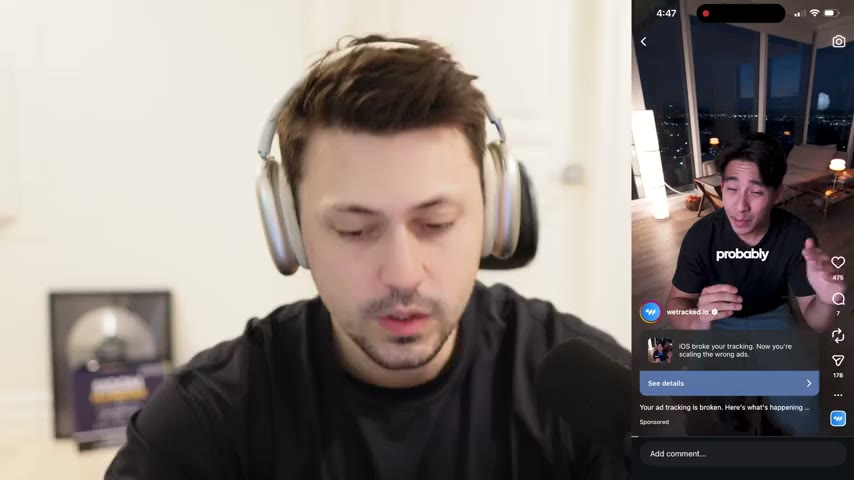

# 53. Ad ONLY Instagram Research
> Open one sponsored ad on the Instagram home feed and scroll from there to get a feed of nothing but ads; do 10-15 minutes a day, save the good ones, and let your viewing behaviour tune what you see.

## 🤖 Agent use
- **Use when:** building a daily ad-inspiration habit or collecting live Instagram ads in a niche or adjacent niches; briefing a human on a manual research routine (the method needs a phone with a real Instagram account).
- **Inputs → outputs:** an Instagram account that is engaging with niche content → a stream of ads, saved/shared links or downloaded files in a swipe file, plus notes on hooks and engagement.
- **Rules:**
  - **DO** start on the Instagram **home feed** (not Reels; the instructor tried Reels and it must be the home page), scroll until a post labelled "Sponsored" appears, tap the creative, then keep scrolling. [00:00-00:42; page text]
  - **DO** confirm the bottom-left label reads "Sponsored" on each item: "these are all ads." [00:00-00:42]
  - **DO** save, share to yourself, copy the link to a database, or download for a swipe file (page text suggests the downloader at snapinsta.to). [page text]
  - **DO** scroll ads for 10-15 minutes per day: "rather than scrolling through your whatever feed, because you're going to actually learn from ads." [00:42-01:39]
  - **DO** read engagement (comment counts) as a signal: 156 comments vs 67 vs none in the demo. [01:39-02:12]
  - **IF** you watch an ad type to the end **THEN** expect more of that type: "the longer that I watch this, the more that I'm probably going to get like that." [01:39-02:12]
  - **IF** you scroll fast for a day **THEN** the next day brings shorter ads; if you watch most ads through you get "longer ads and VSLs". (page text, instructor claim)
  - **DON'T** reuse competitor creative: it is research inspiration (copy the mechanism, not the asset).
- **See also:** [42. Creative Research - Part 2](042-creative-research-part-2.md) · [44. TikTok Research](044-tiktok-research.md) · [Algorithm as library](../../../../concepts/algorithm-as-library.md) · [Competitor ad teardown playbook](../../../../playbooks/competitor-ad-teardown.md)

## Key ideas

### 1. The method [00:00-00:42; page text]
Page text, verbatim in summary: Step 1 scroll the home page until you see a post that says "sponsored". Step 2 click on the creative. Step 3 start scrolling. Step 4 save any ads you like, share them with yourself on IG, log into IG on a computer, copy the links and store them in a database, or download them and create a swipe file with a tool like snapinsta.to. "Super easy and cracked way to do research." (page text)

- The instructor screen-records his phone: the first ad on the home feed opens the ad's landing/website view; scrolling then moves through only ads, each with "Sponsored" at bottom-left. [00:00-00:42]
- Credit: the method was found by "Karlo" ("Carlo the Goat ... runs eComptown" per Whisper, likely Ecom Talent); the page says "s/o Karlo". [00:00; page text]

*The phone recording during the demo: an ad-only feed item (tracking-software promo) with its "Sponsored" label, comment count and share/send button. The instructor says to share good ads to yourself. [01:15]*

### 2. What to pull out of it [00:42-01:39]
- Marketer-niche ads dominated his feed (matching his own interests): examples read aloud include an Upwork ad, a growth-summit ad, a "90 days from now, your e-commerce business..." ad, and "Meta Ads Manager is probably giving you fake data" which he calls "really good hook, actually". [00:42-01:39]
- Send liked ads via the share button. [00:42-01:39]

### 3. Algorithm effect [01:39-02:12; page text]
- What you engage with sets future ads: a meal-kit brand ad leads to more like it. "If we just look at the ads that we actually like and watch them, we're gonna get more like it." [01:39-02:12]
- Page PRO TIP: scroll speed determines ad type. "If I scroll faster for a day and just run through ads, the next day I'll get shorter ads. If I take the time to watch through most of the ads, I'll get longer ads and VSLs." (instructor claim)
- Page: "I would encourage everyone to scroll ads for 10-15 mins per day, save ads you like/find interesting or share them in ad-inspo" (a community channel). (page text)

## Steps / framework
1. Phone, Instagram app. Home feed (not Reels).
2. Scroll until one "Sponsored" post; open the creative.
3. Keep scrolling; every item should be labelled "Sponsored".
4. For each good ad: share to yourself, or copy the link into the swipe database, or download (snapinsta.to).
5. Note hook, format, comment count; 10-15 minutes per day.
6. Steer the feed: watch fully the ad types you want more of; skim others.

## Examples

### Hooks
| Hook | Heuristic(s) | Emotion / zone | Self targeted | Why it works | Source |
|---|---|---|---|---|---|
| "Meta Ads Manager is probably giving you fake data" / "iOS broke your tracking. Now you're scaling the wrong ads." (marketer-niche ad) | Fear / loss (derived) | — | — | Instructor: "really good hook, actually" | [00:42-01:39] |
| "90 days from now, your e-commerce business..." (marketer-niche ad) | Future pacing (derived) | — | — | Read aloud as an example of what appeared | [00:42-01:39] |

## How to apply
- [ ] Do the daily 10-15 minute ad-only scroll for at least a week; keep a log (date, brand, hook, format, comment count, link).
- [ ] Save at least 3 ads per session to the swipe file; mark why each stood out.
- [ ] Steer the algorithm toward ads like your target niche by watching those fully.
- [ ] Translate each saved hook into the research doc's headline ideas, rewritten for your desire.

## Related
- Previous: [52. Action Item/ Clean Up The Research Doc](052-action-item-clean-up-the-research-doc.md) · Next: [54. Answer The Public - Research](054-answer-the-public-research.md)
- [136. How To Get Viral UGC Inspo For Creators & Ads](136-how-to-get-viral-ugc-inspo-for-creators-ads.md)

## Sources and limitations
- Transcript: [53. Ad ONLY Instagram Research….txt](<../../../../../raw/evolve/start-here/_transcripts/👣 Evolve (Start Here)/53. 🆕 Ad ONLY Instagram Research 👣 Evolve (Start Here) Evolve.txt>) · Page text: [53….html.md](<../../../../../raw/evolve/start-here/_extracted/👣 Evolve (Start Here)/53. 🆕 Ad ONLY Instagram Research_👣 Evolve (Start Here)_Evolve.html.md>)
- Machine transcription. Full recording covered (139.01 s). Whisper wrote "Carlo the Goat ... eComptown" (page text says Karlo), "EZA" and unclear brand names for several ads. Brand names shown on the phone are not reproduced beyond a few read-aloud examples. The page links a third-party downloader (snapinsta.to); using it to download others' creative is the user's responsibility. The scroll-speed effect is an instructor claim, untested here.
