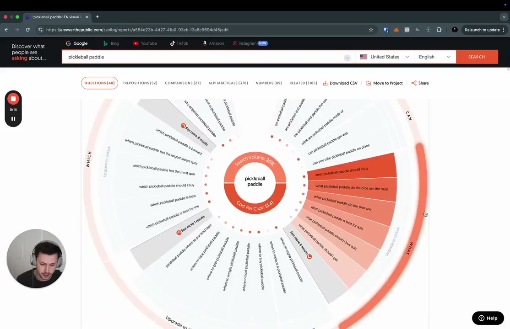
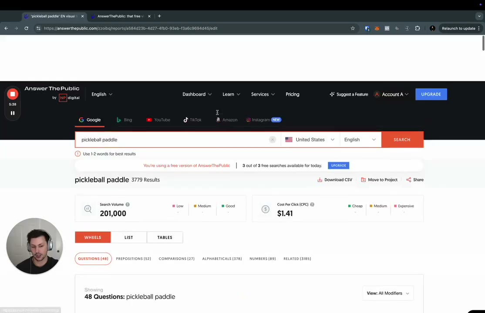
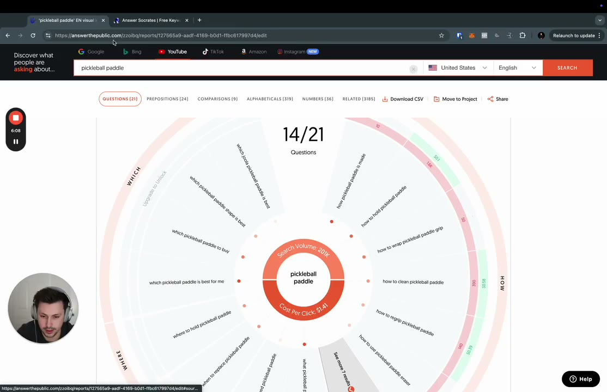
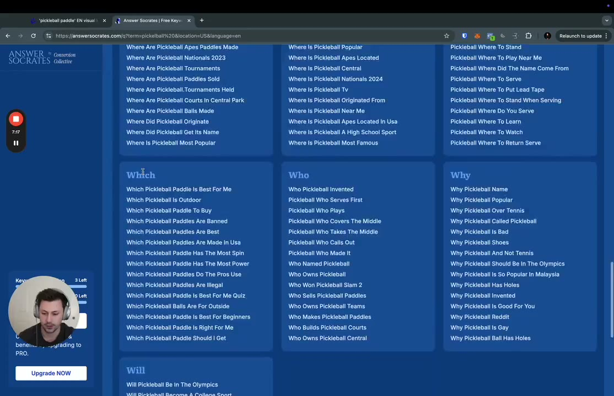

# 54. Answer The Public - Research
> Use Answer The Public and Answer Socrates to see the exact questions people search about your product category (why, can, what, which, are...), then turn them into advertorials, product-aware ads and objection handling.

## 🤖 Agent use
- **Use when:** you need search-intent evidence for a niche: what people ask before buying, what confuses them, which comparisons they make, and which avatar segments exist (e.g. tennis players new to the product).
- **Inputs → outputs:** a 1-2 word product/category term + country + language → a question wheel and lists (questions, prepositions, comparisons, alphabeticals, numbers, related) → objections, FAQ-style hooks, advertorial topics, "how to choose" VSL ideas and avatar leads in the research doc.
- **Rules:**
  - **DO** search with "1-2 words" (the tool's own hint, on screen), pick country and English, then read the Questions wheel first. [00:00; 02:16]
  - **DO** read darker-orange items as highly searched and lighter-orange as least searched. [03:43-04:42]
  - **DO** turn each question into an ad asset: "this can help you with building advertorials. It can help you with building product aware ads, and it can help you understand the questions or the potential objections that people actually have." [02:50-03:43]
  - **DO** read the Comparisons and Prepositions wheels (with, without, for, near, to) for segments and product features. [04:42-05:23]
  - **DO** download the result as a CSV when reading the wheel is awkward ("you kind of have to turn your head"). [02:16; 01:30]
  - **DO** repeat the search in YouTube mode and Amazon mode, and in Answer Socrates, for different intent layers. [05:23-08:34]
  - **DON'T** treat a question you do not understand as noise: research it ("I have no idea what a pickleball paddle eraser is, so I probably have to go and look that up") because it can be a product opening. [02:50-03:43]
  - **IF** a comparison question names another sport/product **THEN** consider an avatar from that audience (tennis players who haven't started pickleball). [06:03-06:55]
  - **IF** Amazon mode shows "how to choose..." searches **THEN** consider a "how to choose the right [product]" VSL or advertorial. [07:46-08:34]
- **See also:** [Answer The Public (tool page)](../../../../tools/answerthepublic.md) · [33. YouTube Research](033-youtube-research.md) · [28. Amazon Research - Part 1](028-amazon-research-part-1.md) · [31. Reddit Research](031-reddit-research.md) · [Customer research stack](../../../../frameworks/customer-research-stack.md) · [Market awareness (Copywriting)](../../copywriting/concepts/market-awareness.md)

Page text (verbatim): "Answer The Public - FREE https://answerthepublic.com/" and "Answer Socrates - FREE https://answersocrates.com/".

## Key ideas

### 1. What the tool shows [00:00-00:53]
- "A tool that shows you some indications around specific words": why, can, what, when, where, which, how. [00:00]
- Demo product: a "specific pickleball paddle". Tabs show counts: Questions (48), Prepositions (52), Comparisons (27), Alphabeticals (378), Numbers (89), Related (3185). [00:00; 05:40 frame]
- Key indicators are "obviously being searched by people who are in the product aware market". [00:53]

*The Questions wheel: spokes grouped by question word (Why, Which, What, Can, Are...) with a shaded intensity scale. Tabs along the top: Questions, Prepositions, Comparisons, Alphabeticals, Numbers, Related, Download CSV. [00:15]*

*Summary view for the keyword: result count, search volume and cost per click, a "free version, 3 out of 3 free searches available today" notice, and the Wheels / List / Tables switch. [05:40]*

### 2. Pricing and access (as said, 2023-24 vintage) [00:53-02:16]
- Free account: "you just sign up with email and I believe you get three searches a day" (screen: "3 out of 3 free searches available for today"). [01:30-02:16]
- Individual: one user, 100 searches per day, tags, $11 a month. Pro: multiple users and unlimited searches. Expert: more for SEO and Google Ads. A "lifetime" deal at $120 appeared "for the next hour" (time-limited, instructor-observed). [00:53-01:30]
- CSV download: "you might see that later in the AI program". [01:30-02:16]

### 3. Reading the wheel: questions as signals [02:16-04:42]
Examples read aloud (pickleball paddle):
- "Why edgeless pickleball paddle", "why hole in pickleball paddle", "why weight a pickleball paddle": "three things that people are clearly asking". [02:16-02:50]
- "Are pickleball paddle erasers worth it?"; "are pickleball and paddle tennis the same?"; "what are pickleball paddles made of"; "can pickleball paddles get wet"; "can you take pickleball paddles on a plane"; "what pickleball paddles do the pros use the most"; "what pickleball paddle is best for spin"; "which pickleball paddle is best for me"; "what pickleball paddle should I buy"; "when to regrip". [02:50-04:42]
- Opportunity reading: "maybe yours is waterproof" or "doesn't need erasers" can be a differentiator; "can get wet" is "being searched a lot". [04:42]
- Prepositions: "with holes", "without rim", "for beginners" (390). Comparisons: other sports and products. [04:42-05:23]

### 4. Other modes [05:23-08:34]
- **YouTube mode:** same tool, switch to YouTube; "it will actually take you directly to YouTube". Shows what people search on YouTube; use to feed YouTube research. [05:23-06:03]
- **Answer Socrates** (free, three free searches, sign-up needed): groups questions by word (are, can, how, what, where, which, who, why, will). Insights: many tennis comparisons -> "maybe we need to go after this avatar that is playing tennis and hasn't started playing pickleball yet"; "Can I play pickleball while pregnant?"; "Should I play pickleball or tennis?"; "What pickleball paddle should I buy?" ("obviously the biggest one"). [06:03-07:46]
- **Instagram mode:** hashtags (free trial shows a little). He judges Amazon better. [07:46]
- **Amazon mode:** "very direct" because the searchers are shopping: "how to choose a pickleball paddle" -> "this could be a great VSL ... how to choose the right pickleball paddle"; "pickleball paddle for women" ("made specifically for women, lighter"); "with bag", "with cover"; "without edge"; sets. [07:46-08:34]
- Closing: "creep into the mind of what your customers are thinking." [08:34]

*Platform tabs at the top (Google, Bing, YouTube, TikTok, Amazon, Instagram); here YouTube is selected and the wheel shows "how to hold a pickleball paddle", "how to wrap pickleball paddle grip", "how to clean", etc. [06:10]*

*Answer Socrates lists questions in alphabetical groups ("Which pickleball paddle is best for me", "Why pickleball is bad", "Who invented pickleball"). Free tier shows a few searches per day. [07:20]*

## Steps / framework
1. Pick the 1-2 word category/product term.
2. Open Answer The Public (free: ~3 searches/day), choose US/English (or the target market).
3. Questions wheel: copy every question; mark the darker (high-volume) ones.
4. Prepositions and Comparisons: note feature gaps (with, without, for) and substitute products.
5. Related and Alphabeticals: scan for modifiers (beginners, women, cheap).
6. Switch platform: YouTube (video topics), Amazon (purchase-intent phrases), Instagram (hashtags).
7. Repeat in Answer Socrates for a cleaner question list.
8. Map outputs: question -> objection/FAQ; "how to choose" -> advertorial/VSL; "for [segment]" -> avatar; comparison -> positioning.

## Examples

### Angles
| Angle | Core desire / pain | Heuristic(s) | Best format | Example line | Source |
|---|---|---|---|---|---|
| Educational: "how to choose the right paddle" | Avoid choosing wrong | (derived) authority / education | VSL / advertorial | "How to choose the right pickleball paddle" | [07:46-08:34] |
| Segment: tennis players new to the sport | Transfer existing skill | (derived) identification | UGC / static | "Can I play pickleball on a tennis court?" (question) | [06:03-06:55] |
| Differentiator from questions | Solve a stated doubt | (derived) risk reduction | Static / UGC | "Can pickleball paddles get wet?" -> "maybe yours is waterproof" | [04:42] |
| Women's version | Product made for women | (derived) identity | Static | "pickleball paddle for women" (Amazon search) | [08:34] |

### Hooks
| Hook | Heuristic(s) | Emotion / zone | Self targeted | Why it works | Source |
|---|---|---|---|---|---|
| "Why does your pickleball paddle have holes?" (derived from "why hole in pickleball paddle") | Curiosity | — | — | A question people actually ask | [02:50] |
| "Are pickleball and paddle tennis the same?" | Curiosity / confusion | — | — | Confusion the market voices (instructor) | [03:43] |

## Prompts / templates (verbatim)
Question words/modifiers shown in the wheels: why, can, what, when, where, which, who, are, will, how (the instructor notes "how" is not visible in the first wheel). Preposition wheel: without, for, is, near, to, with. [00:00; 04:42]

Tool tabs, screen text: `QUESTIONS (48) | PREPOSITIONS (52) | COMPARISONS (27) | ALPHABETICALS (378) | NUMBERS (89) | RELATED (3185) | Download CSV | Move to Project | Share`

## How to apply
- [ ] Run Answer The Public and Answer Socrates for the product term and 2-3 modifiers.
- [ ] Export or copy the 20+ highest-signal questions into the research doc, tagged "question", "objection", "segment", "comparison".
- [ ] Switch to YouTube and Amazon modes; note the purchase-intent phrases.
- [ ] Draft 1 advertorial title and 1 "how to choose" VSL outline from the questions.
- [ ] Flag any question you cannot answer from product facts as "needs verification" (do not guess).

## Related
- Previous: [53. Ad ONLY Instagram Research](053-ad-only-instagram-research.md) · Next: [55. Customer Phone Call Research](055-customer-phone-call-research.md)
- [How to write with labels / customer language (Copywriting 34)](../../copywriting/lessons/34-how-to-write-with-labels-customer-language.md) · [Beliefs (Copywriting)](../../copywriting/concepts/beliefs.md)

## Sources and limitations
- Transcript: [54. Answer The Public - Research….txt](<../../../../../raw/evolve/start-here/_transcripts/👣 Evolve (Start Here)/54. Answer The Public - Research 👣 Evolve (Start Here) Evolve.txt>) · Page text: [54….html.md](<../../../../../raw/evolve/start-here/_extracted/👣 Evolve (Start Here)/54. Answer The Public - Research_👣 Evolve (Start Here)_Evolve.html.md>)
- Machine transcription. Full recording covered (557.03 s). Whisper wrote "Answers by Socrates" and "pickable paddle". Prices ($11/month, $120 lifetime) and free-search limits are stated in passing and are dated (the lifetime offer was time-limited). The demo product is pickleball paddles (not the hair-dryer client). The "AI program" CSV use is not covered here.
