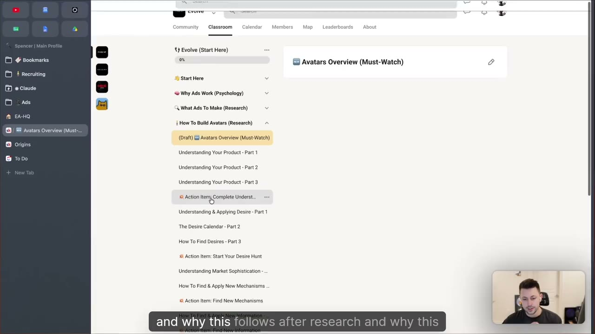
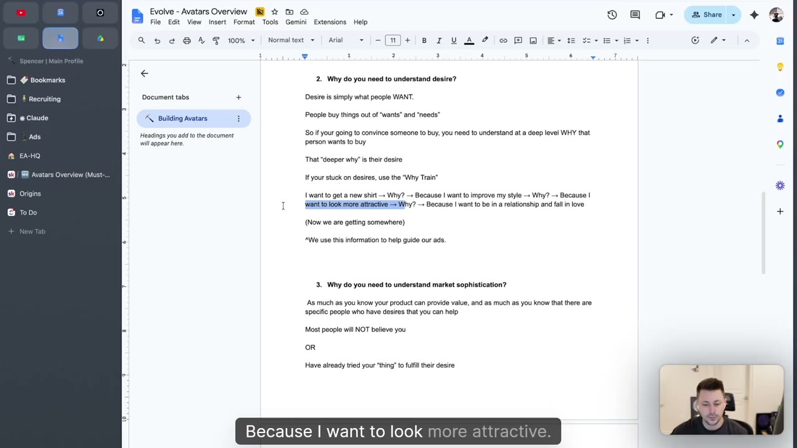

# 56. Organizing Insights Overview (Must-Watch)
> Explains why the next section (product → desire → market sophistication → mechanisms, information and avatars) follows research: its goal is to turn research into belief, because winning ads come from preparation, and desire and product alone do not convince a sophisticated market.

## 🤖 Agent use
- **Use when:** deciding the order of work after research (what to do with a research doc before writing ads), diagnosing why ads with a real desire and real product still do not scale, or briefing another agent on the strategy behind the rest of the Evolve section.
- **Inputs → outputs:** research doc, product facts, market sophistication stage → a build-belief plan: product overview, deep desires (Why Train), the belief gap, then new mechanisms, new information and avatars to close it.
- **Rules:**
  - **DO** prepare before making ads. "The effort that you put in prior to making the ad is the difference between the ad usually winning and the ad flopping on its face." [01:18]
  - **DON'T** run a "rinse and repeat" ad-pumping loop on a shallow pass of research (a couple of angles, then forget it). Volume is needed "to some extent" but you "need to go deeper". [01:18]
  - **DO** work in this order: product, desire, market sophistication, then the belief builders (new mechanisms, new information, new identities/avatars). [02:05–06:45]
  - **DO** use the "Why Train" to reach a deep desire: keep asking "why" until you reach the underlying want. [02:44]
  - **IF** the market is stage 3, 4 or 5 sophistication **THEN** do not write "here we are, come and get it" ads. Build belief with a mechanism, new information or an avatar-specific message. [02:44–03:30]
  - **DO** use customers' own words: "the best copywriters still use their customer's words to write more relatable copy". Relatable copy is a way to "write good copy without actually being good at writing copy". [05:48]
  - **DON'T** assume a desire is enough. "Desires don't mean anything unless I can build belief." [06:45]
  - **IF** an ad works or fails and you cannot say why **THEN** the gap is understanding your writing, so close the feedback loop with mechanism, information and identity checks. [05:05–05:48]
- **See also:** [57. Understanding Your Product Part 1](057-understanding-your-product-part-1.md) · [61. Understanding & Applying Desire Part 1](061-understanding-applying-desire-part-1.md) · [65. Understanding Market Sophistication Part 1](065-understanding-market-sophistication-part-1.md) · [Beliefs (Copywriting)](../../copywriting/concepts/beliefs.md) · [Unique mechanism (Copywriting)](../../copywriting/concepts/unique-mechanism.md) · [Market awareness (Copywriting)](../../copywriting/concepts/market-awareness.md)

## Key ideas

### Why this section exists [00:00–01:18]
- The instructor says this section "is probably the most important" because it lets you "organize all of the research that you've been doing to actually create effective ads". [00:00]
- Most courses say *what* to do; some say *how*; "very few actually explain why". This module explains why each step exists and why it follows research. [00:34]
- The "real secret" behind winning ads is "a shitload of work" in preparation. [00:34–01:18]

### Why go deep on product → desire → sophistication [01:18–04:24]
- Many students do research "because people tell you to", pull a couple of angles and forget it. You need to "go deep on the fundamentals" and "learn why people buy", then "go deep on the product". [01:18–02:05]
- **Product:** the product section overlaps with the features/benefits material in the desire module but is the part that "helps you start to action that". [02:05]
- **Desire:** "we need to know what people actually want". Seasonal desire (the desire calendar) is a separate, important topic. [02:05–02:44]
- **Why Train:** "Whenever you think you found a desire, just ask why": new shirt → improve my style → look more attractive → be in a relationship, fall in love. "Now we're getting to the deep desire." [02:44]
- **Market sophistication:** the instructor says most students are in stage 3, 4 or 5 markets (instructor claim). In sophisticated markets "we can't just be like, here we are, come and get it", and some students are doing this without realising, "that's why your ads aren't scaling". [02:44–03:30]
- **Belief test:** a Facebook ad of the instructor saying "I'm going to make you a millionaire in e-com" (or a "decamillionaire", or "nine-figure brand owner"). You would not believe it, even though it is your desire. "That just hopefully goes to show you why belief is so important." [03:30–04:24]
- "How you feel about that is how your customers feel." If you cannot cut through and build belief, "it does not matter what your product does and it does not matter what their desires are." [04:24]

### The belief builders: mechanisms, information, identities [04:24–07:18]
- Once you accept the above, the section covers new mechanisms, new information and new identities (the Evolve avatar training: core avatars and sub avatars). [04:24]
- The instructor's diagnosis: you either (1) are not as good at copy as you think, since otherwise you would be scaling harder, or (2) write copy and do not understand why it works or fails. [05:05]
- His own example: for years he thought an "us vs them" ad worked because it was "us vs them". "That's not why it's working. Tons of us versus them that didn't work." [05:05]
- The cure: these three things "build belief" and "help you understand your writing". [05:48]
- Chain: know your product → know desire → "desires don't mean anything unless I can build belief, which is where market sophistication comes in" → build belief with mechanisms, information and avatars → "we help people realize that we made their product for them". [06:45]
- Summary line: the section is "about taking your research and learning how to use it to build belief". [06:45]

### Avatar logic [07:18–08:15]
- Illustrative claim: "If you're an e-com community owner on Skool… and you run an agency… I've done it for 10 people just like you." The instructor says you would trust that person because they did it "for somebody just like me". [07:18]
- Hence "how to build avatars is actually more than avatars. It's just how to build belief." [07:18]

### Course status [08:15–08:59]
- Feedback on the earlier version: it "wasn't actionable enough"; this version is "much more actionable". He may rename the section "how to action psychology and research". [08:15]

## Steps / framework
The reasoning chain the page and doc lay out, as an ordered process:

| Order | Question (from the doc) | What to produce | Where it is taught |
|---|---|---|---|
| 1 | "Why do you need to understand your product?" It is hard to solve a problem or provide value if you do not understand what value you provide. You are convincing someone that the product provides at least the value you charge. | Product overview doc | [57](057-understanding-your-product-part-1.md), [58](058-understanding-your-product-part-2.md), [59](059-understanding-your-product-part-3.md), [60](060-action-item-complete-understanding-product-doc.md) |
| 2 | "Why do you need to understand desire?" People buy out of "wants" and "needs"; the "deeper why" is the desire. | Desire list via the Why Train | [61](061-understanding-applying-desire-part-1.md) onward |
| 3 | "Why do you need to understand market sophistication?" Most people will not believe you, or have already tried your "thing". | Sophistication stage and belief gap | [65](065-understanding-market-sophistication-part-1.md) |
| 4 | "Why do you need to know about new mechanisms, new information, and avatars?" They build belief. | Mechanisms, information, identities (avatars) | [66](066-how-to-find-apply-new-mechanisms-part-2.md), [68](068-how-to-find-apply-new-information-part-3.md), [70](070-how-to-find-apply-new-identities-part-4.md), [71](071-the-evolve-avatar-training.md) |

Equation in the doc: New Mechanisms = build belief; New Information = build belief; New Identities (avatars) = build belief. [Doc, section 4]

## Examples
- **Why Train (shirt):** "I want to get a new shirt → Why? → Because I want to improve my style → Why? → Because I want to look more attractive → Why? → Because I want to be in a relationship and fall in love." Stop when you reach the deep desire. [02:44; Doc, section 2]
- **Millionaire claim:** "I will make you a millionaire in ecom" fails on belief because "you've heard other people make that claim". Used to explain sophistication. [03:30; Doc, section 3]
- **Avatar-specific trust:** an offer that names who it is for ("e-com community owners on Skool running an agency") and what you did for people like them is trusted more than a generic claim. [07:18]

## Prompts / templates (verbatim)
Doc header and key lines (from the docx and linked Google Doc, identical):

```text
The New Overview of the "How To Structure Insights" section

In this module, I'm going to help you understand why we go through the things that we do in this upcoming series so you can TRULY understand the strategy behind Evolve.

A lot of courses tell you WHAT to do
Some courses show you or tell you HOW to do it.
But very few actually explain WHY you should do it → Other than the obvious "so you can make more money"

WHY DOES THIS SECTION MATTER?
Because the REAL secret behind winning ads that most people don't understand
Is the SHITLOAD of work winning ads required prior to making them
AKA your preparation.
```

Why Train from the doc:

```text
I want to get a new shirt → Why? → Because I want to improve my style → Why? → Because I want to look more attractive → Why? → Because I want to be in a relationship and fall in love
(Now we are getting somewhere)
^We use this information to help guide our ads.
```

## Screenshots

*Skool classroom sidebar while the lesson was recorded: the section lists "Avatars Overview (Must-Watch)" (draft title), Understanding Your Product Parts 1–3, the Action Item, Understanding & Applying Desire Part 1, The Desire Calendar Part 2, How To Find Desires Part 3, Action Item: Start Your Desire Hunt, Understanding Market Sophistication, New Mechanisms, New Information. This is the order the lesson explains. The lesson was later retitled "Organizing Insights Overview". [01:00]*


*Google Doc "Evolve - Avatars Overview" with the Why Train highlighted under "Why do you need to understand desire?", followed by section 3 on market sophistication. [03:00]*

## How to apply
- [ ] Before writing ads, confirm a product overview, a desire list and a sophistication stage exist. If not, produce them in that order.
- [ ] For each candidate desire, run the Why Train three to four times and record the deep desire.
- [ ] Ask: would a skeptical buyer believe this claim given what they have already tried? If not, add a mechanism, new information or an avatar-specific frame before writing copy.
- [ ] Use verbatim customer phrases ([55](055-customer-phone-call-research.md), reviews, comments) as the language of the copy.
- [ ] When an ad wins or loses, write down which belief builder (mechanism, information, identity) was or was not present.

## Related
- Previous: [55. Customer Phone Call Research](055-customer-phone-call-research.md) · Next: [57. Understanding Your Product - Part 1](057-understanding-your-product-part-1.md)
- [Beliefs (Copywriting 15)](../../copywriting/lessons/15-why-you-need-to-understand-beliefs.md) · [Mechanisms (Copywriting 19)](../../copywriting/lessons/19-being-aware-of-mechanisms.md) · [Avatars (Copywriting 17)](../../copywriting/lessons/17-being-aware-of-avatars.md)

## Sources and limitations
- Transcript: [56. Organizing Insights Overview….txt](<../../../../../raw/evolve/start-here/_transcripts/👣 Evolve (Start Here)/56. 🆕 Organizing Insights Overview (Must-Watch) 👣 Evolve (Start Here) Evolve.txt>) · Page text: [56….html.md](<../../../../../raw/evolve/start-here/_extracted/👣 Evolve (Start Here)/56. 🆕 Organizing Insights Overview (Must-Watch)_👣 Evolve (Start Here)_Evolve.html.md>) · Doc: [56….docx.md](<../../../../../raw/evolve/start-here/_extracted/👣 Evolve (Start Here)/56. 🆕 Organizing Insights Overview (Must-Watch).docx.md>) and its linked Google Doc [56-document-1PxC5rOtz9.docx.md](<../../../../../raw/evolve/start-here/_extracted/_linked/google/56-document-1PxC5rOtz9.docx.md>) (same text).
- Machine transcription (Whisper large-v3-turbo). Full recording covered (last segment 8:59 of 8:59). Whisper heard "e-call" for "e-com", "car recording" for a "call recording" (the Why Train was explained in an earlier call, unverified), and "Ecom, especially Renvo" (probably a platform or community name, unverified).
- The video references "the order of this is likely going to change" and an earlier title "Avatars Overview"; the Skool lesson title is now "Organizing Insights Overview". Treat the module order in the sidebar frame as a snapshot.
- The "stage 3, 4 or 5 markets" claim is the instructor's, offered without evidence. The "I've done it for 10 people" line is an illustration, not a real case.
